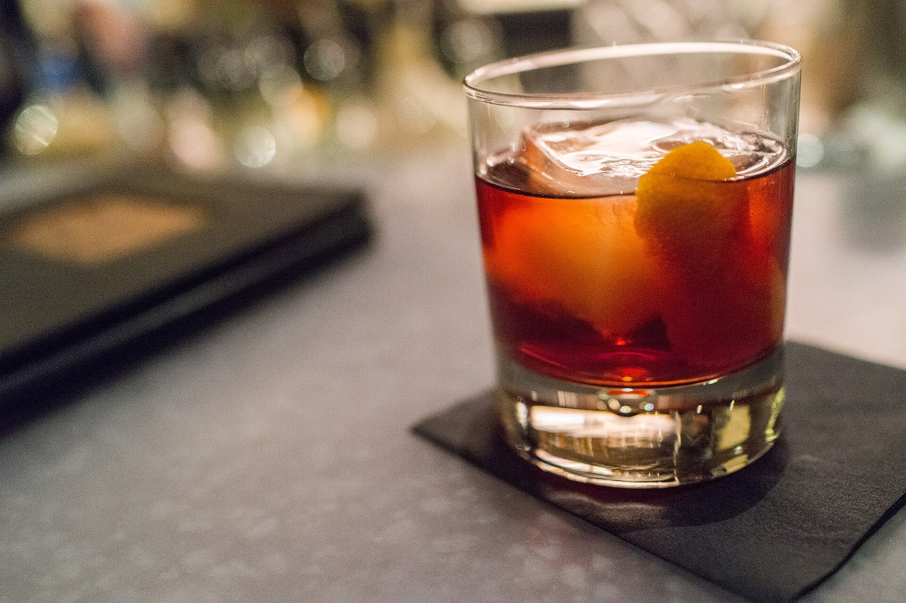

# Boulevardier

The Boulevardier is a classic cocktail of whiskey, Campari and sweet vermouth. It is often described as a whiskey Negroni, but the two drinks do not share an identical ratio history. The Boulevardier as recorded in 1927 is usually retold as equal parts of all three ingredients. The IBA's current formula is 45 ml whiskey, 30 ml Campari and 30 ml sweet vermouth, roughly 1.5:1:1. Equal parts is bitterer and shorter; 1.5:1:1 is more whiskey-forward and more suited to modern tastes.

Figure: Related photograph of Boulevardier. Image: Edsel Little, CC BY-SA 2.0, via Wikimedia Commons ([source page](https://commons.wikimedia.org/wiki/File:Society_Lounge_-_Boulevardier_-_16164913902.jpg)).

> **Quick verdict**
> **In one line:** This cocktail helps you decide whether to order Boulevardier, and how ratio, ice and water change it.
>
> - **Best for:** Anyone who wants the logic, serving method and common mistakes behind Boulevardier.
> - **Not for:** If you want only want a strong drink and do not care about ratio, ice or water.
> - **Check first:**
>   - Order a Boulevardier with bourbon, at 1.5:1:1, in a rocks glass over one large cube, or in a coupe without ice.
>   - The drink takes its name from a magazine.

## 1927, Paris, a magazine and a name

The drink takes its name from a magazine. Erskine Gwynne was an American writer living in Paris who founded the monthly *The Boulevardier* in 1927; the magazine is usually recorded as running until 1932. In French, a boulevardier is a man who strolls the city boulevards and takes part in its social life — someone stylish and urbane, not simply a frivolous playboy.

In the same year, Harry McElhone (also spelled MacElhone) of Harry's New York Bar in Paris recorded the drink in *Barflies and Cocktails*. The book mixes recipes, bar anecdotes and teasing portraits of regulars. It credits the recipe to Gwynne and includes a joking line to the effect that all good Barflies should come to the aid of the party now that Erskine Gwynne has crashed in with his Boulevardier Cocktail. The usual reading is therefore that Gwynne supplied the name or the recipe, McElhone recorded and spread it, and Harry's New York Bar was where it entered cocktail history. Those three roles are often compressed into "McElhone invented it", which is not accurate.

## Equal parts or 1.5:1:1

The most important thing to clarify about the Boulevardier is the ratio.

The 1927 record is usually retold as equal parts: one third whiskey, one third Campari and one third sweet vermouth. This version is the most bitter. Campari leads, sweet vermouth supplies herbs and sugar in the middle, and whiskey holds the base. The body is not especially thick, the bitterness is long, and it works as an aperitif. But for someone with a good bottle of whiskey, Campari covers too much of the detail.

The IBA formula is 45 ml whiskey, 30 ml Campari and 30 ml sweet vermouth, or 1.5:1:1. Campari's own version is given as 3:2:2 — three parts whiskey, two parts Campari and two parts sweet vermouth — which produces the same 45, 30 and 30. This ratio pushes the whiskey forward, moves the bitterness into the middle and lets the vermouth bind the two. The result is rounder, sweeter and closer to the whiskey aperitif seen in modern bars.

A third common formula is 2:1:1 — whiskey 2, Campari 1 and sweet vermouth 1. It is drier and stronger than 1.5:1:1, and the bitterness is more obvious on the finish. All three can be correct, but the differences are not trivial. Equal parts is bitterness-led, 1.5:1:1 is whiskey-led, and 2:1:1 is spirit-led. When ordering or writing a recipe, state the ratio.

## Whiskey: bourbon, rye or blended

The IBA allows bourbon or rye. Bourbon is usually corn-led, with vanilla, caramel and ripe fruit sweetness that can stack on the sweetness of the vermouth. Rye is spicier, with pepper and grain, and it holds Campari's bitterness in clearer focus. Neither is more authentic; the choice depends on the direction you want.

A higher-strength whiskey needs more dilution and a thorough stir. A standard 40% bottling is gentler but can feel thin at 1.5:1:1. A cask-strength whiskey, left unadjusted, will overwhelm the Campari and turn the drink into whiskey with a bitter edge. Blended whiskey can work, but its grain and light smoke blur the outline unless that softness is what you want.

One more point: the Boulevardier is not "a Negroni with the gin swapped out" in any casual sense. The sweetness, oak and grain of whiskey are quite different from juniper and coriander. Changing the base changes the skeleton of the drink, not just its name.

## What Campari and sweet vermouth each do

[Campari](ref:campari) supplies bitterness, colour and herbal aroma. Its bitterness is not a single medicinal note; it is a composite of orange peel, bark and roots, and it carries a good deal of sugar that the bitterness hides. Too little and the drink becomes sweet whiskey; too much and the bitterness covers the whiskey and dries out the finish.

[Sweet vermouth](ref:vermouth) supplies sweetness, the acidity of wine and herbal aroma. It is not a sweet syrup but a fortified, aromatised wine, and an open bottle brings oxidation into the glass. Oxidised vermouth smells sour, metallic or vinegary and can ruin the drink on its own. Keep it in the fridge after opening and use it within a few weeks. That detail matters more than buying a more expensive brand.

The ratio of the two sets the bitter-sweet curve. At equal parts, Campari and vermouth meet almost head-on. At 1.5:1:1, whiskey separates them and bitterness becomes a middle-ground backdrop. At 2:1:1, the bitterness sits further back and the finish is longer. When adjusting, change one variable at a time, or you will not know which ingredient moved the balance.

## Stir, do not shake

The Boulevardier is [stirred](ref:stir), not shaken. All three ingredients are liquids; there is no juice, egg white or cream to emulsify. Stirring chills and dilutes without aerating, keeping the drink clear and silky. Shaking whips in air, clouds the liquid and gives a coarser texture.

Combine the ingredients in a mixing glass, fill with ice and stir with a bar spoon for 20–30 seconds. The test is not only the clock: the glass should frost, the liquid should be visibly cold, and dilution should reach roughly 20% to 25%. Under-stirring leaves the drink warm and separates the alcohol from the bitterness. Over-stirring melts too much ice, thins the body and makes the sweetness taste watery.

Strain off the ice into the serving glass. For a rocks glass, add one large cube; for a coupe, do not add ice and strain into a pre-chilled glass. Do not use crushed ice in the mixing glass; it melts too fast and can wreck the ratio within minutes.

## Rocks glass or coupe

The IBA method strains into a chilled cocktail glass, a stemmed glass of the coupe type. Modern bars more often use a [rocks glass](ref:rocks) with one large cube. Both are defensible, but they drink differently.

A coupe keeps the liquid cold and gathers aroma in the bowl. The first sip is sharper, with the bitterness and orange peel more defined; the downside is that the drink warms quickly and softens in the second half. A rocks glass with a large cube dilutes slowly, so the drink opens as the ice melts: the bitterness softens and the sweetness becomes more prominent. The downside is the wide mouth, which lets aroma escape, and poor ice can bring a freezer smell.

If you choose rocks, use the largest, clearest cube you can, chill the glass and express the orange peel over the drink after pouring. If you choose a coupe, keep it to 150–200 ml and fill about two-thirds, not to the rim. Glassware is not part of the drink's identity, but it changes temperature and the dilution curve, so it is worth specifying when you order.

## One step away from the Negroni

The [Negroni](ref:negroni) is gin, Campari and sweet vermouth, usually in equal parts and often traced to Florence in 1919. The Boulevardier replaces the gin with whiskey and leaves the other two ingredients alone. If it is also made in equal parts, it can fairly be described as a whiskey Negroni.

But that one substitution changes more than the name. Gin's juniper and citrus make the bitterness feel bright; whiskey's corn sweetness, oak and grain make it feel thick. The Negroni is often served over ice in a rocks glass, while the IBA Boulevardier is strained and served without ice. The first is fresher and longer; the second is denser and shorter. "Whiskey Negroni" is a useful memory aid, but it should not be taken to mean that the two recipe histories are identical.

## Variations: Old Pal, 1794 and further relatives

The Old Pal is usually written as equal parts rye whiskey, dry vermouth and Campari. Replacing sweet vermouth with dry vermouth lowers the sweetness, pushes the bitterness and herbs forward and gives a drier finish. Some drinkers find it closer to the aperitif idea than the Boulevardier. Its own origin is also told in more than one way, and this cocktail does not treat a particular year as settled.

The 1794 is usually written as rye whiskey, sweet vermouth and Campari with a few dashes of orange bitters. It is often treated as a modern Boulevardier variant: the orange bitters lift the citrus and give the Campari bitterness more layers. There are also versions that swap bourbon for rye, use a drier style of vermouth, or add a little smoky whiskey. Every substitution should be stated, or "Boulevardier" becomes a name without boundaries.

## Common failures

First, oxidised vermouth. A bottle open too long and stored warm will taste sour, and this is the most common and most easily missed fault. Second, a lopsided ratio. Too much Campari covers the whiskey; too much whiskey turns the drink into a red-tinted spirit. Third, under-stirring. The drink is not cold enough, and the bitterness separates from the alcohol, so it tastes hot. Fourth, over-stirring. Too much meltwater thins the body and makes the sweetness hollow. Fifth, small or too much ice. Dilution runs away and the second half tastes like water. Sixth, no garnish. Orange peel oil is not decoration; it carries citrus aroma to the rim and softens Campari's bitterness. Seventh, insisting on 1.5:1:1 with a low-strength whiskey, which leaves the drink soft and loose.

## Ordering and drinking

Order a Boulevardier with bourbon, at 1.5:1:1, in a rocks glass over one large cube, or in a coupe without ice. If you want more bitterness, ask for equal parts or more Campari; if you want more sweetness, add sweet vermouth rather than sugar syrup, because vermouth also brings herbs and acidity. If you are sensitive to bitterness, start at 1.5:1:1 rather than equal parts.

It works as an aperitif with nuts, olives, salty cheese, roast meat and bitter vegetables. The equal-parts version is especially good with rich food, where the bitterness cuts through fat. Drink slowly and watch the dilution as the ice melts. The alcohol content is not low, so avoid drinking quickly on an empty stomach. Do not drink and drive, and avoid alcohol during pregnancy or while taking medication that interacts with it.

## See also

- [Bourbon whiskey](ref:bourbon): corn sweetness, oak and strength as they affect the ratio.
- [Sweet vermouth](ref:vermouth): sweetness, herbs and the problem of oxidation.
- [Campari](ref:campari): bitterness, colour and herbal aroma.
- [Negroni](ref:negroni): the gin-based classic with the same skeleton.
- [Stirring](ref:stir): chilling, dilution and a clear body.
