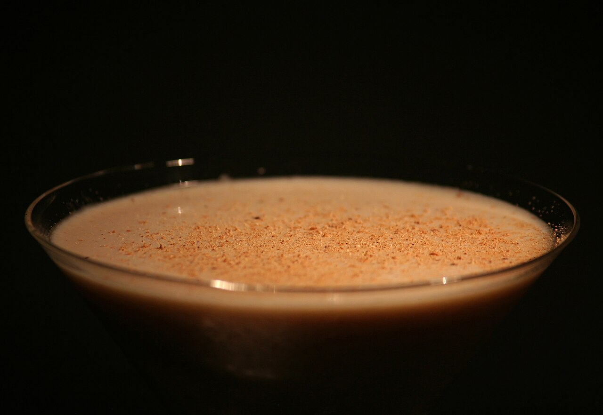

# Brandy Alexander

The Brandy Alexander is a creamy dessert drink. Brandy, white crème de cacao and cream, in equal parts, shaken and strained into a coupe, with a layer of grated nutmeg on top. It is the colour of pale coffee and tastes of melted chocolate milk, low in alcohol and suited to after dinner.

Its name and origin have many explanations. Some say it honours Tsar Alexander II of Russia, some that it marked a royal wedding, and others that the "Alexander" was originally a gin drink with the brandy version arriving later. What can be confirmed is that it became popular in early-twentieth-century American bar culture and reached Europe in the 1920s.

Figure: A Brandy Alexander of brandy, white crème de cacao and cream, topped with nutmeg. Image: Cocktailmarler, CC BY-SA 3.0, via Wikimedia Commons ([source page](https://commons.wikimedia.org/wiki/File:Brandy_Alexander.jpg)).

## Brandy and white cocoa

Brandy supplies the backbone and the fruit. Its grape, oak and vanilla notes can carry cream's weight; without brandy the drink becomes cocoa milk. The brandy need not be expensive, but it needs concentration and aroma; a very light brandy is swallowed by the cream.

White crème de cacao supplies chocolate aroma and sweetness. It lacks dark cocoa's bitterness, offering only cocoa-butter roundness and sugar; with brandy it is a classic pairing, chocolate against grape. It is sweet enough that no sugar is added.

Cream supplies texture. Single cream's fat emulsifies the drink and makes it silky; heavy cream is too thick and turns it to sauce; milk is too thin to support the body. Cream to brandy to cocoa is one to one to one, and equality is the drink's signature.

Nutmeg is the finishing point. Freshly grated, it brings wood, spice and a faint sweetness that cuts the cream's richness; without it the drink feels flat. Grate it fresh, since ground nutmeg has lost its aroma.

## The formula: three equal parts

The IBA standard is three centilitres of brandy, three of white crème de cacao and three of cream. Three centilitres is thirty millilitres, ninety in total, filling a coupe to about seven tenths. Equality keeps the three in balance, none dominating.

For a stronger version, raise brandy to four centilitres and lower cream to two; for a sweeter, creamier drink, raise cream to four. But equality is the classic and the easiest ratio to remember.

VS or VSOP brandy both work. VS is young and fruity, good with cream; VSOP is rounder with vanilla and wood but can overwhelm the cocoa. Avoid a very old cognac, whose complexity the cream would mask.

Choose a colourless or pale white crème de cacao. Dark cocoa changes the colour and adds bitterness; the white version keeps the drink pale coffee-coloured, as the Alexander should be. Chill the cream and take it out only when shaking.

## Method: shake and nutmeg

Put the brandy, white cocoa and cream into a shaker with ice and shake hard for ten to twelve seconds. The cream must emulsify with the spirits so the body is even and fine; shake too little and the cream separates and the drink turns grainy.

Strain through a fine mesh into a chilled coupe. The strainer holds back ice and unemulsified cream and keeps the drink smooth; the wide bowl releases the aroma and the curve supports the foam.

Grate nutmeg over the surface. It can go in the centre of the foam or in a line; the aroma rises with the foam and reaches the nose at the first sip. Do not overdo it or the spice buries the cocoa.

The garnish can be omitted, or a coffee bean or a small orange twist added. The bean reinforces the coffee colour, the twist adds aroma; the traditional Alexander uses only nutmeg.

## The name Alexander

The name has several explanations. One says it honours Tsar Alexander II of Russia, since the brandy version circulated in late-nineteenth-century European courts; another says it marked the 1922 wedding of Princess Mary and Lord Lascelles in Britain.

A third says the "Alexander" was originally gin, cocoa and cream, appearing in the 1910s, and that the brandy version displaced the gin version in the 1920s to become the better-known Alexander. The gin version survives as the Gin Alexander.

Most of these claims lack primary evidence, but all point to one fact: the drink was popular in America and Europe in the early twentieth century, its name entangled with royalty, weddings and bar culture. The exact origin may never be settled.

For the drinker, the name story is an extra, not part of the formula. What matters is that the brandy version uses three equal parts and the gin version replaces brandy with gin; they are branches of one family.

## Variations and common mistakes

Common variations include the Gin Alexander, with gin instead of brandy; the Alexander Special, with coffee liqueur; the Peppermint Alexander, with mint liqueur instead of cocoa; and the Jack Alexander, with applejack instead of brandy.

Four mistakes recur. First, too little cream, leaving the drink strong and thin. Second, too little shaking, so the cream separates and turns grainy. Third, stale nutmeg, so the aroma is weak. Fourth, a warm glass, so the foam collapses. Emulsification and temperature decide the drink.

For a home bartender, the practical advice is: use single cream, keep the three parts equal, shake for at least ten seconds, strain into a cold glass, and grate the nutmeg fresh. The target is a silky chocolate milk, not sweet cream.

## See also and references

- Brandy: see [brandy](ref:brandy).
- Shaking: see [shaking](ref:shaking).
- Coupe: see [coupe](ref:coupe).
- Sweet: see [sweet](ref:sweet).
- Aroma: see [aroma](ref:aroma).

**Short definition:** A dessert cocktail of equal parts brandy, white crème de cacao and cream, shaken and topped with grated nutmeg. Its name and origin are disputed, but it is a fixture of early-twentieth-century American bar culture.

Start with the base and the ratio. From there, consider the dilution and the ice, then the garnish and the glass. That is how a practical judgment about Brandy Alexander is built.

[Brandy](ref:brandy) and [Coupe glass](ref:coupe) are the two useful reference points for Brandy Alexander. [Brandy](ref:brandy) sets out base liquor; [Coupe glass](ref:coupe) brings in technique and ratio. Read them together.

**Key facts.**

| Item | Detail |
| --- | --- |
| In one line | A dessert cocktail of equal parts brandy, white crème de cacao and cream, shaken and topped with grated nutmeg. Its name and origin are disputed, but it is a fixture of early-twentieth-century American bar culture. |
| Style | IBA Contemporary Classics |
| Origin | United States |

**Sources and limits.** The key claims about Brandy Alexander are checked against the following sources: International Bartenders Association, Oxford University Press (Used to check cocktail history and terminology), CocktailDB (Used to cross-check recipe structure and common variations) and 5 sources in total. Prices, batches and status change; the body is project-written and does not reproduce source text.

For Brandy Alexander, this cocktail was last checked in 2026; prices, batches and availability change, so confirm them against the sources below.
