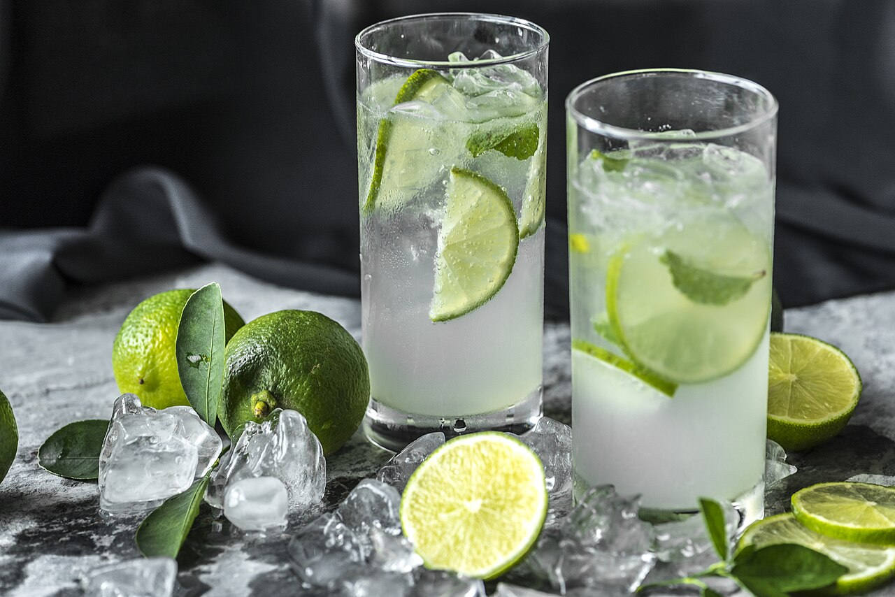

# Caipirinha

The Caipirinha is Brazil's national cocktail: cachaça, lime and sugar, muddled in the glass and topped with ice. It has no juice, soda or liqueur, and its structure is extremely simple: spirit, acid, sweet, cold. Precisely because it is simple, the handling of the lime, the dissolving of the sugar and the amount of ice are all exposed in the glass.

Figure: Caipirinha. Image: rawpixel.com, CC0, via Wikimedia Commons ([source page](https://commons.wikimedia.org/wiki/File:Caipirinha_with_lime.jpg)).

## Definition and national status

The base is [cachaça](ref:cachaca), a Brazilian spirit distilled from fermented sugarcane juice. It is often compared with rum, but rum is usually made from molasses while cachaça is made from fresh cane juice, which gives a grassier, more cane-forward and slightly fermented character. For the raw material, see [sugarcane](ref:sugarcane).

In Brazil the drink appears in bars, restaurants, family gatherings and beach kiosks; it is an everyday drink rather than a special-occasion cocktail. The name comes from “caipira”, originally a rural or country person, with a diminutive suffix; it suggests something plain, local and unpretentious. That is also the character of the drink: direct, refreshing and suited to hot weather.

## The IBA recipe

The public IBA recipe is 60 ml cachaça, one lime and two teaspoons of granulated sugar. Cut the washed lime into wedges, place it in a rocks glass with the sugar, press gently to release juice and start dissolving the sugar, fill with ice, pour in the cachaça and stir. There is no soda and no extra syrup; sweetness comes only from the sugar and acidity only from the lime.

The proportions can move. Cachaça usually sits between 50 and 60 ml, one medium lime (about 80–100 g) is enough, and the sugar is around two teaspoons (about 8–10 g), or 15 ml of syrup. Too little sugar makes the lime taste sharp; too much buries the cane aroma. If the lime is unusually sour or small, start with less sugar and taste before adding.

## The role of cachaça

Cachaça is not “Brazilian vodka”. It keeps a clear signature of its raw material: fresh cane gives grassy notes, fermentation gives esters, and distillation leaves a slight prickle. Unaged cachaça is clear and direct, which suits a Caipirinha; aged cachaça brings vanilla and caramel from the cask, making a rounder drink that also moves away from the classic profile.

Strength changes the balance. Brazilian rules allow a fairly wide range, and bottlings commonly sit between 38% and 48% abv. A stronger cachaça needs more ice and more stirring, or it will burn; a weaker one can taste watery. For the meaning of the figure, see [alcohol by volume](ref:abv). Look for a clean spirit with clear cane aroma rather than a famous label.

## Muddling and sugar

Muddling is the key action. The aim is not to crush the lime into pulp but to break the flesh, release juice and oil from the peel, and bring the sugar into contact with the juice. Cut the lime into six to eight wedges and remove the central white pith to limit bitterness; some peel adds aroma, but pressing hard on the peel releases too much bitter oil.

The choice of sugar changes the texture. Caster sugar dissolves quickly; coarse sugar dissolves slowly and can sink, making the last sips suddenly sweet. Syrup blends more evenly but loses the aromatic effect of sugar rubbing against the peel during muddling. Whichever you use, press it with the lime first so that dissolution starts before the ice and spirit go in. For general structure, see [cocktail basics](ref:cocktails-guide).

## Ice, glass and stirring

A Caipirinha is usually served in a rocks glass of about 250–300 ml. Put the lime and sugar in first, muddle, fill with ice, pour in the cachaça and lift a few times with a bar spoon. The ice can be cubed or crushed; crushed ice chills fast and feels colder but dilutes faster, which suits hot weather and quick drinking, while cubes melt more slowly and suit a slower glass.

Chill the glass and keep the cachaça cold. With too little ice the drink warms quickly, the acidity sharpens and the sweetness turns sticky. Stir gently to mix sugar and spirit, not to break the ice. When making several drinks, muddle each one to order rather than steeping lime in spirit ahead of time, or the peel will keep releasing bitterness. For ice and temperature, see [ice and temperature](ref:ice). For glass choice, see [choosing a glass](ref:glass).

## Variations

Vodka instead of cachaça gives a Caipiroska; rum gives a Caipirissima. Replacing part of the lime with strawberry, passion fruit, mango or pineapple gives the caipirinha de frutas family. A sake-based version is lighter in alcohol. The logic is always “spirit + acid + sweet + ice”, and changing one element changes the style.

When recording a variation, state what was replaced and how the sugar and acid were adjusted. Fruit brings its own sugar, so a fruit version needs less added sugar; with aged cachaça, the lime can be reduced slightly so that acidity does not cut through the cask. Comparing a fruit version with the classic recipe as if nothing had changed leads to false conclusions.

## Common misconceptions

First, shaking instead of muddling and stirring. Shaking suspends ice shards and pulp, clouds the drink and makes the bitterness of the peel more obvious. Second, using only lime juice. Without peel oil and flesh, the aroma is thin. Third, muddling the lime into a paste. Over-pressing releases bitterness from the white pith. Fourth, leaving the sugar undissolved, so the last sips are too sweet.

Fifth, too little ice; a Caipirinha is an ice drink, and warmth destroys its refreshment. Sixth, using warm cachaça, which melts the ice faster and pushes the alcohol forward. Seventh, assuming the drink must be very sweet; sweetness exists to balance the lime, and too much hides the cane. Eighth, treating it as low-alcohol: 60 ml of 40% abv cachaça contains about 24 ml of pure alcohol, and dilution does not make the total disappear.

## See also

- [Cachaça](ref:cachaca): the Brazilian spirit at the base.
- [Sugarcane](ref:sugarcane): the raw material behind cachaça.
- [Cocktail basics](ref:cocktails-guide): muddling, stirring and dilution.
- [Ice and temperature](ref:ice): how ice type changes texture.
- [Choosing a glass](ref:glass): the rocks glass and its capacity.
- [Alcohol by volume](ref:abv): the real strength of the drink.

**At a glance:** Brazil's national cocktail, made by muddling cachaça, lime and sugar over ice; the IBA recipe uses 60 ml cachaça, one lime and two teaspoons of sugar, and muddling and ice decide the result. 

For Caipirinha, begin with the base and the ratio. Then look at the dilution and the ice, and finally ask the garnish and the glass. The answers point to different choices, not to a single score.

Start with [Cachaça](ref:cachaca) for base liquor, then read [A cocktail is another way in](ref:cocktails-guide) for technique and ratio. Seeing both keeps Caipirinha from being confused with a neighbouring idea.
