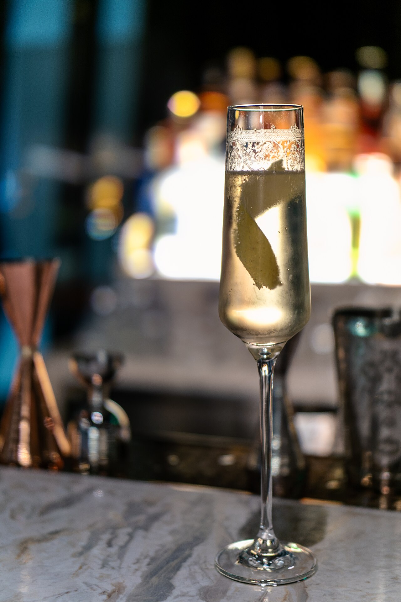

# Champagne Cocktail

The Champagne Cocktail is one of the oldest uses of the word cocktail: sugar, bitters, wine. The method is minimal. A sugar cube, a few dashes of Angostura, into a Champagne glass, filled with Champagne, a twist of lemon peel. Bubbles rise from the cube, and the bitters' spice meets the wine's acidity.

The drink was popular in America and Europe in the mid-nineteenth century and entered the classic cocktail books. Several versions exist, some with cognac, some with orange liqueur; what is certain is the core of sugar, bitters and Champagne.

Figure: A Champagne Cocktail built on a sugar cube and bitters. Image: Melvin Loi, CC BY-SA 2.0, via Wikimedia Commons ([source page](https://commons.wikimedia.org/wiki/File:Champagne_Cocktail_(51022805492).jpg)).

## Sugar, bitters and Champagne

The sugar cube supplies sweetness and a bubble generator. Its rough surface holds bubbles, which rise from the cube in a fine thread; granulated sugar or syrup has no such effect, and the bubbles come from the glass instead, a different look entirely.

Angostura bitters supply spice and bitterness. Cinnamon, clove, gentian and other spices balance the wine's acid and the sugar; without bitters the drink is sweet Champagne, with too much it is medicine. Two dashes is the usual measure.

Champagne supplies bubbles, acidity and structure. A dry Champagne's acid cuts the sugar and its bubbles lift the bitters' spice; a sweet Champagne makes the whole drink cloying. The wine need not be expensive, but it needs acid and gas.

Lemon peel supplies aroma. Its oils add citrus and brighten the colour; without it the drink feels flat. Pare it fresh and avoid the white pith, which is bitter.

## The formula: one cube and two dashes

The IBA standard is one sugar cube, two dashes of Angostura bitters and nine centilitres of Champagne, with one centilitre of cognac optional. Nine centilitres is ninety millilitres, about one Champagne glass; the cognac adds structure and aroma but is not required.

Use a white sugar cube, not a coloured or flavoured one. Coloured cubes change the colour, flavoured cubes clash with the bitters; white sugar gives only sweetness and a surface for bubbles, the most neutral choice.

Use Angostura, not orange bitters. Its spice suits the wine's acid; orange bitters turn the drink into orange Champagne and lose the classical spice. Two dashes is a start: add one, taste, then decide.

Chill the Champagne to about six to eight degrees Celsius. Too warm and the bubbles escape at once; too cold and the aroma is muted. The cognac can be at room temperature, poured into the glass before the wine.

## Method: let the bubbles rise

Place the sugar cube in a Champagne glass, dash the Angostura over it and let the cube absorb the bitters. Then pour the Champagne slowly down the side; bubbles rise from the cube in a fine thread. Do not stir; serve at once.

Guide the wine with a bar spoon, or tilt the glass so the liquid runs down the wall. Poured fast, the cube is washed apart and the bubbles are lost; poured too slowly, the cube dissolves too much and the sweetness shifts.

Add the lemon peel last. Pare a strip of yellow peel, squeeze its oils and lay it at the rim or in the glass; the aroma rises with the bubbles and reaches the nose at the first sip. Do not use a lemon slice, which changes colour and texture.

If using cognac, pour one centilitre into the glass first, then the cube and bitters, then the Champagne. The cognac forms a layer at the bottom and mixes gradually, giving the drink a progression.

## The nineteenth-century way with Champagne

The Champagne Cocktail was popular in the mid-nineteenth century, first in American bars and hotels. In 1862 Jerry Thomas's How to Mix Drinks included a Champagne Cocktail of sugar, bitters, Champagne and lemon peel, one of the earliest written records.

In the late nineteenth century it reached Europe and became a Belle Époque aperitif. Its sweet, sour, bitter and bubbly profile suited the taste of the age, and its simplicity suited homes and restaurants. As dry Champagne spread, the sugar and bitters were reduced.

There is a claim that the Champagne Cocktail was among the first drinks to use the word cocktail; another says the word in the early 1800s meant sugar, bitters and spirit, and the Champagne version was one of several. The exact etymology remains disputed.

What can be confirmed is that the structure of sugar, bitters and Champagne is typical of the nineteenth-century definition of a cocktail; its elegance and simplicity have carried it across two centuries.

## Variations and common mistakes

Common variations include a Champagne Cocktail with cognac; one with Grand Marnier; the Old Cuban, with aged rum and mint; and the French 75, with gin and lemon juice.

Four mistakes recur. First, a cube too large, which unbalances the sweetness. Second, too much bitters, which turns it to medicine. Third, a Champagne too sweet, which makes the drink cloying. Fourth, pouring too fast, which washes apart the cube and the bubbles. Order and temperature decide the drink.

For a home bartender, the practical advice is: use a white sugar cube, two dashes of Angostura, chilled Champagne, pour down the side, and add the lemon peel last. The target is an elegant spiced bubble, not sweet Champagne.

## See also and references

- Sparkling wine: see [sparkling wine](ref:sparkling).
- Opening sparkling wine: see [opening sparkling wine](ref:opening).
- Champagne flute: see [Champagne flute](ref:flute).
- Kir Royale: see [Kir Royale](ref:kir).
- Sweet: see [sweet](ref:sweet).

**Short definition:** A classical cocktail of a sugar cube, Angostura bitters and Champagne, with optional cognac. Bubbles rise from the cube, and the bitters' spice meets the wine's acidity.

Champagne Cocktail is best read by starting with the base and the ratio, moving to the dilution and the ice, and ending with the garnish and the glass.

[Sparkling wine](ref:sparkling) and [Champagne flute](ref:flute) are the two useful reference points for Champagne Cocktail. [Sparkling wine](ref:sparkling) sets out base liquor; [Champagne flute](ref:flute) brings in technique and ratio. Read them together.

**Key facts.**

| Item | Detail |
| --- | --- |
| In one line | A classical cocktail of a sugar cube, Angostura bitters and Champagne, with optional cognac. Bubbles rise from the cube, and the bitters' spice meets the wine's acidity. |
| Style | IBA Contemporary Classics |
| Origin | United States |

**Sources and limits.** The key claims about Champagne Cocktail are checked against the following sources: International Bartenders Association (Used to check the IBA category, ingredients and ratio), Oxford University Press (Used to check cocktail history and terminology), CocktailDB (Used to cross-check recipe structure and common variations) and 5 sources in total. Prices, batches and status change; the body is project-written and does not reproduce source text.

For Champagne Cocktail, this page was last checked in 2026; prices, batches and availability change, so confirm them against the sources below.
