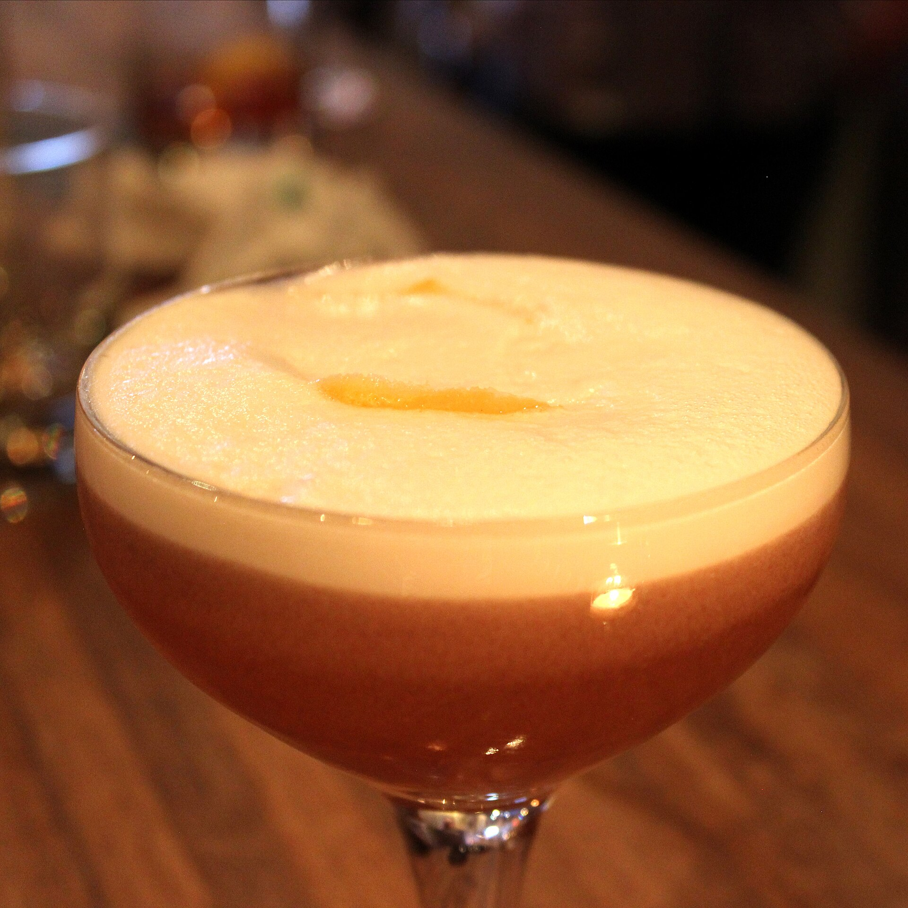

# Clover Club

The Clover Club is a classic cocktail of [gin](ref:gin), lemon juice, raspberry syrup and egg white. It has a fine foam and is balanced between sour and sweet, usually garnished with a raspberry; the name comes from an American club of the same name in the early 20th century.

Figure: Related photograph of Clover Club. Image: Will Shenton, CC BY-SA 3.0, via Wikimedia Commons ([source page](https://commons.wikimedia.org/wiki/File:Clover_Club.jpg)).

## Definition and identity

The Clover Club's name is linked to a club on the American East Coast in the early 20th century, and origin exists in different accounts. The club began as a men's social and debating society before its name reached the cocktail. This page treats it as historical background and does not present one version as settled fact.

## Recipe (IBA version)

The public IBA recipe builds on gin, with lemon juice, raspberry syrup and egg white: dry shake first, then shake with ice, strain into a chilled glass and garnish with a raspberry. Quantities are a starting point, not a law: more lemon makes it sourer, more syrup sweeter, more egg white thicker in foam.

Egg white is part of the structure, not decoration. It creates a fine foam on the surface and makes the body rounder. A dry shake (without ice) builds the foam, then a shake with ice chills and dilutes.

## Choosing the gin

[Gin](ref:gin) is the body of this drink. London dry gin brings a clear juniper and citrus frame, Old Tom gin is sweeter and softer, and other gin styles may bring different herbal and spice notes. The choice sets the direction.

High-strength gin needs more dilution, while lower-strength gin needs a shorter shake. If the gin itself is strongly flavoured, adjust the syrup and lemon juice accordingly, or the drink will be unbalanced.

## Raspberry syrup and egg white

Raspberry syrup provides fruit aroma, sour-sweetness and colour and is a main source of the Clover Club's identity. It is itself sweet: too much covers the gin, too little leaves the colour and fruit aroma short. Sweetness and acidity differ markedly by product.

Egg white provides foam and roundness. Fresh whites foam more easily, and whites left for a day or two may foam better. Handle whites hygienically and from a reliable source; anyone uneasy about raw egg can omit them, though the texture changes.

## Shaking and dilution

The Clover Club uses a two-stage shake: dry shake without ice to build the foam, then shake with ice to chill and dilute. Too little dry shaking leaves a thin foam; too much shaking with ice dilutes too much and thins the body.

Ice quality directly affects the result. Large ice melts slowly and dilutes in a controlled way; crushed ice chills fast but can over-dilute. The goal is to chill while keeping enough body. For more on ice and temperature, see [Ice and temperature](ref:ice).

## Glass and garnish

Traditionally a chilled cocktail glass or small stemmed glass is used: narrow rim, small body, aroma and foam concentrated. Chill the glass beforehand so the drink does not warm quickly after pouring.

A raspberry is the usual garnish, providing fruit aroma and visual identity. It should echo the fruit in the syrup, not just add colour. Garnish just before serving.

## Variations

Another red berry syrup instead of raspberry changes the fruit direction; omitting the egg white gives a clearer drink with less foam; another spirit instead of gin creates different branches. Compared with the [Whiskey Sour](ref:whiskey-sour), the Clover Club swaps whiskey for gin and adds fruit syrup.

Variations are not mistakes but branches with a clear substitution logic. When recording one, state what was replaced and how the ratio changed.

## Common misconceptions

First, shaking everything with ice at once. Egg white needs a dry shake first to form fine foam.

Second, treating egg white as decoration only. It also affects body and texture.

Third, ignoring the sweetness of the syrup itself. Raspberry syrup is very sweet, so the lemon juice must be adjusted.

Fourth, shaking too briefly. Insufficiently cold and under-diluted, the drink feels heavy.

For Clover Club, a common mistake is treating a variation as the original recipe. After replacing a main ingredient, use the variation name and state the difference.

## Drinking and boundary

The Clover Club suits a before-meal or afternoon drink, with nuts, fruit or simple savoury snacks. It has moderate strength and contains egg white, so sip slowly and drink water; do not drink it quickly on an empty stomach. Do not drink when driving, taking medication or pregnant; anyone uneasy about raw egg white should avoid it.

This page records one sourced version, evaluates no specific brand and does not present one ratio as the only correct answer. The finished strength depends on the gin's [alcohol by volume](ref:abv), the syrup and the ice dilution, not on the recipe numbers alone.

**Short definition:** A classic cocktail of gin, lemon juice, raspberry syrup and egg white, shaken to a fine foam; balanced sour-sweet and usually garnished with a raspberry; the name comes from an American club of the same name in the early 20th century.

Clover Club is best approached through the base and the ratio, then the dilution and the ice, and then the garnish and the glass. One check alone will not settle it.

The comparison with [Gin](ref:gin) and [A cocktail is another way in](ref:cocktails-guide) runs through base liquor and technique and ratio. Each answers a different question.

Gin, lemon, raspberry syrup and egg white, shaken dry then with ice; the pink foam is the signature.

**Key facts.**

| Item | Detail |
| --- | --- |
| In one line | A classic cocktail of gin, lemon juice, raspberry syrup and egg white, shaken to a fine foam; balanced sour-sweet and usually garnished with a raspberry |
| Style | Classic cocktail |
| Origin | United States (early 20th century) |

**Sources and limits.** The key claims about Clover Club are checked against the following sources: International Bartenders Association (Used to check the official recipe, method and garnish; Used to confirm the drink is on the IBA official cocktail list), Oxford University Press (Used to check the historical background and basic composition), David Wondrich / Perigee (Used to check background on early 20th-century American cocktail development) and 5 sources in total. Prices, batches and status change; the body is project-written and does not reproduce source text.

**Read alongside.** Put Clover Club next to Gin, Alcohol by volume (ABV), A cocktail is another way in: the first fixes identity and boundary, the others provide a region, process or peer comparison. Read this page first, then return to those entries; the links become coordinates, not decoration.

## Further reading

- [Gin](ref:gin): the body and style source of the Clover Club.
- [Cocktail basics](ref:cocktails-guide): structure, dilution and shaking.
- [Ice and temperature](ref:ice): ice types and how chilling shapes the drink.
- [Alcohol by volume](ref:abv): understanding strength and ice dilution.
- [Whiskey Sour](ref:whiskey-sour): a related classic that also uses egg white.
