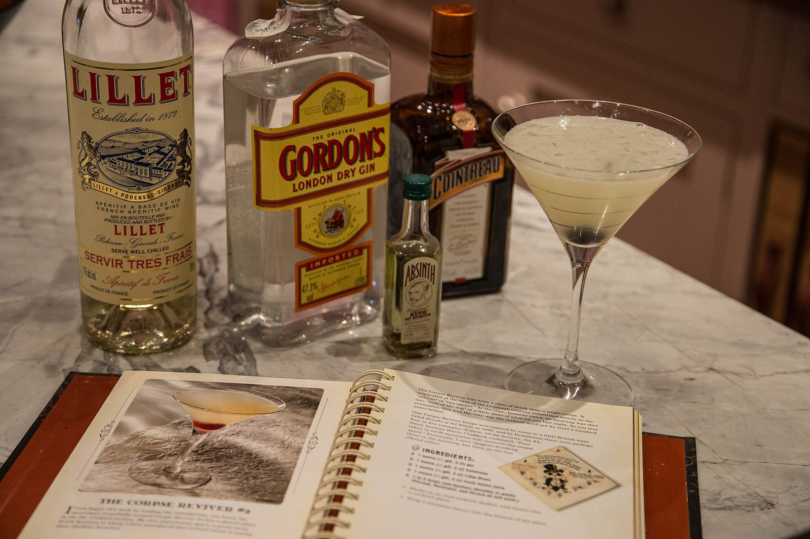

# Corpse Reviver #2

The Corpse Reviver #2 is a classic cocktail of equal parts gin, orange liqueur, Lillet Blanc and lemon juice, served in a glass rinsed with absinthe. It is usually strained into a chilled coupe, pale yellow in colour, sometimes with a thin layer of foam, and garnished with lemon peel. The sweet orange of the liqueur, the body and herbs of Lillet Blanc, the acidity of lemon and the anise aroma of absinthe define the drink.

Figure: Related photograph of Corpse Reviver #2. Image: Adrian Scottow, CC BY-SA 2.0, via Wikimedia Commons ([source page](https://commons.wikimedia.org/wiki/File:Corpse_Reviver_-2_-_16294945262.jpg)).

> **Quick verdict**
> **In one line:** This cocktail helps you decide whether to order Corpse Reviver #2, and how ratio, ice and water change it.
>
> - **Best for:** Anyone who wants the logic, serving method and common mistakes behind Corpse Reviver #2.
> - **Not for:** If you want only want a strong drink and do not care about ratio, ice or water.
> - **Check first:**
>   - Start with the base and the ratio.
>   - "Corpse Reviver" is the name of a family of cocktails intended to revive or wake someone up; the phrase literally means "one that brings a corpse back".

## Origin and naming

"Corpse Reviver" is the name of a family of cocktails intended to revive or wake someone up; the phrase literally means "one that brings a corpse back". The family was recorded in the Savoy Cocktail Book in the 1930s, and the #2 became the most famous member. The exact author, earlier sources and evolution of the recipe are not fully consistent across accounts, so this cocktail treats the origin as widely told rather than documented. No single year or author should be presented as settled fact.

The "number 2" signals that other numbered versions exist in the family; the one most often mentioned is #1, which is built on brandy. #2 uses gin and is closer to a sour: a base spirit, orange liqueur, Lillet Blanc and lemon juice in equal parts, plus an absinthe rinse. The number is not a quality ranking but a way of distinguishing different formulas within the family. Treating #2 as an "upgraded #1" is a misconception.

The word "reviver" is often read as a hangover drink, but it is not medicine and has no sobering effect. Its association with mornings and brunch comes from the twentieth-century brunch culture that placed these "pick-me-up" cocktails on menus, not from any medical property in the recipe. Taking the name as a functional promise is the most common misreading of the drink.

## Recipe structure

A common formula is 22.5 ml gin, 22.5 ml orange liqueur, 22.5 ml Lillet Blanc and 22.5 ml lemon juice, with an absinthe rinse. The four equal parts make a clear structure: gin provides herbs and juniper, orange liqueur provides sweet orange aroma and sweetness, Lillet Blanc provides body, light herbs and roundness, and lemon juice provides acidity. Absinthe does not enter the body; it adds anise aroma through the rinse.

Lillet Blanc is not dry vermouth and not an ordinary sweet liqueur. It is an aromatised wine with sweetness, herbs and citrus and a lower alcohol content. Replacing it with dry vermouth makes the drink drier and less sweet; replacing it with another aromatised wine changes the herbal direction. A recipe should state whether it uses Lillet Blanc or another similar product, because their sweetness and aroma differ clearly.

Orange liqueur can be a clear, sweet-orange product such as Cointreau, or another orange liqueur. Different products vary in sweetness, alcohol content and bitterness, and after a substitution the lemon quantity may need a small adjustment. The absinthe rinse is tiny, but brands differ greatly: some lean anise and liquorice, others toward herbs and bitterness, and the choice changes the first impression.

## Flavour and balance

The entry is lemon acidity and the sweet orange of the liqueur, followed by the herbs and juniper of gin and the round body of Lillet Blanc, with a finish of absinthe anise and mild bitterness. It belongs to the sour family, and the core balance is acid against sugar: too little lemon makes the drink sweet and heavy, too much lemon buries the orange and herbs. Absinthe supplies neither the main acidity nor the main sweetness; it is responsible for aroma and the anise note at the end.

The absinthe rinse is a key step. To rinse is to let absinthe briefly contact the inside of the glass, then pour off the excess, leaving only a thin layer of aroma. It is not a pour of absinthe into the body, and it is not a pool of spirit at the bottom of the glass. Too much rinse lets anise overwhelm the citrus; too little makes it almost invisible. The glass should be pre-chilled, and the drink should be shaken and strained soon after the rinse so the aroma does not evaporate.

Temperature and dilution change the layers. Freshly shaken, the acidity is brightest and the anise clearest; as ice melts, sweetness and body open and the absinthe aroma fades. It is a short drink, usually served without ice, so dilution happens mainly during shaking. Too short a shake leaves acid and sugar unintegrated; too long a shake makes the body thin and the aroma diffuse.

## Method

The method centres on shaking and rinsing. First rinse a pre-chilled coupe with absinthe and pour off the excess. Then combine the gin, orange liqueur, Lillet Blanc and lemon juice in a shaker, add ice and shake until thoroughly chilled, and fine-strain into the glass. Garnish with lemon peel and squeeze the oils over the surface before drinking. Double-straining catches crushed ice and pulp and keeps the texture clean.

For the rinse, measure a small amount of absinthe with a bar spoon or a small measure, turn the glass so the liquid covers the inside evenly, then pour it out. Do not leave absinthe at the bottom, or the first sip will be too strong. If absinthe is unavailable, another anise-forward spirit can be used in a small rinse, but the flavour will differ; omitting the rinse entirely is possible, though the drink loses its signature aroma.

Coupes, Martini glasses or small rocks glasses are common. A wide rim helps the aroma, and a chilled glass helps hold the temperature. Cut the lemon peel to order and take only the coloured outer layer, avoiding the white pith, which adds bitterness. Keep the garnish minimal; anise and citrus are the point, and a cherry or other garnish would change the visual and aromatic direction.

## Variations

A version built on brandy with a different structure is usually called Corpse Reviver #1; it is not a simple substitution for #2. Replacing Lillet Blanc with another aromatised wine gives a different herbal direction; replacing the orange liqueur changes the intensity of the sweet orange. Some versions add absinthe directly to the body, which gives a stronger flavour but moves away from the original rinse structure.

A variation should state what was replaced. Calling a drink with another aromatised wine a "Corpse Reviver #2" is acceptable, but the substitute should be noted; changing the absinthe from a rinse to an ingredient should be described, since the aroma will be heavier. Only when the base spirit, the orange liqueur, the aromatised wine and the treatment of absinthe are recorded does a recipe comparison mean anything.

## How to order and drink

Start with the base and the ratio. From there, consider the dilution and the ice, then the garnish and the glass. That is how a practical judgment about Corpse Reviver #2 is built.

It is often placed on brunch menus and served with eggs, bread, smoked fish and light food. Citrus and anise cut through fat, and the acidity refreshes the palate. But "reviver" is only a name and does not sober anyone up; if the previous night already involved too much alcohol, another drink will not help the body recover faster. Sip slowly; do not drink and drive, and avoid alcohol during pregnancy or while taking medication that interacts with it.

In a bar, if the anise is completely absent, the rinse may have been too light or too much was poured out; if the anise overwhelms the citrus, the rinse may have been too heavy or too much was left in the glass. The aroma at the rim and the colour of the liquid are useful clues, but appearance is not the only measure: the acid-sugar balance and the herbal balance matter just as much.

## Common misconceptions

First, treating a "Corpse Reviver" as an actual hangover cure. It is a product of naming and brunch culture. Second, treating #2 as an upgraded #1. The two have different base spirits and structures. Third, treating absinthe as the main ingredient. It is usually only a rinse, supplying aroma. Fourth, treating Lillet Blanc as dry vermouth. It is an aromatised wine with different sweetness and alcohol content. Fifth, believing equal parts cannot be adjusted. Equal parts are the classic structure, but small adjustments are possible according to the sweetness of the ingredients.

## See also

- [Gin](ref:gin): the herbal and juniper frame of this drink.
- [Liqueur](ref:liqueur): the sweet-orange and sweetness of the orange liqueur.
- [Shaking](ref:shaking): the technique behind integrating a sour, chilling and dilution.
- [Martini glass](ref:martini): the short-drink vessel and aroma presentation.
- [Aroma](ref:aroma): how an absinthe rinse shapes the first impression.

**At a glance:** A classic sour of equal parts gin, orange liqueur, Lillet Blanc and lemon juice, with a rinse of absinthe and an anise-citrus character. 
