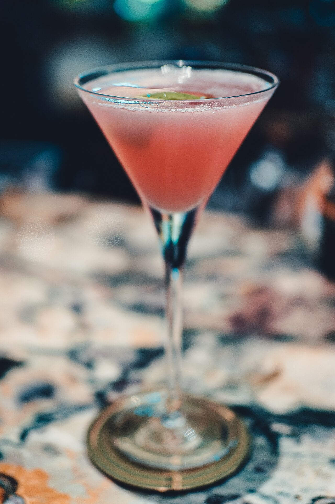

# Cosmopolitan

Cosmopolitan is a classic cocktail of [citron vodka](ref:vodka), [Cointreau](ref:liqueur), lime juice and cranberry juice, shaken and strained into a glass. It is tart and refreshing, pink in colour, and commonly garnished with an orange twist or lime slice.

Figure: A Cosmopolitan in a cocktail glass, with pink liquid and a lime garnish floating on top. Image: Melvin Loi, CC BY-SA 2.0, via [source page](https://commons.wikimedia.org/wiki/File:Cosmopolitan_cocktail_(52272444120).jpg).

## Definition and identity

The Cosmopolitan grew in popularity in the late 20th century, with common accounts linking it to bar scenes in New York or Miami, but several origin stories exist. This page treats it as historical background and does not present one account as settled.

## Recipe (IBA version)

The public IBA recipe uses citron vodka, Cointreau, lime juice and cranberry juice. The method: combine the ingredients with ice in a shaker, shake until well chilled, strain into a chilled glass, and garnish with an orange twist or lime slice.

Quantities are a starting point, not a law. Vodka provides the body, Cointreau the sweetness and orange aroma, lime juice the acidity, and cranberry juice the colour and fruit. Any change alters the balance, especially the ratio of lime juice to Cointreau.

## Vodka and Cointreau

[Vodka](ref:vodka) is the body of the drink. Citron vodka brings citrus aroma, while plain vodka is more neutral; the choice depends on the direction you want. The vodka's strength affects the final strength and the amount of dilution needed.

[Cointreau](ref:liqueur) is an orange liqueur that provides sweetness and orange aroma, a key source of the Cosmopolitan's identity. It is fairly sweet, so too much makes the drink sweet and too little loses the signature orange note. Brands differ in sweetness and aroma, and substitutions should be adjusted accordingly.

## Acid and juice

Lime juice provides acidity, balancing the sweetness of Cointreau and the burn of vodka. Fresh lime juice differs clearly from bottled, with the former having fuller aroma. Too little acid makes the drink sweet and flat; too much overpowers the citrus aroma.

Cranberry juice provides colour and fruit and also contributes some acidity. Its sweetness varies by brand, so with sweetened cranberry juice the Cointreau or sugar should be reduced. Changing the juice proportion changes both colour and taste.

## Shaking and dilution

A Cosmopolitan is usually shaken rather than stirred: shaking chills faster and mixes better. Too little shaking leaves the drink insufficiently chilled and diluted; too much dilutes it and thins the body.

Ice quality directly affects the result. Large ice melts slowly and keeps dilution controllable; crushed ice chills quickly but can over-dilute. The goal is to chill while retaining enough body.

## Glass and garnish

Traditionally served in a chilled cocktail glass with a narrow bowl and small volume, concentrating aroma and showing the colour. The glass should be chilled in advance so the liquid does not warm up quickly after pouring.

An orange twist or lime slice is the usual garnish, providing citrus aroma and visual identity. Squeezing the orange peel sprays oils onto the rim and surface, directly shaping the first sip. Garnish just before serving.

## Variations

Using plain vodka instead of citron gives a more neutral version; using another orange liqueur instead of Cointreau changes sweetness and aroma; using another red juice instead of cranberry changes colour and fruit.

Variations are not wrong versions but branches with a clear substitution logic. When recording a variation, state what was substituted and how the proportions changed. For general cocktail structure, see [cocktail basics](ref:cocktails-guide); compared with the [Whiskey Sour](ref:whiskey-sour), the Cosmopolitan uses vodka and liqueur instead of whiskey and syrup.

## Common misconceptions

First, assuming a Cosmopolitan must be very sweet. Sweetness depends on the amount of Cointreau and juice.

Second, ignoring the freshness of lime juice. Bottled juice differs in aroma and acidity.

Third, using sweetened cranberry juice without adjusting the sweetness source. The drink becomes too sweet.

Fourth, ignoring shaking and dilution. Without enough dilution the aroma does not open and the alcohol burn stands out.

For Cosmopolitan, a common mistake is treating a variation as the same recipe. After replacing a main ingredient, use the variant name and state the difference.

## Drinking and boundaries

A Cosmopolitan suits pre-dinner or social occasions with nuts, fruit or simple savoury snacks. It is medium-to-high in strength, so sip slowly and drink water; do not drink quickly on an empty stomach. Do not drink if driving, taking medication or pregnant.

This page records one sourced version and does not rate specific brands or present one ratio as the only correct answer. The final strength depends on the vodka's [alcohol by volume](ref:abv), the sweetness of the liqueur and ice dilution, not on the recipe numbers alone.

For Cosmopolitan, begin with the base and the ratio, then the dilution and the ice, and finish with the garnish and the glass; that order keeps the account grounded.

**At a glance:** A classic cocktail of citron vodka, Cointreau, lime juice and cranberry juice, shaken and strained into a glass; tart and refreshing, pink in colour, commonly garnished with an orange twist or lime slice.

The drink is usually built on citron vodka or a citrus-forward vodka, with Cointreau, fresh lime and cranberry; the ratio is closer to 1.5:1:0.5:1 than the equal-parts version often quoted. Shake hard, double-strain into a chilled coupe and express an orange twist. Cranberry juice is used for colour and tartness, not sweetness, so avoid a juice blend with added sugar. The cocktail became a 1990s marker through Sex and the City, but its roots are in 1970s gay-bar and Miami circuits; the exact origin is disputed. A good Cosmopolitan is cold, sharp and clear, not a sweet pink martini.

**Key facts.**

| Item | Detail |
| --- | --- |
| In one line | A classic cocktail of citron vodka, Cointreau, lime juice and cranberry juice, shaken and strained into a glass; tart and refreshing, pink in colour, commonly garnished with an orange twist or lime slice. |
| Style | Classic cocktail |
| Origin | United States (late 20th century; exact origin disputed) |

**Sources and limits.** The key claims about Cosmopolitan are checked against the following sources: International Bartenders Association (Used to check the official recipe, method and garnish; Used to confirm the drink is on the IBA official cocktail list), Oxford University Press (Used to check historical background and basic composition), David Wondrich / Perigee (Used to check background on 20th-century American cocktail development) and 5 sources in total. Prices, batches and status change; the body is project-written and does not reproduce source text.

## Further reading

- [Vodka](ref:vodka): the body and style source of the Cosmopolitan.
- [Liqueur](ref:liqueur): the role of Cointreau and orange liqueurs.
- [Cocktail basics](ref:cocktails-guide): general principles of structure, dilution and shaking.
- [Ice and temperature](ref:ice): how ice type and chilling affect the drink.
- [Alcohol by volume](ref:abv): understanding final strength and ice dilution.
- [Whiskey Sour](ref:whiskey-sour): another classic balancing a spirit with acid and sugar.
