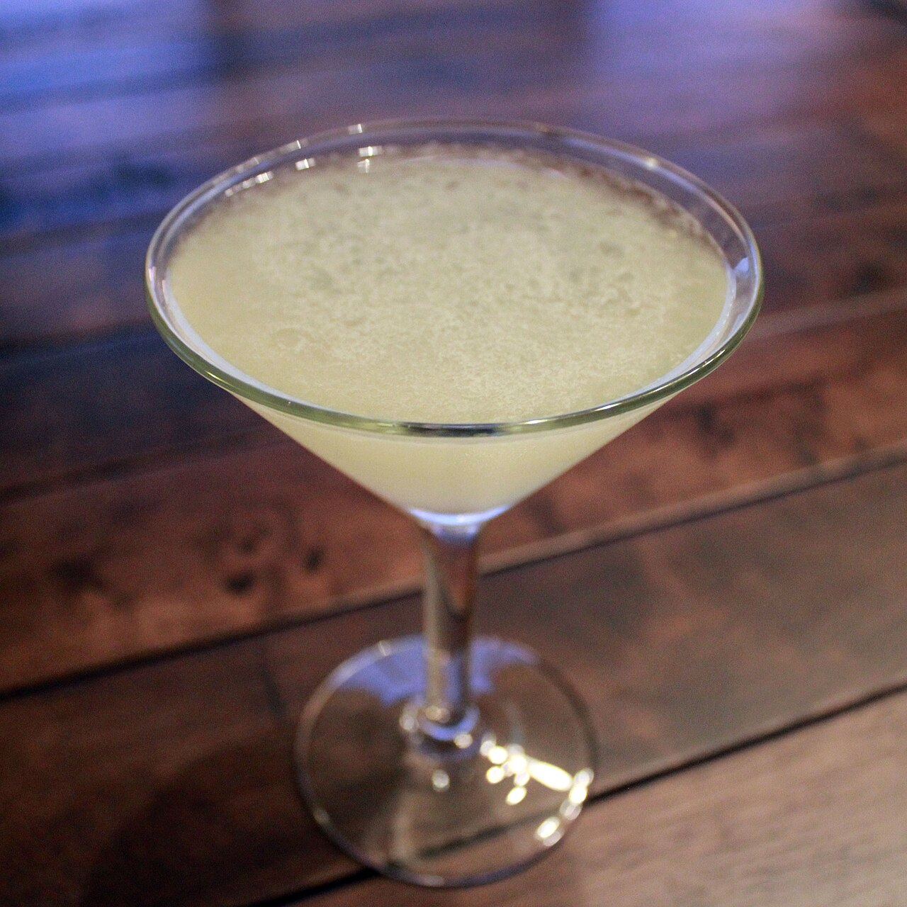

# Daiquiri

The Daiquiri is a classic cocktail of white rum, fresh lime juice and fine sugar, shaken and strained. The public IBA recipe uses 60 ml white Cuban rum, 20 ml fresh lime juice and 2 bar spoons of superfine sugar. Stir to dissolve the sugar, add ice, shake, and strain into a chilled cocktail glass with no garnish.

Figure: Daiquiri. Image: Will Shenton, CC BY-SA 3.0, via Wikimedia Commons ([source page](https://commons.wikimedia.org/wiki/File:Classic_Daiquiri_in_Cocktail_Glass.jpg)).

## Definition and identity

The Daiquiri is often traced to Cuba, with several accounts involving different places and periods. This page does not present one narrative as settled; it treats the drink as part of Caribbean drinking culture in the late 19th and early 20th centuries. Name and recipe are separate things, and the same name with a different method should be explained.

## Recipe (IBA version)

The public IBA recipe is 60 ml white Cuban rum, 20 ml fresh lime juice and 2 bar spoons of superfine sugar. Put the ingredients in a shaker, stir to dissolve the sugar, add ice and shake, then strain into a chilled cocktail glass. The official recipe has no garnish.

This version is roughly 3:1, with sugar measured by bar spoon, and belongs to the sour family. The ratio is not the only answer: some prefer more sour, some sweeter, and some use syrup. Changing the ratio changes the version and should be stated.

## White rum

[White rum](ref:rum) is the body, providing cane sweetness, a light botanical note and the alcohol frame. White rum is usually pale and relatively light, which suits lime; aged rum brings more cask flavour and changes the direction, so it is better treated as a variation.

Choose a rum that is clean and free of obvious off-notes. A stronger rum needs more dilution to balance; a weaker one can leave the drink thin. The recipe numbers alone do not describe strength, which also depends on the dilution from shaking.

## Lime and sugar

Fresh lime juice provides acidity, freshness and lift. Bottled juice usually differs in aroma and acidity, so fresh juice is preferable when possible. Lime acidity varies with ripeness and variety; 20 ml is a starting point, and the final adjustment should follow the palate.

Superfine sugar provides sweetness to balance the lime. It must dissolve before ice is added, or grains may remain after shaking and make the last sips suddenly sweet. If you use syrup, reduce the other water so the drink does not become too thin.

The sweet-sour balance is the core of a Daiquiri. Too sour feels sharp, too sweet feels sticky; at balance, acidity clarifies the rum's cane aroma and sweetness rounds the body. Change one variable at a time and record the result.

## Shaking

A Daiquiri is usually shaken, not stirred. Shaking chills and dilutes quickly and aerates the liquid, making the texture lighter; fresh juice also mixes more effectively by shaking than by stirring. Shake too long and the drink dilutes too much; too briefly and it is under-chilled and under-integrated.

Stirring before adding ice to dissolve the sugar is about controlling dilution. If you start with ice, the sugar may not have dissolved while the ice is already melting. That order is part of the recipe, not an extra step.

## Dilution and temperature

A Daiquiri is a short drink: it should be cold enough but not over-diluted. The water from shaking depends on ice quantity, ice shape and shaking time. Large, dry ice gives more controlled dilution; crushed or wet ice dilutes faster.

After straining into a chilled glass, the drink slowly warms. Warming changes acidity and sweetness: at low temperature acidity stands out more, while sweetness becomes more obvious as it warms. Record the temperature with your notes rather than writing only "good" or "bad". For ice and temperature, see [Ice and temperature](ref:ice).

## Glass

The IBA recipe uses a chilled cocktail glass. The shape should gather aroma, let you hold the drink without transferring heat and show off the clear liquid. If the glass is not cold, the drink warms quickly and both acidity and aroma change.

Without a specialist glass, use another glass with a slightly narrowed rim and moderate capacity. The key points are pre-chilling, suitable capacity and a rim that is not too wide. For shape and temperature, see [Choosing a glass](ref:glass).

## Variations

Syrup instead of fine sugar changes dissolving speed and sweetness control; fruit or juice creates a different variation; aged rum brings cask flavour; a frozen preparation changes dilution and texture; adjusting lime and sugar changes the sweet-sour direction. Another spirit instead of rum creates a different sour.

For Daiquiri, variations are not mistakes but branches with a clear substitution logic. When recording one, state what was replaced and how the ratio changed; otherwise the same name covers different methods and causes confusion.

## Common misconceptions

First, not dissolving the sugar first. After ice is added and the drink shaken, grains may remain.

Second, using bottled lime juice instead of fresh. Aroma and acidity usually differ.

Third, shaking for an arbitrary time. Too long dilutes too much; too brief under-chills and under-integrates.

Fourth, using a warm glass. The drink warms quickly and changes.

For Daiquiri, a common mistake is treating a variation as the original recipe. After replacing a main ingredient, use the variation name and state the difference.

## Boundary

A Daiquiri is a short, relatively strong drink; sip slowly and drink water, and do not drink quickly on an empty stomach. Do not drink when driving, taking medication or pregnant. This page records one sourced version, evaluates no specific brand and does not present one ratio as the only correct answer.

The finished strength depends on the rum's [alcohol by volume](ref:abv), the sugar and the shaking dilution, not on the recipe numbers alone. Keep name, ratio and method separate so that preference is not mistaken for standard.

To read Daiquiri, start with the base and the ratio, then the dilution and the ice, then the garnish and the glass; no single check settles it.

**Key facts.**

| Item | Detail |
| --- | --- |
| In one line | A classic sour of white rum, lime juice and fine sugar, shaken and strained. Its structure is so simple that any imbalance in acidity, dilution or temperature shows at once. |
| Style | Classic cocktail |
| Origin | Cuba (late 19th to early 20th century; exact origin disputed) |

**Sources and limits.** The key claims about Daiquiri are checked against the following sources: International Bartenders Association (Used to check the official recipe, method and garnish; Used to confirm the drink is on the IBA official cocktail list), Oxford University Press (Used to check historical background, basic composition and variations), Dave Arnold / W. W. Norton (Used to check how shaking, sugar dissolution, ice and dilution affect the drink) and 5 sources in total. Prices, batches and status change; the body is project-written and does not reproduce source text.

## Further reading

- [Rum](ref:rum): the body and cane aroma of the Daiquiri.
- [Cocktail basics](ref:cocktails-guide): shaking, dilution and sweet-sour balance.
- [Choosing a glass](ref:glass): shape, pre-chilling and aroma concentration.
- [Alcohol by volume](ref:abv): understanding strength and ice dilution.
