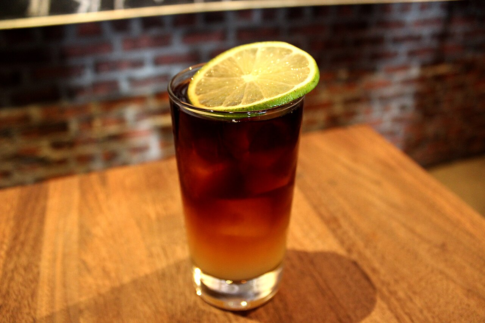

# Dark 'n' Stormy

The Dark 'n' Stormy is Bermuda's signature cocktail: dark rum, ginger beer and lime, built in a highball over ice. Its colour resembles the sea before a storm, while ginger's heat contrasts with the rum's caramel and vanilla. It feels tropical and warming at the same time.

The recipe has only three ingredients and is easy to ruin. The ginger strength, sweetness and carbonation of the beer, the weight and style of the rum, the acidity of the lime: if any one is off, the drink becomes sweet ginger water or alcoholic ginger soup. It tests shopping, not technique.

Figure: A Dark 'n' Stormy of dark rum, ginger beer and lime. Image: Will Shenton, CC BY-SA 3.0, via Wikimedia Commons ([source page](https://commons.wikimedia.org/wiki/File:Dark_%27N%27_Stormy.jpg)).

## Dark rum and ginger beer

Dark rum is the backbone. Gosling's Black Seal is the Bermuda tradition, with molasses, vanilla and a light smokiness; other dark rums work but taste different. White rum is too light and vanishes under the ginger beer; a very expensive aged rum may bring too much wood and caramel.

Ginger beer is not ginger ale. Ginger beer is hotter, more natural and finer in bubble; ginger ale is sweeter and weaker in ginger, and makes the drink taste like candy. If only ginger ale is available, a slice of fresh ginger or a few drops of ginger juice helps, but the texture still differs.

Lime is the balancer. Its acidity cuts the rum's sweetness and the beer's sugar, keeping the drink fresh; without lime the drink turns heavy and cloying. A wedge is more useful than a slice: squeeze it and drop it in.

## The formula: rum, ginger beer and lime

The IBA standard is 60 millilitres of dark rum, 100 millilitres of ginger beer and one lime wedge. Rum to beer is about three to five, a medium-strength drink; for more force, raise rum to 80 millilitres; for a lighter drink, lower it to 40.

Chill the ginger beer and the glass. The colder the beer, the longer the bubbles last and the more the ginger heat is held back; room-temperature beer goes flat quickly. The rum need not be chilled, but measure it in advance so the build is calm.

Press the lime wedge gently in the glass to release its oils and a little juice, then drop it in. Do not squeeze too hard or the acidity overpowers the ginger; do not omit it or the drink loses its fresh spine.

## Method: build in the glass

Fill a highball with ice, pour in the dark rum, squeeze the lime, stir gently. Then pour the ginger beer down the side of the glass, stir once to combine liquid and bubbles. Do not shake hard or the carbonation disappears at once.

Use large, hard ice. Small cubes melt fast and water the drink within minutes; large cubes keep the bubbles and the temperature. Chill the glass beforehand, or fill it with ice and let it stand a minute so the wall goes cold.

Garnish with a lime wedge or slice. The wedge can be squeezed and left at the rim; the slice looks better but releases less aroma. Skip the cherry and pineapple; they do not belong to this drink's language.

## The Bermuda trademark story

The Dark 'n' Stormy comes from Bermuda, tied to Gosling's Brothers rum and local ginger beer. The common account is that early twentieth-century sailors mixed dark rum with ginger beer against the cold at sea; the drink later entered bars and became a local signature.

Gosling's holds the "Dark 'n' Stormy" trademark in the United States, specifying that only drinks made with Gosling's Black Seal rum and ginger beer may use the name. Other producers can describe a similar build as "Dark and Stormy" or "Stormy" but not use the registered spelling.

The trademark dispute does not change the drinking. For the consumer, what matters is the structure; for the bar, what matters is respecting the mark and the origin story. A name can be protected; a formula cannot be monopolised.

## Variations and common mistakes

Common variations include a Dark 'n' Stormy with aged rum, adding vanilla and wood; a Pink Stormy, with a dash of grenadine for colour; and a Stormy Mojito, with ginger beer in a mojito. A Light 'n' Stormy uses white rum for a lighter body.

Four mistakes recur. First, ginger ale instead of ginger beer, which lacks both heat and bubble. Second, beer not cold enough, so the carbonation dies. Third, too much lime, so acidity buries the ginger. Fourth, ice too small, so the drink dilutes. The Dark 'n' Stormy is won or lost on shopping and temperature.

For a home bartender, the practical advice is: buy a good ginger beer, chill both glass and beer, press rather than squeeze the lime, and use large hard ice. The target is a spicy freshness, not sweet heat. A long spear of ice is ideal in a highball: it melts slowly and keeps the carbonation alive.

## See also and references

- Moscow mule: see [Moscow mule](ref:moscow-mule).
- Rum: see [rum](ref:rum).
- Highball: see [highball](ref:highball).
- Pouring: see [pouring](ref:pouring).
- Sweet: see [sweet](ref:sweet).

**At a glance:** A Bermuda classic of dark rum, ginger beer and lime, with a trademark held by Gosling's. Ginger's heat against the rum's caramel makes a strong contrast, and the simple build is very sensitive to the quality of the ginger beer.

For Dark 'n' Stormy, begin with the base and the ratio. Then look at the dilution and the ice, and finally ask the garnish and the glass. The answers point to different choices, not to a single score.

The comparison with [Moscow Mule](ref:moscow-mule) and [Highball glass](ref:highball) runs through base liquor and technique and ratio. Each answers a different question.

A base-liquor brand is not a safe shorthand for Dark 'n' Stormy. Check which base liquor it uses, then which ratio and technique it needs; where they diverge, prefer the specific source.

The entry on Dark 'n' Stormy draws on International Bartenders Association, Oxford University Press, CocktailDB, Make Me a Cocktail.

**Key facts.**

| Item | Detail |
| --- | --- |
| In one line | A Bermuda classic of dark rum, ginger beer and lime, with a trademark held by Gosling's. Ginger's heat against the rum's caramel makes a strong contrast, and the simple build is very sensitive to the quality of the ginge… |
| Style | IBA Contemporary Classics |
| Origin | Bermuda |

**Sources and limits.** The key claims about Dark 'n' Stormy are checked against the following sources: International Bartenders Association (Used to check the IBA category, ingredients and ratio), Oxford University Press (Used to check cocktail history and terminology), CocktailDB (Used to cross-check recipe structure and common variations) and 5 sources in total. Prices, batches and status change; the body is project-written and does not reproduce source text.

For Dark 'n' Stormy, this page was last checked in 2026; prices, batches and availability change, so confirm them against the sources below.
