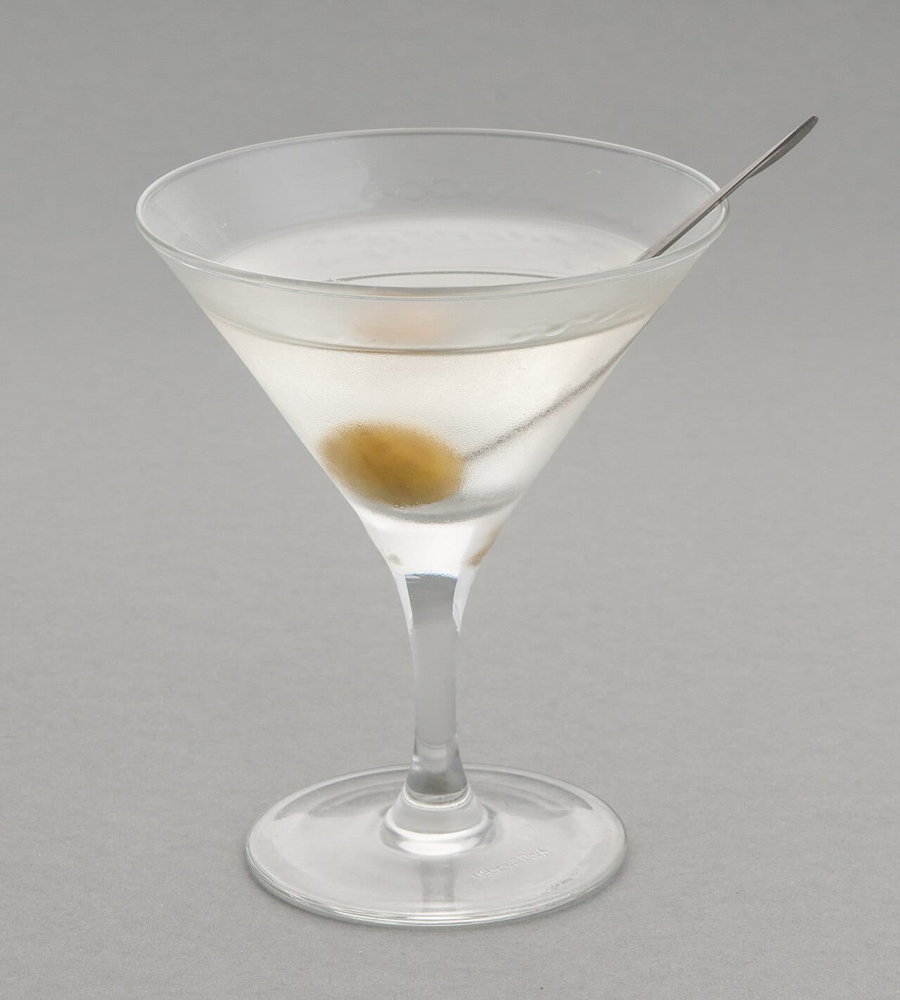

# Dry Martini

The Dry Martini is a classic cocktail of gin and dry vermouth. The public IBA recipe uses 60 ml gin and 10 ml dry vermouth, stirred with ice and strained into a chilled glass, garnished with lemon peel or olives. It aims for low temperature, clarity and restrained aroma rather than juice-like freshness.

Figure: Dry Martini. Image: Ralf Roletschek, CC BY-SA 3.0, via Wikimedia Commons ([source page](https://commons.wikimedia.org/wiki/File:15-09-26-RalfR-WLC-0084.jpg)).

## Definition and identity

The name "Martini" has been connected with several drinks and brands in history, and the exact origin is disputed. This cocktail treats it as background from late-19th-century American cocktail development and does not present one account as settled. Name and recipe are separate things; readers should not assume the same method because the name matches.

## Recipe (IBA version)

The public IBA recipe is 60 ml gin and 10 ml dry vermouth. Pour both into a mixing glass with ice, stir well, and strain into a chilled Martini glass. Express lemon peel over the drink, or add a green olive if requested.

This version is 6:1, on the dry side. The ratio is not the only answer: some prefer less vermouth, some more. Changing the ratio changes the version and should be stated, rather than keeping the name without explaining the difference.

## Gin and dry vermouth

[Gin](ref:gin) is the body, providing the alcohol frame and botanical aroma. Different gins lead with different juniper, citrus or herbal notes, so the finished style changes noticeably. Decide the direction first rather than looking only at strength.

Dry vermouth provides a wine base, spice and a slight bitterness. It connects and modifies the gin rather than sweetening the drink. Dry vermouth oxidises after opening and, stored badly, brings an obvious stale-wine note; check that the aroma is fresh before use.

The ratio determines "dryness". Less vermouth makes the gin more prominent and the palate more direct; more vermouth rounds the body and adds aromatic complexity. "The drier the better" is a preference, not a standard. Dryness is a question of ratio, not of name.

## Stirring and dilution

The traditional method is stirring: it chills, dilutes and mixes while avoiding air and ice shards, leaving the drink clear. Under-stirring leaves the drink insufficiently cold and sharp; over-stirring dilutes too much and thins the body.

Stirring time depends on ice quantity, ice shape and how cold the mixing glass is. Large, dry ice gives more controlled dilution; crushed or wet ice dilutes faster. The goal is a drink that is cold enough and lightly diluted, not a fixed number of seconds. For the general difference between stirring and shaking, see [Cocktail basics](ref:cocktails-guide).

## Temperature and glass

A Martini is usually served in a conical, stemmed Martini glass. The shape gathers aroma, lets you hold the stem without transferring heat and shows off the clear liquid. The glass should be pre-chilled, or the drink warms quickly and both aroma and palate change.

Without a Martini glass, use another glass with a slightly narrowed rim and a moderate capacity. The key points are pre-chilling, suitable capacity and a rim that is not too wide. For shape and temperature, see [Choosing a glass](ref:glass) and [Ice and temperature](ref:ice).

## Dryness and ratio

"Dry" in the Martini context usually means a low proportion of dry vermouth, not a dry-feeling palate. Ratios range from almost no vermouth to nearly equal parts, each producing a different style. A lower ratio makes the gin more direct and the alcohol more obvious; a higher ratio makes the vermouth's spice and bitterness clearer.

When adjusting the ratio, keep the other conditions the same: the same gin, the same ice, the same stirring time. Otherwise you cannot tell whether the change comes from the ratio or the technique. At home, measure in millilitres, start at 6:1 and adjust to preference.

## Garnish: lemon peel or olives

Lemon peel provides citrus essential oil; when expressed, it sprays over the rim and surface. It adds no noticeable acidity and mainly shapes the first impression of aroma. Olives provide saltiness and texture and change the fat and savoury feel of the entry.

Lemon peel and olives are not interchangeable. For a fresh, bright aroma choose lemon peel; for saltiness and a rounder palate choose olives. Both can be used, but sparingly, so they do not cover the gin and vermouth detail. Garnish just before serving.

## Variations

Vodka instead of gin makes a Vodka Martini; olive brine makes a Dirty Martini; a pearl onion makes a Gibson; less vermouth makes a drier version; more vermouth makes a "wet" version. Each variation changes the structure or the aroma direction.

Variations are not mistakes but branches with a clear substitution logic. When recording one, state what was replaced and how the ratio changed; otherwise the same name covers different methods and causes confusion. This cocktail only outlines them; the recipe page remains the executable reference.

## Common misconceptions

First, assuming drier is always better. Dryness is a ratio preference, not a quality grade.

Second, using a warm or room-temperature glass. The drink warms quickly and changes.

Third, shaking without adjusting the ratio. Shaking adds more dilution and aeration, giving a different texture from stirring.

Fourth, keeping vermouth at room temperature long after opening. Oxidation brings a stale note and affects the drink.

Fifth, piling on garnish. Too much garnish covers the main aroma, especially the saltiness of olives.

## Boundary

The Martini is relatively strong; sip slowly and drink water, and do not drink it quickly on an empty stomach. Do not drink when driving, taking medication or pregnant. This cocktail records one sourced version, evaluates no specific brand and does not present one ratio as the only correct answer.

The finished strength depends on the gin's [alcohol by volume](ref:abv), the vermouth ratio and the ice dilution, not on the recipe numbers alone. Keep name, ratio and method separate so that preference is not mistaken for standard.

Start with the base and the ratio. From there, consider the dilution and the ice, then the garnish and the glass. That is how a practical judgment about Dry Martini is built.

[Gin](ref:gin) and [A cocktail is another way in](ref:cocktails-guide) answer different questions about Dry Martini: base liquor and technique and ratio. Read them as a pair, not as alternatives.

**Key facts.**

| Item | Detail |
| --- | --- |
| In one line | A classic cocktail of gin and dry vermouth, stirred and strained into a chilled glass, garnished with lemon peel or olives. Dryness is a matter of vermouth ratio, not the name. |
| Style | Classic cocktail |
| Origin | United States (late 19th century; exact origin disputed) |

## Further reading

- [Gin](ref:gin): the body and botanical aroma of the Martini.
- [Choosing a glass](ref:glass): shape, pre-chilling and aroma concentration.
- [Cocktail basics](ref:cocktails-guide): stirring, dilution and structure.
- [Alcohol by volume](ref:abv): understanding strength and ice dilution.
