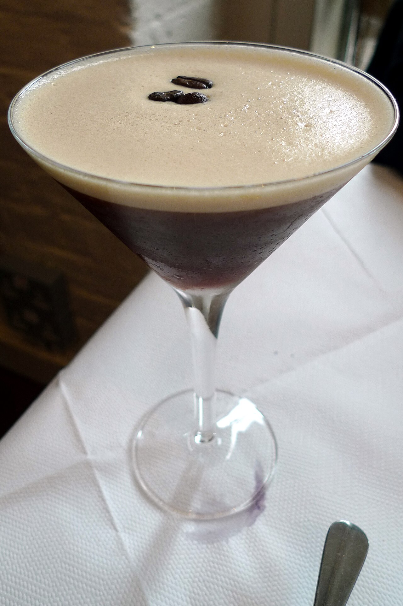

# Espresso Martini

The Espresso Martini is a cocktail of vodka, coffee liqueur, espresso and syrup, shaken hard and strained into a chilled Martini or coupe glass. A fine layer of coffee foam covers the surface and three coffee beans are the usual garnish. Despite the name, it contains neither gin nor dry vermouth and is not a stirred drink. Its identity comes from coffee aroma, a bitter-sweet balance and the texture created by shaking.

Figure: Espresso Martini. Image: Ewan Munro from London, UK, CC BY-SA 2.0, via Wikimedia Commons ([source page](https://commons.wikimedia.org/wiki/File:Bistrot_Bruno_Loubet,_Clerkenwell,_London_(4574785649).jpg)).

## Origin and naming

The most widely told account places the drink in London in the 1980s and links it to a bartender in Soho and a late-night request from a customer who wanted something to wake her up. The bartender is said to have combined coffee with the Martini format that was already popular. The exact year, the name of the bar and the details of the conversation differ between retellings, so this page treats the story as widely told rather than documented. No single date should be presented as an archive fact.

The "Martini" in the name is a borrowed form, not a statement of recipe lineage. It borrows the Martini glass and the association of a short, cold, clear drink, but replaces gin and vermouth with coffee liqueur and espresso. Placing it inside the Martini family can suggest that it should be stirred and extremely dry, while in practice it must be shaken hard to build foam and bring the coffee and alcohol together.

Coffee is both flavour and structure here. The oils and foam of espresso form the surface layer after shaking; egg white or cream are not required. "Espresso" means coffee brewed under pressure rather than filter coffee or instant powder. Different extraction methods produce different bitterness, acidity and foam, which is one reason two drinks with the same name can taste so different.

## Recipe structure

A common formula is 50 ml vodka, 20 ml coffee liqueur, 30 ml espresso and 10 ml syrup. Vodka provides the alcoholic frame, coffee liqueur provides sweetness, coffee aroma and body, espresso provides bitterness, acidity and foam, and syrup balances the coffee's bitterness. The proportions can be adjusted, but the roles should not be confused. More syrup does not make the drink more authentic, and more coffee does not automatically make it better.

The brand of coffee liqueur changes sweetness and aroma noticeably. Some products are sweeter and more vanilla-like, others are more bitter and closer to coffee itself; when the brand changes, the syrup quantity should change with it. Espresso should be freshly extracted. Coffee left standing loses its oils and aroma, and the foam becomes thinner. A moka pot or cold-brew concentrate can produce a similar flavour, but the foam structure will differ from true espresso, and the appearance of the drink will show it.

Syrup is a balancing tool, not a sweetness switch. Coffee is bitter, and the liqueur already contains sugar; too much syrup makes the drink sticky and can make the bitterness stand out inside the sweetness. If the coffee is sour or thin, adjust the coffee first rather than reaching for more sugar. A recipe should state the concentration of the syrup, because one-to-one and two-to-one syrups differ greatly in sweetness.

## Flavour and balance

The entry is roasted coffee and bitterness, followed by the sweetness of the liqueur and the warmth of vodka, with coffee acidity and a slight astringency at the end. The foam adds a fine texture and keeps the aroma close to the nose. Unlike a dry Martini, the drink is not trying to be clear and minimal; it aims to feel like a complete iced coffee with alcohol. The balance is between bitter, sweet, sour and temperature. When the coffee is too bitter, syrup or liqueur can soften it; when the drink is too sweet, stronger coffee or a little lemon peel can lift it.

Temperature strongly affects foam and aroma. If the ingredients are not cold, the foam collapses after shaking; if the shake is too short, the foam is thin; if the shake is too long, too much ice melts and the body becomes watery. The ideal is pre-chilled ingredients, enough ice, and shaking until the tin is heavily frosted, then double-straining into a chilled glass. The coffee beans are not only a pattern: close to the rim they add roasted aroma, though they do not need to be eaten.

Alcohol content is not low, and caffeine adds a sense of alertness that can make the total intake easy to underestimate. Caffeine does not cancel the effect of alcohol on judgment and reaction time, and it does not sober anyone up. Keep the number of glasses in view, especially late at night; people sensitive to caffeine may find that even one drink affects sleep.

## Method

Shaking hard is the core of the method. Put the vodka, coffee liqueur, espresso and syrup into a shaker, fill it with ice and shake firmly for about ten to fifteen seconds, until the outside of the tin is heavily frosted. Double-strain through a fine mesh into a chilled Martini or coupe glass, let the foam settle for a moment, then place three coffee beans on the surface. Double-straining catches crushed ice and coffee grounds and keeps the texture clean.

The temperature of the espresso affects dilution. Freshly pulled espresso is hot and will melt more ice in the shaker, so some bartenders let it cool slightly, or use less ice and a shorter shake. At home, without an espresso machine, a moka pot or cold-brew concentrate can produce a stronger coffee, but the foam will not be the same. Instant coffee rarely produces the desired oily foam and is usually a poor first choice.

Martini glasses, coupes or small rocks glasses are common. A wide rim helps the aroma, and a chilled glass helps the foam stay stable. Three coffee beans are the usual garnish; orange peel or cocoa powder also appear. Cocoa powder clumps easily and should be sifted before dusting. Do not shake the drink into a milkshake texture; too much shaking raises the water content and dilutes the coffee aroma.

## Variations

Replacing vodka with rum or brandy gives a sweeter, fuller-bodied version. Decaf espresso lowers the caffeine but changes the flavour. Vanilla, salted caramel or hazelnut syrup shifts the sweetness; a little orange peel oil brightens the coffee acidity. Some versions omit syrup and rely on a sweeter liqueur for balance, which gives a rounder sweetness but a higher alcohol content.

The Espresso Martini is not a Carajillo. The latter is usually coffee and liqueur without vodka, and it does not rely on the Martini-glass presentation in the same way. Treating them as the same drink makes recipe comparisons meaningless. A variation should state the base spirit, the type of coffee and the source of sweetness, or identical names will hide different methods.

## How to order and drink

For Espresso Martini, begin with the base and the ratio. Then look at the dilution and the ice, and finally ask the garnish and the glass. The answers point to different choices, not to a single score.

The drink suits after-dinner service with chocolate, nuts and coffee-flavoured desserts, and can replace part of an after-dinner coffee. Coffee bitterness and dessert sweetness balance each other, but the drink is not a hangover remedy. The body still needs time to metabolise the alcohol, so do not drive afterwards. If other drinks have already been served during dinner, count this one in the total.

In a bar, if the bartender shakes only briefly, the foam will usually be poor; if the tin is not properly frosted, the chilling is insufficient. The fineness of the foam and whether it sits level with the rim are useful clues about execution, but appearance is not the only measure: coffee freshness and the sweet-bitter balance matter just as much.

## Common misconceptions

First, that it belongs to the dry Martini family and should therefore be stirred. It needs shaking to build foam and integrate the coffee. Second, that the foam comes from egg white. The classic version relies on espresso oils and shaking, not egg white. Third, that more coffee is more authentic. Too much coffee dilutes the body and adds bitterness. Fourth, that caffeine cancels alcohol. Caffeine can make a person feel alert, but it does not lower blood alcohol concentration. Fifth, that syrup is optional. Syrup balances coffee bitterness, though the amount must follow the coffee and the liqueur.

## See also

- [Vodka](ref:vodka): the alcoholic frame and neutral style of this drink.
- [Liqueur](ref:liqueur): the sweetness, aroma and body contributed by coffee liqueur.
- [Shaking](ref:shaking): the technique behind foam, chilling and dilution.
- [Martini glass](ref:martini): the short-drink vessel and the presentation of foam.
- [Aroma](ref:aroma): how temperature and foam affect coffee aroma.
