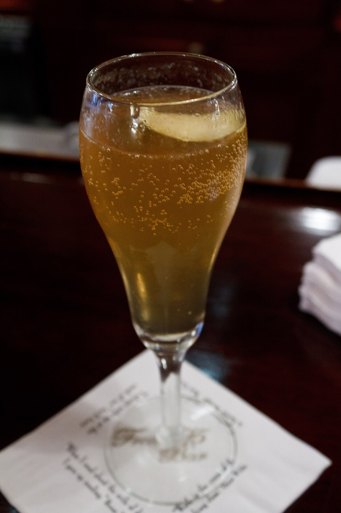

# French 75

The French 75 is a sparkling short drink made by shaking [gin](ref:gin), lemon juice and sugar syrup, then topping the mixture with [Champagne](ref:sparkling). It is usually served in a chilled [flute](ref:flute) or tulip glass, pale gold in colour, with fine bubbles and an optional expression of lemon peel. The entry is lemon acidity and rounded sugar, followed by the bubbles, fruit and faint yeast of Champagne, with gin providing juniper and an alcoholic frame at the end. It tastes light, but its strength is closer to a fortified wine; the bubbles hide the alcohol very effectively.

Figure: A French 75 in a flute, with golden liquid, fine bubbles and a lemon garnish. Image: Gary J Wood, CC BY-SA 2.0, via [source page](https://commons.wikimedia.org/wiki/File:French_75.jpg).

## A name borrowed from a field gun

The name comes from the [French](ref:france) 75 mm field gun used by the French army before and during the First World War, officially the Canon de 75 modèle 1897. The gun was known for its rate of fire and mobility and became a symbol of French artillery. Naming a sparkling cocktail after it was a joke about a drink that goes down easily but arrives with a kick. The 75 in the name is neither a year nor an alcohol percentage; it is the calibre.

The name settled into newspapers and cocktail books in the early 20th century. Accounts differ about the exact year and the person who first used it, so this page says "commonly traced to the First World War" rather than treating one date as the only answer. What is clear is that the name belongs to the public image of the gun, not to a French event in the year 75.

There are spelling variants as well. French sources may write Soixante-Quinze, English sources usually write French 75, and some menus close the space as French75. The same name can cover different recipes, so it is worth asking whether the base is gin or Cognac and whether syrup is included.

## Paris, 1915, and Harry's New York Bar

The most common origin story places the drink in Paris during the First World War, at Harry's New York Bar. It is usually dated to around 1915 and often linked to the bar's operator, Harry MacElhone. The exact year, and whether MacElhone himself created it, vary between accounts; the safer formulation is that the drink is commonly traced to Harry's New York Bar in Paris in 1915, not that the authorship is documented.

Early printed recipes were not uniform. Some sources note that drinks called Soixante-Quinze around 1915 combined gin, grenadine, apple brandy and lemon; the version built on gin, lemon, sugar and Champagne became standard later, through cocktail books. *Here's How!* in 1927 and the *Savoy Cocktail Book* in 1930 are often cited, which shows that the drink had entered English-language cocktail writing during Prohibition.

This history explains a common misunderstanding. The French 75 is not a single act of invention consisting of "gin plus Champagne"; it is the result of several early recipes converging through bar practice and print. Today it carries both the urban culture of Parisian bars and the wartime charge of its name, and those two associations together give the drink its identity.

## When the Champagne goes in

The most important rule is that the Champagne goes in last and is never shaken. The IBA method begins with [shaking](ref:shaking) gin, lemon juice and syrup with ice, then strains the mixture into a chilled flute and slowly tops it with Champagne. The reason is simple: carbon dioxide is released violently inside a shaker, so Champagne that has been shaken loses most of its bubbles and much of its fresh fruit.

Pour the Champagne slowly down the side of the glass, or fill to about half, rotate the stem gently to mix, then top to about seven-tenths full. Do not stir hard with a bar spoon and do not pour the drink from one glass into another; both create turbulence and drive off the gas. The ideal result is a drink with an even colour and a fine bead of bubbles, not a thick foam collar.

Adding Champagne before the gin mixture forces it to absorb extra mixing and loses more gas. Putting everything into a shaker produces a flat sour. The order is not a ritual; it is the technical condition for keeping the bubbles, and it is the sequence [cocktail basics](ref:basics) describes for any drink topped with bubbles. Bars usually shake the base, open a fresh bottle and pour to order, and home makers should follow the same sequence.

## The narrow window of sugar and acid

The IBA formula is 30 ml gin, 15 ml lemon juice, 15 ml syrup and 60 ml Champagne. The syrup is usually a 2:1 rich syrup; if a 1:1 syrup is used, 15 ml will taste considerably less sweet and the amount should be increased. Lemon supplies acid, syrup supplies sugar, and Champagne supplies bubbles and a little residual sugar. The window is narrower than it looks: a little more sugar and the yeast notes disappear; a little more acid and the bubbles feel sharp.

The difficulty is that the base must be slightly concentrated and slightly sweet before the Champagne goes in. Champagne dilutes the drink, and carbonation makes acidity feel brighter on the palate. If the base is balanced as a finished sour, it will taste thin once the wine is added. If the base is too sweet, the Champagne's freshness is buried and the drink becomes a sweet soda. The usual approach is to let the base lean slightly sweet, then let the wine's acidity and bubbles pull it back.

Sugar also affects how long the bubbles last. Sugar increases viscosity and slows the rise of bubbles, but too much sugar makes the drink cloying. A version with almost no sugar lets the lemon and the Champagne acids stack up and taste sharp. If sugar is reduced, increase the lemon and choose a drier Champagne, but do not replace Champagne with soda water; that would remove the yeast and fruit entirely.

## Gin or Cognac

The gin version is the one most often written by the IBA and found in international bars. London dry gin brings juniper, citrus peel and herbal notes that cut through the yeastiness of Champagne and give the finish a clear frame. A gin that is too floral or too soft disappears behind the wine. A dry gin between 40% and 47% ABV is a reliable choice; heavily oak-aged gin adds vanilla and wood that may not sit well with the fresh direction of Champagne.

The Cognac version has deep roots in the American South. Arnaud's in New Orleans named its bar the French 75 Bar and builds the drink on Cognac; the grape, floral and oak notes make the result rounder and wider, with softer acidity. The Cognac versions often use less syrup, keeping the drink drier to emphasise the grape and the aged spirit. It is not a substitute for the gin version; it is a parallel tradition.

The choice depends on the structure wanted. Gin is crisper and more herbal and citrus-led; Cognac is rounder and more grape- and spice-led. Both share Champagne and lemon, and the difference is mainly in the frame at the end. Asking "gin or Cognac" at the bar is not fussiness; it is a way of confirming which tradition is being poured.

## Bubbles, temperature and glassware

The temperature of the Champagne determines the life of the bubbles. The bottle should be well chilled, ideally around 6 to 8°C. The warmer the wine, the more easily carbon dioxide escapes, and the bubbles in the glass become coarser and disappear faster. The glass should be chilled too, but not frozen to the point of frost; an over-cold glass closes the aroma and coats the rim with condensation.

The choice between a flute and a tulip is a trade-off. A flute is narrow and tall, giving bubbles a long path and preserving them well; it also looks celebratory. But the narrow rim slows aroma release, so the gin and lemon details are harder to smell. A tulip has a wider bowl and a slightly narrowed rim, which opens the aroma and emphasises the body and yeast; the cost is faster bubble loss. Both are valid, as long as the glass is not filled to the brim.

Do not use an oversized glass. The total volume of a French 75 is about 120 ml, and after shaking and dilution the finished drink is around 140 to 150 ml. Poured into a glass larger than 200 ml, the liquid sits too shallow, warms quickly and loses its bubbles. Do not sugar the rim; sugar disrupts the dry finish of the Champagne and makes the rim sticky.

## Why it is stronger than it tastes

The French 75 is roughly 14% to 16% ABV, close to a fortified wine, but the bubbles, acidity and low temperature hide the alcohol. Carbonation can speed absorption, cold dulls the perception of alcohol, and lemon and sugar make the drink taste like fruit soda. Those three effects together make it easy to drink faster than intended.

The arithmetic is straightforward. 30 ml of 40% gin contributes about 12 ml of pure alcohol; 60 ml of 12% Champagne contributes about 7 ml; the total is about 19 ml. After shaking and dilution the volume is around 140 ml, which puts the drink at about 14% ABV. That is not a high number, but the accumulation over several glasses is faster than the taste suggests. It is a good opening drink, not the only drink of an evening.

Drink water alongside it and avoid drinking on an empty stomach; do not drink and drive, and avoid alcohol during pregnancy or while taking medication that interacts with it. If a bar uses a stronger sparkling wine or a fortified bubbly, the drink will be stronger, so it is reasonable to ask about the wine or its strength. "It tastes like soda" is not evidence that there is no alcohol.

## Common failure points

First, Champagne that is too warm. The bubbles are coarse, disappear quickly, and the drink tastes sweeter and heavier. Second, pouring Champagne into the shaker. The result is a flat sour with no bubbles. Third, too much syrup. The drink becomes a sweet soda and the yeast and fruit of the wine disappear. Fourth, lemon juice that is not fresh. Pre-squeezed juice has a flat aroma and a sharp, one-dimensional acidity. Fifth, a glass that is too small or filled too full. The bubbles have no room to rise and the drink warms quickly. Sixth, using a sweet sparkling wine instead of dry Champagne. The residual sugar changes the balance, especially in the Cognac version.

Another common problem is a base that has been diluted too much. If the gin, lemon and syrup are shaken with too much ice or for too long, the base becomes watery and the finished drink feels thin even after the Champagne is added. Shake until cold, not until the ice has mostly melted; the base should be slightly stronger than the final drink so that the wine has room to dilute it.

## Variations and seasons

The Cognac version is the most regionally rooted variation, associated with New Orleans. It replaces gin with Cognac and usually uses less syrup, giving a rounder, wider drink. A rosé Champagne version is prettier and more fruit-forward, but the acidity and bubble structure become softer. Other sparkling wines, such as Crémant, can replace Champagne at a lower cost, but the yeast and acidity will differ.

Seasonally, the drink suits spring, celebrations and brunch. It pairs well with oysters, caviar, fried food, citrus salads and mild cheese; the bubbles and acidity cut through fat, and the lemon and wine fruit meet seafood. Heavy cream and very sweet desserts are a poor match, because the bubbles magnify the sweetness and the acidity becomes jarring.

At home, the base can be mixed and chilled in advance, but the Champagne must be opened and poured to order. A base left standing loses the fresh lemon aroma and the gin's herbal edge becomes dull. If making a batch, keep the lemon juice and syrup separate and combine just before serving.

## How to order and pair

Order a "French 75" and confirm whether the base is gin or Cognac. If it is too sweet, ask for less syrup or a drier Champagne; if more acidity is wanted, ask for extra lemon, keeping in mind that the wine is acidic too. A tulip glass will open the aroma; a flute will hold the bubbles longer. Either is fine, depending on the experience wanted.

It works as an aperitif or a celebration drink, not as a companion to heavy savoury food. Oysters, shrimp, fried chicken, fries, citrus salads and soft cheese all sit well with it; the wine's acidity and bubbles clean the palate, and the gin's herbs meet the seafood. Sip slowly, drink water and avoid an empty stomach. The alcohol hides in the bubbles, so eat something before the second glass.

In a bar, a drink with no bubbles may mean the Champagne was warm, poured too hard, or stirred too much after mixing. A drink that is too sweet may mean too much syrup or a sweet sparkling wine. A fine bead and a clear colour are useful clues about execution, but the final test is the balance of acid, sugar and bubbles.

## Common misconceptions

First, that a French 75 must use Champagne and nothing else. Champagne is the classic, but dry Crémant or Cava can make a valid drink with a different flavour. Second, that the 75 is a year. It is the calibre of the gun. Third, that the gin version is the only authentic one. The Cognac version has its own regional tradition. Fourth, that the Champagne can be shaken with the base. The bubbles will be lost. Fifth, that the drink is low in alcohol. It is close to a fortified wine, and the bubbles mask the strength. Sixth, that a sugar rim improves it. Sugar disrupts the dry finish and the bubbles.

## See also

- [Gin](ref:gin): how juniper and citrus cut through Champagne.
- [Sparkling wine](ref:sparkling): Champagne, Crémant and other bubbly choices.
- [France](ref:france): Parisian bar culture and the regional background of the name.
- [Shaking](ref:shaking): chilling and diluting the base.
- [Champagne flute](ref:flute): the trade-off between bubbles and aroma.
