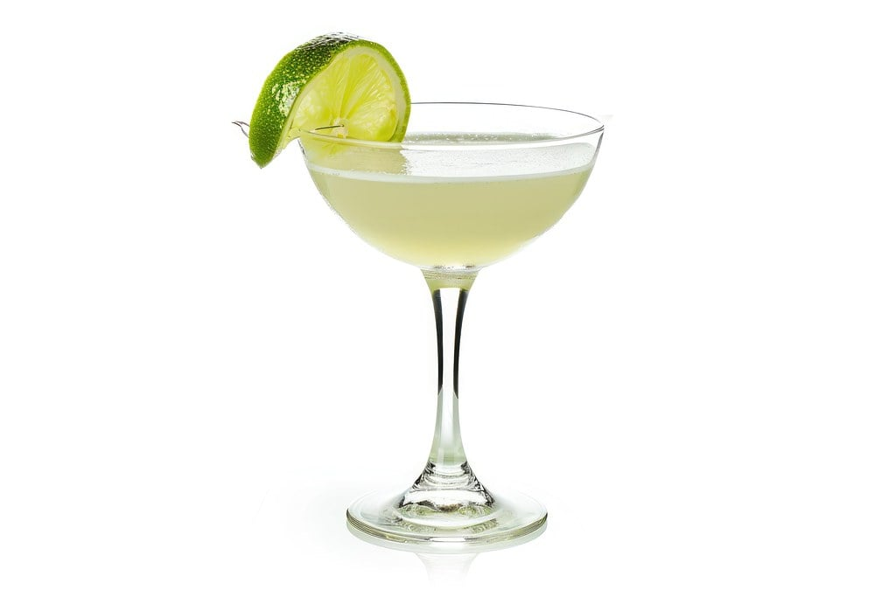

# Gimlet

The Gimlet is a short drink built on gin and lime. It has two versions: one uses lime cordial, the other fresh lime juice plus syrup. The cordial version is the older and more "classic" one; the fresh version is what most modern bars make. They are not the same recipe with one ingredient swapped. Acidity, sweetness, aroma and texture all change.

Figure: A Gimlet in a coupe, with pale yellow-green liquid and a lime wheel on the rim. Image: ccnull.de Bilddatenbank, CC BY 2.0, via [source page](https://www.flickr.com/photo.gne?id=53457787167).

> **Quick verdict**
> **In one line:** This cocktail helps you decide whether to order Gimlet, and how ratio, ice and water change it.
>
> - **Best for:** Anyone who wants the logic, serving method and common mistakes behind Gimlet.
> - **Not for:** If you want only want a strong drink and do not care about ratio, ice or water.
> - **Check first:**
>   - The cordial version has a very simple structure: gin plus lime cordial, usually somewhere between 2:1 and 3:1, for example 60 ml gin and 20–25 ml cordial.
>   - The most popular origin story ties the drink to Thomas Gimlette, a surgeon in the British Royal Navy.

## Two formulas, two different drinks

The cordial version has a very simple structure: gin plus lime cordial, usually somewhere between 2:1 and 3:1, for example 60 ml gin and 20–25 ml cordial. The result is clear and sweet, with a lime aroma that tastes preserved, a faint confectionery note and a touch of salinity. Acidity is low, the texture is round, and the body is thicker than the fresh version.

The fresh version is gin, fresh lime juice and syrup, commonly 60 ml gin, 22.5 ml lime juice and 15 ml syrup. It is sharper, brighter and shorter on the finish. Lime peel oil gives a fresh bitter perfume, but it fades after standing. Because it contains pulp and oil, the fresh version is usually shaken and fine-strained; the cordial version can be stirred.

Both are called a Gimlet, but if you do not specify, you may get either. It is safer to ask for "a Gimlet with cordial" or "a fresh-lime Gimlet" than to assume the other person shares your formula.

## The Royal Navy surgeon story, and why it is only a story

The most popular origin story ties the drink to Thomas Gimlette, a surgeon in the British Royal Navy. The usual version runs like this: in the late 19th or early 20th century, sailors needed lime juice to prevent scurvy, but the juice was sour and unpleasant; Gimlette mixed gin into it to make the medicine drinkable, and the Gimlet took his name. Thomas Gimlette was a real person, born in 1857 and died in 1943, and he rose to the rank of Surgeon Rear-Admiral; but the claim that he invented the drink by adding gin to lime juice is not supported by contemporary recipes, letters or bar records.

The timeline is also awkward. Citrus juice had been part of Royal Navy anti-scurvy practice much earlier: lemon juice was adopted as a ration in the late 18th century, and lime juice became common later. Gin with lime cordial as a bar drink only took shape in the late 19th and early 20th centuries. Attributing a 20th-century cocktail to a single medical inspiration stitches two separate histories together.

There is also a plainer explanation. A gimlet was a small boring tool used at sea to pierce a barrel and draw off spirits; the drink's name may come from that tool or from the action of boring, not from a surgeon's surname. That idea is not settled either, but it is a useful reminder: the origin of a name and the origin of a recipe are two different questions, and a shared surname is not evidence.

This cocktail therefore treats the surgeon story as a popular story, not as history. It explains why the drink is associated with the navy, limes and scurvy prevention, but it does not identify an inventor.

## Raymond Chandler and The Long Goodbye

The Gimlet entered popular culture largely through Raymond Chandler's 1953 novel *The Long Goodbye*. In it, the detective Philip Marlowe describes a Gimlet in a line that is often quoted: "a real gimlet is half gin and half Rose's lime juice and nothing else." That sentence fixed two ideas in the public memory at once: the recipe is minimal, and the ratio can be 1:1.

A 1:1 Gimlet sounds very sweet today, but in the context of the 1950s it was not strange. Rose's lime cordial contains sugar, so a 1:1 drink is sweet and falls below 20% ABV; it drinks more like a lime beverage with alcohol in it. Chandler was writing a character's taste, not a mixing standard. Treating the line as the only correct Gimlet turns a novel into a recipe manual.

The cultural effect was considerable: many people first heard of the drink through a book rather than a bar. That also explains why the "classic image" of the Gimlet is so often minimal, cold and half-and-half, even though real recipes are more varied.

## The IBA and the historical formulas: 7:3 and 1:1

First, the important point: there is no Gimlet entry in the IBA's current official cocktail list. Unlike the Sidecar or the Negroni, it does not have an IBA page that can be cited, so this cocktail does not call any formula an "IBA official recipe".

What can be checked are historical formulas. The Gimlet in the IBA's 1985 recipe manual is commonly retold as 7/10 gin and 3/10 lime cordial, about 2.3:1. That is much drier than Chandler's 1:1 and closer to modern bar practice. The earlier *The Savoy Cocktail Book* of 1930 gives half gin and half lime juice; note that it says lime juice, not lime cordial, so the same 1:1 is far more acidic and much closer to a gin sour.

Start with the base and the ratio. From there, consider the dilution and the ice, then the garnish and the glass. That is how a practical judgment about Gimlet is built.

## Lime cordial: acidity, sweetness and texture

Lime cordial is not simply "lime-flavoured sugar water". It is usually made from lime juice, sugar and a preservative, and some products add lime peel oil. Sugar softens the sharpness of the acid and raises viscosity, making the drink feel thicker in the mouth; peel oil adds aroma but also a little bitterness. In 1867, Lauchlan Rose patented a method for preserving lime juice for long sea voyages. That technology developed into commercial lime cordial and turned lime from a fresh fruit into an industrial ingredient that could be stored for months.

The advantage of cordial is predictability. The same bottle tastes almost the same today and next week, the acidity is stable and the drink is quick to make. The disadvantage is a flatter aroma and a high sugar level that becomes cloying after a glass or two. A bottle kept too long or stored badly can turn metallic or smell of detergent. A common starting point is 60 ml gin to 20–25 ml cordial; more cordial means more sweetness, less acidity, a thicker body and less room for the fresh lime aroma.

Fresh lime juice usually has a titratable acidity of 5%–6%, clearly higher than cordial diluted by sugar. Its aroma comes from peel oil and the juice itself: bright, brief and prone to oxidation. Half an hour after squeezing, the perfume is noticeably weaker. The fresh version therefore needs more syrup to balance it, commonly 22.5 ml lime juice to 15 ml syrup. That is a starting point, not a fixed answer: ripeness, variety and season all change the acidity.

## How to make the fresh version

The first step is choosing the limes. Thin-skinned fruit that feels heavy for its size and has fine oil pores usually gives more juice and aroma; shiny, light fruit often gives less. Let the fruit come to room temperature before squeezing for a better yield, but use the juice soon after; do not prepare it an hour in advance.

Start with 60 ml gin, 22.5 ml fresh lime juice and 15 ml syrup. A 1:1 simple syrup is enough. If the limes are especially acidic, raise the syrup to 17.5 ml or lower the juice to 20 ml. Make one drink at the standard ratio before adjusting, and do not change three variables at once.

Shake with ice for 10–12 seconds and fine-strain into a chilled glass. Fresh juice contains pulp that an ordinary strainer will not catch; a fine mesh gives a cleaner texture and also holds back ice shards. Garnish with a lime wheel or express lime peel oil over the surface. A wheel gives visual cues and a little peel aroma; the oil is more direct, but do not squeeze too much into the drink or the bitterness becomes excessive.

## Stir or shake

The cordial version is usually stirred and the fresh version usually shaken. The reason is the ingredient, not tradition. Cordial has no pulp or oil, so stirring chills, dilutes and keeps the drink clear. Shaking whips in air, clouds a liquid that should be transparent and makes the sweetness taste frothy. Fresh juice has pulp, oil and fibre, and only shaking integrates them properly while softening the acidity.

Stir for 20–30 seconds, until the glass frosts and dilution reaches about 20%. Shake for 10–12 seconds, until the sound of the ice becomes dull. Neither method should be extended "to get it colder": the longer it goes, the more meltwater enters the drink and the thinner it becomes. With crushed ice, shorten the time or dilution will run away.

Some bars shake the cordial version as well, arguing that it gives a livelier texture. That is not wrong, but it changes the drink: a shaken cordial Gimlet carries a thin foam, feels lighter and loses clarity. If you want a drink as cold and clear as a martini, stir it; if you want a softer, more sour-like texture, shaking is defensible.

## Glassware: coupe, martini and Nick & Nora

Traditionally the drink is served in a [coupe](ref:coupe) or a cocktail glass. A coupe has a wide bowl and a slightly narrowed rim, giving aroma room to gather, and it warms more slowly than a cone. A martini glass has a wide rim and a shallow bowl: the first sip is aromatic, but it warms quickly and is easy to spill. The IBA does not specify a glass for the Gimlet because it is not on the current list; historically, short drinks of this kind were served in small stemmed glasses.

For more concentrated lime aroma, choose a coupe with a slightly narrowed rim, 150–200 ml, and fill about two-thirds. For a colder drink to be finished quickly, choose a martini glass, accepting that it is not built for long conversation. A Nick & Nora also works, especially for the cordial version, whose thicker body and sweeter aroma suit a smaller, narrower glass.

Whatever the shape, chill the glass first. A warm glass brings the drink back up in temperature, loosens the acidity and lets the lime aroma escape. For the general principles of glass shape and aroma, see [cocktail basics](ref:basics).

## Choosing the gin

[Gin](ref:gin) is the only flavouring frame in the drink, so the choice matters more than the ratio. London dry gin, with juniper, coriander and citrus peel, points in the same direction as lime and gives a clean, crisp result. Plymouth style is softer and slightly earthy, and it blends easily with the sweetness of cordial. Navy-strength gin is high in alcohol and needs more dilution, or the spirit covers the lime.

Very complex modern gins are best avoided. When the gin itself carries a lot of floral, tea or tropical fruit notes, the lime acidity pulls those details apart and the drink tastes muddled. Nor should a poor gin be hidden behind cordial: sugar can cover roughness, but it cannot supply a frame.

With cordial, the juniper needs to be clear enough to cut through the sugar. With fresh lime, a citrus-forward gin can echo the peel oil, but avoid a heavily bitter recipe that stacks bitterness on top of the lime. For more on gin styles, see [gin](ref:gin).

## Common failures

First, old lime cordial. Even in the fridge it oxidises, and a metallic or medicinal smell means it should be discarded. Second, too much cordial. The sugar covers the gin and the lime, and the drink tastes like a lime soda with alcohol. Third, juice squeezed too far in advance; the aroma fades within half an hour and the acidity becomes one-dimensional. Fourth, over-shaking or over-stirring. Too much meltwater thins the body. Fifth, a warm glass. The drink separates as it warms and the texture turns coarse. Sixth, the wrong gin; either a very floral gin or a very cheap one loses the frame. Seventh, no fine strain; pulp and ice shards cloud the fresh version.

## Ordering and drinking

State the version: "a Gimlet with cordial" or "a fresh-lime Gimlet, 60 ml gin". Ask which gin is used and whether the cordial is house-made or bottled. If the bartender asks whether you want it sweet or sour, they are asking about the cordial-to-lime balance. For a drier drink, reduce the cordial or add lime; for a sweeter one, add cordial rather than more gin.

It works as an aperitif with oysters, salted nuts, light seafood, fried food or lime desserts. The cordial version suits salty and fried food; the fresh version suits oysters and white fish. Sip slowly and watch the temperature; the alcohol content is usually around 20%, but it accumulates over successive drinks. Do not drink and drive, and avoid alcohol during pregnancy or while taking medication that interacts with it.

## See also

- [Gin](ref:gin): the base spirit and the choice of style.
- [Shaking](ref:shake): mixing, chilling and fine-straining the fresh version.
- [Coupe glass](ref:coupe): bowl shape, rim and aroma.
- [Dry martini](ref:martini): another gin short drink, but drier in structure.
- [Cocktail basics](ref:basics): sour structure, dilution and judging a serve.
