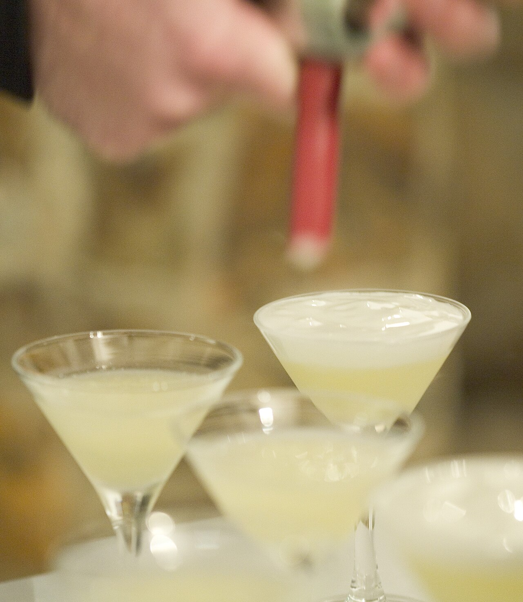

# Gin Fizz

A Gin Fizz is a short drink built from gin, lemon juice, sugar and soda water: the first three are shaken with ice, strained into a slim glass, and finished with a small charge of soda. The public IBA recipe uses 45 ml gin, 30 ml fresh lemon juice and 10 ml syrup, with soda as a late addition and no ice in the glass. It is one step away from a gin sour — the water is simply replaced by sparkling water — but that step decides temperature, dilution and texture.

Figure: Gin Fizz. Image: Charles Haynes, CC BY-SA 2.0, via Wikimedia Commons ([source page](https://commons.wikimedia.org/wiki/File:Gin_Fizz_en_El_Bulli.jpg)).

## What a Fizz Is

In the 19th-century American bar, "fizz" meant a structure: spirit, citrus, sugar, shaken and then topped with soda. The Gin Fizz is its best-known branch and the template for judging the rest. Its difference from a gin sour is not the ingredient list but the order: soda enters after the shake, so the bubbles stay intact, the body stays light and the dilution stays low. Old Tom, genever or a modern London dry can all be used, and each pulls the drink in a different direction.

## The Structured Recipe: 45 / 30 / 10

The IBA public version:

- Gin 45 ml
- Fresh lemon juice 30 ml
- Syrup 10 ml
- Soda water a splash, commonly about 10 ml, to the rim (the IBA text says only splash)
- Glass: a thin tall tumbler, chilled
- Ice: ice for the shake; no ice in the glass
- Method: shake everything except the soda with ice, strain into the glass, then add soda slowly
- Garnish: a lemon slice, optionally lemon zest

The IBA note specifies serving without ice. That differs from what many bars do: Beefeater's official version uses 50 ml gin, 25 ml lemon juice and 10 ml syrup, strained into an iced highball, topped with soda and finished with lemon zest. Both sets of numbers work; the first gives a more concentrated short drink with longer-lasting bubbles, the second a colder, easier long drink. For the general principles of structure and dilution, see [cocktail basics](ref:cocktails-guide).

## Soda Goes In After the Shake

The shake chills, mixes and supplies part of the dilution. The soda supplies bubbles. Do both at once and the bubbles are broken inside the tin, leaving sweet water. The correct order is: shake, strain into a chilled glass, pour the soda slowly down the side, then lift the drink once with a bar spoon — do not stir.

The colder the glass and the liquid, the longer the carbon dioxide stays in solution. A warm glass, warm liquid or a hard pour will drive the gas off within seconds. This is one reason the IBA version serves the drink without ice: with no ice in the glass, the dilution curve stays flat and the bubbles are not washed away sip by sip.

## The Fizz Family: Silver, Golden and Ramos

The fizz is a tree with clear branches:

- Silver Fizz: add egg white. Beefeater's official method dry-shakes for roughly 20 seconds without ice, then shakes with ice until cold, strains and tops with soda. The white gives a fine foam and a rounder texture.
- Golden Fizz: add egg yolk. This appears in late-19th-century bar manuals and is rare today; the yolk adds weight and colour and can bury part of the citrus aroma.
- Royal Fizz: add a whole egg, sitting between the two.
- Ramos Gin Fizz: cream, egg white, lime and orange flower water — the most distinctive branch of the family.

## Ramos and the Twelve-Minute Shake

The Ramos Gin Fizz was created by Henry C. Ramos in 1888 at the Imperial Cabinet Saloon in New Orleans. Its name is tied to a twelve-minute shake: the original method called for a full twelve minutes to emulsify cream, egg white and sugar into a fine foam. At its busiest, Ramos employed more than thirty "shaker boys" in relays; during Mardi Gras in 1915, the commonly cited figure is 32 bartenders shaking at once. Ramos himself did not drink, closed at 8 p.m., sold his last Ramos Gin Fizz at midnight on 27 October 1919 as Prohibition arrived, and gave the recipe to the New Orleans Item-Tribune shortly before his death.

A workable modern version: gin 60 ml, lemon juice 15 ml, lime juice 15 ml, syrup 22.5 ml, heavy cream 30 ml, orange flower water 3 drops, one egg white and soda water 60 ml. Dry-shake everything except the soda for at least one minute, shake with ice until cold, strain into a Collins glass, then top with soda and stir briefly. Twelve minutes is history, not today's threshold; the order — dry shake, iced shake, soda last — is what cannot be skipped.

## Glass, Ice and the No-Ice Fizz

A fizz is traditionally served in a slim glass. Bormioli Rocco's glassware guide gives 10–12 oz for a highball and 12–14 oz for a Collins. The fizz sits closer to the highball: smaller, thin-walled and good for showing bubbles; the Collins is taller and holds more ice and garnish.

Ice decides two things: how fast the shake dilutes, and how much dilution continues in the glass. The IBA version has no ice, so the temperature is built in the shaker and the drink does not fade; the iced version starts colder but keeps moving downhill as the ice melts. Either is valid, but you cannot add ice and also top with the no-ice amount of soda without ending up thin.

## Four Lines Between a Fizz and a Collins

The IBA lists the [Tom Collins](ref:tom-collins) recipe under "John Collins": 45 ml gin, 30 ml lemon juice, 15 ml syrup and 60 ml soda, built over ice in a highball, garnished with lemon and a maraschino cherry, with the note to use Old Tom gin for a Tom Collins. Set beside a Gin Fizz, there are four clean lines:

1. Soda: a splash, about 10 ml, for the fizz; 60 ml for the Collins.
2. Sugar: 10 ml for the fizz; 15 ml for the Collins.
3. Ice: none in the fizz glass; a full charge in the Collins.
4. Base and glass: Old Tom and a 12–14 oz Collins glass by tradition; London dry and a 10–12 oz highball or fizz glass for the fizz.

The same 45 / 30 frame becomes two different drinks across those four settings.

## Gin Style and the Sweet-Sour Calibration

London dry gives a clear juniper and citrus frame; Old Tom is rounder and sweeter; navy-strength gin needs more dilution. 45 ml is a volume, not a promise of strength. Use fresh lemon juice — 30 ml is roughly one medium lemon — and note that 10 ml of syrup is dry by modern taste. If the gin is aggressive, raise the syrup to 15 ml, but do not substitute granulated sugar; it will not dissolve evenly. Final strength also depends on shake dilution; see [alcohol by volume](ref:abv).

## Where a Gin Fizz Goes Wrong

First, under-shaking: if the tin is not frosted and your hand does not feel the cold, the drink is not cold enough and the soda will fade fast.

Second, small ice and a long shake: crushed ice can turn a light-bodied fizz to water in fifteen seconds.

Third, soda before the shake: the most complete failure, with all the gas lost.

Fourth, a warm glass: the liquid warms on contact and carbon dioxide leaves solution.

Fifth, no dry shake in the egg-white version: the white never foams, and the soda leaves only a thin scum.

Sixth, lemon juice squeezed long in advance: the aroma oxidises while the acid stays, so the freshness is gone. For ice types and temperature, see [ice and temperature](ref:ice).

## Variations and a No-Alcohol Version

Swap lemon for lime for a sharper, drier drink; swap gin for vodka or rum for another fizz entirely; add egg white, yolk or cream for the Silver, Golden and Ramos branches. A no-alcohol version can use 0% gin and keep the 30 / 10 / about 10 structure of lemon, syrup and soda; lemonade made from soda, lemon and syrup is pleasant, but it is not a fizz.

Compared with the [Whiskey Sour](ref:whiskey-sour), the Gin Fizz adds the soda top and gives up the egg-white body; both share the spirit, citrus and sugar frame.

## When to Drink It

A Gin Fizz suits a pre-dinner or afternoon slot, or hot weather, with nuts, olives or simple savoury snacks. It is small and goes down quickly, so sip slowly and keep water nearby. Do not drink if driving, taking medication or pregnant.

This page records sourced versions and does not present any one ratio as the only answer. Final strength depends on the gin's strength, the syrup, the shake dilution and the amount of soda.

## Further Reading

- [Gin](ref:gin): base spirit and style.
- [Cocktail basics](ref:cocktails-guide): shaking, dilution and structure.
- [Ice and temperature](ref:ice): how ice type changes the drink.
- [Alcohol by volume](ref:abv): strength and dilution.
- [Whiskey Sour](ref:whiskey-sour): a sour-family comparison.
- [Tom Collins](ref:tom-collins): the same frame as a long drink.
