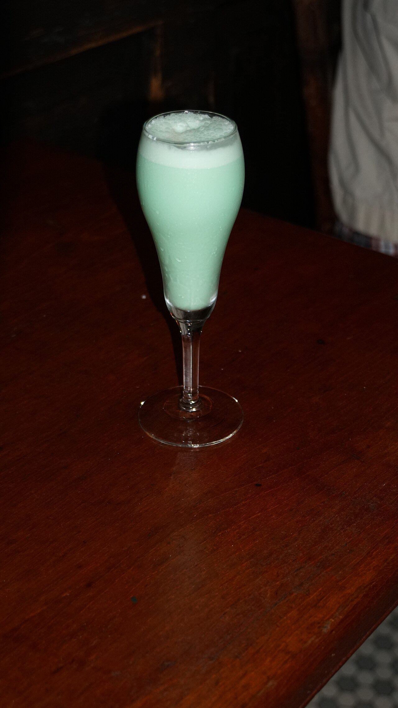

# Grasshopper

The Grasshopper is a dessert drink. Green crème de menthe, white crème de cacao and cream are shaken and strained into a coupe, pale green, tasting of melted mint chocolate. It is low in alcohol and high in sugar, suited to after dinner and to a first encounter with cocktails.

Figure: A Grasshopper of green crème de menthe, white crème de cacao and cream, pale green like dessert. Image: Miguel Discart, CC BY-SA 2.0, via Wikimedia Commons ([source page](https://commons.wikimedia.org/wiki/File:Grasshopper_Cocktail,_French_Quarter,_New_Orleans.jpg)).

It became popular in mid-twentieth-century America, especially in the bar culture of New Orleans and the French Quarter. The formula is simple, but balancing the green, the mint aroma and the cream texture requires control of temperature and shaking.

## Mint, cocoa and cream

Green crème de menthe supplies colour, mint aroma and sweetness. Its green comes from colouring and its mint from mint oil; too much and the drink tastes of toothpaste, too little and both colour and aroma are weak. A good crème de menthe tastes more natural.

White crème de cacao supplies chocolate aroma and round sweetness. It lacks the bitterness of dark cocoa, carrying only cocoa-butter aroma and sugar; with mint it makes the classic mint-chocolate pairing. It is sweet enough that no extra sugar is needed.

Cream supplies texture and roundness. Its fat wraps the mint's sharpness and makes the drink silky; without cream the drink becomes mint liqueur and loses the dessert texture. Cream usually runs at more than twice the liqueur volume to support the body.

The ratio is about one to one to two and a half. Mint and cocoa in equal parts, cream more; the drink turns pale green and tastes like liquid dessert. Less cream and it is strong and thin; more and it is rich and pale.

## The formula: equal liqueurs, double cream

The IBA standard is two centilitres of green crème de menthe, two of white crème de cacao and five of cream. Two centilitres is twenty millilitres and five is fifty; the total is about ninety millilitres, filling a coupe to about seven tenths.

Use half-and-half or single cream, not heavy cream. Heavy cream is too fatty and shakes into a thick sauce; single cream foams more easily and stays lighter. Without single cream, milk with a little heavy cream works.

Chill the mint and cocoa liqueurs. Cold liqueurs chill the drink faster and reduce dilution during shaking; warm ones melt the ice sooner and water the drink. Chill the cream too, or it will not shake evenly.

No syrup is needed. Mint and cocoa both contain sugar and cream contains lactose; more sugar makes the drink cloying. If it tastes too sweet, reduce the mint or add a few drops of lemon, though the classic formula adds none.

## Method: shake and chill the glass

Put the mint, cocoa and cream into a shaker with ice and shake hard for ten to twelve seconds. Shake long enough for the cream to emulsify with the spirits and the body to become even and fine; too short and the cream separates and the drink turns grainy.

Strain through a fine mesh into a chilled coupe. The strainer holds back ice shards and unemulsified cream and keeps the drink smooth; the wide bowl releases the mint aroma and the curve supports the foam.

Chill the glass beforehand. A cold glass keeps the drink cold and the foam stable; a warm glass lets the drink warm and the foam collapse. Without a chilled glass, stand it in ice water for a few minutes, then empty it.

Garnish with a mint leaf. It can sit on the foam or on the rim; it reinforces the mint aroma and adds a layer of colour. Skip the cherry or cocoa powder, which change the dessert language.

## The dessert drink of New Orleans

Several origins circulate, the best known being early-twentieth-century New Orleans, especially Tujague's in the French Quarter. A bartender is said to have combined mint, white cocoa and cream to make a drink like mint chocolate, which became the house signature.

Another account places it in America in the 1910s or 1920s without a firm location; a third links it to Prohibition-era dessert substitutes. Most such claims lack primary evidence, but all point to the same tradition: the dessert drink of the American South.

The drink was popular from the 1950s to the 1970s, especially in American after-dinner culture. Its colour, sweetness and dessert positioning earned it a place on family tables and restaurant menus. As low-sugar and lighter tastes grew, it became a retro cocktail.

The name has nothing to do with the insect; it may come from the green colour or from a "hopping" texture. There is no reliable primary record of the naming, and the story need not be over-explained.

## Variations and common mistakes

Common variations include the Flying Grasshopper, with vodka for more strength; the Girl Scout, with mint-chocolate cream for more sweetness; the Grasshopper Shake, with ice cream like a milkshake; and the After Eight, with dark crème de cacao for a darker colour.

Four mistakes recur. First, too little cream, leaving the drink strong and thin. Second, too little shaking, so the cream separates and the drink turns grainy. Third, a warm glass, so the foam collapses. Fourth, too much mint, so it tastes of toothpaste. Emulsification and ratio decide the drink.

For a home bartender, the practical advice is: use single cream, chill all three ingredients, shake for at least ten seconds, strain into a cold glass, and add the mint last. The target is a silky mint chocolate, not sweet minted milk.

## See also and references

- Shaking: see [shaking](ref:shaking).
- Coupe: see [coupe](ref:coupe).
- Sweet: see [sweet](ref:sweet).
- Aroma: see [aroma](ref:aroma).
- Espresso martini: see [espresso martini](ref:espresso).

**In brief:** A dessert cocktail of green crème de menthe, white crème de cacao and cream, shaken into a pale green drink that tastes of mint chocolate. The New Orleans origin is the best-known account.

Grasshopper is best read by starting with the base and the ratio, moving to the dilution and the ice, and ending with the garnish and the glass.

[Shaking](ref:shaking) and [Sweet](ref:sweet) answer different questions about Grasshopper: base liquor and technique and ratio. Read them as a pair, not as alternatives.

**Key facts.**

| Item | Detail |
| --- | --- |
| In one line | A dessert cocktail of green crème de menthe, white crème de cacao and cream, shaken into a pale green drink that tastes of mint chocolate. The New Orleans origin is the best-known account. |
| Style | IBA Contemporary Classics |
| Origin | New Orleans, United States |

**Sources and limits.** The key claims about Grasshopper are checked against the following sources: International Bartenders Association (Used to check the IBA category, ingredients and ratio), Oxford University Press (Used to check cocktail history and terminology), CocktailDB (Used to cross-check recipe structure and common variations) and 5 sources in total. Prices, batches and status change; the body is project-written and does not reproduce source text.

For Grasshopper, this cocktail was last checked in 2026; prices, batches and availability change, so confirm them against the sources below.
