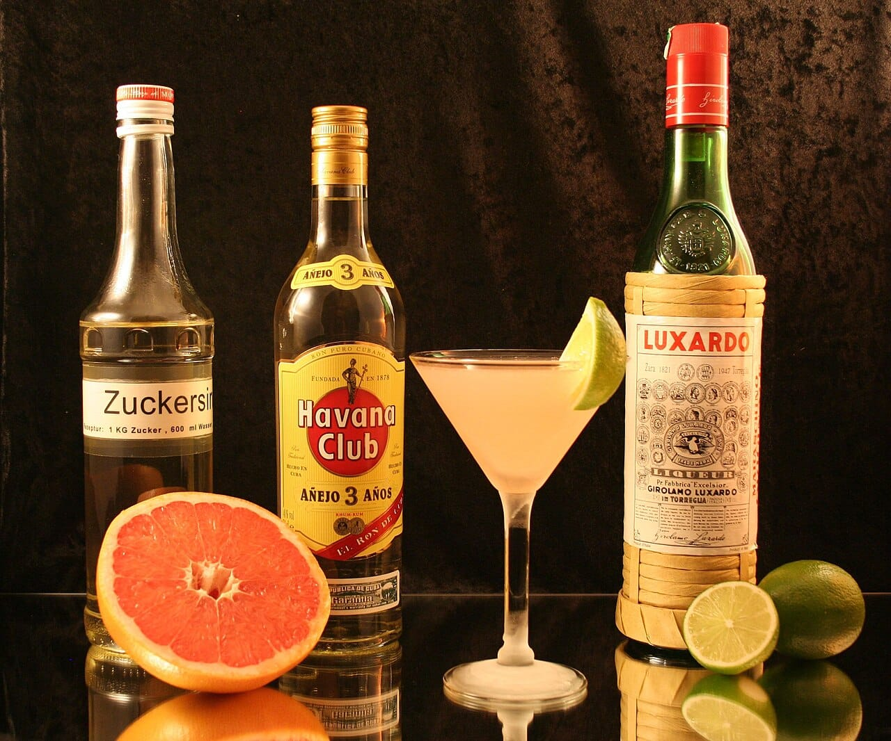

# Hemingway Daiquiri

The Hemingway Daiquiri is a short drink of [white rum](ref:rum), fresh grapefruit juice, lime juice and maraschino liqueur, made without sugar. It is usually strained into a chilled coupe and ranges in colour from pale pink to almost clear, depending on the grapefruit. A grapefruit twist or a lime wheel is optional. Compared with a standard Daiquiri it is drier, more bitter and stronger, with a much larger volume of citrus. It tastes like a sour from which the sugar has been removed, and the bitterness of grapefruit plus the cherry-pit aroma of maraschino are what keep the structure from collapsing.

Figure: Hemingway Daiquiri. Image: Achim Schleuning (E-Mail: comander02_de@yahoo.de ), CC BY-SA 3.0 de, via Wikimedia Commons ([source page](https://commons.wikimedia.org/wiki/File:Hemingway_Daiquiri.jpg)).

> **Quick verdict**
> **In one line:** This cocktail helps you decide whether to order Hemingway Daiquiri, and how ratio, ice and water change it.
>
> - **Best for:** Anyone who wants the logic, serving method and common mistakes behind Hemingway Daiquiri.
> - **Not for:** If you want only want a strong drink and do not care about ratio, ice or water.
> - **Check first:**
>   - The skeleton of a standard Daiquiri is rum, lime and syrup.
>   - Order a "Hemingway Daiquiri" or a "Hemingway Special" and confirm whether sugar is included.

## El Floridita in Havana

The drink is inseparable from [El Floridita](ref:floridita) in Havana. The bar's own history places Constantino Ribalaigua Vert at its centre: the Catalan immigrant began working there as a bartender in 1914, became the owner in 1918 and was known to guests as "Constante". He is credited with turning the Daiquiri into a house signature, and some accounts also credit him with the popularity of the frozen version.

El Floridita was part of Havana's bar culture in the first half of the twentieth century, with writers, journalists, actors and businessmen among its customers. Ernest Hemingway became a regular in the 1930s and lived near Havana from 1939 onward, which is why the bar and the writer are so often discussed together. The exact year and the exact conversation that produced the drink are not fully consistent across sources, so it is safer to say that the drink is commonly associated with Hemingway rather than to treat a single date as archival fact.

The IBA lists the drink as "Hemingway Special", while "Hemingway Daiquiri" and "Papa Doble" point to different versions of the same idea. That multiplicity of names is a clue that the drink travelled through bars, writers, tourists and later bartenders, each adding a layer of storytelling.

## The "Papa Doble" order

The most widely told story is that Hemingway found the bar's standard Daiquiri too sweet and asked for double rum and no sugar. The bar then adjusted the recipe with grapefruit juice and maraschino, producing a drier, stronger drink. Another account places the drink closer to an internal house recipe, such as the Floridita Daiquiri No. 3, with Hemingway's preference merely making it famous. Both stories put "no sugar" and "double" at the centre, but the authorship is not fully settled.

"Papa Doble" is usually explained as "a double for Papa". Papa was Hemingway's nickname in Cuba and the Spanish-speaking world; doble means double. The name describes a quantity rather than a fixed formula. Different bars interpret "double" as double rum, double total volume, or both. Order a Papa Doble and you may receive a large Hemingway Daiquiri, or simply a double measure of a standard Daiquiri.

There are many anecdotes about Hemingway's drinking, but this cocktail does not treat "how many glasses he drank" as fact. What is clear is that his name gave the drink a reach far beyond an ordinary Daiquiri. His personal habits belong to the overlap between biography and bar legend, and readers should treat them as cultural narrative rather than recipe parameters.

## Where sweetness goes when sugar leaves

[A standard Daiquiri](ref:daiquiri) is built from rum, lime and syrup. The sugar softens the lime's edge and opens up the rum's sweetness. The Hemingway version removes the syrup and lets maraschino liqueur supply the sweetness instead. The IBA formula is 60 ml white rum, 40 ml grapefruit juice, 15 ml maraschino liqueur and 15 ml lime juice. Maraschino is around 32% ABV and contains sugar, but its sweetness carries cherry-pit and almond aroma rather than the plain sweetness of white sugar.

This explains why "no sugar" does not mean "bone dry". The 15 ml of maraschino supplies enough sugar to keep 55 ml of citrus from becoming pure acid water, but the sweetness is aromatic and finishes dry rather than round. Remove the maraschino as well and the drink becomes rum plus two citrus juices, with the acid and bitterness fully exposed; it would need sugar from somewhere else to be balanced.

Removing syrup also changes texture. Syrup adds viscosity and volume, so without it the drink feels thinner and more direct, and the alcohol outline is clearer. Grapefruit pulp and fibre affect texture too, which is why most recipes call for straining the juice before shaking. Cleanliness of texture is more noticeable here than in a standard Daiquiri.

## Grapefruit bitterness as structure

Grapefruit juice is not simply "another acid". It is usually less acidic than lime but carries a distinct bitterness from compounds such as naringin, concentrated near the pith and peel. The 40 ml of grapefruit gives the drink volume, bitterness and a dry citrus aroma. It pushes the rum's sweetness into the background and makes the drink feel closer to an aperitif than to a tropical sweet drink.

Bitterness does the structural work that sugar would otherwise do. Sugar wraps around acid; bitterness stretches it out, so the acidity lingers. The grapefruit's bitterness and the maraschino's sweetness form a pull: sweet first, bitter after, with lime acidity running through the middle. If the grapefruit is too sweet and lacks bitterness, the drink feels soft; if it is too bitter, the cherry aroma is buried and the finish turns medicinal.

Both pink and white grapefruit can work, but they pull in different directions. Pink grapefruit is sweeter and gives a pinker colour, which makes the drink more approachable. White grapefruit is more bitter and drier, with a clearer structure. Juice should be squeezed close to service, because standing dulls the aroma and increases bitterness. Sweetened bottled grapefruit juice is not a substitute: its sugar-acid balance is already fixed and will turn the drink into something else.

## How it differs from a Daiquiri

The skeleton of a standard Daiquiri is rum, lime and syrup. The citrus is usually much smaller in volume than the rum, and the syrup carries the sweetness on its own. The Hemingway version brings rum and total citrus close to one to one: 60 ml rum against 55 ml juice. That ratio makes the body lighter and more acidic, and it also dilutes the alcohol more. It is not simply "a Daiquiri with grapefruit instead of sugar"; the centre of gravity moves from sweetness to bitterness and citrus.

The second difference is strength. A standard Daiquiri usually lands around 20% ABV after shaking. The Hemingway version, with its high juice proportion, sits at roughly 18% to 20% ABV. The numbers look similar, but the drink tastes drier and stronger because there is no sugar to cushion the alcohol. It is easy to underestimate: the colour looks like juice, the entry tastes like a sour, and the alcohol arrives later. That is also why "Papa Doble" can be misleading; a double is not double the safety.

Some modern recipes reduce the grapefruit to 15 ml and the maraschino to 10 ml for a tighter, more acidic drink. Others keep the 40 ml of grapefruit but increase the lime for lift. These differences show that the drink has no single correct ratio, only a describable balance: enough rum, fresh citrus, and just enough sweetness to support the bitterness.

## Shaking and dilution

The method is [shaking](ref:shaking). Combine the white rum, grapefruit juice, lime juice and maraschino in a shaker with ice, shake hard for 10 to 15 seconds until the tin is heavily frosted, then double-strain into a chilled coupe. Shaking is not only about chilling; it mixes the three liquids and the alcohol, introduces a little air and keeps the texture from feeling flat. It is the basic sequence that [cocktail basics](ref:basics) describes for a sour: combine, chill, then strain. Grapefruit pulp and fibre are broken up in the process, and double-straining gives a cleaner drink.

Dilution needs care. A juice-heavy drink is easy to wash out, and a shake that runs too long leaves the drink thin, with both the grapefruit bitterness and the rum aroma weakened. The aim is to reach a low temperature with roughly 20% dilution and then stop. Ice size and hardness affect the speed: crushed ice chills quickly but melts quickly, while large, hard cubes are better suited to this drink.

Do not serve it over ice. The Hemingway Daiquiri is a short drink, usually strained into a chilled coupe and drunk without ice. Ice in the glass keeps diluting the drink and makes the grapefruit bitterness more prominent. In a hot room, chill the glass more thoroughly or build the drink slightly stronger, but do not use a lot of ice to fight the temperature.

## Glass, temperature and garnish

[A coupe](ref:coupe) is the usual choice. The wide bowl gives the grapefruit and cherry aromas room to open, and the short stem keeps the drink from being tilted too far. A capacity of 150 to 200 ml works well, filled to about two-thirds. A large cocktail glass or a Nick & Nora can also be used, but the narrower the rim, the more concentrated the aroma and the more obvious the alcohol. The glass must be chilled; if the drink warms, the bitterness becomes sharp.

Garnish is optional. A small grapefruit peel or a lime wheel is common. Expressed grapefruit peel adds citrus oil and makes the first sip brighter; a lime wheel is more neutral. Do not sugar the rim and do not drop in a cocktail cherry. The maraschino already supplies the sweetness, and extra sugar would destroy the dry character.

Serve at 4 to 6°C. Too cold and the grapefruit aroma closes; too warm and the alcohol and bitterness turn harsh. It suits an aperitif or an afternoon drink, not a glass left on the table for an hour. If the drink is to be sipped slowly, serve it in two smaller pours rather than letting one large glass warm up.

## The flavour map and its failure points

The entry is grapefruit bitterness and lime acidity, followed by the cane sweetness and gentle heat of the rum. Maraschino fills the middle with cherry, almond and floral notes, and the finish returns to citrus peel bitterness. The layers are held together not by syrup but by the bitterness of the citrus and the cherry-pit aroma. The ideal is "dry but not parched": enough acid, enough bitterness for support, and enough dilution to make a second sip appealing.

The common failures are easy to list. Grapefruit juice that is too sweet makes the drink soft; juice that has stood too long tastes dull and bitter; too much maraschino lets almond dominate the citrus; too little lime leaves the rum without an acid frame; a short shake leaves the alcohol sharp; a long shake makes the drink watery and bitter. When adjusting, check the freshness of the juice first, then the sweetener, and only then consider changing the rum.

The rum itself changes the result. A light-bodied white rum lets the citrus lead and suits the dry style. A white rum with a little ester or cane sweetness adds complexity but can push the drink sweeter. Aged rum is not forbidden, but its vanilla and wood notes take the drink in a different direction; if used, it should be treated as a deliberate variation.

## Variations and recipe disagreements

Beyond the IBA formula of 60 to 40 to 15 to 15, there are drier modern versions that reduce grapefruit to 15 ml and maraschino to 10 ml, concentrating the acidity and shrinking the body. Some replace grapefruit with pink grapefruit or lime with lemon for a softer, less bitter profile. A frozen version blends the ingredients with ice, which suits hot weather but changes both dilution and texture.

Variation names should state what has been replaced. "Hemingway Special" usually refers to the IBA formula; "Papa Doble" emphasises the double measure and the absence of sugar; "Hemingway Daiquiri" is the broader name. If the grapefruit is replaced with blood orange, or the maraschino with another cherry liqueur, the name should say so; otherwise comparisons between recipes with the same name mean very little.

There is also a family of lower-alcohol versions that reduce the rum, increase the grapefruit or add soda for a highball. They can be pleasant, but they are no longer the same structure. Once the alcohol is lowered, the ratio of bitterness to acid has to be redesigned; simply adding water does not solve it.

## How to order and pair

Order a "Hemingway Daiquiri" or a "Hemingway Special" and confirm whether sugar is included. If the bar's version tastes sweet, ask for less maraschino; if the bitterness is unwelcome, ask which grapefruit is used, since pink is usually sweeter. If a stronger drink is wanted, ask for a double rum, but accept the larger volume and the extra alcohol. Do not ask for syrup and then call it a no-sugar version; that is a contradiction.

It works as an aperitif with ceviche, grilled fish, seafood, citrus salads and mild cheese. The grapefruit bitterness cuts through oil, the lime cleans the palate, and the rum's sweetness meets the savouriness of seafood. Heavy cream or very sweet desserts are a poor match; the bitterness is magnified and the body feels thin.

Sip slowly and avoid drinking quickly on an empty stomach; do not drink and drive, and avoid alcohol during pregnancy or while taking medication that interacts with it. The colour looks like fruit juice, which makes it easy to forget the alcohol. If a second glass follows, drink water alongside and decide whether a third is actually wanted.

## Common misconceptions

First, that "no sugar" means no sweetness at all. Maraschino contains sugar; the sweetness has simply changed source. Second, that bottled grapefruit juice is an acceptable substitute. Its sugar-acid balance and aroma are different, and the drink turns soft. Third, that "Papa Doble" is a fixed recipe. It is better understood as a description of size and preference. Fourth, that a pinker colour means a better drink. Colour depends on the grapefruit variety; flavour is the test. Fifth, that Hemingway's name guarantees quality. Bars and recipes with the same name can produce very different balances.

## See also

- [Rum](ref:rum): the cane sweetness and body of white rum.
- [Daiquiri](ref:daiquiri): the original drink and its proportions.
- [El Floridita](ref:floridita): the Havana bar and Constantino's background.
- [Shaking](ref:shaking): controlling dilution in a juice-heavy sour.
- [Coupe glass](ref:coupe): aroma and temperature in a short drink.
