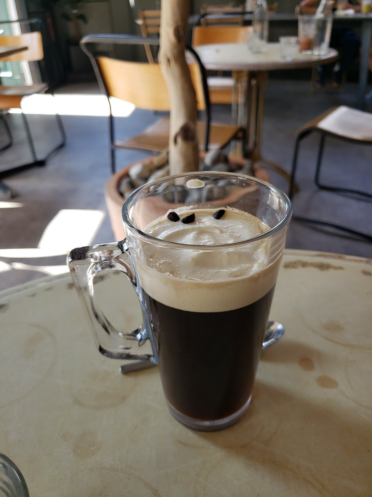

# Irish Coffee

Irish coffee is one of the few classic cocktails served hot: hot coffee, Irish whiskey and brown sugar, topped with lightly whipped cream. It carries the bitterness and aroma of coffee, the warmth and spice of whiskey, and a cream layer that wraps the two together. It is part dessert, part medicine, entirely a drink.

The technique is not in the formula but in the layer. The cream must float on the surface, neither sinking nor fully mixing in; the drinker passes through it so coffee and whiskey enter together. Temperature, sugar and the fat content of the cream all decide whether that hat stays in place.

Figure: Irish coffee with hot coffee, Irish whiskey, brown sugar and lightly whipped cream. Image: Andy Li, CC0, via Wikimedia Commons ([source page](https://commons.wikimedia.org/wiki/File:Irish_Coffee_-_T_@_Hove_2023-09-07.jpg)).

## A drink with temperature

Irish coffee belongs to cold weather, late nights and airports. Its alcohol is substantial but hidden by coffee bitterness and cream sweetness, which makes it easy to drink too quickly; a hot drink also delivers alcohol faster. It is a drink to sip, not a thirst-quencher.

Compared with an espresso martini, Irish coffee uses no shaking and no ice, building texture from heat and fat; compared with a hot toddy, it is sweeter, thicker and more dependent on coffee. It sits between cocktail and coffee, fully belonging to neither.

## The formula: coffee, whiskey and sugar

The IBA standard is 40 millilitres of Irish whiskey, 80 millilitres of hot coffee, 30 millilitres of cream and a teaspoon of brown sugar. The sugar must dissolve in the hot coffee before the whiskey goes in; the cream is whipped separately and floated last.

Irish whiskey is the traditional choice. Its soft grain and fruit notes do not overwhelm the coffee the way a peated Scotch would; Scotch can work, but peat clashes with roast. Rum or brandy would move the drink away from its identity.

The coffee should be hot, strong and unsweetened. A light roast has high acidity that can taste sharp against cream; a dark roast has the bitterness to support whiskey and sugar. Instant coffee is possible but lacks aroma and oils, leaving the drink thin. Sugar is not only sweetness: it raises the density and viscosity of the liquid and helps the cream float.

## Method: how the cream floats

Preheat the glass with hot water, then discard it so the glass does not steal heat from the coffee. Put the brown sugar in the glass, pour in hot coffee and stir until fully dissolved, then add the whiskey and stir gently. Fill to about seven-tenths, leaving room for cream.

The cream should be cold but not frozen. Whip it with a whisk or milk frother until thick but still pourable, not to stiff peaks. Pour slowly over the back of a spoon or down the side of the glass so it settles on the surface. Pour too fast and it sinks; over-whip and it becomes a solid lump.

Do not stir before drinking. Pass your lips through the cream so coffee and whiskey come from underneath; each sip carries cream, coffee and whiskey together. Use a tall goblet or an Irish coffee glass: thick walls hold heat, and a narrower rim concentrates aroma.

## The Foynes airport story

The most widely told origin is Foynes airport in Ireland in the 1940s. Bartender Joe Sheridan prepared hot coffee for passengers arriving on a cold night, added whiskey and brown sugar and capped it with cream. When a passenger asked what kind of coffee it was, he is said to have replied: Irish coffee.

Another account places a similar drink in Vienna or French cafés earlier. Whatever the origin, Irish coffee reached the United States through San Francisco bars in the 1950s and then became a fixture in airports and bars worldwide. Its spread is tied to air travel, cold climates and the idea of a drink that warms you from inside.

The name carries a strong national label but no geographical protection. Any bar can call a drink Irish Coffee if the formula and method roughly match. The name is a cultural symbol, not a legal certification.

## Variations and common mistakes

Common variations include Irish Coffee with Baileys, using Irish cream liqueur in place of some cream; French Coffee, with brandy instead of whiskey; Mexican Coffee, with tequila and cinnamon; and Cold Irish Coffee, with ice and cold brew for summer.

Four mistakes recur. First, an unheated glass, so the coffee cools quickly. Second, sugar that has not fully dissolved, leaving grains at the bottom. Third, cream whipped too stiff, becoming a solid block that cannot be sipped through. Fourth, cream poured too fast, so it sinks and the layer fails. Irish coffee is decided almost entirely by temperature and pouring speed.

For a home bartender, the practical rule is: preheat the glass, brew fresh coffee, stir the sugar until invisible, and whip the cream only until it flows. Pour over a spoon, slowly. The drink is about temperature, not an elaborate formula.

## See also and references

- Espresso martini: see [espresso martini](ref:espresso-martini).
- Whisky: see [whisky](ref:whisky).
- Goblet: see [goblet](ref:goblet).
- Layering: see [layering](ref:layering).
- Sweet: see [sweet](ref:sweet).

**Short definition:** A hot drink of coffee, Irish whiskey, brown sugar and lightly whipped cream, layered so the cream floats. It began at Foynes airport in Ireland in the 1940s; temperature, sugar and cream texture decide the result.

For Irish Coffee, begin with the base and the ratio. Then look at the dilution and the ice, and finally ask the garnish and the glass. The answers point to different choices, not to a single score.

A base-liquor brand is not a safe shorthand for Irish Coffee. Check which base liquor it uses, then which ratio and technique it needs; where they diverge, prefer the specific source.

The entry on Irish Coffee draws on International Bartenders Association, Oxford University Press, CocktailDB, Make Me a Cocktail.

Use a preheated glass, strong hot coffee, brown sugar and lightly whipped cream poured over the back of a spoon; the cream should float, not sink.

**Key facts.**

| Item | Detail |
| --- | --- |
| In one line | A hot drink of coffee, Irish whiskey, brown sugar and lightly whipped cream, layered so the cream floats. It began at Foynes airport in Ireland in the 1940s; temperature, sugar and cream texture decide the result. |
| Style | IBA Contemporary Classics |
| Origin | Foynes, Ireland |

**Sources and limits.** The key claims about Irish Coffee are checked against the following sources: International Bartenders Association (Used to check the IBA category, ingredients and ratio), Oxford University Press (Used to check cocktail history and terminology), CocktailDB (Used to cross-check recipe structure and common variations) and 5 sources in total. Prices, batches and status change; the body is project-written and does not reproduce source text.

For Irish Coffee, this page was last checked in 2026; prices, batches and availability change, so confirm them against the sources below.
