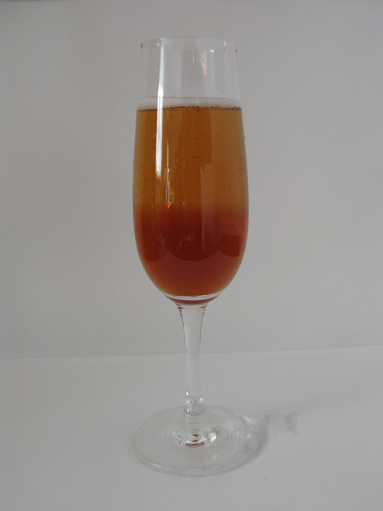

# Kir Royale

The Kir Royale is the simplest of Champagne cocktails: crème de cassis and Champagne. No shaking, no syrup, no garnish, only two liquids and bubbles. Its colour is a deep jewel red, the bubbles rise from the bottom of the glass, and sweet and sour meet in a strong contrast.

The name comes from Félix Kir, mayor of Dijon. The "Kir" he promoted was white wine with blackcurrant; the "Royale" replaces the wine with Champagne. To understand the drink you need both the Kir and the Royale, and the balance between cassis and bubbles.

Figure: A Kir Royale of crème de cassis and Champagne, deep red and sparkling. Image: Martin Asche, CC BY-SA 3.0, via Wikimedia Commons ([source page](https://commons.wikimedia.org/wiki/File:Kir_Royal.jpg)).

## Blackcurrant and Champagne

Crème de cassis is the soul of the drink. Made by macerating blackcurrants, sweetening and lowering the alcohol, it is deep red, almost black, tart and berry-fruity with a leafy note. High in sugar and density, it sinks into the Champagne and then slowly rises.

Champagne supplies bubbles, acidity and structure. Its acidity cuts the liqueur's sugar and its bubbles lift the cassis aroma; without bubbles the drink is dull, without acidity it becomes syrup. The Champagne need not be expensive, but it must be dry; a sweet Champagne makes the whole drink cloying.

The ratio is the key. Too much cassis and the drink becomes blackcurrant juice, burying the Champagne's acid and bubble; too little and it is pale and thin, a tinted Champagne. The IBA ratio is one centilitre to ten, about one to ten, which gives both colour and flavour.

Use a Champagne flute or a coupe. The flute keeps the bubbles and shows the colour; the coupe shows the aroma but loses carbonation faster. Either works, provided the glass is clean and grease-free, or the bubbles will not form.

## The formula: one centilitre to ten

The IBA standard is one centilitre of crème de cassis and ten centilitres of Champagne. One centilitre is ten millilitres and ten centilitres is one hundred, a ratio that colours the drink deep red without turning it to syrup.

For a larger glass, scale both: two centilitres of cassis to twenty of Champagne. Do not increase only the Champagne or the colour pales and the sweetness drops; do not increase only the cassis or the drink turns sweet and heavy.

Chill the Champagne to about six to eight degrees Celsius. Too warm and the bubbles escape at once; too cold and the aroma is muted. The cassis can be at room temperature or chilled; chilled, it integrates faster.

No syrup or lemon is needed. The cassis already brings sugar and acid, the Champagne brings acid and bubbles; more sugar or lemon would break the balance. The beauty of the drink comes from restraint.

## Method: liqueur first, Champagne after

Pour the crème de cassis into a flute or coupe. Then pour the Champagne slowly down the side so the two layer, deep red below and gold above. Do not stir; serve at once, and the liquids will mix as you drink.

Guide the Champagne with a bar spoon, or tilt the glass so the liquid runs down the wall. Poured fast, it mixes violently and loses bubbles; poured too slowly, the cassis clings to the glass and the colour is uneven.

For a more even colour, stir once after adding the Champagne, at the cost of some bubbles. For the layered look, do not stir; for a consistent taste, stir lightly. Both are valid, depending on the occasion.

The garnish can be omitted or a single blackcurrant or lemon twist added. The berry reinforces the theme, the lemon adds aroma; the traditional Kir Royale is usually ungarnished, letting colour and bubbles speak.

## The mayor of Dijon

The name comes from Félix Kir (1876–1968), mayor of Dijon, Catholic priest and member of the French Resistance. After the Second World War he promoted the "Kir": Burgundy white wine, usually Aligoté, with crème de cassis, a way to use up local surpluses of cassis and white wine.

The Kir Royale is the variant that replaces the white wine with Champagne. The "Royale" refers to Champagne, not to a royal title. The variant became popular in the later twentieth century and is now a classic French aperitif.

There is also a story that Dijon bars during the war used cassis to disguise poor white wine. Such claims lack primary evidence and read more like local legend. What can be confirmed is that Kir promoted the drink and that the name comes from him.

The name and formula are not trademarked; bars across France may serve a Kir or Kir Royale. But "Kir" is a place and a person, and the historical context should be respected rather than reduced to a story about an invented drink.

## Variations and common mistakes

Common variations include the Kir, with Burgundy white wine instead of Champagne; the Kir Pétillant, with sparkling white wine; the Kir Imperial, with raspberry liqueur instead of cassis; and the Kir Normand, with cider instead of wine.

Four mistakes recur. First, Champagne that is too sweet, making the drink cloying. Second, too much cassis, turning it to syrup. Third, Champagne too warm, so the bubbles vanish. Fourth, a glass with grease, so the bubbles cannot form.

For a home bartender, the practical advice is: buy a dry Champagne or dry sparkling wine, chill the cassis, chill the glass, pour the liqueur first and the Champagne down the side, and stir not at all or only once. The target is a deep-red freshness, not a sweet wine.

## See also and references

- Crème de cassis: see [crème de cassis](ref:cassis).
- Sparkling wine: see [sparkling wine](ref:sparkling).
- Bellini: see [Bellini](ref:bellini).
- Champagne flute: see [Champagne flute](ref:flute).
- Opening sparkling wine: see [opening sparkling wine](ref:opening).

**At a glance:** A French classic of crème de cassis and Champagne, descended from the Kir of Dijon. Deep red, finely bubbled and sharply balanced between sweet and sour, it is one of the simplest Champagne cocktails. 

For Kir Royale, begin with the base and the ratio. Then look at the dilution and the ice, and finally ask the garnish and the glass. The answers point to different choices, not to a single score.

[Crème de Cassis](ref:cassis) and [Bellini](ref:bellini) are the nearest useful comparisons: one clarifies base liquor, the other tests technique and ratio.

**Key facts.**

| Item | Detail |
| --- | --- |
| In one line | A French classic of crème de cassis and Champagne, descended from the Kir of Dijon. Deep red, finely bubbled and sharply balanced between sweet and sour, it is one of the simplest Champagne cocktails. |
| Style | IBA Contemporary Classics |
| Origin | Dijon, France |

**Sources and limits.** The key claims about Kir Royale are checked against the following sources: International Bartenders Association, Oxford University Press (Used to check cocktail history and terminology), CocktailDB (Used to cross-check recipe structure and common variations) and 5 sources in total. Prices, batches and status change; the body is project-written and does not reproduce source text.

For Kir Royale, this cocktail was last checked in 2026; prices, batches and availability change, so confirm them against the sources below.
