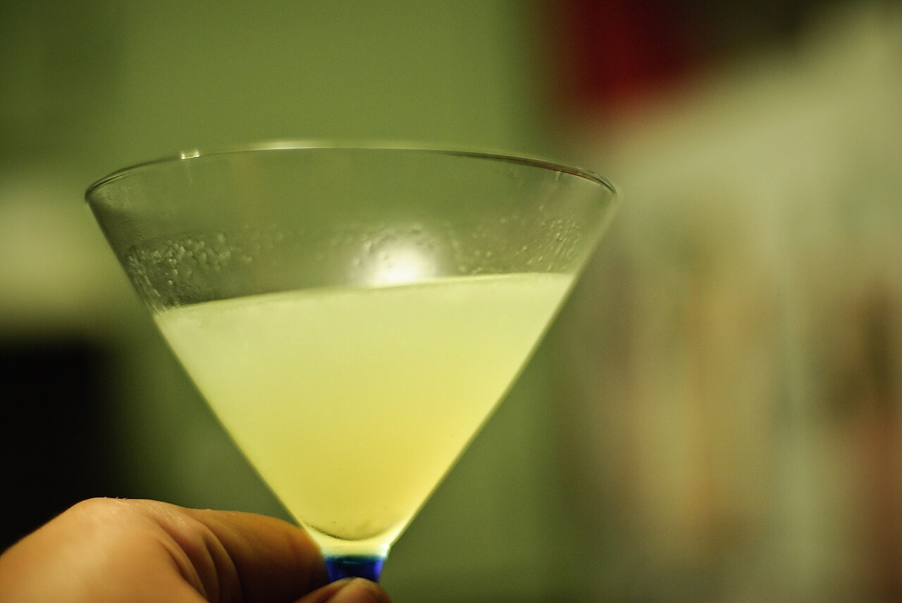

# The Last Word

The Last Word is a short drink built from equal parts gin, green Chartreuse, maraschino liqueur and fresh lime juice. It is usually shaken, double-strained and served without ice in a chilled coupe. The colour is a bright yellow-green; the garnish can be omitted or reduced to a strip of lime peel or a single maraschino cherry. Lime acidity arrives first, then the herbal force of green Chartreuse and the sweet cherry-pit aroma of maraschino, with juniper and a gentle bitterness returning at the end. Four equal parts look simple, but each ingredient is competing for the same space on the palate.

Figure: The Last Word. Photograph: The Last Word cocktail raised. Credit: Don LaVange, CC BY-SA 2.0, via Wikimedia Commons ([source](https://commons.wikimedia.org/w/index.php?curid=18593444)).

## A Detroit club and a vaudeville name

The drink is commonly traced to the Detroit Athletic Club in 1915 or 1916, shortly before Prohibition. The name most often attached to it is Frank Fogarty, a vaudeville performer billed as the "Dublin Minstrel". The usual story is that Fogarty ordered the drink regularly and carried it beyond the club; whether he actually created it is less clear, and accounts do not agree. The safer formulation is that the drink is associated with Fogarty, not that he is its documented sole author.

The origin of the name is also unsettled. One common explanation borrows the language of the variety stage: the "last word" is the closing line, and the drink is a final statement before the evening ends. That is a naming anecdote, not a recipe record. What is more concrete is that the recipe appears in Ted Saucier's *Bottoms Up!* in 1951, which places the drink well before the 2000s and well before the bartenders who would later revive it.

The Last Word is best read by starting with the base and the ratio, moving to the dilution and the ice, and ending with the garnish and the glass.

## Why equal parts can work

The International Bartenders Association gives 22.5 ml each of [gin](ref:gin), green Chartreuse, maraschino liqueur and lime juice, shaken and strained into a cocktail glass. Equal parts are easy to remember and easy to scale, but they do not mean equal intensity. Green Chartreuse is 55% ABV, maraschino is around 32%, gin usually sits between 40% and 47%, and lime juice contains almost no alcohol. The equality is volumetric, not sensory.

What holds the structure together is the collision of sugar and acid, the same logic that governs a [Daiquiri](ref:daiquiri), with an extra herbal layer. Both Chartreuse and maraschino carry sugar, while lime supplies the acid; gin supplies the frame and the juniper signature. [Shaking](ref:shaking) adds water equal to roughly 20% to 25% of the finished volume. That water brings the 55% liqueur down to a drinkable strength and rounds off the lime, which would otherwise taste sharp against so much herbal sweetness.

Equal parts also make the drink practical. A bar can scale it to 20 ml, 30 ml or 45 ml without remembering three separate numbers. Scaling up, however, changes the surface area and the ice ratio. A larger glass warms faster and loses aroma faster. If several drinks are being made at once, they should be shaken in batches small enough to keep the ice-to-liquid ratio under control; pouring everything into one large tin changes the dilution curve.

## Green Chartreuse and the weight of herbs

Green Chartreuse descends from a Carthusian monastic recipe and, according to the producer, is bottled at 55% ABV with about 130 plants in the infusion. Its aroma is dense: mint, eucalyptus, anise, liquorice, pine and spice are all common descriptors. The first impression is sweet, followed by a clear bitterness and a good deal of heat. It is not a liqueur to drink in large measures, but 22.5 ml is enough to give the Last Word its entire herbal spine.

The high strength does two things. First, it carries the botanicals far enough for the drink to smell herbal before it is tasted. Second, it raises the overall alcohol level, so the drink feels stronger than its pale colour suggests. Green Chartreuse is also sweet, but the sugar is held in check by bitterness and alcohol, which is why the recipe needs no added syrup. Cut the Chartreuse and add syrup instead, and the result is a softer drink with a different centre of gravity.

An opened bottle of green Chartreuse changes slowly. Its strength gives it more shelf life than many low-proof liqueurs, but light and heat still flatten the aroma. It should be stored sealed, away from sunlight and away from a warm back bar. In a drink this small, the liqueur is not masked by other ingredients, so freshness matters more than it would in a long, juice-heavy cocktail.

## Green versus yellow Chartreuse

Green and yellow Chartreuse belong to the same family but pull in different directions. Green is 55% ABV, less sweet and more aggressive in its herbal bitterness. Yellow is 43% ABV, sweeter and often described as softer, with saffron and honey notes. Substituting yellow directly into the Last Word produces a sweeter, rounder drink with a paler colour; the herbal impact is reduced by roughly half.

If yellow Chartreuse is the only bottle available, it is better treated as a deliberate variation than as an equivalent substitute. The usual correction is to reduce the maraschino and increase the lime slightly, so that acidity pulls the sweetness back into line. Even then, the herbal direction is different. The honest solution is to call it a yellow-Chartreuse version on the menu, so that the drinker knows the balance has been redrawn.

Other herbal liqueurs are not drop-in replacements either. Génépy-type alpine liqueurs lean toward pine and flowers with less bitterness; Strega is sweeter and more vanilla-like; some bitter liqueurs are far too bitter. The Last Word depends on the specific combination of high alcohol and high botanical density that green Chartreuse provides. Remove it, and the equal-parts ratio has to be rebuilt rather than merely adjusted.

## Maraschino is not cherry syrup

[Maraschino liqueur](ref:liqueur) is often mistaken for the syrup from a jar of cocktail cherries. It is actually a clear liqueur made from Marasca cherries, including the pits, and bottled at around 32% ABV. Its aroma is not fresh cherry flesh but cherry, almond kernel, rose and a faint fermented note. It is sweet, but it finishes drier than the syrup. The cherry note in the Last Word comes from this liqueur, not from the red fruit at the bottom of the glass.

Its job in the drink has three layers. It supplies sweetness to balance the lime; it adds aroma that shifts the Chartreuse from "medicinal" toward flowers and stone fruit; and it gives body, so that four equal parts do not taste thin. Too much, and the almond-pit note turns soapy or cough-syrup-like and buries the juniper. Too little, and the lime turns sharp while the Chartreuse bitterness sits exposed.

The garnish is a separate matter. A true maraschino cherry, preserved in its own liqueur, tastes very different from a bright red cocktail cherry made from sugar, colour and flavouring. The latter may look right but adds little aroma. The Last Word does not need a garnish at all, so it is better to leave the glass bare than to drop in a sweet cherry that has nothing to do with the drink.

## Shaking, dilution and the coupe

The drink is shaken rather than stirred because lime juice and two sweet liqueurs need to be brought together. Combine the ingredients with ice, shake hard for 10 to 12 seconds until the tin frosts, then double-strain into a chilled coupe to catch shards of ice and fruit solids. A short shake leaves acid and sugar separate, so the first sip tastes sour and the second sweet. A long shake melts too much ice, thinning the body and dispersing the herbal aroma. This is the balance that [cocktail basics](ref:basics) keeps returning to: chilling and dilution have to arrive together.

The [coupe](ref:coupe)'s wide bowl helps the aroma open, but a wide rim also lets the drink warm quickly. A useful capacity is around 120 to 150 ml, filled to about two-thirds, leaving room to nose the drink. The glass must be chilled. Poured into a room-temperature glass, the liquid warms within seconds, the 55% Chartreuse turns sharp and the lime becomes more acidic.

Garnish is optional. The traditional presentation often leaves the yellow-green liquid as the visual signature; a small piece of lime peel, expressed over the surface, adds a citrus lift. Do not sugar the rim. The drink already contains enough sugar, and a sugared rim makes the first sip sweet while pushing the herbal bitterness to the back of the mouth.

## The flavour map and its failure points

The first impression is lime acidity, followed by the mint, anise and pine of green Chartreuse. Maraschino fills the middle with sweetness and cherry-pit aroma, while gin returns at the end with juniper and alcohol heat. In a good version, no single ingredient dominates, yet each remains identifiable. This is not an easy-drinking sweet-sour; the herbs and bitterness are present from the first sip.

The common failures are predictable. Too much lime and the cherry sweetness disappears, leaving the Chartreuse tasting like medicine. Too much maraschino and the almond note becomes heavy, with a sticky finish. Too much Chartreuse and the bitterness and heat arrive together, hiding the gin. A gin that is too floral or too low in strength cannot carry the frame. When adjusting, change one variable at a time and decide first whether the problem is acid, sugar, bitterness or alcohol.

Temperature matters more than it does in many cocktails. The ideal drinking temperature is around 4 to 6°C. Too cold and the aroma closes; too warm and the alcohol and bitterness become prominent. The drink is meant to be sipped, but it is not meant to sit while the glass warms. In a hot room, use a smaller glass, chill it thoroughly and finish the drink while the structure is still intact.

## How Seattle made it a modern classic

The modern revival is usually credited to Murray Stenson at the Zig Zag Café in Seattle. The common account is that in the early 2000s, with sources naming either 2003 or 2004, he found the recipe in Ted Saucier's old book, put it on the menu and watched it become one of the bar's best-selling drinks. The exact year varies between accounts, but the broader claim that Stenson brought the drink back into view is consistent across cocktail-revival histories.

It became a model of the "modern classic revival" for several reasons. The equal-parts structure is easy to transmit. The colour is immediately recognisable. The story includes a pre-Prohibition club and a vaudeville performer. And the drink is complex enough for bartenders to discuss without being difficult to make. In the 2000s, bartender networks, competitions and online writing amplified those qualities, and an old recipe could enter menus around the world within a few years.

Revival is not invention. Calling the Last Word a 2000s creation erases its pre-Prohibition history; calling it an unbroken classic is equally inaccurate. It disappeared, survived in old books and was carried back to the bar by a bartender. That crooked path is itself part of modern classic culture.

## Variations and how to order

One of the best-known variations is the Final Ward, which replaces gin with rye whiskey and lime with lemon while keeping the Chartreuse and maraschino. Rye adds spice and lemon adds a brighter, wider acidity, so the drink becomes drier and more whiskey-led. It is usually attributed to the New York bartender Phil Ward, though the attribution belongs in the "commonly credited" category rather than the archive. A yellow-Chartreuse version moves in the opposite direction: softer, sweeter and less aggressively herbal.

When ordering, ask for a Last Word and confirm that the bar uses green Chartreuse rather than yellow. If it tastes too sweet, ask for less maraschino; if the herbs are overwhelming, ask whether the Chartreuse can be reduced, though that already departs from the equal-parts structure. If the almond-pit note is unwelcome, this may not be the right drink; cherry syrup is not a substitute and will produce something entirely different.

It works as a before- or after-dinner short drink with hard cheese, smoked duck, roasted nuts and dark chocolate. The herbs and bitterness cut through fat, while the cherry aroma meets the chocolate. Sip slowly and avoid drinking quickly on an empty stomach; do not drink and drive, and avoid alcohol during pregnancy or while taking medication that interacts with it. The alcohol content is not low, so a second glass deserves a moment of thought.

## Common misconceptions

First, that equal parts means equal flavour. The four ingredients differ widely in strength, sugar and aromatic intensity; equality is only volumetric. Second, that yellow Chartreuse can replace green without changing the drink. It is sweeter and lower in alcohol, and the balance moves. Third, that cherry syrup or cherry juice can stand in for maraschino liqueur. One is sugar water; the other is a liqueur. Fourth, that a greener colour means a more authentic drink. Colour varies with batch, light and glassware; aroma and balance are the real tests. Fifth, that this is a sweet liqueur drink to be finished in one gulp. It is a short drink, but 55% Chartreuse gives it real strength.

### Key dates and figures

- 1920: Prohibition took effect in the United States, breaking up the club-bar network and pushing the drink off mainstream menus.
- 1950: by the late 1950s it was rarely mentioned; its first revival came from bartenders rediscovering it in old recipe books.

## See also

- [Gin](ref:gin): the juniper frame and its tension with the herbs.
- [Liqueur](ref:liqueur): the roles of green Chartreuse and maraschino.
- [Shaking](ref:shaking): integrating acid, sugar and high-strength liqueurs.
- [Coupe glass](ref:coupe): aroma, temperature and the short-drink presentation.
- [Daiquiri](ref:daiquiri): another three-part structure of spirit, acid and sugar.
