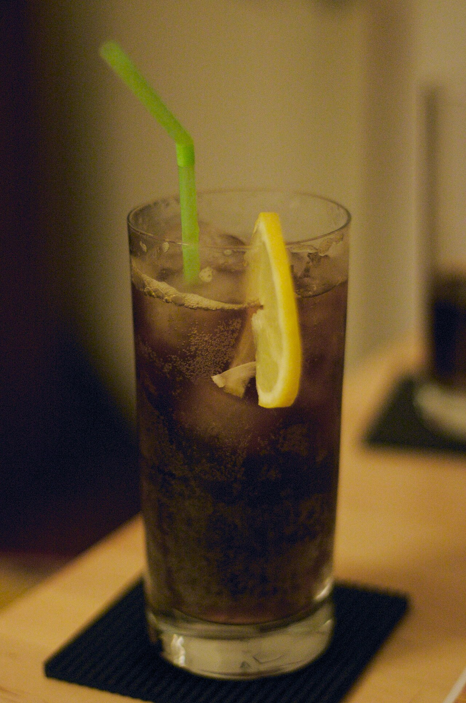

# Long Island Iced Tea

The Long Island Iced Tea is the most famous disguise in cocktails. It looks like a glass of iced black tea, coloured by cola and lemon, and tastes of citrus and caramel; in fact its alcohol content approaches neat spirits. Five spirits at 15 millilitres each, plus liqueur and cola, make a drink far stronger than its appearance.

It appeared in Long Island bars in the 1970s and became a symbol of party culture. Several versions exist and the origin is disputed; what is certain is the structure: many spirits, citrus, sugar and cola.

Figure: A Long Island Iced Tea of five spirits and cola, looking much like iced black tea. Image: Alisdair McDiarmid, CC BY 2.0, via Wikimedia Commons ([source page](https://commons.wikimedia.org/wiki/File:Long_Island_Iced_Tea_with_Lemon_and_Straw.jpg)).

## Balancing five spirits

Vodka, gin, white rum, tequila and orange liqueur each bring a character. Vodka is neutral and supplies the alcohol; gin brings juniper and herb for aroma; white rum brings cane sweetness for roundness; tequila brings vegetal and pepper notes for structure; orange liqueur brings citrus and sugar to connect them.

Mixed in equal parts and drunk alone, the five would seem muddled; with lemon, syrup and cola they are diluted into one body. Cola's caramel and phosphoric acid, the lemon's acid and the syrup's sugar smooth the edges and leave the illusion of iced tea.

The key is equality. Give any one spirit more weight and the balance breaks: more gin and the drink turns herbal; more tequila and it turns sharp; more orange liqueur and it turns sweet. Equal parts are the drink's democracy and its danger.

## The formula: 15 millilitres of each

The IBA standard is 15 millilitres each of vodka, gin, white rum, tequila and orange liqueur, 30 millilitres of lemon juice, 15 millilitres of sugar syrup and cola to top. The alcohol is around 40 percent before dilution, and even with cola and ice the drink remains strong.

The lemon juice should be fresh. Bottled juice is too sharp and clashes with cola's caramel; fresh juice is rounder in acid and richer in aroma. The syrup can be homemade or bought; its job is to balance the lemon, not to add sweetness.

The cola should be cold and added late. Its bubbles and colour are the disguise; poured early, it goes flat and the colour deepens. Add it down the side of the glass at the last moment to keep the carbonation and the layers.

Use a highball of at least 300 millilitres. The five spirits and juice already approach 150 millilitres; with ice and cola, a smaller glass overflows and a larger one looks empty. A clear glass lets the tea colour show.

## Method: shake, then add cola

Put the five spirits, lemon juice and syrup into a shaker with ice and shake for ten to twelve seconds to chill and combine. Strain into a highball packed with ice, pour the cola down the side and stir once. Never shake cola or the bubbles disappear.

Shaking is for chilling and integration, not dilution. Use enough ice in the shaker and strain at once so the drink does not keep diluting. Strain through a fine mesh to hold back the shards and keep the body clear.

The amount of cola sets colour and strength. Usually 30 to 50 millilitres gives a strong-tea colour; less leaves it pale and fierce, more makes it dark and weak. Start with 30 millilitres, taste, then decide.

Garnish with a lemon wedge or slice. The wedge can be squeezed for extra acid; the slice looks better. Skip the cherry, which breaks the iced-tea illusion. A straw is optional, but it encourages faster drinking and is therefore riskier.

## Long Island and the Prohibition story

Several origin stories circulate. The most common is that in 1972 Robert "Rosebud" Butt, working at the Oak Beach Inn on Long Island, combined several spirits with cola and lemon for a cocktail competition to make a drink that looked like iced tea.

Another version traces it to the Prohibition era, when bartenders supposedly used multiple spirits and cola to hide alcohol from inspectors. That claim lacks primary evidence and reads more like later storytelling. Prohibition-era "tea" drinks existed, but a direct link cannot be confirmed.

A third account says the drink appeared under other names before the 1970s and that the Long Island version merely made it famous. Whatever the origin, the structure of many spirits, citrus, sugar and cola is a product of 1970s American bar culture.

The "Long Island" in the name is Long Island, New York, not a tea-growing region. The drink is tied to the bar culture of Long Island, not to tea gardens.

## Variations and common mistakes

Common variations include the Long Beach Iced Tea, with cranberry juice instead of cola for a red colour; the Texas Tea, with whisky for more strength; the Tokyo Tea, with melon liqueur for a green colour; and the Adios Motherfucker, blue and even stronger.

Four mistakes recur. First, cola added early, which loses the bubbles and darkens the colour. Second, shaking too long, which melts the ice and dilutes the drink. Third, too little lemon, which leaves it sweet and hot. Fourth, too small a glass, which upsets the ratio of ice and cola.

For a home bartender, the practical advice is: shake the five spirits with lemon and syrup first and taste the strength; add the cola last, tasting as you go; chill the glass and the ice; and drink slowly, because the iced-tea appearance is deceptive.

## See also and references

- Vodka: see [vodka](ref:vodka).
- Gin: see [gin](ref:gin).
- Rum: see [rum](ref:rum).
- Tequila: see [tequila](ref:tequila).
- Highball: see [highball](ref:highball).

To read Long Island Iced Tea, start with the base and the ratio, then the dilution and the ice, then the garnish and the glass; no single check settles it.

**Short definition:** A highball of five spirits, lemon juice, syrup and cola that looks like iced tea and is far stronger than it appears. The origin story in 1970s Long Island is disputed.

The drink mixes vodka, gin, rum, tequila and triple sec with lemon and cola; its high strength is the point.

**Key facts.**

| Item | Detail |
| --- | --- |
| In one line | A highball of five spirits, lemon juice, syrup and cola that looks like iced tea and is far stronger than it appears. The origin story in 1970s Long Island is disputed. |
| Style | IBA Contemporary Classics |
| Origin | Long Island, United States |

**Sources and limits.** The key claims about Long Island Iced Tea are checked against the following sources: International Bartenders Association (Used to check the IBA category, ingredients and ratio), Oxford University Press (Used to check cocktail history and terminology), CocktailDB (Used to cross-check recipe structure and common variations) and 5 sources in total. Prices, batches and status change; the body is project-written and does not reproduce source text.

For Long Island Iced Tea, this cocktail was last checked in 2026; prices, batches and availability change, so confirm them against the sources below.
