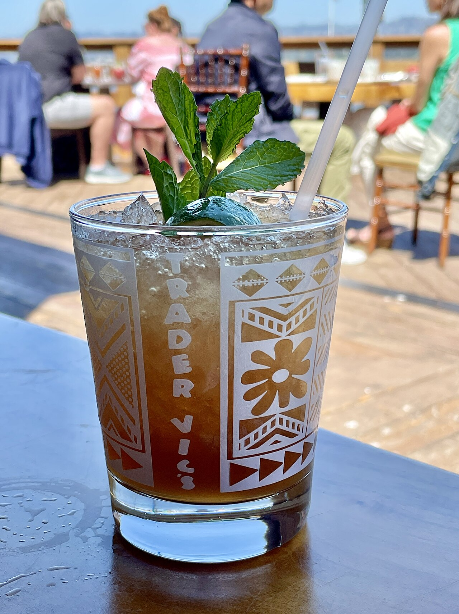

# Mai Tai

A Mai Tai is rum, orange liqueur, orgeat and lime, created in Oakland in 1944 by Trader Vic — Victor Bergeron. The original used a 17-year J. Wray Nephew Jamaican rum with lime, Dutch orange liqueur, rock candy syrup and French orgeat, hand-shaken over crushed ice and finished with mint and a spent lime shell. It has only four or five ingredients and is one of the easiest tiki drinks to ruin.

Figure: Mai Tai. Image: Kevdo, CC BY-SA 4.0, via Wikimedia Commons ([source page](https://commons.wikimedia.org/wiki/File:Mai_Tai_at_Trader_Vic%27s_Emeryville.jpg)).

## What a Mai Tai Is

A Mai Tai is not a juice punch. Its frame is rum, lime, almond and orange; the sweetness comes from syrup and liqueur, not pineapple juice. The IBA lists it as a Contemporary Classic, which means it is no longer one bar's private drink but a public standard. Compared with a [Daiquiri](ref:daiquiri), it adds orange liqueur and orgeat to the rum, lime and sugar triangle, and brings crushed ice into the glass.

## The Structured Recipe: IBA and Trader Vic's

The IBA public recipe:

- Amber Jamaican rum 30 ml
- Martinique molasses rum 30 ml
- Orange liqueur 15 ml
- Orgeat 15 ml
- Fresh lime juice 30 ml
- Syrup 7.5 ml
- Glass: double rocks or highball
- Ice: shake with ice and pour unstrained; more crushed ice may go in the glass
- Method: shake all ingredients with ice, do not strain
- Garnish: pineapple spear, mint leaves, lime peel

Trader Vic's current published version is silver rum 30 ml, dark rum 30 ml, orgeat 15 ml, orange liqueur 22.5 ml, rock candy syrup 7.5 ml and lime juice 30 ml, shaken with crushed ice and poured into a Mai Tai glass, garnished with a half lime shell and mint. The two differ mainly in the orange liqueur and the rum pairing; the structure is identical. For the basics of shaking and dilution, see [cocktail basics](ref:cocktails-guide).

## Seventeen-Year Rum and Oakland, 1944

In Trader Vic's own account, given in a 1970 interview: in 1944, at the service bar of his Oakland restaurant, he took down a bottle of 17-year J. Wray Nephew Jamaican rum. It was medium-bodied but held the rich aroma of Caribbean rum and, in his words, was never meant to be overpowered. He added only lime, Dutch orange liqueur, a little rock candy syrup and a dollop of French orgeat, shook it by hand with shaved ice, finished it with a sprig of mint and served it to two friends from Tahiti, Ham and Carrie Guild. Carrie took one sip and said, "Mai Tai—Roe Ae," meaning "out of this world — the best." The line became the name. Trader Vic's opened as Hinky Dinks in 1934, was renamed Trader Vic's in 1938, and in 1944 the Mai Tai was born there.

## "Maita'i": Naming a Drink in Tahitian

"Maita'i" means good, or the best, in Tahitian. Trader Vic's account renders it as "out of this world — the best." The drinks historian Jeff "Beachbum" Berry has also noted that the common pronunciation is not quite right; in Tahitian the word simply means "the best." The naming story comes from Trader Vic's own recollection; Carrie Guild's line has no independent recording. It is safer to treat it as a sourced founding narrative than as courtroom testimony.

## The Rival Claim: Don the Beachcomber and the QB Cooler

The other claim comes from Don the Beachcomber — Donn Beach. His widow, Phoebe Beach, argued in a 2001 book that Donn invented the Mai Tai in 1933, when he opened his bar as Prohibition ended, and that Trader Vic took it. Berry checked the Don the Beachcomber menus: the 1937 menu has no Mai Tai, and the name does not appear on Donn's menus until 1960 or later. Donn himself told people a different story: Vic drank a "QB Cooler" in 1937, liked it, and later made the Mai Tai. Berry's conclusion is that the two drinks share only rum and lime, with everything else different; the drink Vic made is the one that became the Mai Tai. The dispute has no documentary settlement, but "1944, Oakland, Trader Vic" remains the best-evidenced line.

## From Crushed Ice to the Mai Tai Glass

Trader Vic's uses a dedicated Mai Tai glass, short with a slightly narrowed rim, holding crushed ice and a half lime shell; the IBA allows a double rocks or highball. Crushed ice is not only about cold: it keeps diluting the drink between sips, so the texture changes layer by layer and the drink is made to last. The core garnish is a spent half lime shell plus a mint sprig. The shell sits upside down on the ice like a small island; the mint is slapped before it goes in, or the aroma never arrives. The IBA adds a pineapple spear and lime peel for a busier look, without changing the recipe. For ice types and temperature, see [ice and temperature](ref:ice).

## After 1950: The Juice-Lengthened "Improved" Mai Tai

In 1953 Trader Vic's partnered with Matson Steamship Lines to serve the Mai Tai at the Royal Hawaiian, Moana and Surfrider hotels in Hawaii; in 1959 Hawaii became the 50th US state, and the drink moved from tiki bars into mainstream restaurants. To reach a wider palate and to cut cost and strength, restaurant versions after 1950 often added orange juice and pineapple juice, producing a paler, larger "Hawaiian Mai Tai." Those versions share only the rum, lime and almond frame with the 1944 drink; sweetness and volume roughly double. They are not "wrong," but they should be called a juice-lengthened version, not the original recipe.

## Balancing Orgeat and Orange Liqueur

Orgeat brings almond aroma and roundness and is itself very sweet; orange liqueur brings citrus perfume and another layer of sugar. Together they need enough lime to hold them up. The IBA uses 15 ml orgeat, 15 ml orange liqueur and 30 ml lime; Trader Vic's uses 15 ml orgeat, 22.5 ml orange liqueur, 30 ml lime and 7.5 ml rock candy syrup. If only amaretto is on hand, do not substitute it one for one: amaretto is lower in alcohol and sweeter, so the common fix is to use less and add a little lime. Orange liqueurs range from Cointreau to dry curaçao with very different sweetness; start at 15 ml the first time.

## Shaking, Crushed Ice and Dilution

Shake a Mai Tai; do not stir it. Eight to ten seconds with ice, until the ice sound dulls and the tin frosts, is enough. Shake longer and the crushed ice turns to water and the body goes thin. The IBA method pours the drink unstrained; if you shook with large cubes, strain it over crushed ice in the glass instead. Chill the glass, add the mint last and smell the rim before the first sip.

## Where a Mai Tai Goes Wrong

First, too much orgeat. 15 ml is the ceiling; more tastes like almond syrup.

Second, bottled lime juice. The aroma is flat and the acid is rigid.

Third, all dark rum. Dark colour is not complexity, and it can bury the lime.

Fourth, shaking too long or using too much crushed ice. Five minutes later there is only water.

Fifth, skipping the lime shell and mint. They are aroma, not decoration.

Sixth, treating the juice-lengthened version as the original. That is a different drink.

## Variations and a No-Alcohol Version

The most common variation is the rum blend: all Jamaican, all Martinique, or a small measure of high-ester rum. Less orgeat gives a drier drink; grapefruit juice and falernum move toward the Donn-style tiki profile. A no-alcohol version can use 0% rum and keep 30 ml lime, 15 ml orgeat, 15 ml alcohol-free orange liqueur and 7.5 ml syrup, shaken and poured over crushed ice with the same garnish.

## Sipping a Strong Tiki Drink

A Mai Tai is strong and not small, which makes it a pre-dinner or summer-night drink, good with grilled meat, nuts and savoury snacks. The crushed ice keeps diluting it, so finish it within about 20 minutes; sip slowly, drink water and do not start on an empty stomach. Do not drink if driving, taking medication or pregnant. Final strength depends on the rum's [alcohol by volume](ref:abv), the sweetness of the liqueurs and the melt from the crushed ice, not on the recipe numbers alone.

The dates, people and recipe here come from Trader Vic's official account, the IBA recipe and an Imbibe interview; the dispute keeps both sides on the record.

## Further Reading

- [Rum](ref:rum): the base spirit and its styles.
- [Liqueur](ref:liqueur): the sweetness and aroma of orange liqueur.
- [Daiquiri](ref:daiquiri): the same rum, lime and sugar frame.
- [Cocktail basics](ref:cocktails-guide): shaking, dilution and structure.
- [Ice and temperature](ref:ice): crushed ice and the finished drink.
- [Alcohol by volume](ref:abv): strength and crushed-ice dilution.
