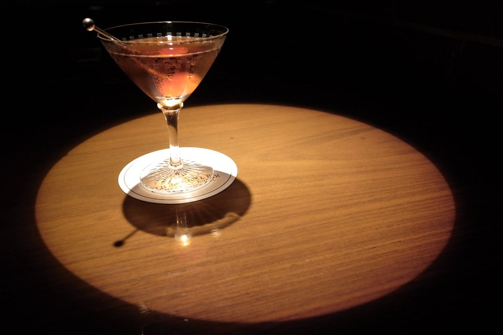

# Manhattan

Manhattan is a classic cocktail of [rye whiskey](ref:whisky), sweet [vermouth](ref:vermouth) and bitters. It is stirred, strained into a glass and garnished with a cherry; the structure is simple: whiskey provides the backbone, vermouth adds sweetness and spice, and bitters lift the layers.

Figure: A Manhattan in a coupe, with deep amber liquid and a cherry on a pick laid across the rim. Image: naotakem, CC BY 2.0, via [source page](https://www.flickr.com/photo.gne?id=6992048786).

## Definition and identity

There are several accounts of where the name "Manhattan" came from, commonly linked to the New York borough or a particular bar, but without a single agreed conclusion. This cocktail treats it as historical background and does not present one account as settled.

## Recipe (IBA version)

The public IBA recipe uses rye whiskey, sweet vermouth and a small amount of bitters, with whiskey exceeding vermouth in roughly two-to-one style. The method: combine the ingredients with ice in a mixing glass, stir until well chilled and diluted, strain into a chilled glass, and garnish with a cherry.

Quantities are a starting point, not a law. The ratio of whiskey to vermouth clearly changes the style: more whiskey gives a drier, stronger drink, more vermouth a sweeter, softer one. A few dashes of bitters are enough; too much overpowers the whiskey and vermouth aromas.

## Choosing the whiskey

[Whiskey](ref:whisky) is the body of the drink. Rye brings spice, dryness and pepper, bourbon is sweeter and rounder, and Scotch may bring peat or malt. The classic recipe leans towards rye, but the choice depends on the direction you want.

Higher-strength whiskey needs more stirring and dilution, lower-strength whiskey less. If you switch to a strongly flavoured whiskey, the sugar and vermouth proportions should be adjusted too, or the drink will lose balance.

## The role of vermouth

[Vermouth](ref:vermouth) is a fortified, aromatised wine; sweet vermouth provides sugar, herbal notes and spice, and is the main source of sweetness in a Manhattan. Combined with whiskey, it forms the backbone: the strength of the spirit is wrapped in sweetness, and the aroma opens towards herbs and spice.

Different brands of vermouth differ clearly in sweetness, bitterness and aroma. Sweet vermouth is sweeter with more herbal notes, while dry vermouth is drier and more bitter. The classic Manhattan uses sweet vermouth; substituting dry vermouth produces a drier variant that should be recorded as such.

## Stirring and dilution

A Manhattan is usually stirred with ice in a mixing glass and then strained, rather than built on ice in the serving glass. Under-stirring leaves the drink insufficiently chilled and diluted, so the aroma does not open; over-stirring dilutes too much and thins the body.

Ice quality directly affects the result. Large ice melts slowly and keeps dilution controllable; crushed ice chills quickly but can over-dilute. The goal is to chill while retaining enough body, not to hit a fixed time. For more on ice types and temperature, see [ice and temperature](ref:ice).

## Glass and garnish

Traditionally the drink is served in a chilled cocktail glass or a small stemmed glass with a narrow bowl, concentrating the aroma. The glass should be chilled in advance so the liquid does not warm up quickly after pouring.

A cherry is the usual garnish, providing sweet aroma and visual identity. A twist of orange peel can add citrus aroma but is not required. Garnish just before serving; left too long in advance, it loses aroma.

## Variations

Using bourbon instead of rye gives a sweeter version; using dry vermouth instead of sweet gives a drier one; using another spirit instead of whiskey creates different branches. Different bitters also change the aromatic direction.

Variations are not wrong versions but branches with a clear substitution logic. When recording a variation, state what was substituted and how the proportions changed. For general cocktail structure, see [cocktail basics](ref:cocktails-guide); compared with the whiskey-sugar-bitters [Old Fashioned](ref:old-fashioned), the Manhattan uses vermouth instead of sugar.

## Common misconceptions

First, assuming a Manhattan must be very sweet. Sweetness depends on the amount and brand of vermouth.

Second, assuming more bitters is better. Bitters are aroma, not the main taste.

For Manhattan, a common mistake is ignoring stirring and dilution. Without enough dilution the aroma does not open and the alcohol burn stands out.

Fourth, substituting dry vermouth for sweet without adjusting proportions. The style changes clearly.

For Manhattan, a common mistake is treating a variation as the same recipe. After replacing a main ingredient, use the variant name and state the difference.

## Drinking and boundaries

A Manhattan suits slow pre-dinner drinking with nuts, cheese or simple savoury snacks. It is relatively strong, so sip slowly and drink water; do not drink quickly on an empty stomach. Do not drink if driving, taking medication or pregnant.

This cocktail records one sourced version and does not rate specific brands or present one whiskey or ratio as the only correct answer. The final strength depends on the whiskey's [alcohol by volume](ref:abv), the sweetness of the vermouth and ice dilution, not on the recipe numbers alone.

**Short definition:** A classic cocktail of rye whiskey, sweet vermouth and bitters, stirred and strained into a glass, garnished with a cherry. The structure is simple, with sweetness and spice unfolding in layers.

Manhattan is best read by starting with the base and the ratio, moving to the dilution and the ice, and ending with the garnish and the glass.

[Whisky](ref:whisky) and [Alcohol by volume (ABV)](ref:abv) are the nearest useful comparisons: one clarifies base liquor, the other tests technique and ratio.

The classic ratio is 2 oz rye to 1 oz sweet vermouth, with a dash of bitters and a cherry.

**Key facts.**

| Item | Detail |
| --- | --- |
| In one line | A classic cocktail of rye whiskey, sweet vermouth and bitters, stirred and strained into a glass, garnished with a cherry. The structure is simple, with sweetness and spice unfolding in layers. |
| Style | Classic cocktail |
| Origin | United States (late 19th century; exact origin disputed) |

**Sources and limits.** The key claims about Manhattan are checked against the following sources: International Bartenders Association (Used to check the official recipe, method and garnish; Used to confirm the drink is on the IBA official cocktail list), Oxford University Press (Used to check historical background and basic composition), David Wondrich / Perigee (Used to check background on 19th-century American cocktail development) and 5 sources in total. Prices, batches and status change; the body is project-written and does not reproduce source text.

For Manhattan, this cocktail was last checked in 2026; prices, batches and availability change, so confirm them against the sources below.

## Further reading

- [Whiskey](ref:whisky): the body and style source of the Manhattan.
- [Vermouth](ref:vermouth): the main source of sweetness and spice.
- [Cocktail basics](ref:cocktails-guide): general principles of structure, dilution and stirring.
- [Ice and temperature](ref:ice): how ice type and chilling affect the drink.
- [Alcohol by volume](ref:abv): understanding final strength and ice dilution.
- [Old Fashioned](ref:old-fashioned): another classic built on whiskey, sugar and bitters.
