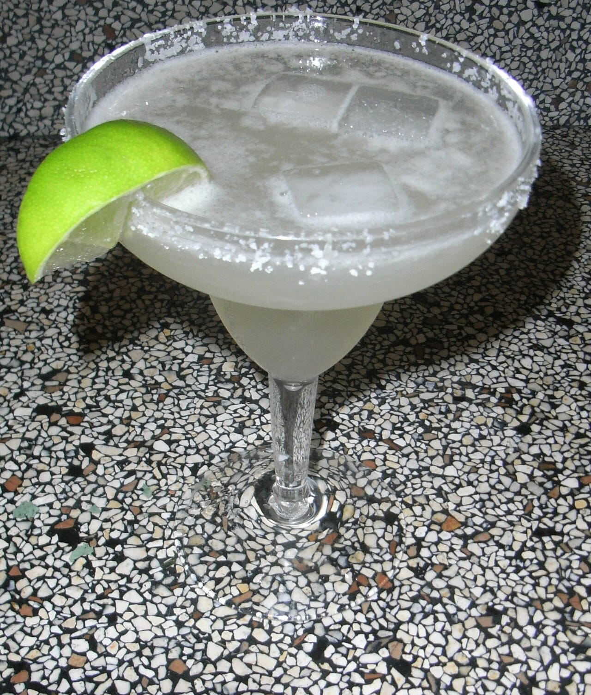

# Margarita

The Margarita is a classic cocktail of tequila, orange liqueur and fresh lime juice, shaken and served with an optional salt rim. The public IBA recipe uses 50 ml 100% agave tequila, 20 ml orange liqueur and 15 ml fresh lime juice, shaken and strained into a chilled glass.

Figure: Margarita. Image: Akke Monasso, CC BY-SA 3.0, via Wikimedia Commons ([source page](https://commons.wikimedia.org/wiki/File:MargaritaReal.jpg)).

## Definition and identity

The Margarita's origin has several accounts, involving different places, people and years. This cocktail does not present one narrative as settled; it treats the drink as part of 20th-century drinking culture around Mexico and the US border. Name and recipe are separate things, and the same name with a different method should be explained.

## Recipe (IBA version)

The public IBA recipe is 50 ml 100% agave tequila, 20 ml orange liqueur and 15 ml fresh lime juice. Add all ingredients to a shaker with ice, shake and strain into a chilled cocktail glass. A half salt rim is optional.

This version is roughly 10:4:3, with restrained sweetness and acidity. The ratio is not the only answer: some prefer more sour, some sweeter, and some use a different orange liqueur. Changing the ratio changes the version and should be stated, rather than keeping the name without explaining the difference.

## Tequila

[Tequila](ref:tequila) is the body, providing botanical aroma, heat and the alcohol frame. The IBA recipe specifically says "100% agave", emphasising the raw material; mixto tequila has different rules and flavour and is not simply the same ingredient.

Tequila styles vary noticeably: some lean green and peppery, some ripe and sweet, and aged versions may bring wood and vanilla. Choose by whether it can balance the lime's acidity and the orange liqueur's sweetness, not by strength alone.

## Orange liqueur

Orange liqueur provides sweetness, citrus aroma and body. It connects the tequila's heat with the lime's acidity so the drink does not feel sharp. Orange liqueurs differ in sweetness, bitterness and alcohol, and swapping them changes the result clearly.

Orange liqueur is not an optional sweetener. Too little and the balance leans towards lime, making the drink sharp; too much and sweetness covers the tequila. With a sweeter liqueur, you can reduce syrup or add lime juice, but change one variable at a time.

## Lime juice and balance

Fresh lime juice provides acidity, freshness and lift. Bottled lime juice usually differs in aroma and acidity, so fresh juice is preferable when possible. Lime acidity varies with ripeness and variety; the millilitres in a recipe are a starting point, and the final adjustment should follow the palate.

The sweet-sour balance is the core of a Margarita. Too sour feels sharp, too sweet feels sticky; at balance, acidity clarifies the tequila's botanical notes and sweetness rounds the body. When adjusting, first check the lime and liqueur balance, then whether a little syrup is needed.

## Shaking and ice

A Margarita is usually shaken, not stirred. Shaking chills and dilutes quickly and aerates the liquid, making the texture lighter; fresh juice also mixes more effectively by shaking than by stirring. Shake too long and the drink dilutes too much; too briefly and it is under-chilled and under-integrated.

Ice quality directly affects the result. Large, dry ice gives more controlled dilution; crushed or wet ice dilutes faster. Strain into a chilled glass immediately after shaking so the drink does not keep sitting in icy water. For ice and temperature, see [Ice and temperature](ref:ice).

## The salt rim

The salt rim is optional, and the IBA recipe says "half salt rim". Salt boosts savouriness, suppresses bitterness and changes the perception of acidity on entry. Too much salt covers the tequila and lime detail; too little does almost nothing.

To make a salt rim, moisten the outer rim with lime juice and dip it in fine salt, avoiding salt inside the glass. A half rim lets the drinker choose a salted or unsalted entry. The salt rim is part of the flavour structure, not a decorative slogan.

## Glass and temperature

The IBA recipe uses a chilled cocktail glass. The shape should gather aroma and let you hold the drink without transferring heat. Broader, shorter Margarita glasses are also traditional, but the shape is not part of the definition; the key points are pre-chilling, suitable capacity and a rim that is not too wide.

If the glass is not cold, the drink warms quickly and both acidity and aroma change. Without a specialist glass, use a small glass with a slightly narrowed rim. For shape and temperature, see [Choosing a glass](ref:glass).

## Variations

Using a different orange liqueur changes sweetness and citrus direction; adding juice makes a longer drink; a frozen preparation changes dilution and texture; using another spirit instead of tequila creates a different variation. A salt rim, sugar rim or no rim also changes the entry.

Variations are not mistakes but branches with a clear substitution logic. When recording one, state what was replaced and how the ratio changed; otherwise the same name covers different methods and causes confusion. For general cocktail structure, see [Cocktail basics](ref:cocktails-guide).

## Common misconceptions

First, assuming a Margarita must be sweet. Too much sweetness covers the tequila and lime detail.

Second, using bottled lime juice instead of fresh. Aroma and acidity usually differ; fresh juice is preferable when possible.

Third, salting the whole rim. A full rim makes every sip too salty; a half rim is more controllable.

Fourth, shaking for an arbitrary time. Too long dilutes too much; too brief under-chills and under-integrates.

For Margarita, a common mistake is treating a variation as the original recipe. After replacing a main ingredient, use the variation name and state the difference.

## Boundary

The Margarita's strength depends on the tequila and liqueur ratios and cannot be read from the recipe numbers alone. It suits pre-dinner or casual drinking; sip slowly and drink water, and do not drink quickly on an empty stomach. Do not drink when driving, taking medication or pregnant.

This cocktail records one sourced version, evaluates no specific brand and does not present one ratio as the only correct answer. Strength is also affected by ice dilution; see [Alcohol by volume](ref:abv). Keep name, ratio and method separate so that preference is not mistaken for standard.

**Key facts.**

| Item | Detail |
| --- | --- |
| In one line | A classic cocktail of tequila, orange liqueur and fresh lime juice, shaken and served with an optional salt rim. Sweetness, sourness and salt are part of the structure. |
| Style | Classic cocktail |
| Origin | Mexico (20th century; exact origin disputed) |

## Further reading

- [Tequila](ref:tequila): the body and botanical aroma of the Margarita.
- [Cocktail basics](ref:cocktails-guide): shaking, dilution and sweet-sour balance.
- [Choosing a glass](ref:glass): shape, pre-chilling and aroma concentration.
- [Alcohol by volume](ref:abv): understanding strength and ice dilution.
