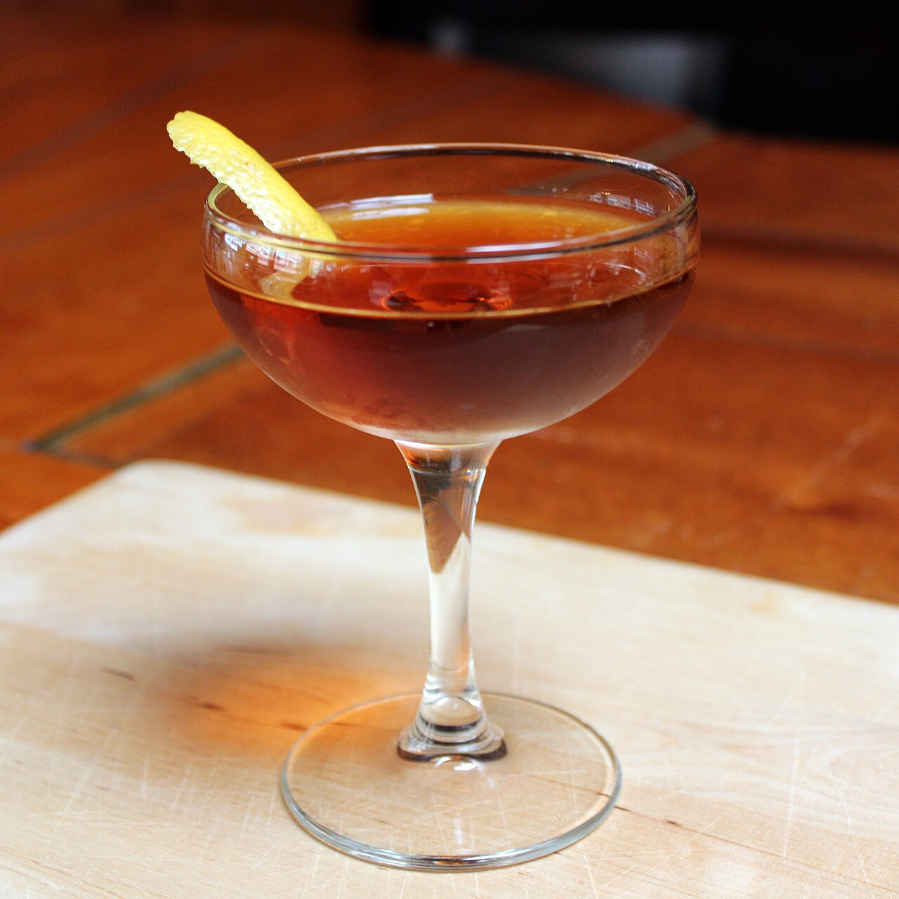

# Martinez

The Martinez combines gin, sweet vermouth, maraschino and orange bitters. It is often described as a gin Manhattan and as an ancestor of the dry martini: the same gin-and-vermouth spine, but with the sweetness of cherry liqueur and the orange scent of bitters, giving a rounder, softer drink.

Its history is vague and its formulas are many, which is part of the interest. Some recipes use equal gin and sweet vermouth, some favour gin; some include maraschino, some use another cherry liqueur; some add orange bitters, some only Angostura. Understanding the structure matters more than memorising one version.

Figure: A Martinez of gin, sweet vermouth, maraschino liqueur and bitters. Image: Will Shenton, CC BY-SA 3.0, via Wikimedia Commons ([source page](https://commons.wikimedia.org/wiki/File:Martinez_Cocktail.jpg)).

## A gin Manhattan

A Manhattan uses whiskey, sweet vermouth and bitters; the Martinez swaps whiskey for gin. Gin's juniper and citrus meet the herbs of sweet vermouth and the cherry sweetness of maraschino in three layers: gin in front, vermouth in the middle, cherry behind, bitters at the end.

Against the dry martini, the Martinez is sweeter, softer and a little lower in alcohol. The dry martini pursues dryness and cold; the Martinez pursues roundness and aroma. It is a good introduction to gin cocktails and a good choice for someone who wants sweetness without syrup.

## The formula: gin, sweet vermouth and maraschino

The IBA standard is 45 millilitres of gin, 45 millilitres of sweet vermouth, 15 millilitres of maraschino and 2 dashes of orange bitters. Equal gin and vermouth makes the sweetness prominent; for a drier drink, raise gin to 60 millilitres and cut vermouth to 30.

Maraschino is essential. It is distilled from sour cherries and carries sweetness, almond-like notes and a bitter edge from the cherry stones; cherry syrup cannot replace it or the drink becomes candy. Orange bitters add citrus peel and spice; orange oil can substitute, but the herbal complexity of bitters is lost.

The vermouth sets the background. Italian sweet vermouths lean toward vanilla and caramel; French sweet vermouths are drier and more herbal. Compared with a Manhattan, the Martinez suits a more herbal vermouth because gin already brings strong botanical perfume.

## Method: stir and cherry

Pour all liquids into a mixing glass full of ice and stir for about 20 seconds, until the glass frosts and the drink is properly cold. Strain into a coupe so no ice chips enter. Stirring suits the drink: with no juice, egg white or cream, shaking would add too much air and roughen the soft texture.

Garnish with a cherry. A maraschino cherry is standard, though a brandied cherry works. The cherry is not only decoration: its sweet-sour note complements the aroma at the rim. Do not drop cherry juice into the drink or the sweetness will tip.

Use a coupe or a martini glass. The coupe's wide bowl releases aroma; the martini glass is colder and sharper but easier to spill. Chill the glass first so the drink stays cold longer.

## The origin debate

There is no settled origin. The most common account places the Martinez in the 1880s, created by a bartender in San Francisco or a New York hotel; some attribute it to Jerry Thomas's recipe books, others to California racing clubs or Italian immigrant communities.

The name has several explanations: a surname Martinez, the California city of Martinez, or simply a variant of Martin. Whatever the source, the name appears by the late nineteenth century and gradually enters cocktail manuals.

The relationship with the dry martini is equally disputed. Some see the Martinez as its predecessor, others as a parallel branch. What is certain is that the late-nineteenth-century combination of gin, vermouth and bitters gave rise to a whole family of gin-and-vermouth classics.

## Variations and common mistakes

Common variations include the Martinez Perfecto, with a little orange oil; the Tom Martinez, with Old Tom gin for more sweetness; and a version using black cherry liqueur instead of maraschino for a darker, heavier drink. The Marguerite removes the cherry liqueur and moves closer to the dry martini.

Four mistakes recur. First, shaking instead of stirring, which fills the drink with bubbles and coarsens the texture. Second, too much maraschino, whose sweetness buries the gin. Third, too much bitters, which turns orange into medicine. Fourth, a warm glass, so the drink warms within minutes. The Martinez is a problem of balance, not of formula.

For a home bartender: start with equal gin and vermouth, begin maraschino at 10 millilitres, add only two dashes of bitters and stir until properly cold. Taste, then adjust. The target is round aroma, not sweetness.

A cherry is the traditional garnish, but its job is aroma rather than sweetness: the fruit echoes the maraschino in the drink and adds a red note at the rim. Without a cherry, an orange twist works, squeezed for its oils and brighter in effect. The bitters choice shapes the style too: orange bitters brighten the drink, Angostura steadies it, and two dashes of each also works. Stir for twenty to thirty seconds depending on ice size and glass temperature, until the tin frosts and the liquid is clearly cold, without over-diluting.

## See also and references

- Manhattan: see [manhattan](ref:manhattan).
- Dry martini: see [dry martini](ref:dry-martini).
- Gin: see [gin](ref:gin).
- Vermouth: see [vermouth](ref:vermouth).
- Coupe glass: see [coupe glass](ref:coupe).

**Short definition:** A classic of gin, sweet vermouth, maraschino and orange bitters, dating to the 1880s in the United States. It bridges the Manhattan and the dry martini, with a delicate bitter-sweet balance.

For Martinez, begin with the base and the ratio, then the dilution and the ice, and finish with the garnish and the glass; that order keeps the account grounded.

[Manhattan](ref:manhattan) explains base liquor; [Gin](ref:gin) adds technique and ratio. Put Martinez between them before deciding what it is.

The usual confusion is to treat Martinez as a base-liquor brand. Check which base liquor it uses first, then which ratio and technique it needs; the two need not agree.

The Martinez is a precursor of the martini, with gin, sweet vermouth, maraschino and bitters.

**Key facts.**

| Item | Detail |
| --- | --- |
| In one line | A classic of gin, sweet vermouth, maraschino and orange bitters, dating to the 1880s in the United States. It bridges the Manhattan and the dry martini, with a delicate bitter-sweet balance. |
| Style | IBA Unforgettables |
| Origin | United States (disputed) |

**Sources and limits.** The key claims about Martinez are checked against the following sources: International Bartenders Association (Used to check the IBA category, ingredients and ratio), Oxford University Press (Used to check cocktail history and terminology), CocktailDB (Used to cross-check recipe structure and common variations) and 5 sources in total. Prices, batches and status change; the body is project-written and does not reproduce source text.

For Martinez, this page was last checked in 2026; prices, batches and availability change, so confirm them against the sources below.
