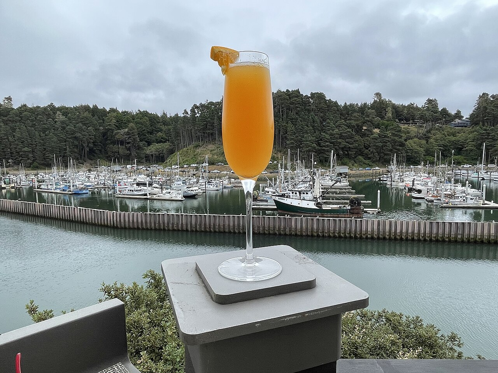

# Mimosa

The mimosa is the most familiar sparkling-wine cocktail on a brunch table: equal parts champagne and orange juice, poured into a flute, sometimes finished with a strip of orange peel. Low in alcohol, fine in bubbles and the colour of morning light, it is easier to like than most classics.

Simple does not mean careless. The temperature, acidity and pulp of the juice, the sweetness and bubble strength of the wine, even the shape of the glass, all change the drink's character. Freshly squeezed juice and chilled champagne make a different beverage from concentrate and room-temperature sparkling wine.

Figure: A mimosa of equal parts sparkling wine and orange juice, a brunch staple. Image: Missvain, CC BY 4.0, via Wikimedia Commons ([source page](https://commons.wikimedia.org/wiki/File:Mimosa_at_Noyo_Harbor_Inn_-_August_2022_-_Sarah_Stierch_02.jpg)).

## A drink for brunch

The mimosa is not a table wine but a wake-up drink. It belongs to breakfast, brunch, weddings and holiday tables, where it is lighter, more acidic and more refreshing than a main-course wine. Compared with a bellini it is crisper, because orange juice has more acidity; compared with plain champagne it is cheaper, easier to drink and friendlier to people who rarely drink alcohol.

That role sets the formula. The wine supplies bubbles and backbone; the juice supplies sweetness, acidity and colour. The two must balance. Juice that is too sweet makes the drink sticky; juice that is too sour buries the wine's fruit; wine that is too sweet turns the whole glass into fruit soda. A good mimosa tastes like sparkling orange, not like orange juice with alcohol in it.

## The formula: equal parts or sharper

The IBA standard is 10 centilitres of champagne and 10 centilitres of orange juice, equal parts. Equal parts are easy to remember and give a stable colour; the weakness is that orange varieties differ enormously, and winter juice can be far more acidic than summer juice. Many bartenders cut the juice slightly or add a few drops of lemon to lift the bubbles.

The wine depends on budget and occasion. True champagne has fine bubbles and high acidity and suits formal settings; crémant, cava or prosecco can also make a good mimosa, with different sweetness and bubble texture. Prosecco is sweeter and looser, suited to drinkers who want fruit; cava is drier and brighter, closer to champagne.

Juice should ideally be fresh and strained. Pulp blocks bubbles and clouds the texture; concentrate often carries a cooked note. If preparing ahead, chill the juice and take the champagne out only at the moment of opening, so the bubbles stay in the bottle. Use a flute or a coupe: the flute concentrates bubbles, the coupe is wider and shows more aroma.

## Method: juice first, wine second

Pour the orange juice into the glass first, then tilt the glass and pour the champagne slowly down the side. The order matters: wine first and juice second breaks up the bubbles and makes the colour harder to integrate. Fill to about seven-tenths, leaving room for aroma.

Do not add ice. Ice dilutes the drink and kills the bubbles; if both ingredients are well chilled, the drink is already cold enough. If ice is unavoidable, use one large cube and finish the glass quickly.

Garnish with orange peel or a slice. Expressing the peel adds aroma, but too much oil turns bitter and overwhelms the bubbles. A cherry at a wedding or party is decoration, not part of the formula.

## Name and date

The name comes from the yellow mimosa flower, which the drink resembles in colour. The most widely told origin is 1925 at the Hôtel Ritz in Paris, where bartender Frank Meier mixed champagne with orange juice as a daytime drink. Another version places a similar drink in English bars earlier.

Whatever the origin, the mimosa became truly popular in the second half of the twentieth century. American brunch culture, wedding buffets and airline first-class cabins turned it into a social drink that needs no trained bartender. It spread because it was consistent, cheap and universally acceptable, not because it was complex.

The mimosa is often compared with the bellini. The bellini uses peach purée and prosecco, giving a thicker, sweeter drink; the mimosa uses orange juice and champagne, giving a sharper, lighter one. Both prove the same point: sparkling wine plus fruit can become a complete drinks language.

## Variations and common mistakes

The best-known variation is the Grand Mimosa, which adds a small measure of Grand Marnier to the juice and champagne for more orange aroma and alcohol. A Mimosa Royale uses a more expensive champagne and blood orange juice for a deeper colour and higher acidity. Mimosa Punch scales the formula for a party with fruit and ice.

Three mistakes recur. First, room-temperature juice and wine, which destroys both bubbles and freshness. Second, reversing the pouring order, so the juice knocks the bubbles out of the wine. Third, a glass that still carries detergent residue, which collapses the foam. The mimosa has no advanced technique, only discipline over temperature, ratio and cleanliness.

For a home bartender, the practical rule is: chill both ingredients, squeeze the juice to order, start with equal parts and adjust to the acidity of the fruit. The target is lightness, not concentration.

## See also and references

- Bellini: see [bellini](ref:bellini).
- Sparkling wine: see [sparkling wine](ref:sparkling).
- Champagne flute: see [champagne flute](ref:flute).
- Opening sparkling wine: see [opening sparkling wine](ref:opening).
- Triple sec: see [triple sec](ref:triple-sec).

For Mimosa, begin with the base and the ratio, then the dilution and the ice, and finish with the garnish and the glass; that order keeps the account grounded.

**Short definition:** A brunch cocktail of equal parts sparkling wine and orange juice, low in alcohol and light on bubbles; its name comes from a yellow flower, and its simple formula is sensitive to temperature and ratio.

Use equal parts chilled sparkling wine and fresh orange juice; a drier sparkling wine keeps the drink from tasting sweet.

**Key facts.**

| Item | Detail |
| --- | --- |
| In one line | A brunch cocktail of equal parts sparkling wine and orange juice, low in alcohol and light on bubbles; its name comes from a yellow flower, and its simple formula is sensitive to temperature and ratio. |
| Style | IBA Contemporary Classics |
| Origin | Paris, France (traditional account) |

**Sources and limits.** The key claims about Mimosa are checked against the following sources: International Bartenders Association (Used to check the IBA category, ingredients and ratio), Oxford University Press (Used to check cocktail history and terminology), CocktailDB (Used to cross-check recipe structure and common variations) and 5 sources in total. Prices, batches and status change; the body is project-written and does not reproduce source text.

For Mimosa, this cocktail was last checked in 2026; prices, batches and availability change, so confirm them against the sources below.
