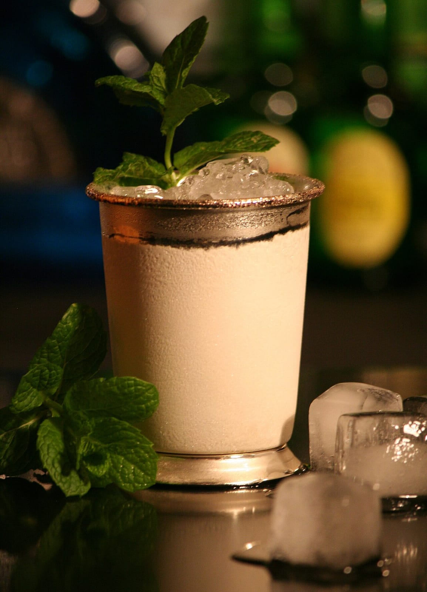

# Mint Julep

The Mint Julep is a classic cocktail of [bourbon](ref:bourbon), mint and sugar served over crushed ice in a filled glass, usually garnished with a mint sprig. It is cool and sweet, and a signature drink of American Southern horse-racing culture.

Figure: Mint Julep. Image: Cocktailmarler, CC BY-SA 3.0, via Wikimedia Commons ([source page](https://commons.wikimedia.org/wiki/File:Mint_Julep_im_Silberbecher.jpg)).

## Definition and identity

The Mint Julep is often tied to horse-racing events in the American South, and historical accounts go back to the 19th century. Its name relates to mint, and several origin stories exist; this cocktail treats them as historical background and does not present one as settled fact.

## Recipe (IBA version)

The public IBA recipe is built on bourbon, mint and sugar: place mint and sugar in a glass, press gently to release aroma without shredding the leaves; add a little whiskey and stir until the sugar dissolves; fill the glass with crushed ice, pour in the rest of the whiskey, stir well until the glass frosts; garnish with a mint sprig.

Quantities are a starting point, not a law. Bars and households differ markedly in whiskey, sugar and ice. The key is to balance mint aroma, sweetness and the strength of the whiskey.

## Choosing the bourbon

[Bourbon](ref:bourbon) is the body of this drink. It brings corn sweetness, vanilla and caramel, contrasting with mint's cooling character. Rye is spicier and drier and can be substituted, but the style changes.

High-strength whiskey needs more ice and stirring to dilute, lower-strength whiskey less. If the whiskey is strongly flavoured, adjust the sugar and mint accordingly, or the drink will be unbalanced. For the general classification of [whiskey](ref:whisky), see the corresponding entry.

## Mint and sugar

Mint provides cooling aroma and visual identity. Press the leaves gently to release aroma; shredding them brings in bitterness that affects the taste. Freshness matters: wilted leaves have noticeably less aroma.

Sugar provides sweetness and roundness, balancing the whiskey's alcohol and the mint's coolness. Too little sugar leaves the drink harsh; too much covers the mint. Syrup dissolves more easily than granulated sugar and suits cold drinks.

## Crushed ice and stirring

Crushed ice is central to the Mint Julep: it chills the drink fast and creates the frosted look in the glass. Crushed ice melts quickly and dilutes quickly, so stir well and drink soon.

Stirring is not only for mixing but for chilling the glass until it frosts. Under-stirring leaves the drink insufficiently cold and the aroma closed; over-stirring dilutes too much and thins the body. For more on ice and temperature, see [Ice and temperature](ref:ice).

## Glass and garnish

Traditionally a silver cup or thick-walled glass is used, tall enough to fill with crushed ice and hold the cold. Chill the glass beforehand so the drink does not warm quickly after pouring.

A mint sprig is the usual garnish, providing cooling aroma and visual identity. Insert it into the crushed ice; a light sniff before drinking enhances the aroma. Garnish just before serving.

## Variations

Using rye instead of bourbon gives a spicier version; using another spirit instead of whiskey creates different branches; reducing the sugar gives a drier version that emphasises mint. Southern examples also differ in ice and sugar.

Variations are not mistakes but branches with a clear substitution logic. When recording one, state what was replaced and how the ratio changed. For general cocktail structure, see [Cocktail basics](ref:cocktails-guide); compared with the [Old Fashioned](ref:old-fashioned), the Mint Julep replaces stirring and bitters with crushed ice and mint.

## Common misconceptions

First, shredding the mint leaves. Over-pressing brings in bitterness.

Second, treating crushed ice as decoration. Crushed ice affects temperature and dilution speed.

Third, ignoring the balance of sugar and whiskey. Too sweet covers the mint.

Fourth, using only wilted mint. The aroma will be clearly lacking.

For Mint Julep, a common mistake is treating a variation as the original recipe. After replacing a main ingredient, use the variation name and state the difference.

## Drinking and boundary

The Mint Julep suits summer drinking, with nuts, savoury snacks or Southern-style dishes. It is relatively strong, so sip slowly and drink water; do not drink it quickly on an empty stomach. Do not drink when driving, taking medication or pregnant.

This cocktail records one sourced version, evaluates no specific brand and does not present one ratio as the only correct answer. The finished strength depends on the whiskey's [alcohol by volume](ref:abv), the sugar, the amount of crushed ice and how fast it melts, not on the recipe numbers alone.

A Mint Julep is not simply whiskey with mint in it. The sugar is first lightly pressed with mint to release aroma, the glass is packed with crushed ice, and stirring chills the drink while adding controlled dilution. Bourbon supplies corn sweetness and barrel notes; mint supplies the cooling top note. If the mint is only used as a garnish and never expressed, the drink tends to feel flat and overly sweet.

Start with the base and the ratio. From there, consider the dilution and the ice, then the garnish and the glass. That is how a practical judgment about Mint Julep is built.

**In brief:** A classic cocktail of bourbon, mint and sugar served over crushed ice in a filled glass, usually garnished with a mint sprig; cool and sweet, and a signature drink of American Southern horse-racing culture.

The classic ratio is 2 oz bourbon to 0.5 oz syrup, with crushed ice and a mint sprig.

**Key facts.**

| Item | Detail |
| --- | --- |
| In one line | A classic cocktail of bourbon, mint and sugar served over crushed ice in a filled glass, usually garnished with a mint sprig; cool and sweet, and a signature drink of American Southern horse-racing culture. |
| Style | Classic cocktail |
| Origin | Southern United States (19th century) |

**Sources and limits.** The key claims about Mint Julep are checked against the following sources: International Bartenders Association (Used to check the official recipe, method and garnish; Used to confirm the drink is on the IBA official cocktail list), Oxford University Press (Used to check the historical background and basic composition), David Wondrich / Perigee (Used to check background on 19th-century American cocktail development) and 5 sources in total. Prices, batches and status change; the body is project-written and does not reproduce source text.

**Read alongside.** Put Mint Julep next to Bourbon Whiskey, Whisky, Alcohol by volume (ABV): the first fixes identity and boundary, the others provide a region, process or peer comparison. Read this cocktail first, then return to those entries; the links become coordinates, not decoration.

## Further reading

- [Bourbon](ref:bourbon): the body and style source of the Mint Julep.
- [Whiskey](ref:whisky): whiskey classification and regional background.
- [Cocktail basics](ref:cocktails-guide): structure, dilution and stirring.
- [Ice and temperature](ref:ice): crushed ice and how chilling shapes the drink.
- [Alcohol by volume](ref:abv): understanding strength and ice dilution.
- [Old Fashioned](ref:old-fashioned): another classic built on whiskey, sugar and bitters.
