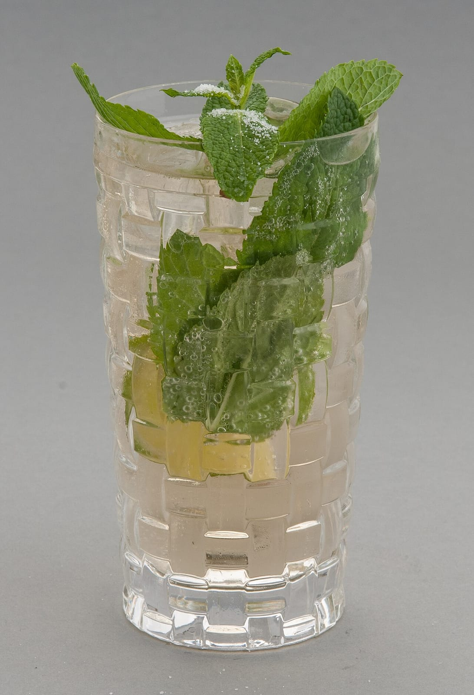

# Mojito

The Mojito is a long drink of white rum, lime, mint, cane sugar and soda. The public IBA recipe uses 45 ml white Cuban rum, 20 ml fresh lime juice, 6 mint sprigs, 2 teaspoons white cane sugar and soda water, built in the glass and garnished with mint sprigs and a lime slice.

Figure: Mojito. Image: Ralf Roletschek, CC BY-SA 3.0, via Wikimedia Commons ([source page](https://commons.wikimedia.org/wiki/File:15-09-26-RalfR-WLC-0072.jpg)).

## Definition and identity

The Mojito is often traced to Cuba, but several accounts involve different periods, places and people. This cocktail does not present one narrative as settled; it treats the drink as part of Cuban and Caribbean drinking culture. Name and recipe are separate things, and the same name with a different method should be explained.

## Recipe (IBA version)

The public IBA recipe is 45 ml white Cuban rum, 20 ml fresh lime juice, 6 mint sprigs, 2 teaspoons white cane sugar and soda water. Mix the mint, sugar and lime juice, add a splash of soda water, fill the glass with ice, pour in the rum and top with soda water. Stir gently so all the ingredients meet.

This version is built in the glass rather than shaken and strained. Press the mint lightly rather than crushing it; the sugar needs to dissolve; and enough ice is needed to keep the drink cold and the bubbles alive. Quantities are a starting point, not a law; changing sugar, lime or mint changes the result.

## Mint

Mint provides freshness and aroma and is the most recognisable part of a Mojito. The IBA recipe uses 6 sprigs, but the variety, leaf size and freshness all affect intensity. Mint that is not fresh smells weak and can turn grassy.

Handle the mint with a light press, not a crush. Crushing releases bitterness and chlorophyll, making the drink taste green and harsh; a light press releases only the surface oils and keeps the aroma clean. Mint sprigs can stay in the glass as a garnish, but do not leave them soaking until they blacken.

## Lime and sugar

Lime juice provides acidity, freshness and lift. Fresh juice is more reliable than bottled, whose aroma and acidity usually differ. Lime acidity varies with ripeness, so the 20 ml in the recipe is a starting point and the final adjustment should follow the palate.

White cane sugar provides sweetness to balance the lime. Too little and the drink feels sharp; too much covers the mint and rum. Dissolving matters: undissolved sugar sinks to the bottom and makes the last sips suddenly sweet. Stir the sugar into a little lime juice first, then add the rest.

## White rum

[White rum](ref:rum) is the body, providing cane sweetness and the alcohol frame. White rum is usually filtered, pale and relatively light, which suits lime and mint; aged rum brings more cask flavour and changes the direction.

Choose a white rum that is clean and shows clear cane or botanical notes. A stronger rum needs more ice and soda to balance; a weaker one can leave the drink thin. The recipe numbers alone do not describe the strength.

## Soda and ice

Soda water provides bubbles, freshness and dilution. Too much carbonation is prickly, too little feels flat; add soda last and stir gently so the bubbles are not knocked out. Plenty of ice both chills and helps keep the bubbles.

Ice quality directly affects a long drink. Large cubes melt slowly and dilute in a controlled way; crushed ice chills fast but can thin the drink quickly. A Mojito usually uses a good deal of ice so a visible ice bed forms; with too little ice the soda warms quickly and the drink goes flat. For ice and temperature, see [Ice and temperature](ref:ice).

## Muddling and stirring

Muddling releases the aroma of mint and lime; it is not meant to crush the ingredients. A few light presses are enough, just until the leaves open slightly and the aroma rises. Over-muddling brings bitterness and leaves leaf fragments floating in the glass.

Stirring is for mixing, not shaking. A Mojito is a long drink and needs its bubbles and ice bed; shaking adds too much air and ice shards and drives off carbonation. A few gentle stirs are enough to bring rum, lime, sugar and soda together.

## Glass

A Mojito usually uses a highball or a large straight-sided glass with room for ice, mint and soda. The rim should not be too narrow, or the mint sprig will not fit; the walls should not be too thin, or the drink warms quickly in the hand.

Chill the glass first to slow the ice. Without a specialist glass, choose a straight-sided glass with enough capacity. For shape and aroma, see [Choosing a glass](ref:glass).

## Variations

Aged rum instead of white rum brings cask flavour and a heavier body; less sugar or more lime changes the balance; fruit such as strawberry or passion fruit creates a different variation; another sparkling drink instead of soda changes sweetness and bubbles.

Variations are not mistakes but branches with a clear substitution logic. When recording one, state what was replaced and how the ratio changed; otherwise the same name covers different methods and causes confusion. For general cocktail structure, see [Cocktail basics](ref:cocktails-guide).

## Common misconceptions

First, crushing the mint. Over-muddling releases bitterness; a light press is enough.

Second, leaving the sugar undissolved. Sugar at the bottom makes the last sips too sweet.

Third, too little ice. Without enough ice the bubbles fade and the drink goes warm and flat.

Fourth, shaking instead of stirring. Shaking destroys the bubbles and ice bed, which a long drink does not need.

Fifth, assuming more mint is better. Too much mint turns grassy and can block the straw.

## Boundary

A Mojito is a long drink; its strength depends on the rum and the dilution, not on the recipe numbers alone. It suits hot weather and casual occasions; sip slowly and drink water, and do not drink quickly on an empty stomach. Do not drink when driving, taking medication or pregnant.

This cocktail records one sourced version, evaluates no specific brand and does not present one ratio as the only correct answer. Strength is also affected by ice and soda dilution; see [Alcohol by volume](ref:abv).

Read Mojito through the base and the ratio, then the dilution and the ice, and finally the garnish and the glass. The sequence matters.

Start with [Rum](ref:rum) for base liquor, then read [A cocktail is another way in](ref:cocktails-guide) for technique and ratio. Seeing both keeps Mojito from being confused with a neighbouring idea.

## Further reading

- [Rum](ref:rum): the body and cane aroma of the Mojito.
- [Cocktail basics](ref:cocktails-guide): structure, dilution and stirring.
- [Choosing a glass](ref:glass): shape, capacity and pre-chilling.
- [Alcohol by volume](ref:abv): understanding the real strength of a long drink.
