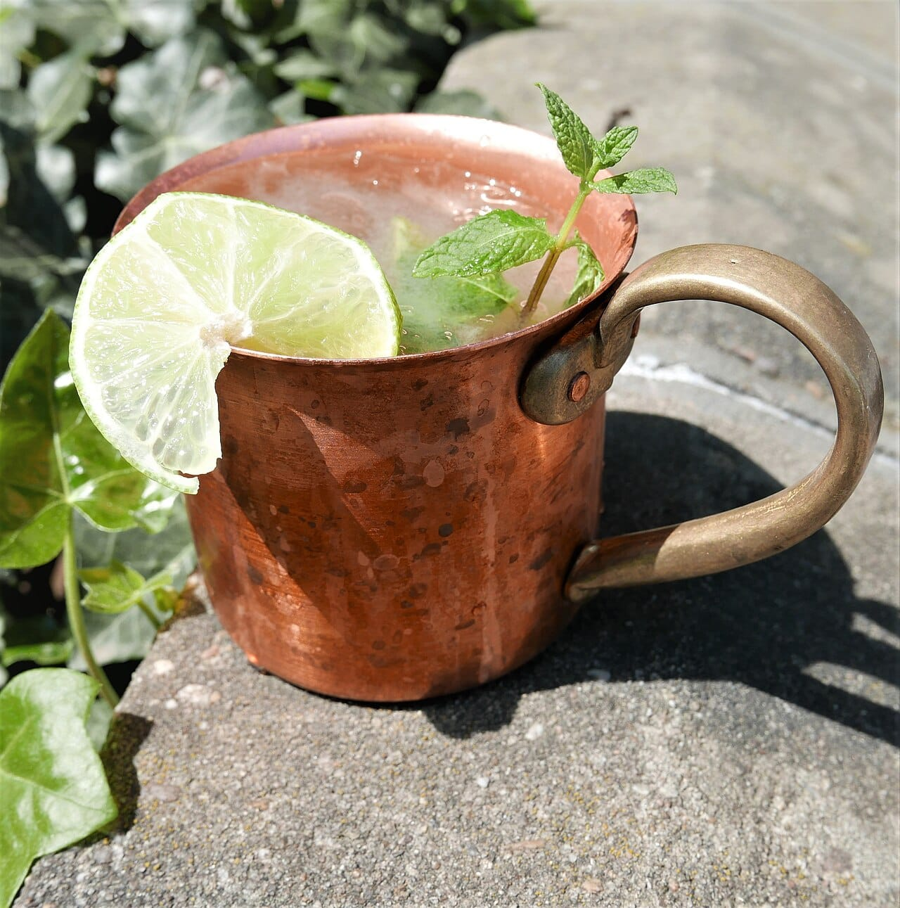

# Moscow Mule

The Moscow Mule is a long drink built from vodka, ginger beer and fresh lime. It is usually served over plenty of ice in a copper mug or a highball glass, with the ginger beer added last and a lime wedge on the rim. Ginger supplies heat and bubbles, lime supplies acidity, and vodka supplies a clean alcoholic frame. The structure is simple, yet the drink changes noticeably with the sweetness of the ginger beer, the amount of ice and the freshness of the lime.

Figure: Moscow Mule. Image: Gordito1869, CC BY-SA 4.0, via Wikimedia Commons ([source page](https://commons.wikimedia.org/wiki/File:Cocktail_Moscow_Mule_im_Kupferbecher_mit_Minze.jpg)).

> **Quick verdict**
> **In one line:** This cocktail helps you decide whether to order Moscow Mule, and how ratio, ice and water change it.
>
> - **Best for:** Anyone who wants the logic, serving method and common mistakes behind Moscow Mule.
> - **Not for:** If you want only want a strong drink and do not care about ratio, ice or water.
> - **Check first:**
>   - For Moscow Mule, begin with the base and the ratio, then the dilution and the ice, and finish with the garnish and the glass; that order keeps the account grounded.
>   - Public accounts of the drink's beginnings do not fully agree.

## Origin and naming

Public accounts of the drink's beginnings do not fully agree. The most widely told version places it in the United States in the 1940s and links it to a collaboration between a vodka brand, a ginger beer brand and a bar operator; the copper mug and the "mule" image are often explained as part of that marketing. Names, places and the order of events differ between retellings, so this cocktail treats the story as widely told rather than documented. No single date should be presented as an archive fact.

The "Moscow" in the name does not mean the drink originated in Moscow. It is more often read as an association with the vodka then being promoted, and that reading is itself an interpretation rather than a verified record. "Mule" is commonly said to describe the kick of ginger, which is another piece of naming lore. A name can suggest a place or a sensation without proving anything about the recipe's origin.

The copper mug appears early in the story, but it is not a legal standard. Copper conducts heat well, so the outside of the mug frosts quickly and looks colder; the liquid inside does not change its basic structure when poured into a highball glass. Treating the mug as a badge of authenticity distracts from the factors that actually shape the drink: the sweet-hot balance of the ginger beer, the freshness of the lime and the quality of the ice.

## Recipe structure

A common version uses 45 ml vodka, 120 ml ginger beer and 10 ml lime juice, built over ice. These proportions are a reference point, not the only correct formula. Vodka provides the frame, ginger beer brings sweetness, heat and carbonation at the same time, and lime juice pulls the sweetness back into balance. A larger glass or more ice may call for scaling the same ratio, but check the glass capacity first so that the drink does not overflow once ice is added.

Ginger beer and ginger ale are different products. Ginger beer is usually stronger in ginger, with more noticeable sweetness and heat; ginger ale is milder and closer to an ordinary soft drink. Replacing ginger beer with ginger ale makes the drink thinner, and it usually needs less lime or a little ginger syrup to compensate, but that is already a different drink. A recipe should state which product it means, because the same millilitres produce very different results.

The choice of vodka matters less than the choice of ginger beer. Vodka mainly supplies alcohol and a clean frame, while the ginger beer's brand, sweetness and method of extracting ginger are far more influential. Lime should be squeezed to order; pre-squeezed juice loses aroma and can taste flat. Syrup is not essential because ginger beer usually contains sugar. Consider a small amount only when the ginger beer is very dry or when a large glass and heavy dilution make the drink taste thin.

## Flavour and balance

The first impression is ginger heat and carbonation, followed by lime acidity and the clean warmth of vodka. The drink does not aim for complex aged flavour; it works through temperature, bubbles and acidity. The central balance is sweet against sour. Ginger beer already carries a good deal of sugar, so too little lime makes the drink taste like a soft drink, while too much lime buries the ginger. Melting ice keeps diluting the glass, so the first sip is usually the most concentrated and the experience changes as the drink sits.

Ginger heat is not the burn of chilli. It is the warm, tingling sensation of gingerols, layered with the physical stimulation of carbonation. If the drink is too sweet, add lime or choose a drier ginger beer before adding more sugar; if it is too sour, reduce the lime rather than sweetening the whole glass. Temperature matters as well. Ginger beer that is not cold enough tastes loose after ice is added, and the bubbles feel less tight.

The alcohol content is moderate, but the serving is large and the drinking time is long, so total alcohol intake may still be significant. Ice changes both concentration and aroma release. When the glass begins to taste watery, the ice has already done most of its work, and forcing the rest of the drink will only make it weaker. It is reasonable to stop and make a fresh one rather than finish a diluted glass.

## Method

The usual method is to build the drink directly. Chill the glass and the ginger beer first, fill the glass with fresh ice, add the vodka and lime juice, then top with ginger beer along the inside wall and stir once to combine the layers. Do not shake. Shaking drives off carbonation and dilutes the ginger beer too quickly. Squeeze the lime wedge just before drinking so that the peel oils and acidity are still fresh.

Pre-chilling the glass is often overlooked. A copper mug can go into the refrigerator, or at least be cooled by turning ice inside it; the same applies to a highball glass. Use clean ice without off-odours and ice that melts at a reasonable pace. Crushed ice dilutes the drink quickly and kills the bubbles. With a copper mug, check that the rim and inner surface are clean, and drink the cocktail soon after mixing, because the material is not intended for storing acidic liquid for long periods.

Garnish with a lime wedge or wheel, and perhaps a slice of ginger or a small mint sprig. Keep the garnish modest so that it does not cover the rim or block the aroma. When squeezing lime peel, take only the coloured outer layer and avoid pressing the white pith, which adds bitterness. If the recipe includes syrup, mix it with the lime juice first, then add the vodka and finally the ginger beer; a clear order makes the drink repeatable.

## Variations

Replacing vodka with bourbon usually gives a Kentucky Mule; replacing it with gin gives a London Mule type; replacing it with tequila is often called a Mexican Mule. Other versions add mint, cucumber or fresh ginger, and some use a low-sugar ginger beer to reduce sweetness. A variation should state which ingredient was replaced, or identical names will hide different drinks.

Changing the base spirit changes the direction of the drink. Bourbon adds sweet wood and vanilla, gin brings herbs and juniper, and tequila makes the drink more vegetal and peppery. The sweet-hot intensity of the ginger beer should be adjusted with the base, rather than keeping the original lime quantity out of habit. If ginger beer is replaced by ginger ale, it is better to call the result a ginger-ale version instead of continuing to use the original name.

Another common approach adds a little ginger syrup or honey syrup to concentrate the ginger. That also raises the sugar, so the acidity needs to rise with it. Any variation should record the base spirit, the type of ginger beer, the lime quantity and the source of sweetness. Only then can a change be judged as an improvement rather than a different drink.

## How to order and drink

For Moscow Mule, begin with the base and the ratio, then the dilution and the ice, and finish with the garnish and the glass; that order keeps the account grounded.

The drink suits spicy, fried or salty food. Ginger heat and fat balance each other, and the bubbles refresh the palate. As a long drink, it is large, so sip it slowly and drink water alongside. Do not drink and drive, and avoid alcohol during pregnancy or while taking medication that interacts with it. A heavily iced version is pleasant in hot weather, but the drinking pace still matters, because a large glass can deliver a lot of alcohol in a short time.

In a bar, the drink is normally not aged or batched for long. It should be served soon after mixing. If the outside of the mug frosts clearly, the pre-chilling was done well; if the ice turns to water quickly, the ice quality or the room temperature is working against the drink. If the second half of the glass tastes thin, a little extra lime can help, but more syrup is rarely the answer.

## Common misconceptions

First, that the copper mug is part of the recipe. It affects temperature and presentation, not the basic flavour. Second, that ginger ale is the same as ginger beer. Their ginger intensity differs, and a substitution should change the formula. Third, that the drink should be shaken. Shaking costs carbonation and flattens the texture. Fourth, that a more expensive vodka guarantees a better drink. Vodka mostly supplies a clean frame, and brand differences are limited here. Fifth, that the drink must be very sweet. Lime and dilution can adjust the sweetness, and sweetness is not the goal.

## See also

- [Vodka](ref:vodka): the clean alcoholic frame of this drink.
- [Highball glass](ref:highball): glass shape, ice volume and carbonation retention.
- [Cocktail basics](ref:basics): building, measuring and the basic logic of equipment.
- [Acidity](ref:acidity): how lime shapes sweetness and overall balance.
- [Mojito](ref:mojito): another long drink built on lime, bubbles and freshness.
