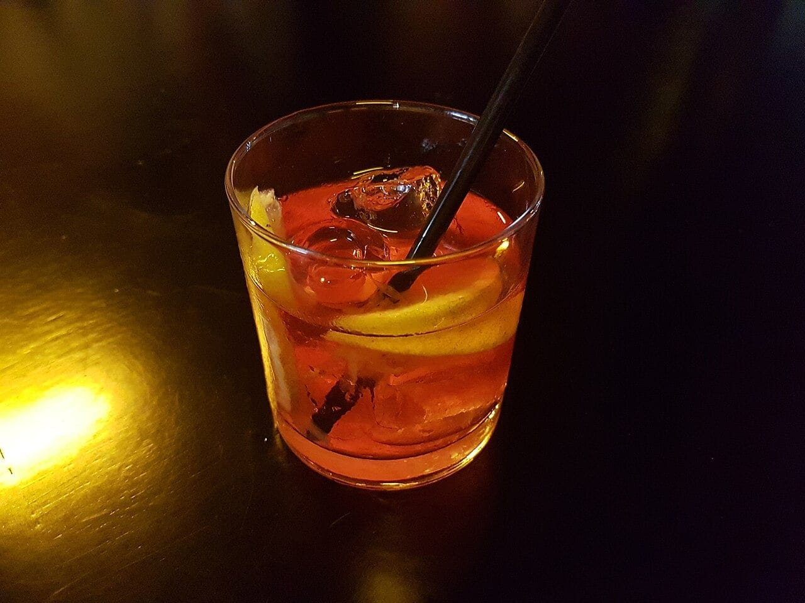

# Negroni

The Negroni is a classic cocktail made with gin, bitter aperitif and sweet vermouth. The International Bartenders Association (IBA) public recipe uses 30 ml of each, stirred and strained into a rocks glass over ice.

Figure: A Negroni in a rocks glass, with red liquid, ice, an orange slice and a black straw. Image: Sudhertzen, CC BY-SA 4.0, via [source page](https://commons.wikimedia.org/wiki/File:Negroni_(cocktail).jpg).

## Definition and identity

Separating identity from recipe prevents treating "one bar's method" as "the definition of a Negroni". The IBA recipe is one international reference, but bars adjust proportions, brands and garnish; as long as the three-part structure and balance hold, it remains in the Negroni family.

The name comes from the Negroni surname, which relates to the story of who invented it but does not mean every detail is supported by complete archives. Much cocktail history is passed on and retold, so writing should mark such stories as "widely told" rather than presenting legend as archive.

## Recipe and proportions

The IBA recipe is 30 ml each of gin, bitter aperitif and sweet vermouth, stirred with ice, strained into a rocks glass over ice and garnished with orange peel or an orange slice. Equal parts are the classic version, easy to remember and teach, but not the only correct ratio.

Proportion changes flavour markedly: more gin brings herbs and juniper forward, more bitter aperitif increases bitterness and citrus peel, and more sweet vermouth gives a rounder, sweeter body. Change one variable at a time so you can tell where the difference comes from.

Measurements must match the glass: too small a glass overflows after ice, too large a glass loses aroma and dilutes too fast. Home mixing should use a jigger or small measure and work by volume rather than eye, for repeatable results. A recipe is executable only when units, order and equipment are clear.

## Ingredients and roles

[Gin](ref:gin) provides the frame and herbal aroma and is the main source of alcohol and fragrance. The bitter aperitif provides bitterness, red colour and citrus-herbal notes and is central to the bitter-sweet balance. Sweet vermouth adds sweetness, body and spice, softening bitterness and connecting the other two.

All three ingredients contain alcohol, so the finished drink is relatively strong. The exact figure depends on brands and proportions, and a strength label alone cannot describe the drink in the glass; melting ice keeps diluting it, so the palate changes as you drink.

Brand choice clearly changes the result: the gin's botanicals set the herbal direction, the bitter aperitif's bitterness and citrus set the frame, and the vermouth's spice and sweetness set roundness. Changing brands is not changing the recipe, but it makes the same ratio taste different, so records should state both brand and ratio.

## Method

The usual method is stirring with ice to chill, dilute and mix evenly, then straining into a pre-chilled or ice-filled glass. Stirring rather than shaking avoids excess aeration and rapid dilution; with a sweeter vermouth some bartenders choose a short shake, which is a style choice.

The orange peel is not decoration: the oils released by squeezing directly affect aroma. Check that the peel is clean and free of wax before garnishing. Use fresh ice without off-odours and avoid ice that melts too quickly.

## Flavour and balance

The Negroni typically balances bitter, sweet, herbal and citrus notes, with a bitter entry that remains rounded and an orange-peel and spice finish. It is not sweet-and-sour or juice-like; evaluation focuses on whether the three ingredients harmonise rather than whether one dominates.

Balance changes with temperature and dilution. Freshly made, the body is tight and bitter; as ice melts it softens and sweetness and aroma open. If too bitter, add a little vermouth; if too sweet, add a little bitter aperitif or gin. Adjust in small steps.

## Variations

Replacing gin with bourbon usually gives the Boulevardier, sweeter and more woody. Replacing gin with soda water returns to the earlier Americano, lower in strength. Replacing part of the mix with sparkling wine gives a Sbagliato-type variation, lighter in texture.

Variations are not "wrong versions" but branches with clear substitution logic. A variation should state which ingredient was replaced and how the ratio changed, or identical names will hide different methods. This cocktail gives an overview only; executable recipes belong on the recipe page.

## Drinking and pairing

Suited to aperitif service with salted nuts, olives, hard cheese and cured meat. Bitterness and fat balance each other, and sweet vermouth carries savoury notes. As a after-dinner drink, reduce the serving size and avoid rapid drinking after other alcohol.

An aperitif serving is usually smaller than an after-dinner one; the aim is to open the appetite, not to intoxicate. If the table orders a second round, add water and food; melting speed also changes the second drink's concentration. Cocktail "strength" is an experience in the glass, not just the recipe's ABV.

A [rocks glass](ref:vessel) is wide-mouthed and lets aroma spread; a smaller glass can control the serving. Drink in moderation and avoid rapid drinking on an empty stomach; do not drink while driving or taking medication. Squeeze the orange peel just before drinking to keep the aroma.

## Common misconceptions

First, that only equal parts is authentic. Equal parts is the classic version, not the only one.
Second, treating the bitter aperitif as a "medicinal liqueur". It is a flavoured spirit drink with different flavour and legal status.
Third, that stirring does not matter. Stirring affects chilling, dilution and evenness.
Fourth, replacing stirring with shaking without adjusting the ratio. Shaking adds dilution and aeration.
Fifth, treating a variation as the same recipe. After substituting an ingredient, use the variation's name.

**At a glance:** A classic cocktail of equal parts gin, bitter aperitif and sweet vermouth. Cocktail identity and recipe versions are recorded separately. 

To read Negroni, start with the base and the ratio, then the dilution and the ice, then the garnish and the glass; no single check settles it.

[Negroni recipe (IBA version)](ref:recipe) and [Rocks glass](ref:vessel) are the nearest useful comparisons: one clarifies base liquor, the other tests technique and ratio.

**Key facts.**

| Item | Detail |
| --- | --- |
| In one line | A classic cocktail of equal parts gin, bitter aperitif and sweet vermouth. Cocktail identity and recipe versions are recorded separately. |
| Style | Classic cocktail |
| Origin | Florence, Italy (as the widely told story) |

**Sources and limits.** The key claims about Negroni are checked against the following sources: International Bartenders Association (the official recipe and method; the Negroni's place on the official cocktail list), Oxford University Press (Consulted for entries on the Negroni, bitters and vermouth), Campari (Used to check the equal-parts recipe and the 1919 origin account). Prices, batches and status change; the body is project-written and does not reproduce source text.

## Further reading

- [Recipe version](ref:recipe): executable quantities, steps and equipment.
- [Gin](ref:gin): the frame and herbal aroma of the Negroni.
- [Rocks glass](ref:vessel): how glass and ice affect aroma and dilution.
- [Alcohol by volume](ref:abv): understanding finished strength and ice dilution.
