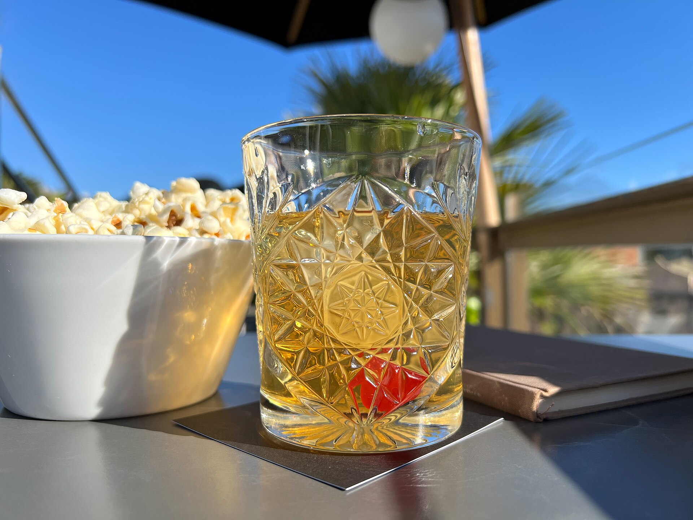

# Old Fashioned

The Old Fashioned is a classic cocktail of whiskey, sugar, bitters and a little water. It uses no juice or carbonated drink, and its structure is simple: sugar and water open up the spirit, bitters add layers, and orange peel or a cherry finishes it. Because it is simple, the character of the whiskey is hard to hide.

Figure: Related photograph of Old Fashioned. Image: Capvideo, CC BY 4.0, via Wikimedia Commons ([source page](https://commons.wikimedia.org/wiki/File:Claris_Hotel,_Barcelona,_Smoky_Old-Fashioned_with_Popcorn.jpg)).

## Definition and identity

The name points to a way of making a drink: in the late 19th century, when more elaborate cocktails became fashionable, some customers asked for the "old-fashioned" combination of spirit, sugar, water and bitters. The exact origin and naming process have several accounts; this cocktail treats them as historical background and does not present one account as settled fact.

## Recipe (IBA version)

The public IBA recipe uses 45 ml bourbon or rye whiskey, one sugar cube, a few dashes of Angostura bitters and a few dashes of plain water. Place the sugar cube in a rocks glass, saturate it with bitters and a little water, and muddle until dissolved. Fill the glass with ice, add the whiskey and stir gently. Garnish with an orange slice or peel and a cocktail cherry.

This version is built in the glass rather than stirred and strained separately. The sugar cube must dissolve fully, or the last sips turn suddenly sweet; the bitters must be distributed evenly, or the aroma stays on the surface. Quantities are a starting point, not a law; changing the whiskey, sugar or bitters changes the result.

## Sugar, bitters and water

Sugar is not there to make the drink sweet but to round the body and soften the alcohol. Too little sugar makes the drink feel hard and dry; too much covers the whiskey's aroma. A cube dissolves more slowly than syrup, so a little water helps; if you use syrup, reduce the water accordingly.

Bitters provide aroma and a slight bitterness, commonly Angostura. They work like a spice rather than making the drink bitter. A few dashes are enough; too many bury the whiskey. Bitters recipes differ widely, so swapping them changes the style and should be recorded.

Water is often underestimated. A little opens the aroma, reduces the alcohol burn and clarifies the whiskey's layers. Too much dilutes the body and makes the drink thin. The amount should match how much water the sugar needs and how strong the whiskey is.

## Choosing the whiskey

[Whiskey](ref:whisky) is the body of this drink. Bourbon often brings corn sweetness, vanilla and caramel; rye is spicier and drier; Scotch may bring peat, malt or cask notes. The IBA recipe allows bourbon or rye but does not require any particular brand.

Decide the direction first: for sweet richness choose bourbon; for spice and structure choose rye; for smoke or complexity you can try another whiskey, adjusting sugar and bitters accordingly. High-strength whiskey needs more water to open up, while lower-strength whiskey needs less.

## Stirring and dilution

Stirring happens in the glass, and the ice keeps melting. Under-stirring leaves sugar undissolved and the drink insufficiently cold; over-stirring dilutes too much and thins the body. The goal is to dissolve the sugar, lower the temperature and open the aroma, not to hit a fixed time.

Ice quality directly affects the result. A large cube melts slowly and dilutes in a controlled way; crushed ice chills fast but can thin the drink within minutes. With large ice, chill the whiskey slightly first; with ordinary cubes, shorten the stirring time to avoid over-dilution.

## Glass and ice

Traditionally a [rocks glass](ref:rocks) is used: short and wide, easy for a sugar cube, muddling and a large cube. The wide rim lets aroma spread and leaves room for the garnish. The glass has no stem, so holding the body transfers heat; to keep it cold longer, hold near the rim or use a coaster.

Glass capacity affects the recipe ratio. A small glass spills easily once ice is added; a large glass creates too much headspace and aroma disperses. "Fill with ice" should be adjusted to the glass, not copied. For more on ice and temperature, see [Ice and temperature](ref:ice).

## Garnish

Orange peel or an orange slice provides citrus aroma, and a cocktail cherry adds sweetness and visual identity. When you express the peel, the oils spray onto the rim and surface and directly shape the first impression. The cherry is optional, but its sweetness and colour can affect the drink.

Garnish just before serving. Left too long, citrus peel dries and loses aroma; a cherry steeped in the drink releases extra sweetness. The garnish should complement, not cover.

## Variations

Using syrup instead of a sugar cube changes dissolving speed and sweetness control; using a different bitters changes the aroma direction; using another spirit instead of whiskey creates a different variation, for example with gin or rum. Adding soda makes a longer drink with different strength and texture.

For Old Fashioned, variations are not mistakes but branches with a clear substitution logic. When recording one, state what was replaced and how the ratio changed; otherwise the same name covers different methods and causes confusion.

## Common misconceptions

First, assuming an Old Fashioned must be sweet. Sugar is a balancing tool; too much covers the whiskey.

Second, stirring sugar powder dry. Powder dissolves poorly and clumps; a little water or syrup is more reliable.

Third, more bitters is better. Bitters are aroma, not the main flavour; a few dashes usually suffice.

Fourth, ignoring dilution. Without enough water the aroma stays closed and the alcohol burn stands out.

For Old Fashioned, a common mistake is treating a variation as the original recipe. After replacing a main ingredient, use the variation name and state the difference.

## Drinking and boundary

The Old Fashioned suits slow sipping before or after a meal, with nuts, cheese or simple savoury snacks. It is relatively strong, so sip slowly and drink water; do not drink it quickly on an empty stomach. Do not drink when driving, taking medication or pregnant.

This cocktail records one sourced version, evaluates no specific brand and does not present one whiskey or ratio as the only correct answer. The strength of the finished drink depends on the whiskey's [alcohol by volume](ref:abv), the sugar and the ice dilution, not on the recipe numbers alone.

Put [Whisky](ref:whisky)'s base liquor next to [A cocktail is another way in](ref:cocktails-guide)'s technique and ratio; the difference marks the boundary.

## Further reading

- [Whiskey](ref:whisky): the body and style source of the Old Fashioned.
- [Rocks glass](ref:rocks): shape, ice and how to hold it.
- [Cocktail basics](ref:cocktails-guide): structure, dilution and stirring.
- [Alcohol by volume](ref:abv): understanding strength and ice dilution.
