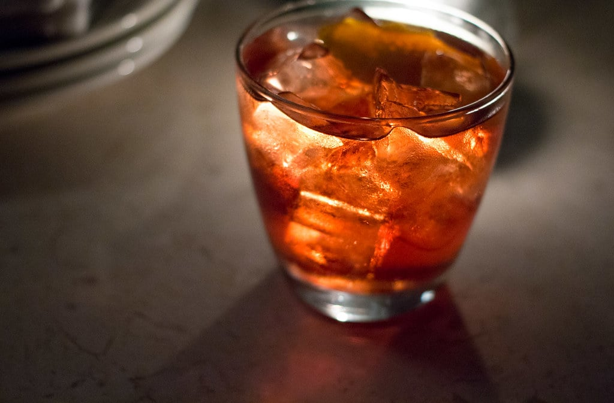

# Old Pal

The Old Pal is a classic cocktail of equal parts [rye whiskey](ref:whisky), [Campari](ref:liqueur) and [dry vermouth](ref:vermouth). It is stirred, strained into a chilled glass, usually garnished with lemon peel, and bitter and dry in style.

Figure: An Old Pal in a rocks glass, with red-orange liquid, ice and a piece of citrus peel. Image: goodiesfirst, CC BY 2.0, via [source page](https://www.flickr.com/photo.gne?id=9071091103).

## Definition and identity

Common accounts link the Old Pal to the Paris bar scene of the 1920s, and its name relates to "old friend". Several origin stories exist; this page treats them as historical background and does not present one as settled fact.

## Recipe (classic ratio)

The classic method uses rye whiskey, Campari and dry vermouth in roughly equal parts. Combine the ingredients with ice in a mixing glass, stir until well chilled and diluted, strain into a chilled glass, and express lemon peel over the drink and drop it in.

Quantities are a starting point, not a law. Whiskey provides the frame, Campari the bitterness and herbal aroma, and dry vermouth a dry herbal background. Any change in proportion noticeably changes the bitterness and body.

## Whiskey and Campari

[Whiskey](ref:whisky) is the body of this drink. Rye brings a spicy, dry frame, while bourbon is sweeter and rounder; the choice sets the direction. The whiskey's flavour intensity affects the balance between bitterness and herbal aroma.

[Campari](ref:liqueur) is a bitter liqueur that supplies bitterness, orange notes and herbal character, and it is the main source of the Old Pal's identity. Its bitterness is strong: too high a proportion buries the whiskey, too low loses the signature bitter structure. Bitterness and sweetness differ by brand.

## The role of dry vermouth

[Dry vermouth](ref:vermouth) is an aromatised fortified wine that provides a dry herbal background and some body. It sets off Campari's bitterness and keeps the finished drink on the dry side; swapping in sweet vermouth makes the style noticeably sweeter and softer.

Dry vermouths differ markedly in herbal aroma and bitterness by brand. Adjust the proportion when substituting, or the drink may turn too bitter or too dry. Opened vermouth should be refrigerated to slow oxidation and loss of aroma.

## Stirring and dilution

The Old Pal is usually stirred rather than shaken: stirring controls dilution and keeps the body clear. Under-stirring leaves the drink insufficiently cold and under-diluted; over-stirring dilutes too much and thins the body.

Ice quality directly affects the result. Large ice melts slowly and dilutes in a controlled way; crushed ice chills fast but can over-dilute. The goal is to chill while keeping enough body.

## Glass and garnish

Traditionally a chilled cocktail glass or small stemmed glass is used: narrow rim, small body, aroma concentrated. Chill the glass beforehand so the drink does not warm quickly after pouring.

Lemon peel is the usual garnish, providing citrus aroma and visual identity. When you express the peel, the oils spray onto the rim and surface and directly shape the first impression. Garnish just before serving.

## Variations

Using bourbon instead of rye gives a sweeter version; using sweet vermouth instead of dry gives a softer, sweeter version; using another bitter liqueur instead of Campari changes the bitter and aromatic direction.

Variations are not mistakes but branches with a clear substitution logic. When recording one, state what was replaced and how the ratio changed. For general cocktail structure, see [Cocktail basics](ref:cocktails-guide); compared with the [Negroni](ref:negroni), the Old Pal swaps sweet vermouth for dry and gin for whiskey.

## Common misconceptions

First, assuming an Old Pal must be sweet. Its direction is bitter and dry.

Second, treating Campari as an ordinary sweet liqueur. Bitterness is its core.

Third, ignoring stirring and dilution. Without enough dilution the aroma stays closed and the bitterness turns sharp.

Fourth, swapping dry vermouth for sweet without adjusting the ratio. The style changes markedly.

For Old Pal, a common mistake is treating a variation as the original recipe. After replacing a main ingredient, use the variation name and state the difference.

## Drinking and boundary

The Old Pal suits slow sipping before a meal, with nuts, olives or simple savoury snacks. It is relatively strong and distinctly bitter, so sip slowly and drink water; do not drink it quickly on an empty stomach. Do not drink when driving, taking medication or pregnant.

This page records one sourced version, evaluates no specific brand and does not present one ratio as the only correct answer. The finished strength depends on the whiskey's [alcohol by volume](ref:abv), the liqueur's sweetness and the ice dilution, not on the recipe numbers alone.

**Short definition:** A classic cocktail of equal parts rye whiskey, Campari and dry vermouth, stirred and strained into a chilled glass, usually garnished with lemon peel; bitter and dry in style.

Begin with the base and the ratio, move on to the dilution and the ice, and finish with the garnish and the glass. That order keeps the reading of Old Pal practical.

[Whisky](ref:whisky) and [Vermouth](ref:vermouth) answer different questions about Old Pal: base liquor and technique and ratio. Read them as a pair, not as alternatives.

Old Pal is a rye-based equal-parts cocktail with Campari and dry vermouth, distinct from the whiskey Negroni family. The modern version often uses a 2:1:1 ratio to soften the Campari, and the original 1920s recipe appeared in Harry MacElhone's ABC of Mixing Cocktails. Dry vermouth makes it leaner and more aperitif-like than the sweet-vermouth Boulevardier. Serve it stirred and up with a lemon twist; the drink is sensitive to vermouth freshness, so refrigerate an opened bottle.

**Key facts.**

| Item | Detail |
| --- | --- |
| In one line | A classic cocktail of equal parts rye whiskey, Campari and dry vermouth, stirred and strained into a chilled glass, usually garnished with lemon peel; bitter and dry in style. |
| Style | Classic cocktail |
| Origin | United States (1920s, circulating in Paris) |

**Sources and limits.** The key claims about Old Pal are checked against the following sources: Oxford University Press (Used to check the historical background and basic composition), David Wondrich / Perigee (Used to check background on 20th-century American cocktail development), International Bartenders Association (Used to confirm the drink is on the IBA official cocktail list) and 4 sources in total. Prices, batches and status change; the body is project-written and does not reproduce source text.

For Old Pal, this page was last checked in 2026; prices, batches and availability change, so confirm them against the sources below.

## Further reading

- [Whiskey](ref:whisky): the body and style source of the Old Pal.
- [Liqueur](ref:liqueur): Campari and the role of bitter liqueurs.
- [Vermouth](ref:vermouth): the herbal background of dry vermouth.
- [Cocktail basics](ref:cocktails-guide): structure, dilution and stirring.
- [Ice and temperature](ref:ice): ice types and how chilling shapes the drink.
- [Alcohol by volume](ref:abv): understanding strength and ice dilution.
- [Negroni](ref:negroni): a related classic built on sweet vermouth and gin.
