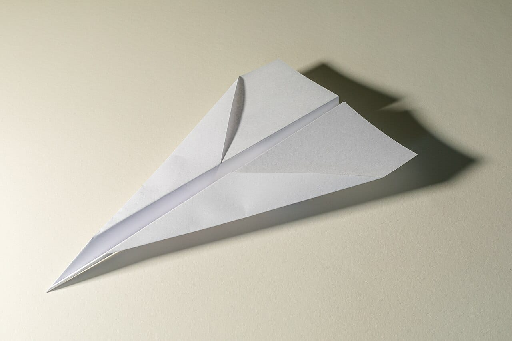

# Paper Plane

The Paper Plane is a cocktail of equal parts bourbon, Aperol, amaro and lemon juice, shaken and served in a chilled coupe. It is pink-orange in the glass, sometimes with a thin layer of foam, and is usually ungarnished or finished with only a small strip of lemon peel. Bittersweet, herbal, citrus and the sweet wood of bourbon all carry equal weight. It is one of the modern classics that spread widely after the 2000s.

Figure: Paper Plane. Image: Dietmar Rabich, CC BY-SA 4.0, via Wikimedia Commons ([source page](https://commons.wikimedia.org/wiki/File:Papierflieger_--_2021_--_7215.jpg)).

> **Quick verdict**
> **In one line:** This cocktail helps you decide whether to order Paper Plane, and how ratio, ice and water change it.
>
> - **Best for:** Anyone who wants the logic, serving method and common mistakes behind Paper Plane.
> - **Not for:** If you want only want a strong drink and do not care about ratio, ice or water.
> - **Check first:**
>   - For Paper Plane, begin with the base and the ratio.
>   - The widely told story places the drink in New York in the late 2000s and links it to a local bar and a bartender.

## Origin and naming

The widely told story places the drink in New York in the late 2000s and links it to a local bar and a bartender. The exact year, the first bar and the details of the recipe differ between accounts, so this cocktail treats the story as widely told rather than documented. What is clearer is that it belongs to the group of drinks that appeared early in the "modern classic" discussions after the 2000s and then travelled through bars around the world.

The name is often said to come from a song of the same title, and the paper-plane image is sometimes used to explain the drink's lightness and its angular, square visual associations. That connection is naming lore, not a verifiable recipe record. The name does not describe the ingredients or imply a fixed ratio; it is a memory hook that ties a pink-orange, bittersweet short drink to a specific cultural reference.

Calling the Paper Plane a "bourbon Negroni" is a common simplification, but it is not accurate. The Negroni is built on gin, bitter aperitif and sweet vermouth, while the Paper Plane is built on bourbon, Aperol, amaro and lemon juice. Both aim for bittersweet balance, but their citrus and herbal directions differ. Treating them as the same drink ignores the acidity and structure that lemon juice brings to the Paper Plane.

## Recipe structure

A common formula is 30 ml bourbon, 30 ml Aperol, 30 ml amaro and 30 ml lemon juice, all equal parts. Bourbon provides sweet wood, vanilla and the alcoholic frame, Aperol provides orange, bitterness and colour, amaro provides herbs, bittersweetness and body, and lemon juice provides acidity and tightens the whole drink. Equal parts are easy to remember and easy to scale with the glass.

The choice of amaro changes the result clearly. A common approach uses a softer amaro with vanilla and citrus notes; a more bitter, heavier amaro can let bitterness overwhelm the orange of the Aperol and make the drink feel weighty. When the amaro changes, the lemon and sugar balance may need small adjustments, but that already moves away from the original recipe. A record should name the amaro's brand or type rather than saying only "amaro".

The choice of bourbon also changes sweetness and wood. A higher-corn mash bill tends to be sweeter and rounder; a higher-rye mash bill is spicier and drier. Aperol and amaro already contain sugar, and lemon juice balances them, so no extra syrup is needed. If the drink is too sweet, add lemon first or choose a drier bourbon; if it is too bitter, check whether the amaro is the cause before reaching for sugar.

## Flavour and balance

The entry is lemon acidity and the orange of Aperol, followed by the herbal bittersweetness of amaro and the vanilla and caramel of bourbon, with a finish of mild bitterness and citrus peel. Unlike the Negroni, which centres on bitter aperitif and sweet vermouth, the Paper Plane uses lemon juice to pull the bittersweet structure tighter and brighter. The balance is between acid, sugar, bitterness and herbs. Too much of any one makes the pink-orange body feel one-dimensional.

Temperature and dilution change the layers. Freshly shaken, the acidity is brightest and the bitterness clearest; as ice melts, sweetness and herbal notes open and the bitterness softens. It is a short drink, usually served without ice or with only a little, so most of the dilution happens during shaking. Too short a shake leaves acid and sugar unintegrated; too long a shake makes the body thin and the colour pale.

Aperol and amaro both contain sugar, and the acidity of lemon juice is the key to balance. Too little lemon makes the drink taste like bitter syrup; too much lemon buries the sweet wood of bourbon and the herbs of amaro. Adjust one variable at a time: first decide whether the problem is acid, sugar, bitterness or herbs, then choose which ingredient to change.

## Method

The method is based on shaking. Combine the bourbon, Aperol, amaro and lemon juice in a shaker, add ice and shake until thoroughly chilled, then fine-strain into a chilled coupe or small rocks glass. It is usually ungarnished, or finished with a small strip of lemon peel; if lemon peel is used, squeeze the oils over the surface just before drinking to add citrus aroma. Double-straining catches crushed ice and pulp and keeps the texture clean.

Coupe glasses, small rocks glasses or Martini glasses are common. A wide rim helps the aroma, and a chilled glass helps hold the temperature. Do not add too much ice, or the drink will keep diluting and the colour will fade; with a rocks glass, one large piece is possible, but it will still soften the body over time. Keep the garnish minimal, because the visual focus of the Paper Plane is usually the pink-orange liquid itself.

At home, measure the four equal parts first, then adjust the lemon to the sweetness of the amaro and bourbon. Squeeze the lemon to order; pre-squeezed juice loses aroma. Shake for about ten to fifteen seconds, until the tin is heavily frosted. If amaro is unavailable, do not casually replace it with an ordinary bitter liqueur; the structure changes clearly, and it is better to treat the result as a different drink.

## Variations

Replacing bourbon with rye gives a spicier, drier version; replacing the amaro changes the herbal and bittersweet direction. Scaling the four equal parts to make several drinks at once is common in bars, and a frozen version blended with ice also exists. A little orange or grapefruit peel oil can brighten the citrus without changing the basic structure.

A variation should state what was replaced. Calling a drink with a more bitter amaro a "Paper Plane" is acceptable, but a "specific-amaro version" is clearer; replacing bourbon with rye reduces the sweet wood and should be noted. Only when the base spirit, the bitter liqueur, the amaro and the source of acidity are recorded does a recipe comparison mean anything.

## How to order and drink

For Paper Plane, begin with the base and the ratio. Then look at the dilution and the ice, and finally ask the garnish and the glass. The answers point to different choices, not to a single score.

The drink suits after-dinner service with dark chocolate, citrus desserts, nuts and hard cheese. Bittersweet and herbal notes balance the sugar of dessert, and lemon acidity refreshes the palate. Sip slowly and avoid drinking quickly on an empty stomach; do not drink and drive, and avoid alcohol during pregnancy or while taking medication that interacts with it. The alcohol content is not low, so a second glass deserves a moment of thought.

In a bar, if the colour is pale and bitterness is buried by acidity, there may be too much lemon or too long a shake; if the colour is dark and the drink too sweet, the amaro or Aperol may be too high. A clear pink-orange colour and a clean texture are useful clues about execution, but appearance is not the only measure: the bittersweet and herbal balance matters just as much.

## Common misconceptions

First, treating the Paper Plane as a "bourbon Negroni". The ingredients and citrus structure are different. Second, that equal parts is the only correct version. Equal parts is the classic approach, but the character of the amaro and bourbon changes the balance. Third, that the amaro can be replaced freely. Different amaros differ greatly in bitterness and herbal direction. Fourth, adding syrup. Aperol and amaro already contain sugar, and lemon juice provides the balance. Fifth, that a garnish is required. The drink usually stands on the liquid itself and works without one.

## See also

- [Bourbon](ref:bourbon): the sweet wood and vanilla frame of this drink.
- [Aperitif](ref:aperitif): the bittersweet orange role of Aperol.
- [Negroni](ref:negroni): a classic comparison in bittersweet balance.
- [Shaking](ref:shaking): the technique behind integrating acidity, chilling and dilution.
- [Choosing a glass](ref:glass): the coupe and the presentation of a short drink.
