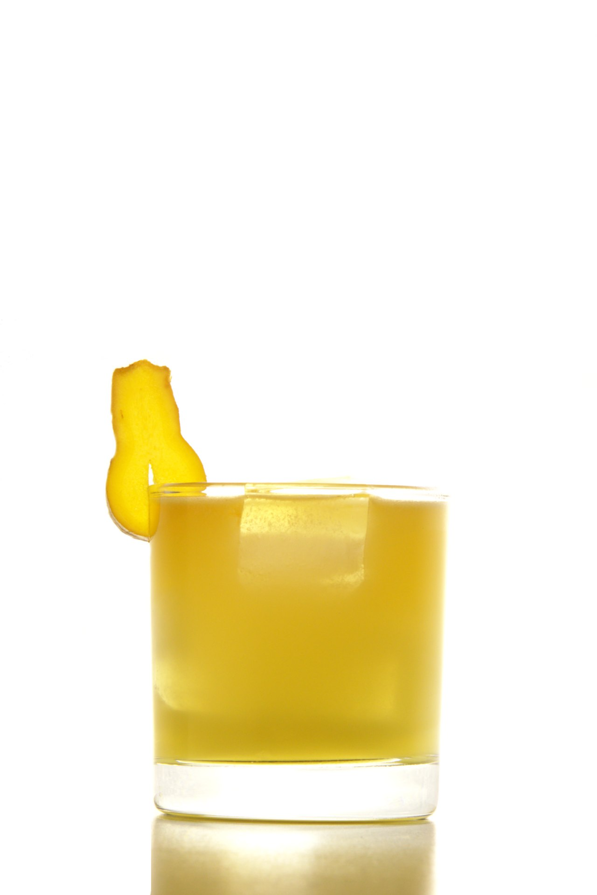

# Penicillin

The Penicillin is a cocktail of blended Scotch whisky, lemon juice and honey-ginger syrup, shaken and finished with a float of Islay whisky. It is usually strained into a rocks glass over ice and garnished with a piece of candied ginger. Lemon acidity, honey sweetness, ginger heat and the peat smoke of Islay whisky define the drink. It tastes like a smoky honey-ginger tea, but its alcohol content is far from tea-like.

Figure: Penicillin. Photograph: File:Penicillin Cocktail.png. Credit: Matthias Friedlein (www.augustine-bar.de), CC BY-SA 4.0, via Wikimedia Commons ([source](https://commons.wikimedia.org/w/index.php?curid=41778882)).

## Origin and naming

The widely told story places the drink in New York in the mid-2000s and links it to a local bar and a bartender. The exact year, the name of the bar and the evolution of the recipe differ between accounts, so this page treats the story as widely told rather than documented. What is clearer is that it belongs to the group of drinks that appeared early and travelled widely in the "modern classic" discussions that followed the 2000s.

The name comes from the antibiotic penicillin. Ginger and honey are traditionally associated with soothing a sore throat, and the bartender used the name to suggest a "medicinal" and restorative quality. That is naming wit, not a medical claim. A cocktail cannot treat an infection and cannot replace medicine. Taking the name as a health promise is one of the most common misreadings of the drink.

The layered structure is another feature beyond the name. The body is blended Scotch, lemon, honey and ginger, and a float of heavily peated Islay whisky goes on top. The float is not decoration: it lets the drinker meet the smoke first and then move into the sweet-hot honey-ginger body. Mixing the Islay whisky into the shaker changes the aromatic structure and blurs the smoke.

## Recipe structure

A common formula is 60 ml blended Scotch whisky, 22.5 ml lemon juice, 22.5 ml honey syrup and 7.5 ml ginger syrup, shaken and strained into a rocks glass over ice, then topped with a 7.5 ml float of Islay whisky. Blended whisky provides a grain-and-malt frame with light smoke, lemon provides acidity, honey syrup provides sweetness and floral notes, ginger syrup provides heat and Islay whisky provides peat aroma.

Honey syrup is not the same as a spoonful of honey. Honey does not dissolve easily in cold liquid, so using it directly gives uneven sweetness and a sticky texture. It is usually warmed and stirred with water at roughly two-to-one or one-to-one by volume, then cooled before use; the ratio changes both sweetness and flow. A recipe should state the syrup ratio, or the same millilitres will produce different sweetness.

Ginger syrup can be homemade or bought. Homemade syrup made by chopping fresh ginger, heating it to infuse, straining and adding sugar has a direct flavour; commercial products vary widely in heat and sweetness. Lemon should be squeezed to order, because honey and ginger flavours become dull after standing. The Islay whisky is used in a small quantity, but brands differ clearly: some lean medicinal and maritime, others toward bonfire and ash, and the choice changes the first impression.

## Flavour and balance

The entry is lemon acidity and honey sweetness, followed by ginger heat and a finish of peat smoke and mild bitterness. It feels like a warm ginger tea, but the alcohol brings a noticeable heat. The balance is between acid, sugar, spice and smoke. Too much honey makes the drink sticky and buries the ginger; too much lemon makes the ginger heat sharp; too much ginger syrup overwhelms the floral side of the honey; too much Islay float lets smoke dominate the body.

Smoke is not "the heavier the better". The float is there for aroma, not to turn the glass into peat soup. Pour it slowly along the wall of the glass or over the back of a bar spoon so that it forms a thin layer on the surface; stirring destroys the layering and spreads the smoke at once. The first sip meets the smoke, followed by the sweet-hot honey and ginger, and the sense of layers comes from that order.

Temperature and dilution change the balance. Melting ice softens the sweetness and ginger heat and also fades the smoke; if the glass is too large and there is too much ice, the second half tastes thin. The ideal is chilled ingredients, a full shake, clean ice in a moderate amount and drinking while the flavour is still concentrated. It is a drink to sip, but not to leave until the ice has completely melted.

## Method

The method is based on shaking. Combine the blended Scotch, lemon juice, honey syrup and ginger syrup in a shaker, add ice and shake until thoroughly chilled, then fine-strain into a rocks glass over fresh ice. Float the Islay whisky gently on the surface along the wall of the glass or over the back of a bar spoon, and finish with a piece of candied ginger or a slice of fresh ginger. Do not shake the Islay whisky, and do not stir the finished drink hard, or the float will disappear.

Candied ginger can be homemade or bought. Homemade candied ginger is simmered in syrup, drained, dried and coated in fine sugar; commercial candied ginger varies greatly in sweetness and heat. The garnish is not essential, but a piece of candied ginger reinforces the ginger aroma and gives the drinker something to chew. If sweetness is unwanted, omit the candied ginger and use only fresh ginger or a lemon peel.

At home, make the honey syrup in advance and keep it chilled. The heat of the ginger syrup can be adjusted by infusion time: longer infusion gives more heat, and more sugar gives more sweetness. A shake that is too short leaves the honey and ginger syrup insufficiently integrated, so the layers feel disconnected; too long a shake melts too much ice and makes the smoke float easier to dilute.

## Variations

Replacing the Islay float with another heavily peated whisky gives a different kind of smoke, perhaps more maritime, more herbal or more ashy. A mezcal float adds the vegetal and smoky notes of agave. Some versions replace ginger syrup with fresh ginger juice, or honey with another sweetener, but the sweetness and texture change. Other recipes mix the Islay whisky directly into the body, giving a more unified flavour but losing the aromatic layering.

A variation should state what was replaced. Calling a mezcal-float drink a "Penicillin" is acceptable, but "mezcal-float version" is clearer; replacing honey with syrup changes the aromatic sweetness and should be noted. Only when the base whisky, the sweetener, the ginger source and the float are recorded does a comparison between recipes with the same name mean anything.

## How to order and drink

Penicillin is best approached through the base and the ratio, then the dilution and the ice, and then the garnish and the glass. One check alone will not settle it.

The drink suits cold weather, after-dinner service or the role of a comforting cocktail, with smoked meat, roasted food, ginger desserts and nuts. The sweet heat of honey and ginger meets fat, and the smoke echoes the char of grilled food. Sip slowly and avoid drinking quickly on an empty stomach; do not drink and drive, and avoid alcohol during pregnancy or while taking medication that interacts with it. The alcohol content is not low, so a second glass deserves a moment of thought.

In a bar, if the float mixes into the body almost at once, the pour may have been too fast or the glass too small; if there is no smoke aroma at all, the float may be too small or the whisky may be the wrong style. A clear thin layer on the surface is a useful clue about execution, but appearance is not the only measure: the acid-sugar balance and the ginger heat matter just as much.

## Common misconceptions

First, treating the Penicillin as actual medicine. The name is borrowed and has no therapeutic effect. Second, using raw honey instead of honey syrup. Honey dissolves poorly and gives uneven sweetness. Third, thinking the Islay whisky is the base. It is usually only the float; the body is blended Scotch. Fourth, thinking more smoke is always better. The float is for aroma, not for turning the drink into peat soup. Fifth, blaming the whisky when the ginger is weak. The amount and quality of the ginger syrup are the key.

## See also

- [Scotch whisky](ref:scotch): the background of blended whisky and Islay peat styles.
- [Shaking](ref:shaking): chilling, dilution and the integration of honey-ginger syrup.
- [Scotland](ref:scotland): the regional background of whisky styles.
- [Rocks glass](ref:rocks): the short-drink vessel, ice and the presentation of a float.
- [Cocktail basics](ref:basics): shaking, straining and garnishing.