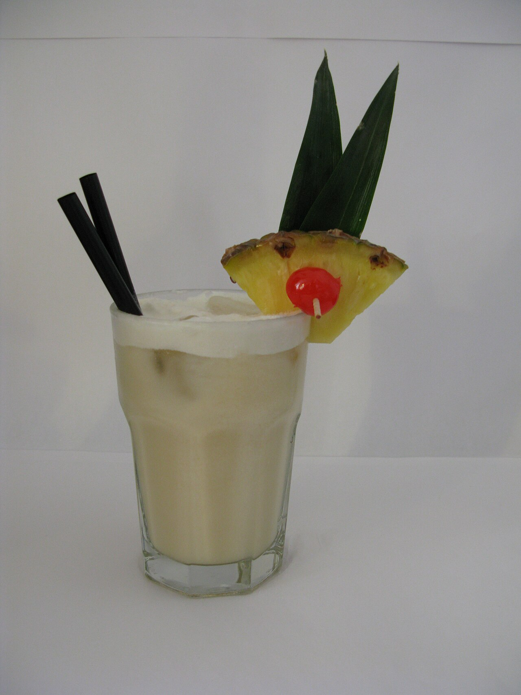

# Piña Colada

The piña colada is the reference point for tropical cocktails: white rum, coconut cream and pineapple juice, blended with ice, poured into a highball and garnished with a pineapple wedge. It is sweet, thick and cold, like liquid pineapple-coconut milk, yet the rum keeps an alcoholic backbone underneath.

The difficulty is texture, not the recipe list. The fat in the coconut cream, the acidity of the pineapple, the size of the ice and the length of blending decide whether the glass holds a dense slush or a thin fruit water. The same formula, with different proportions and blending, can land several levels apart.

Figure: A piña colada blended from rum, coconut cream and pineapple juice, garnished with pineapple. Image: Martin Asche, CC BY-SA 3.0, via Wikimedia Commons ([source page](https://commons.wikimedia.org/wiki/File:Pina_Colada_(Cocktail).jpg)).

## The three tropical layers

The first layer is rum. White rum gives clean cane sweetness and alcohol without fighting the coconut or pineapple; aged rum adds vanilla and wood, which suits darker colada variations. The second layer is coconut cream, bringing fat, body and tropical aroma. The third is pineapple juice, supplying acidity, fruit and colour.

The three must balance. Too much coconut and the drink turns greasy and cloying; too much pineapple and it becomes sour and thin; too much rum and the fruit disappears. A good colada is sweet without being heavy, tart without being sharp, cold without being watery, and all three ingredients remain visible at once.

## The formula: rum, coconut and pineapple

The IBA standard is 50 millilitres of white rum, 30 millilitres of coconut cream and 50 millilitres of pineapple juice, blended with ice. That ratio is on the sweet side and makes a useful starting point; cut the coconut slightly if the juice is very acidic, or add a little juice if the cream is very dense.

Coconut cream is not coconut water. Coconut water is clear, sweet and thin and suits a lighter variation; coconut cream is white, rich and fatty and is the backbone of the drink. Coconut milk can work too, but its fat and sweetness differ, so the ratio must be reset. Coconut-flavoured syrup is the worst shortcut: it turns the cocktail into sugary cordial.

Pineapple juice should be fresh or a high-quality chilled juice. Canned juice often carries a cooked note and its acidity varies. With fresh pineapple, freeze the fruit first and blend it with the liquids, which reduces the amount of ice needed and intensifies the fruit.

## Method: shake or blend

The traditional method shakes the ingredients with ice and strains them into a highball filled with crushed ice. Shaking emulsifies the coconut cream and juice for a more even texture; crushed ice supplies lasting cold and gradual dilution. Modern bars more often use a blender: liquids and ice are blended into a dense slush and poured into the glass.

Ice is the critical variable in blending. Too much and the drink becomes a tasteless snow cone; too little and it is thin and warms quickly. A useful starting point is roughly equal volumes of liquid and ice, adding ice in stages. Blend until smooth, not until the ice has completely melted and the drink has separated.

Garnish with pineapple, cherry or mint. A grilled pineapple wedge adds caramel; a cherry gives colour contrast; mint adds freshness. A rim of shredded coconut is optional, but too much makes every sip messy.

## Puerto Rico's national drink

Puerto Rico calls the piña colada its national drink. The most widely told version dates it to 1954, when bartender Ramón "Monchito" Marrero at the Caribe Hilton in San Juan combined coconut cream, pineapple juice and rum after repeated trials. Another account places a similar drink in the 1930s, with the 1950s version being the commercial one.

Whatever the origin, the drink is tied to Puerto Rico's tourism economy. In the second half of the twentieth century, Caribbean holidays, air travel and bar culture carried the colada around the world. It became the taste of an island vacation and a standard flavour for ready-to-drink bottles and slush machines.

The Spanish name means "strained pineapple", referring to fresh pineapple juice. English drops the tilde and writes Piña Colada or Pina Colada. The spelling change does not change the formula, but it is a reminder that the root of the drink is pineapple, not coconut.

## Variations and common mistakes

Common variations include the Chi Chi, which swaps vodka for rum; the Amaretto Colada, with almond liqueur; the Virgin Piña Colada, without alcohol but with coconut and pineapple; and the Dark 'n' Colada, with dark rum floated on top for colour and aroma.

Four mistakes recur. First, using coconut water instead of coconut cream, which leaves the drink thin. Second, not shaking the coconut can before measuring, so the fat separates. Third, too much ice, which dilutes the flavour. Fourth, over-blending, which melts all the ice and turns the drink into warm juice. The colada looks casual but is sensitive to ratio and temperature.

For a home bartender, the practical method is: shake the coconut can, measure the rum and juice, add ice in two stages and blend just until smooth. Chill the glass and garnish last. The target is tropical texture, not sugary syrup.

## See also and references

- Mai tai: see [mai tai](ref:mai-tai).
- Zombie: see [zombie](ref:zombie).
- Rum: see [rum](ref:rum).
- Highball: see [highball](ref:highball).
- Shaking: see [shaking](ref:shaking).

Piña Colada is best read by starting with the base and the ratio, moving to the dilution and the ice, and ending with the garnish and the glass.

[Mai Tai](ref:mai-tai)'s base liquor and [Rum](ref:rum)'s technique and ratio form a useful pair: the contrast shows where one ends and the other begins.

**At a glance:** A tropical cocktail of white rum, coconut cream and pineapple juice. A version existed in the 1930s, the modern drink was fixed at the Caribe Hilton in Puerto Rico in 1954, and sweetness and ice decide whether it works.

Blend white rum, coconut cream and pineapple juice with ice; the 1954 Caribe Hilton version is the usual reference.

**Key facts.**

| Item | Detail |
| --- | --- |
| In one line | A tropical cocktail of white rum, coconut cream and pineapple juice. A version existed in the 1930s, the modern drink was fixed at the Caribe Hilton in Puerto Rico in 1954, and sweetness and ice decide whether it works. |
| Style | IBA Contemporary Classics |
| Origin | San Juan, Puerto Rico |

**Sources and limits.** The key claims about Piña Colada are checked against the following sources: International Bartenders Association (Used to check the IBA category, ingredients and ratio), Oxford University Press (Used to check cocktail history and terminology), CocktailDB (Used to cross-check recipe structure and common variations) and 5 sources in total. Prices, batches and status change; the body is project-written and does not reproduce source text.

For Piña Colada, this page was last checked in 2026; prices, batches and availability change, so confirm them against the sources below.
