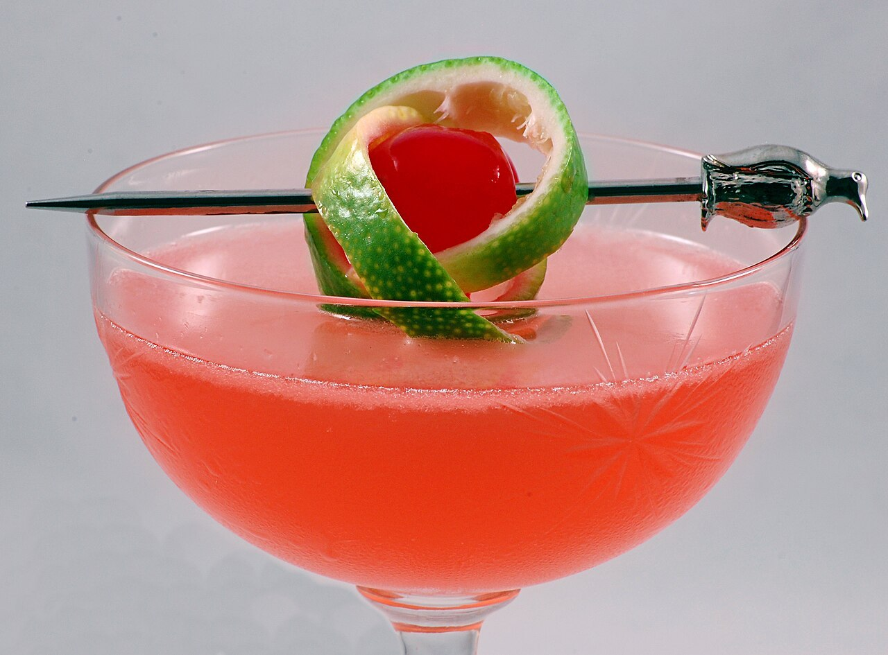

# Pink Lady

The Pink Lady is often mistaken for a sweet drink "for the ladies." What actually separates it from its neighbours is a three-part structure: a dual base of gin and applejack, the pink of grenadine, and the fine foam of egg white. Its history is more complicated than its name.

Figure: Pink Lady. Photograph: File:Pink Lady with a twist of lime, in a cocktail glass.jpg. Credit: WxMom, CC BY-SA 2.0, via Wikimedia Commons ([source](https://commons.wikimedia.org/w/index.php?curid=18268285)).

## The 1911 Broadway Musical, and the "1912" Retelling

The most common story is that the drink was named for the Broadway musical *The Pink Lady*, and that its star, Hazel Dawn, was given the cocktail as a surprise on opening night. *The Oxford Companion to Spirits and Cocktails* supports this line, and Wine Enthusiast's account also cites the 1911 musical as the naming source.

Chinese-language sources often give the year as 1912, but the Broadway opening is usually dated to 1911. More importantly, what Hazel Dawn drank was not today's recipe: one account describes it as a mix of ojen (an anise liqueur), Peychaud's and Angostura bitters, far from the later gin sour.

Another attribution gives the invention to the interior designer Elsie de Wolfe. Her version used gin, pink grapefruit juice and Cointreau, with neither applejack nor grenadine. The point is that "Pink Lady" was a fashionable name before it was a fixed formula.

## Jacques Straub's 1913 Manual

One of the earliest printed recipes appears in Jacques Straub's *Manual of Mixed Drinks* (1913). Both Cocktailarium and Wine Enthusiast mention this version; it has no egg white and is simpler than the modern build.

Straub was Swiss, settled in Kentucky in 1913, and became an important recorder of early American drinks. Wine Enthusiast treats his version as the groundwork for today's cocktail: gin, lemon and grenadine are already there, while applejack and egg white were fixed later.

This is why the early Pink Lady sources disagree with one another. It was never a drink invented by one bartender on one day; it is a set of versions that overwrote each other across bars, menus and recipe books.

## The 6 : 2 : 3 : 2 : 2 Build

The version below follows Cocktailarium and most modern bars. Wine Enthusiast cuts the grenadine to 7.5 ml for a drier drink; both work, and the difference is sweetness and depth of colour. For acid balance, see [Acidity](ref:acidity).

| Ingredient | Amount | Role |
| --- | --- | --- |
| Gin (London Dry) | 45 ml | Juniper frame that holds back the sugar |
| Applejack or apple brandy | 15 ml | Fruit and a rounder body |
| Fresh lemon juice | 22.5 ml | Acidity that balances the grenadine |
| Grenadine | 15 ml | Pink colour and fruit sweetness; can drop to 7.5 ml |
| Egg white | 15 ml (about 1 white) | Foam and silky texture |

- **Ratio:** gin : applejack : lemon : grenadine : egg white is about 6 : 2 : 3 : 2 : 2.
- **Glass:** a chilled coupe.
- **Ice:** dry shake (no ice) for 10–15 seconds, then wet shake with ice for 8–10 seconds; no ice in the glass.
- **Method:** double-strain to catch ice shards and the tougher egg-white strands.
- **Garnish:** a brandied cherry, or an apple slice.

## Pink Comes from Grenadine

The colour is not violette and not food colouring; it is grenadine. The red of the syrup is softened by dilution and by the white egg foam, producing a pale pink. The more syrup, the deeper the colour and the sweeter the drink.

Real pomegranate grenadine is dark red and distinctly tart. Cheap products are often corn syrup and red dye: vividly coloured, sweet and empty. That is the most common failure in a Pink Lady. It leaves the drink both sweet and hollow, with the lemon unable to hold the sugar and an artificial fruit finish.

## Egg White: Dry Shake, Wet Shake, Double Strain

The egg white is not decoration; it determines the texture. Shake without ice first so the protein unfolds and foams at room temperature, then shake with ice to chill and dilute. Reverse the order and the foam is thin and the body less round.

Ten to fifteen seconds is the usual dry shake. Too short and the foam collapses; too long and the protein turns coarse. Eight to ten seconds of wet shaking is enough to chill; over-shaking dilutes the foam and thins the body. Double-strain at the end to catch both ice shards and the coarser strands of egg white. Foam stability is tied to the drink's body; see [Body](ref:body).

Egg safety deserves its own note. Use fresh eggs from a reliable source; anyone uneasy about raw egg can use 30 ml of aquafaba (chickpea water), which foams similarly but tastes slightly different.

## The Clover Club Connection

The [Clover Club](ref:clover-club) is the Pink Lady's close relative: the same gin, lemon and egg-white frame, the same reliance on a red syrup for colour. The difference is the syrup and the base. [Gin](ref:gin) provides the frame here; the Clover Club uses raspberry syrup, which is brighter and more directly fruity; the Pink Lady uses grenadine and adds [applejack](ref:brandy), giving a rounder body and deeper fruit.

Both are often grouped as "pink egg-white sours," but they do not drink the same. The Clover Club tastes like raspberry jam cut by lemon; the Pink Lady's grenadine brings a faint tannic edge, and the applejack adds apple and oak. Swap the recipes and the colour may look similar while the structure falls apart.

## Against the Aviation's Violet

The [Aviation](ref:aviation) is another gin sour often compared with the Pink Lady. The first difference is the source of colour: the Aviation uses crème de violette and turns pale violet to grey-blue; the Pink Lady uses grenadine and turns pink. One is floral, the other fruity.

The texture differs too. The Aviation has no egg white and stays clear; the Pink Lady builds a foam layer with egg. In the recipe, the Aviation uses maraschino for cherry and sweetness, while the Pink Lady uses applejack for fruit. Both are "coloured," but the colour, aroma and texture take different routes.

## Prohibition, Popularity and the "Lady's Drink" Label

The Pink Lady was popular in the 1920s and 1930s, a period spanning American Prohibition (1920–1933) and the speakeasy culture that followed. Its pink colour and sweetness made it memorable, and also easy to label.

From the 1930s into the 1960s it was often dismissed as a "lady's drink" by critics in a male-dominated cocktail press. Wine Enthusiast calls this "their loss": with its acidity, egg-white body and dual base, the drink is not light by the standards of a modern classic list.

## Common Failures

First, a short dry shake. The egg white never foams properly, the head is thin and the drink tastes watery.

Second, too much grenadine. Fifteen millilitres is already sweet; above 20 ml the drink cloys and the pink turns artificial.

Third, cheap grenadine. Red dye and corn syrup cover the gin and applejack, and the finish tastes like candy.

Fourth, a warm glass or an overlong wet shake. The first lets the drink warm quickly; the second thins both foam and body.

Fifth, ignoring egg safety and substitution. Use a reliable source for raw egg, and use aquafaba if you have concerns rather than omitting the white and expecting the same texture.

## Variations and a Non-Alcoholic Version

- **Drier version:** cut the grenadine to 7.5 ml and keep the lemon at 22.5 ml, for a less sweet drink.
- **No applejack:** gin, lemon, grenadine and egg white only; lighter in fruit and thinner in body.
- **A touch of cream:** some early recipes include cream, giving a dessert-like texture that is outside the modern mainstream.
- **Calvados instead of applejack:** drier and more apple-skin than orchard fruit, with slightly less sweetness.
- **Aquafaba version:** 30 ml of chickpea water replaces the egg white for a vegan or raw-egg-averse build.

A non-alcoholic version can only be an approximation: 45 ml of 0.0% gin, 15 ml non-alcoholic apple juice, 22.5 ml fresh lemon, 15 ml grenadine and 30 ml aquafaba, dry-shaken, then shaken with ice and double-strained. The colour and foam are close, but without alcohol's weight and gin's juniper the drink is lighter and sweeter.
