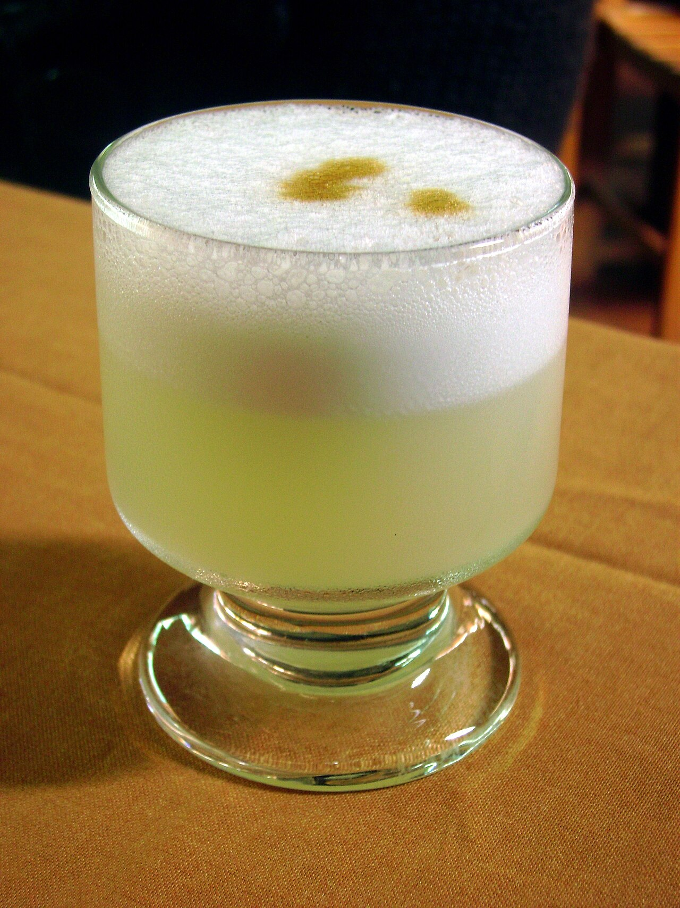

# Pisco Sour

The Pisco Sour is a sour cocktail made from pisco, lime juice, syrup and egg white. It is usually strained into a chilled coupe or a rocks glass over ice, covered with a fine layer of foam and dotted with a few dashes of Angostura bitters. The grape aroma of pisco, the acidity of lime, the sweetness of syrup, the silkiness of egg white and the spice of bitters together define the drink.

Figure: Pisco Sour. Image: Dtarazona, CC BY-SA 4.0, via Wikimedia Commons ([source page](https://commons.wikimedia.org/wiki/File:Pisco_sour_20100613b.JPG)).

## Origin and naming

The origins of the Pisco Sour are contested. Peru and Chile both treat pisco and their sour traditions as part of national food culture, and public accounts do not agree on which port saw the drink first, who refined it or when it took its present form. The widely told story places it in port cities along the Pacific coast of South America and links it to local habits of drinking grape brandy with lemon and sugar. Because the exact year and the individuals involved are not consistently documented, this page treats the story as widely told.

Pisco itself is a distillate made from grapes, and Peru and Chile each have their own production regions and regulations with clearly different styles. Peruvian pisco is generally not aged for long in wood and emphasises fresh grape aroma; Chilean pisco has its own rules and traditions. Using "pisco" as a blanket term hides these differences, so a record should state the origin, grape varieties and production method.

The "Sour" in the name refers to the sour family, the basic structure of a base spirit, citrus acidity and a sweetener. It shares that logic with the Whiskey Sour and the Gin Sour, but pisco's aroma and body give the result a different direction. Calling it simply "a Whiskey Sour made with pisco" ignores the floral and fruit notes and the lighter body of grape brandy.

## Recipe structure

A common formula is 60 ml pisco, 30 ml lime juice, 20 ml syrup and one egg white, plus two or three dashes of Angostura bitters. Pisco provides grape aroma and the alcoholic frame, lime provides acidity, syrup balances the sourness, egg white provides foam and a silky texture, and bitters mainly add aroma. The proportions can be adjusted, but the relationship between acid, sugar, egg white and body should hold.

The concentration of the syrup changes sweetness noticeably. One-to-one and two-to-one syrups differ in sweetness at the same volume, so a recipe should state the concentration, or "20 ml of syrup" will produce different results. Egg white is about texture, not flavour: it rounds the edges of the sour and gives the bitters something to sit on. If egg white is not wanted, aquafaba or another substitute can be used, or it can be omitted, though the texture will be more direct and thinner.

Lime should be squeezed to order, and the pisco should stay as fresh as possible. Pisco loses floral and fruit aroma after long storage, especially the unaged styles, so a record can note the opening date or the batch. Bitters are used in a tiny amount but set the aromatic direction of the first sip; when dotted on the foam they should not be stirred in, so that the drinker meets the spice first.

## Flavour and balance

The entry is lime acidity and syrup sweetness, followed by the grape aroma of pisco and a mild alcoholic warmth. Egg white makes the texture round, and the finish leaves the spice and light bitterness of the bitters. Because it belongs to the sour family, the core balance is still acid against sugar: when it is too sour, add a little syrup; when it is too sweet, add a little lime. Adjust in small steps. Egg white adds no sweetness, but it softens the acid, so its presence changes how sweet the drink seems.

Pisco aroma can lean floral, citrusy or toward ripe grapes, depending on origin and variety. A strongly aromatic pisco suits less syrup so that sweetness does not bury the fruit; a lighter pisco needs more attention to dilution so that shaking does not leave it watery. Bitters are not decoration: they connect the creamy foam with the citrus and add a little spice at the end.

Temperature and foam change over time. Freshly shaken, the foam is fine and the texture tight; left too long, the foam collapses and the aroma fades. Insufficient chilling makes the acidity sharp, while over-chilling can mute the aroma. The ideal is chilled ingredients, a full shake, pre-chilled glassware and drinking while the foam is still intact.

## Method

The usual method has two stages. First, without ice, combine the pisco, lime juice, syrup and egg white in the shaker and dry-shake to build the foam. Then add ice and shake again to chill, dilute and integrate. Strain into a chilled coupe or a rocks glass over ice, let the foam settle for a moment, and dot a few dashes of bitters on top. The dry shake is not strictly required, but it clearly improves the foam.

Egg white brings food-safety considerations. Use fresh eggs kept properly refrigerated, or pasteurised egg products where available. People with weakened immunity, pregnant people, or anyone uncomfortable with raw egg can omit the egg white or use aquafaba. The foam structure of substitutes differs, and a recipe should say so, or comparisons become misleading.

Shake time affects dilution and foam. A dry shake of about ten seconds and a wet shake of ten to fifteen seconds, until the tin is heavily frosted, is common. A fine strainer catches crushed ice and clumps of egg white and keeps the texture clean. Bitters can be dotted in the centre or arranged in small dots, but they should not be stirred in with a bar spoon; the first sip should meet their aroma.

## Variations

Diluting pisco with ginger ale or soda produces lighter drinks of the Chilcano type; pisco with fruit juice and sugar leads to traditional preparations such as Pisco Punch. Replacing lime with other citrus, adding fruit purée or chilli, or changing the sweetener creates different branches of the Pisco Sour. There are also versions without egg white, with a more direct texture, and aquafaba versions for a plant-based alternative.

A variation should state what was replaced. Swapping pisco for another grape distillate but still calling it a "Pisco Sour" loses the origin and aroma information; removing the egg white is better labelled as a "no-egg-white version" so that the change in texture is clear. Only when ingredients and structure are recorded does a comparison between drinks with the same name mean anything.

## How to order and drink

Start with the base and the ratio. From there, consider the dilution and the ice, then the garnish and the glass. That is how a practical judgment about Pisco Sour is built.

The drink suits aperitif service with seafood, ceviche, light fish and salty snacks. Acidity and foam refresh the palate, and the floral-fruit aroma of pisco can meet the savoury note of seafood. Sip slowly and avoid drinking quickly on an empty stomach; do not drink and drive, and avoid alcohol during pregnancy or while taking medication that interacts with it. An egg-white version should not sit at room temperature for long and should be drunk soon after it is made.

In a bar, if the foam collapses quickly, the dry shake may have been too short or the egg white may not be fresh; if the bitters sink into the liquid instead of sitting on the foam, the foam structure is too thin. The fineness of the foam and whether it sits level with the rim are useful clues, but appearance is not the only measure: the aroma of the pisco and the acid-sugar balance matter just as much.

## Common misconceptions

First, treating the Pisco Sour as a simple substitution for a Whiskey Sour. The grape aroma and lighter body of pisco change the whole direction. Second, that egg white is required. It affects texture but can be omitted or replaced. Third, skipping the dry shake. A dry shake clearly improves the foam. Fourth, treating bitters as decoration. They add aroma and a spice note at the end. Fifth, that the Peru-Chile dispute decides which drink tastes better. Origin and regulation shape style, but the balance in the glass still depends on the recipe and the execution.

## See also

- [Brandy](ref:brandy): the wider family of grape distillates that includes pisco.
- [Shaking](ref:shaking): dry shaking, wet shaking and foam formation.
- [Acidity](ref:acidity): the role of lime in a sour.
- [Rocks glass](ref:rocks): how glass and ice affect foam and dilution.
- [Cocktail basics](ref:basics): the basic structure and equipment of the sour family.

**Short definition:** A sour of pisco, lime juice, syrup and egg white, shaken into a silky foam and finished with a few dashes of Angostura bitters. 
