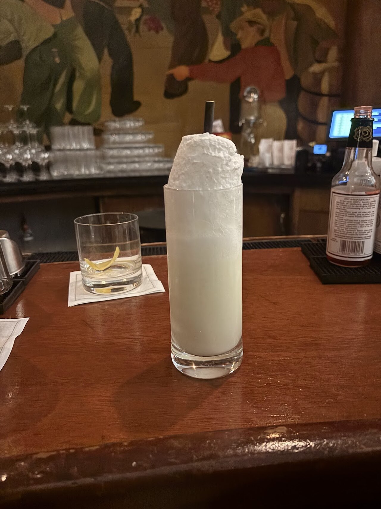

# Ramos Gin Fizz

The Ramos Gin Fizz is the most labour-intensive member of the fizz family. Gin, lemon, lime, sugar, cream, egg white and orange flower water are shaken long with ice, strained into a highball and topped with soda. The foam rises above the rim like a cloud, and the drink beneath is milky white.

Henry C. Ramos fixed the drink at Meyer's Restaurant in New Orleans in 1888. Legend says that at its peak a single bar needed a dozen men shaking it; today an electric shaker or a hard shake does the work, but shaking until the foam is fine remains the core.

Figure: A Ramos Gin Fizz with its cloud of foam. Image: AGnias47, CC BY 4.0, via Wikimedia Commons ([source page](https://commons.wikimedia.org/wiki/File:Ramos_Gin_Fizz_at_The_Sazerac_Bar.jpg)).

## Gin, citrus and cream

Gin supplies the backbone and the aroma. London dry gin's juniper, citrus and herb cut through the cream and egg white; old tom gin is sweeter and rounder, suiting the drink's retro style. Avoid a very strongly flavoured gin, which clashes with the orange flower water.

Lemon and lime supply acid and aroma. Lemon's acid is round and lime's is sharp; together they give the acidity depth. Lemon alone makes the drink too yellow in character, lime alone too green. The usual ratio is 1.5 centilitres of each.

Cream supplies fat and roundness. Single cream's fat stabilises the foam and smooths the body; without cream the drink becomes an egg-white foam and feels too light. Cream runs at six centilitres, about half the total liquid.

Egg white supplies the foam's structure. The protein denatures and foams during shaking, forming a fine mesh; without it the foam collapses quickly. Use a fresh egg white, chilled and taken out just before shaking; an old white foams poorly.

Orange flower water supplies the floral note. It is the drink's signature: a drop or two turns citrus cream into a New Orleans garden. Too much tastes of perfume, too little disappears; two dashes is a common starting point.

## The formula: seven ingredients

The IBA standard is 4.5 centilitres of gin, 1.5 of lemon juice, 1.5 of lime juice, 3 of sugar syrup, 6 of cream, one egg white, two dashes of orange flower water and soda to top. The total is about 180 millilitres, strained into a highball and filled with soda.

The syrup can be homemade, one part sugar to one part water, or bought. Sugar balances the citrus and supports the foam; too little and the drink is sour and the foam unstable, too much and it is cloying and the foam heavy.

Use food-grade orange flower water, not perfume or essential oil. Its aroma is delicate and volatile once opened; store it dark and cold. Two dashes is a start: add one, shake, taste, then decide.

The soda should be cold and fresh. Its carbonation lifts the foam and dilutes the drink; stale soda has too little gas and the foam will not rise. Pour it down the side of the glass so the foam is not torn apart.

## Method: long shake and soda

Put the gin, lemon, lime, syrup, cream, egg white and orange flower water into a shaker and dry-shake for thirty seconds without ice, so the egg white foams and the cream emulsifies. Then add ice and shake hard for two to three minutes, until the tin frosts and the foam is fine.

The dry shake is the key. Without ice the egg white foams more easily and the cream emulsifies with the spirits; dry-shaking first and adding ice later gives a finer, more stable foam. Skip it and the foam is coarse and short-lived.

Strain through a fine mesh into a chilled highball, holding back the ice and any unfoamed egg. Then pour cold soda down the side; the foam rises slowly into a cloud. Do not stir or the foam collapses.

Chill the glass and keep it clean and grease-free. Grease breaks the foam's structure and the cloud collapses; a cold glass keeps the foam stable and the drink fresh. The highball must be large enough to leave room for the rising foam.

The garnish can be omitted, or a lemon slice or an extra dash of orange flower water added. The lemon reinforces the citrus, the flower water the perfume; the traditional Ramos is usually ungarnished, letting foam and colour speak.

## Ramos in New Orleans

Henry C. Ramos was a New Orleans bar owner at the end of the nineteenth century, working at Meyer's Restaurant. In 1888 he reworked the gin fizz with cream, egg white and orange flower water and a long shake, producing the thick foam that became the city's signature.

Legend says that in the 1880s to 1900s the drink was so popular that the bar needed a dozen assistants to shake it, passing the tins along the counter like a shaking line. The story is often repeated, though its full accuracy can no longer be checked.

The drink also records New Orleans bar culture: the French Quarter, Jackson Square, the Mississippi. Its flowers, cream and bubbles resemble the city's mixed culture, and its labour resembles the city's slower rhythm.

Today the Ramos Gin Fizz remains a New Orleans essential and a technical test for bartenders worldwide. Whether the foam is stable, fine and rising is the measure of a good Ramos.

## Variations and common mistakes

Common variations include a Ramos made with egg white powder instead of fresh white; a Chocolate Ramos with crème de cacao; a Ramos Fizz Float with a dash of orange flower water on the foam; and the plain Gin Fizz, without cream or egg.

Four mistakes recur. First, skipping the dry shake, which gives a coarse, short foam. Second, shaking too briefly, so the egg white never foams. Third, stale soda, so the foam will not rise. Fourth, a greasy glass, so the foam collapses. Foam decides the drink.

For a home bartender, the practical advice is: chill the egg white and cream, dry-shake for thirty seconds, shake hard with ice for two minutes, strain into a cold glass, add cold soda down the side, and do not stir. The target is a cloud of foam, not a sweet egg white drink.

## See also and references

- Gin: see [gin](ref:gin).
- Gin fizz: see [gin fizz](ref:gin-fizz).
- Dry shaking: see [dry shaking](ref:dry-shaking).
- Highball: see [highball](ref:highball).
- Sweet: see [sweet](ref:sweet).

To read Ramos Gin Fizz, start with the base and the ratio, then the dilution and the ice, then the garnish and the glass; no single check settles it.

[Gin](ref:gin) and [Dry shaking](ref:dry-shaking) are the nearest useful comparisons: one clarifies base liquor, the other tests technique and ratio.

**Short definition:** A New Orleans classic of gin, citrus, cream, egg white and orange flower water, shaken long and topped with soda, with a cloud of foam. Henry C. Ramos fixed it at Meyer's Restaurant in 1888.
