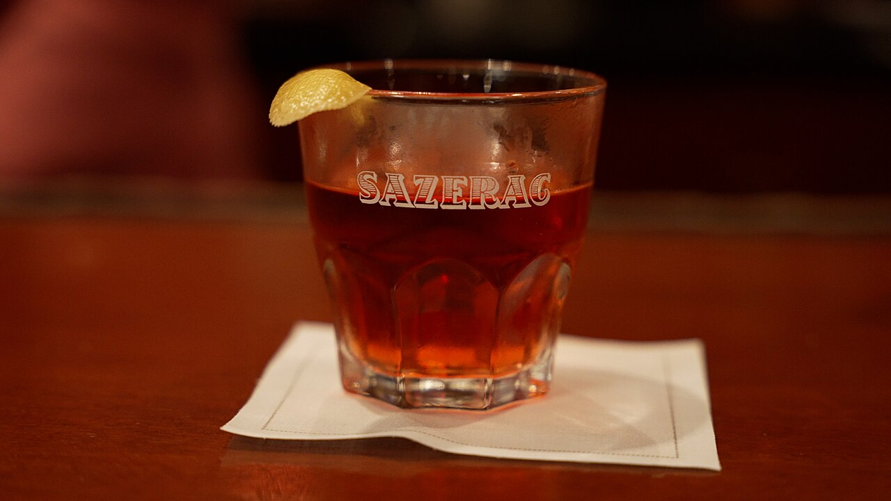

# Sazerac

Sazerac is a classic cocktail originating in New Orleans. The public IBA version uses cognac, a sugar cube and Peychaud's bitters, with an [absinthe](ref:absinthe) rinse in the glass, commonly garnished with a lemon peel; the rye whiskey version is a substitution tradition that formed after the American Civil War when cognac was scarce, and it is the default in many bars today.

Figure: Sazerac. Image: Gtandersson, CC BY 4.0, via Wikimedia Commons ([source page](https://commons.wikimedia.org/wiki/File:SazeracCocktail.jpg)).

## Definition and identity

The Sazerac is often called New Orleans' signature cocktail, and its history involves local bars, a bitters brand and French-influenced culture. Several accounts of its origin and early method exist, and this page treats them as historical background rather than a settled conclusion.

## Recipe (IBA version)

The public IBA recipe is: 50 ml cognac, 10 ml absinthe (for the rinse), 1 sugar cube and 2 dashes Peychaud's bitters. Method: pour the absinthe into a chilled rocks glass, turn the glass so the inside is evenly coated, then discard the excess liquid and crushed ice; stir the cognac, sugar and bitters with ice, strain into the glass, squeeze a lemon peel over the drink and place it in the glass. The IBA note explains that after the American Civil War cognac became hard to obtain and rye whiskey replaced it as the common base — which is why many modern recipes specify rye while the IBA entry still lists cognac.

Quantities are a starting point, not a law. Cognac provides the backbone, the sugar rounds the body, the bitters provide aroma, and the absinthe rinse provides an aromatic background. Any change clearly alters the result.

## Cognac, rye and bitters

The IBA version is built on cognac, bringing grape, oak and softer fruit; rye whiskey brings a spicy, dry backbone, while bourbon is sweeter and rounder. In the historical record, cognac is the earlier practice and rye the post-war substitution; neither is more "authentic", they reflect what was available and what drinkers wanted in different eras. When substituting the base spirit, adjust the sugar and bitters accordingly.

Peychaud's bitters are the Sazerac's identifying feature, carrying anise and spice that echo the absinthe aroma. Different bitters differ greatly in formula, so changing them changes the style and should be recorded. A few dashes are enough; too much overpowers the base spirit.

## The absinthe rinse

[Absinthe](ref:absinthe) is used here mainly as a rinse rather than as the main liquid. The absinthe coating the inside of the glass provides an aromatic background for every sip, especially anise and herbal notes; discarding the excess prevents absinthe from overpowering the base spirit.

The amount and duration of the rinse affect aroma intensity. Too little and the aroma is barely noticeable; too much and absinthe dominates. Absinthes differ in aromatic intensity, and substitutions should be adjusted accordingly.

## Stirring and dilution

A Sazerac is usually stirred rather than shaken: stirring controls dilution and keeps the drink clear. Too little stirring leaves it insufficiently chilled and diluted; too much dilutes it and thins the body.

Ice quality directly affects the result. Large ice melts slowly and keeps dilution controllable; crushed ice chills quickly but can over-dilute. The goal is to chill while retaining enough body. For more on ice types and temperature, see [ice and temperature](ref:ice).

## Glass and garnish

Traditionally served in a chilled rocks glass or a small stemmed glass. A rocks glass suits the rinse and the lemon peel, while a stemmed glass concentrates aroma. The glass should be chilled in advance so the liquid does not warm up quickly after pouring.

A lemon peel is the usual garnish, providing citrus aroma and visual identity. Squeezing the peel sprays oils onto the rim and surface, directly shaping the first sip. Garnish just before serving.

## Variations

Using rye or bourbon instead of cognac gives a spicier or sweeter version; using other bitters instead of Peychaud's changes the aromatic direction; skipping the absinthe rinse gives a simpler version but loses the signature anise background.

Variations are not wrong versions but branches with a clear substitution logic. When recording a variation, state what was substituted and how the proportions changed. For general cocktail structure, see [cocktail basics](ref:cocktails-guide); compared with the [Old Fashioned](ref:old-fashioned), the Sazerac uses an absinthe rinse and Peychaud's bitters.

## Common misconceptions

First, treating the absinthe rinse as a main ingredient. Its role is to provide an aromatic background.

Second, assuming more bitters is better. Bitters are aroma, not the main taste.

For Sazerac, a common mistake is ignoring stirring and dilution. Without enough dilution the aroma does not open and the alcohol burn stands out.

Fourth, treating the Sazerac as an ordinary whiskey cocktail. The rinse and Peychaud's bitters are its identifying features.

For Sazerac, a common mistake is treating a variation as the same recipe. After replacing a main ingredient, use the variant name and state the difference.

## Drinking and boundaries

A Sazerac suits slow pre-dinner drinking with nuts, cheese or New Orleans-style snacks. It is relatively strong, so sip slowly and drink water; do not drink quickly on an empty stomach. Do not drink if driving, taking medication or pregnant.

This page records one sourced version and does not rate specific brands or present one ratio as the only correct answer. The final strength depends on the base spirit's [alcohol by volume](ref:abv), the amount of sugar and ice dilution, not on the recipe numbers alone.

**Short definition:** A classic cocktail originating in New Orleans, made with cognac, a sugar cube and Peychaud's bitters in the IBA version, with an absinthe rinse; the rye whiskey version is the post-Civil War substitution tradition.

For Sazerac, begin with the base and the ratio. Then look at the dilution and the ice, and finally ask the garnish and the glass. The answers point to different choices, not to a single score.

**Key facts.**

| Item | Detail |
| --- | --- |
| In one line | A classic cocktail originating in New Orleans, made with cognac, a sugar cube and Peychaud's bitters in the IBA version, with an absinthe rinse; the rye whiskey version is the post-Civil War substitution tradition. |
| Style | Classic cocktail |
| Origin | New Orleans, United States (19th century) |

**Sources and limits.** The key claims about Sazerac are checked against the following sources: International Bartenders Association (Used to check the official recipe, method and garnish; Used to confirm the drink is on the IBA official cocktail list), Oxford University Press (Used to check historical background and basic composition), David Wondrich / Perigee (Used to check background on 19th-century American cocktail development) and 5 sources in total. Prices, batches and status change; the body is project-written and does not reproduce source text.

## Further reading

- [Whiskey](ref:whisky): the rye version and the post-war substitution tradition.
- [Absinthe](ref:absinthe): the rinse and aromatic background.
- [Cocktail basics](ref:cocktails-guide): general principles of structure, dilution and stirring.
- [Ice and temperature](ref:ice): how ice type and chilling affect the drink.
- [Alcohol by volume](ref:abv): understanding final strength and ice dilution.
- [Old Fashioned](ref:old-fashioned): another classic built on whiskey, sugar and bitters.
