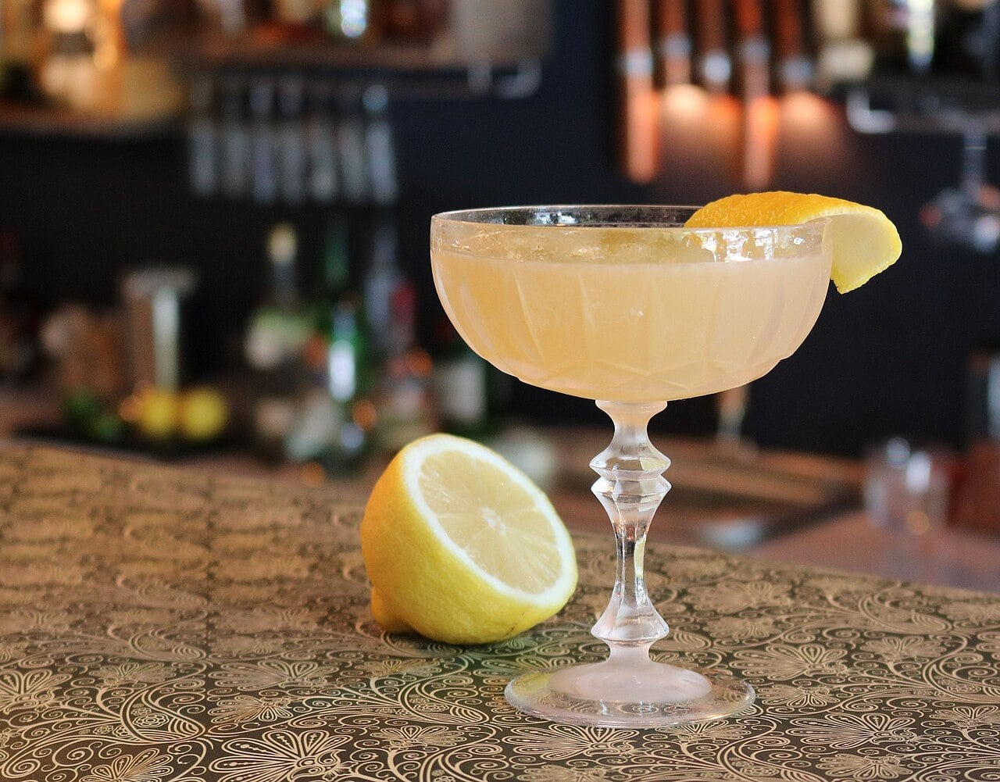

# Sidecar

The Sidecar is a classic cocktail of cognac, orange liqueur and fresh lemon juice, shaken and served in a chilled stemmed glass. It belongs to the sour family: a spirit provides the frame, citrus provides acidity, and a sweet liqueur supplies both sweetness and aroma. The IBA's published formula is 50 ml cognac, 20 ml orange liqueur and 20 ml fresh lemon juice, shaken and strained into a chilled cocktail glass. A sugar rim is optional, not part of the definition.

Figure: A Sidecar in a coupe, with amber liquid and a lemon wheel on the rim. Image: Achim Schleuning, CC BY-SA 4.0, via [source page](https://commons.wikimedia.org/wiki/File:Sidecar_Cocktail.jpg).

## The triangle of a sour

A sour is built on spirit, acid and sugar. In the Sidecar, [cognac](ref:cognac) is the spirit and the centre of the flavour; [orange liqueur](ref:orange) provides sweetness, citrus aroma and some body; lemon juice provides acidity and lift. The three are not simply added together. The sweetness of the liqueur needs the lemon to cut it, the sharpness of the lemon needs sweetness to round it, and the grape and oak of the cognac need both to sit in the middle.

The identity of the drink lies less in any single ingredient than in the ratio. A high proportion of cognac gives body. Too much orange liqueur turns the glass into a sweet orange drink. Too much lemon buries the fruit of the cognac. The 50:20:20 formula is roughly 2.5:1:1, a dry, spirit-forward version. Early printed recipes often used equal parts, one third of each, which tastes sweeter, rounder and closer to "orange liqueur with a splash of brandy". Both can be correct, but they are different versions and should not share an unexplained formula.

The drink is not low in alcohol. With cognac at 40% ABV and orange liqueur somewhere between 20% and 40% ABV, the pre-shake mixture is roughly 27% to 31% ABV. Shaking dilutes it with meltwater, so the served drink usually lands around 25% ABV. The exact figure depends on the spirits, the shake and the strain, and cannot be judged from the shape of the glass.

## Paris, London and an army captain

There is no settled origin for the Sidecar. At least three stories recur, and they point to different cities and different people.

One places the drink at Harry's New York Bar in Paris and credits Harry MacElhone. That bar was a meeting point for American expatriates and drinks writers in the 1920s, and MacElhone did record a Sidecar in his books. A second places it at Buck's Club in London and credits the bartender MacGarry. One of the earlier printed records is Robert Vermeire's *Cocktails: How to Mix Them* of 1922, which lists a Side-Car of one-sixth of a gill each of lemon juice, Cointreau and cognac — equal parts — and notes that the drink was very popular in France and had been introduced in London by MacGarry of Buck's Club. A third account comes from David Embury's *The Fine Art of Mixing Drinks* of 1948: he wrote that an American army captain in Paris during the First World War invented it and named it after the motorcycle sidecar that carried him to and from the bistro. Embury gave no bar name, though later retellings often supply one.

These stories do not prove one another. The 1922 printing shows that the drink was already circulating; it does not identify the inventor. Harry's New York Bar and Buck's Club may both have been transmission points rather than a single birthplace. The army-captain story reads more like an anecdote that was repeated than a documented event. This page therefore says "is often traced to" or "one account holds", and does not present any year, bar or person as settled fact.

## Why the IBA uses 50:20:20

The IBA lists the Sidecar among its Unforgettables. Its ingredients are only three: 50 ml cognac, 20 ml orange liqueur and 20 ml fresh lemon juice. The method is to shake with ice and strain into a chilled cocktail glass. The garnish field reads N/A. That absence is informative: in the IBA version, a sugar rim is not required.

The point of 50:20:20 is to put cognac back at the centre. In an equal-parts recipe the orange liqueur occupies the same volume as the cognac, so its sugar and orange peel overwhelm the delicate fruit of the brandy and the result drinks like an after-dinner liqueur. At 2.5:1:1 the grape, oak and light spice of the cognac arrive first, the orange liqueur sits in the middle, and the lemon closes the finish. It is drier, and it is much less forgiving of a poor base spirit.

Sources differ mainly on sweetness. Beyond equal parts and 2.5:1:1, a 2:1:1 formula also appears. Some modern recipes add 5–10 ml of sugar syrup to make the drink easier for a first-time drinker. Others raise the orange liqueur to 25 ml, trading dryness for a fuller citrus mid-palate. None of these is wrong, but each should be stated. The syrup version is softer, the equal-parts version is sweeter, and 2.5:1:1 is drier. Blurring them leaves the reader unable to tell which drink is in the glass.

## The sugar rim: optional, and it mutes aroma

The sugar rim is the most misunderstood part of the Sidecar. It looks like a signature, but it is only an option. The usual method is to moisten the outside of the rim with a lemon wedge and dip it in fine sugar, either halfway round or all the way. Sugar must not fall into the drink, or it changes the sweetness of the liquid itself.

The rim changes the order of perception. The lips meet sugar first, so the first sip tastes sweeter, the acidity is softened, and the alcohol of the cognac feels gentler. For a drinker who likes sweetness, this makes the drink friendlier. For a drinker with a good bottle of cognac, it is an intervention. The sugar stacks on top of the orange liqueur's sweetness, dulls the citrus in the middle, and the grain of the sugar pulls attention away from aroma. In short, the rim trades aroma for sweetness, and the more it trades, the more the Sidecar becomes a dessert drink.

That is why the IBA formula does not include a rim. If you want one, make it half a rim, use fine sugar rather than icing sugar, and dry the outside of the glass enough that the sugar sticks without running. Humid sugar clumps and leaves a sticky rim; sugar the glass at service, not in advance. If the base spirit and the orange liqueur are both on the sweet side, skip the rim entirely and let the lemon hold the structure.

## Shaking, dilution and temperature

The Sidecar is shaken, not stirred. There are three reasons: fresh lemon juice needs to be integrated; shaking chills quickly; and the small amount of air whipped into the liquid makes the texture feel lighter. Too short a shake leaves the drink insufficiently cold, with acid and sugar sitting apart. Too long a shake melts too much ice, washes out the cognac's aroma and leaves water in the bottom of the glass.

Put all the ingredients and ice into the shaker and shake for 10–12 seconds, until the sound of the ice becomes dull and the tin is visibly frosted. When straining, double-strain: use a strainer to hold back the ice, then pass the liquid through a fine mesh to catch pulp and shards. There is no egg white here, so no dry shake is needed, but lemon pulp clogs an ordinary strainer, and fine straining gives a cleaner texture. Chill the glass in advance and do not add ice after straining, or dilution continues in the glass.

Dilution is part of the recipe, not a mistake. The meltwater that enters the drink during shaking is usually equal to 20% to 25% of the original volume. It brings a mixture of roughly 30% ABV down to around 25% and binds acid, sugar and alcohol together. If the glass and liquids are already very cold, shake a second or two less; if everything is at room temperature, shake fully, but do not try to chill the drink by shaking for a long time, or it will over-dilute.

## Coupe or martini glass

Traditionally the drink is served in a [coupe](ref:coupe) or a cocktail glass. Both have stems, keeping the hand from warming the liquid; the difference is the bowl. A coupe has a wider bowl and a slightly narrowed rim, giving aroma room to gather. Its surface area is moderate, so it warms more slowly than a cone. A martini glass is a shallow cone with a very wide rim: aroma escapes quickly, the liquid sits in a thin layer, it warms fast, and it is easy to spill.

The IBA says only "chilled cocktail glass" and does not specify a shape. With a coupe, fill about two-thirds of the capacity and leave headspace for aroma. With a martini glass, the wide rim suits a drink that will be finished quickly, not one that will be nursed through a conversation. A 150–200 ml coupe is enough. A smaller glass brings the liquid close to the rim and makes the alcohol sharp on the nose; a much larger one leaves too much empty space. For more on how shape affects aroma and temperature, see [cocktail basics](ref:basics).

## Variations: the Chelsea Sidecar and Between the Sheets

The Chelsea Sidecar replaces cognac with gin. Juniper, coriander and citrus peel make the drink leaner and drier, while the orange liqueur becomes more prominent. If the 2.5:1:1 ratio is kept, the botanicals can overwhelm some of the orange aroma, and some recipes put a little of the liqueur back. It is not "a Sidecar with gin added"; the base has changed, and the direction of the drink changes with it.

Between the Sheets is usually written as equal parts cognac, white rum, orange liqueur and lemon juice. It is often traced to Paris in the 1930s, and some accounts link it to Harry's New York Bar, but there is no single documented conclusion. Rum brings sugar cane and tropical fruit, cognac brings grape and oak, and the combination is thicker, sweeter and more layered than a Sidecar.

A more distant relative is the Margarita. Replace cognac with tequila, lemon with lime and the sugar rim with a salt rim, and the structure is still spirit, orange liqueur and citrus. But this is not a simple substitution. The vegetal, peppery side of tequila, the bitter edge of lime and the way salt suppresses bitterness and lifts acidity all change the balance. Calling the Margarita a "tequila Sidecar" is a structural analogy, not a historical conclusion.

## The structural link to the Margarita

The IBA [Margarita](ref:margarita) is 50 ml tequila, 20 ml orange liqueur and 15 ml fresh lime juice, a ratio of about 10:4:3. The Sidecar is 50:20:20, about 2.5:1:1. Both put the base spirit at half or more, both use orange liqueur for sweetness and aroma, and both use citrus for acidity. The difference is the citrus and the rim: lemon is more direct and its aroma is lighter, lime is sharper and slightly bitter; sugar adds sweetness, while salt suppresses bitterness and magnifies both acid and sugar.

Structurally, the Sidecar is drier and the Margarita is tighter. Lemon and orange liqueur widen the middle of the Sidecar; lime shortens and sharpens the finish of the Margarita. Swap the Sidecar's sugar rim for salt and you get a savoury, still dry brandy sour. Swap the Margarita's salt rim for sugar and you get a sweeter, rounder tequila sour. The rim is not decoration; it changes the first sip directly.

History should not be read backwards. The Margarita's origins are also disputed and are usually placed in the Mexico–United States border region in the 1930s and 1940s. There is no reliable evidence that it was a direct remake of the Sidecar. Comparing the two inside the same sour template is structural analysis, not a claim of descent.

## Common failures

First, a warm glass. The drink warms quickly after straining, the acidity loosens and the aroma escapes. Second, lemon juice that was not squeezed to order; old juice loses its lift and leaves only sharpness, and no sugar rim can rescue it. Third, an orange liqueur that is too sweet, or too much of it; the sugar buries the cognac and the drink tastes like orange liqueur. Fourth, a full sugar rim; every sip meets sugar first and the acidity and aroma are suppressed. Fifth, over-shaking; too much meltwater thins the body. Sixth, no fine strain; the texture is cloudy and ice shards sit in the glass. Seventh, a cognac that is too heavily oaked or too young; the first buries the orange, the second is sharp, and 2.5:1:1 exposes both.

## Ordering and drinking

Order a Sidecar with cognac, and ask for a half rim or no rim. Ask which orange liqueur is used. If you want it drier, ask for 2.5:1:1 or less liqueur; if you want it sweeter, ask for a little syrup or a rim rather than more orange liqueur, because the latter adds orange aroma and sweetness together. If alcohol strength is a concern, ask about the pour size; the Sidecar is a short drink, but it is not weak.

It works as an aperitif and with nuts, salty cheese, olives or citrus desserts. The sugar-rimmed version suits bitter or salty food; the no-rim version suits lighter seafood and white meat. Sip slowly and do not leave the glass standing too long; as it warms, the acid and alcohol become more prominent. Do not drink and drive, and avoid alcohol during pregnancy or while taking medication that interacts with it.

## See also

- [Cognac](ref:cognac): the base spirit, its strength and its layers of flavour.
- [Orange liqueur](ref:orange): sweetness, orange peel aroma and differences between brands.
- [Shaking](ref:shake): chilling, dilution and double straining.
- [Coupe glass](ref:coupe): bowl shape, rim and aroma.
- [Margarita](ref:margarita): the same sour template with tequila.
