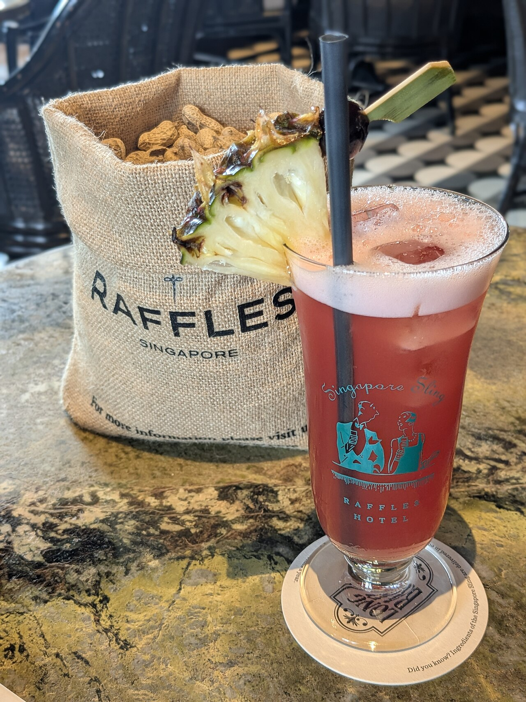

# Singapore Sling

The Singapore Sling is a classic [gin](ref:gin)-based cocktail with cherry liqueur, citrus juice, pineapple juice and a little bitters, shaken with ice and strained into a hurricane glass, garnished with a pineapple slice and a maraschino cherry. It is full-bodied and balanced between sour and sweet; the public IBA version contains no soda, while whether early bar versions added bubbles varies by recipe.

Figure: Singapore Sling. Image: Paul2520, CC BY 4.0, via Wikimedia Commons ([source page](https://commons.wikimedia.org/wiki/File:Singapore_Sling_and_peanuts_at_the_Raffles_Hotel_Long_Bar_in_Singapore.jpg)).

## Definition and identity

Common accounts link the Singapore Sling to a Singapore hotel bar in the early 20th century, and the original recipe differs considerably from later versions. Origin and recipe evolution exist in different accounts; this page treats them as historical background and does not present one as settled fact.

## Recipe (IBA version)

The public IBA recipe is: 30 ml gin, 15 ml cherry liqueur, 7.5 ml Cointreau, 7.5 ml DOM Bénédictine, 120 ml fresh pineapple juice, 15 ml fresh lime juice, 10 ml grenadine syrup and 1 dash Angostura bitters. Shake all ingredients with ice, strain into a hurricane glass and garnish with a pineapple slice and a maraschino cherry. The IBA version contains no soda; carbonation is not a required part of the structure. If you see a version topped with soda, that is another version and should be labelled as such. Quantities are a starting point, not a law: the juice ratio, syrup and liqueur all change the result.

Too short a shake leaves the drink insufficiently cold and under-diluted; too long a shake dilutes too much and thins the body. A hurricane glass holds a large volume, and ice in the glass keeps diluting the drink, so keep enough body when shaking.

## Choosing the gin

[Gin](ref:gin) is the body of this drink. London dry gin brings a clear juniper and citrus frame, Old Tom gin is sweeter and softer, and other gin styles may bring different herbal and spice notes. The choice sets the direction.

High-strength gin needs more dilution, while lower-strength gin needs a shorter shake. If the gin itself is strongly flavoured, adjust the juice and syrup accordingly, or the drink will be unbalanced.

## Juice, liqueur and bitters

Citrus juice provides acidity and citrus aroma, and pineapple juice provides tropical fruit aroma and some body. Juice freshness directly affects aroma and acidity; bottled juice differs markedly.

Cherry liqueur provides sweetness, fruit aroma and colour and is a main source of the Singapore Sling's identity. Its sweetness is high: too much makes the drink cloying. A little bitters adds layers; too much covers the fruit.

## Shaking and dilution

The Singapore Sling is shaken, not built. Shaking brings the gin, juice and liqueur together at a low temperature and provides the necessary dilution.

Ice quality directly affects the shake. Large ice melts slowly and dilutes in a controlled way; crushed ice chills fast but can over-dilute. For more on ice and temperature, see [Ice and temperature](ref:ice).

## Glass and garnish

The IBA specifies a hurricane glass: a waisted body that flares at the top, large enough to hold crushed ice and garnish. Without one, a highball glass is a reasonable substitute, though the volume and grip differ. Chill the glass beforehand so the drink does not warm quickly after pouring.

A pineapple slice and a maraschino cherry are the IBA garnish, providing fruit aroma and visual identity. Garnish just before serving; left too long, they lose their aroma.

## Variations

Using another spirit instead of gin creates different branches; less cherry liqueur gives a drier, more juice-forward version; another juice instead of pineapple changes acidity and aroma. Compared with the [Tom Collins](ref:tom-collins), the Singapore Sling adds juice and liqueur.

Variations are not mistakes but branches with a clear substitution logic. When recording one, state what was replaced and how the ratio changed. For general cocktail structure, see [Cocktail basics](ref:cocktails-guide).

## Common misconceptions

First, assuming the IBA version must include soda. The IBA recipe contains no soda; soda-topped versions are different recipes.

Second, assuming a sling must be very sweet. Sour and sweet need balance.

Third, ignoring that the hurricane glass and the ice in it keep diluting the drink. Keep enough body when shaking.

Fourth, using bottled juice instead of fresh. Aroma and acidity differ markedly.

For Singapore Sling, a common mistake is treating a variation as the original recipe. After replacing a main ingredient, use the variation name and state the difference.

## Drinking and boundary

The Singapore Sling suits a before-meal or afternoon drink, with nuts, fruit or simple savoury snacks. It has moderate strength and a large volume, so sip slowly and drink water; do not drink it quickly on an empty stomach. Do not drink when driving, taking medication or pregnant.

This page records one sourced version, evaluates no specific brand and does not present one ratio as the only correct answer. The finished strength depends on the gin's [alcohol by volume](ref:abv), the sweetness of the juice and liqueur, and ice dilution, not on the recipe numbers alone.

**In brief:** A classic cocktail of gin, cherry liqueur, citrus juice, pineapple juice and a little bitters, shaken and strained into a hurricane glass; the IBA version contains no soda and is garnished with pineapple and a maraschino cherry. 

Singapore Sling is best approached through the base and the ratio, then the dilution and the ice, and then the garnish and the glass. One check alone will not settle it.

The comparison with [Gin](ref:gin) and [Alcohol by volume (ABV)](ref:abv) runs through base liquor and technique and ratio. Each answers a different question.

**Key facts.**

| Item | Detail |
| --- | --- |
| In one line | A classic cocktail of gin, cherry liqueur, citrus juice, pineapple juice and a little bitters, shaken and strained into a hurricane glass; the IBA version contains no soda and is garnished with pineapple and a maraschino… |
| Style | Classic cocktail |
| Origin | Singapore (early 20th century) |

**Sources and limits.** The key claims about Singapore Sling are checked against the following sources: International Bartenders Association (Used to check the official recipe, method and garnish; Used to confirm the drink is on the IBA official cocktail list), Oxford University Press (Used to check the historical background and basic composition), Raffles Hotel Singapore (Used to check the 1915 origin and original ingredient account of the Singapore Sling). Prices, batches and status change; the body is project-written and does not reproduce source text.

## Further reading

- [Gin](ref:gin): the body and style source of the Singapore Sling.
- [Liqueur](ref:liqueur): the sweetness and aroma of cherry liqueur.
- [Cocktail basics](ref:cocktails-guide): structure, dilution and shaking.
- [Ice and temperature](ref:ice): ice types and how chilling shapes the drink.
- [Alcohol by volume](ref:abv): understanding strength and ice dilution.
- [Tom Collins](ref:tom-collins): a related gin-based classic that builds its carbonation with soda.
