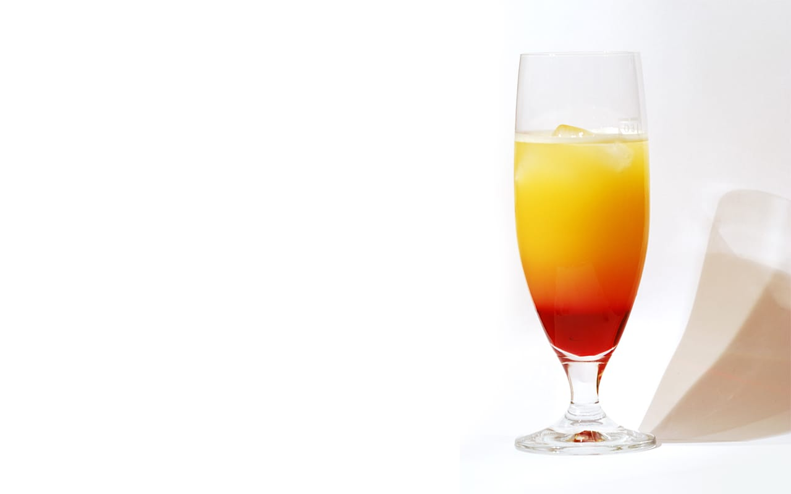

# Tequila Sunrise

The Tequila Sunrise looks more complicated than it drinks. Tequila, orange juice and grenadine form a gradient from orange-yellow to deep red in a highball, like the sky at dawn. The recipe is short, but the layering and the balance need a little order and patience.

The drink became popular in California in the 1970s and later reached a wide audience through a rock band's tour and bar culture. Its name, colour and pop history matter almost as much as its taste.

Figure: A Tequila Sunrise with its orange-to-red gradient. Image: Benjamin Nussbaum, CC BY 2.0, via Wikimedia Commons ([source page](https://commons.wikimedia.org/wiki/File:Tequila_Sunrise_(2411086102).jpg)).

## The colour of sunrise

The colour comes from the density of grenadine. High in sugar and heavy, grenadine sinks to the bottom and then slowly spreads upward, leaving red below and orange above. Stir at the start and the colour becomes an even pink-orange, losing the sunrise.

The concentration of the orange juice also matters. Fresh juice is paler and carries pulp, so the gradient is softer; juice from concentrate is darker and sweeter, giving a stronger red-orange contrast but a flatter taste. Blood orange juice makes a redder, more dramatic gradient.

The glass and the ice matter too. A clear highball lets the colour be seen; too much ice dilutes the colour, too little cannot support the layers. Use clean, clear ice, ideally large and hard.

## The formula: tequila, orange juice and grenadine

The IBA standard is 45 millilitres of tequila, 90 millilitres of orange juice and 15 millilitres of grenadine. Tequila to juice is about one to two, a medium-strength drink; the grenadine is a small fraction, responsible for colour and sweetness rather than the main flavour.

Blanco or gold tequila both work. Blanco is crisp and vegetal, better for daytime; gold has a little ageing and brings caramel and vanilla that agree with orange. Reposado and añejo also work but are heavier and can overwhelm the juice.

The orange juice must be fresh. Bottled juice is too direct in its sugar and acid, and becomes cloying next to grenadine; fresh juice has the acidity and fruit to carry the drink. Without a juicer, a good chilled juice works, but not a concentrated syrup.

Choose a grenadine made with real pomegranate rather than red sugar water. The darker and more tart the syrup, the better the gradient and the more controllable the sweetness. Cheap syrup turns the drink into red sugar water.

## Method: building the gradient

Fill a highball with ice, pour in the tequila, then the orange juice, and stir gently so the spirit and juice combine and the glass goes cold. Then pour the grenadine slowly down the side; it sinks to the bottom and forms a red layer. Do not stir; serve as it is.

Use a bar spoon to guide the syrup, or pour it over an ice cube so it sinks slowly. Poured too fast, it mixes into the juice and the gradient vanishes; poured too slowly, it clings to the glass and the colour is uneven.

Garnish with an orange slice and a cherry. The slice can sit on the rim, the cherry on top, echoing the sunrise palette. Skip mint or lime; they change the drink's colour and aroma.

Do not stir before drinking. Sip the top first for the orange and tequila, then work down to the pomegranate's tart sweetness. Every mouthful is different; that is the design.

## From California bars to a rock tour

The modern Tequila Sunrise is usually traced to early-1970s California, especially the bars of the San Francisco Bay Area. One account credits a restaurant bartender around 1971; another says the name is older and the modern formula came later.

What spread it was rock music. In 1972, a British rock band on tour in the United States encountered the drink in a bar and carried it into their tour and media story. The orange gradient, California sun and rock stage together made the drink a visual symbol of the 1970s.

Fame brought myths. Some say a particular singer invented it, others that the formula is Mexican; most such claims lack primary evidence. What can be confirmed is that the modern formula took shape in California and that the grenadine gradient is its signature.

## Variations and common mistakes

Common variations include the Tequila Sunset, with blackberry liqueur replacing part of the grenadine for a darker colour; the Tequila Sunrise Fizz, with soda for a lighter body; and a Bloody Sunrise with blood orange juice. A Tequila Sunrise Margarita carries the gradient into a margarita.

Four mistakes recur. First, stirring at the start, which kills the gradient. Second, pouring the syrup too fast, which mixes it to pink-orange. Third, juice that is not fresh, which throws off the sweet-sour balance. Fourth, ice too small, which dilutes the drink. Order and temperature are the keys.

For a home bartender, the practical advice is: mix the tequila and juice first and taste the balance; pour the syrup slowly down the side; chill the glass and the ice; do not stir before serving. The beauty and the flavour both come from the layers.

## See also and references

- Tequila: see [tequila](ref:tequila).
- Margarita: see [margarita](ref:margarita).
- Highball: see [highball](ref:highball).
- Pouring: see [pouring](ref:pouring).
- Sweet: see [sweet](ref:sweet).

Start with [Tequila](ref:tequila) for base liquor, then read [Highball glass](ref:highball) for technique and ratio. Seeing both keeps Tequila Sunrise from being confused with a neighbouring idea.

**In brief:** A layered highball of tequila, orange juice and grenadine, shading from orange to red. It became popular in 1970s California and reached a wide audience through a rock band's tour.

Tequila Sunrise is best read by starting with the base and the ratio, moving to the dilution and the ice, and ending with the garnish and the glass.

The drink is built in a highball with tequila, orange juice and a slow pour of grenadine; the syrup sinks to create the sunrise gradient, so do not stir before serving.

The grenadine should be poured last and not stirred, so the sunrise gradient survives to the glass.

**Key facts.**

| Item | Detail |
| --- | --- |
| In one line | A layered highball of tequila, orange juice and grenadine, shading from orange to red. It became popular in 1970s California and reached a wide audience through a rock band's tour. |
| Style | IBA Contemporary Classics |
| Origin | California, United States |

**Sources and limits.** The key claims about Tequila Sunrise are checked against the following sources: International Bartenders Association (Used to check the IBA category, ingredients and ratio), Oxford University Press (Used to check cocktail history and terminology), CocktailDB (Used to cross-check recipe structure and common variations) and 5 sources in total. Prices, batches and status change; the body is project-written and does not reproduce source text.

For Tequila Sunrise, this cocktail was last checked in 2026; prices, batches and availability change, so confirm them against the sources below.
