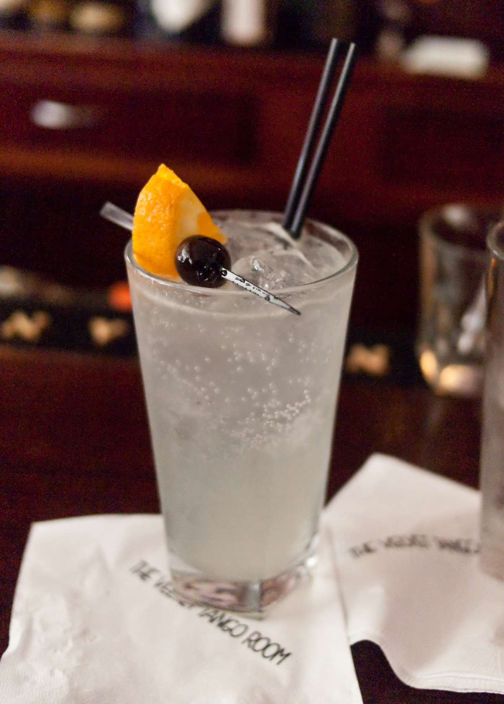

# Tom Collins

A Tom Collins is a long drink of Old Tom gin, lemon juice, syrup and soda water. The IBA lists it under "John Collins": 45 ml gin, 30 ml fresh lemon juice, 15 ml syrup and 60 ml soda, built over ice in a highball, garnished with lemon and a maraschino cherry, with the note that a Tom Collins uses Old Tom gin. The same sheet of numbers, one different gin, one different name.

Figure: Tom Collins. Image: Edsel L, CC BY-SA 2.0, via Wikimedia Commons ([source page](https://commons.wikimedia.org/wiki/File:VTR_-_Tom_Collins.jpg)).

## What Makes a Collins

The Collins is a family: John Collins, Tom Collins, and the rum, tequila and whiskey Collins that followed. Its structure is sour plus soda plus a big glass plus plenty of ice. It is longer, lighter and more thirst-quenching than the [Gin Fizz](ref:gin-fizz). The Tom in the name is not the inventor but a code for Old Tom gin — which is exactly where it gets confused with an ordinary gin sour.

## The Structured Recipe: From John Collins to Tom Collins

The IBA entry (John Collins):

- Gin 45 ml, Old Tom for a Tom Collins
- Fresh lemon juice 30 ml
- Syrup 15 ml
- Soda water 60 ml
- Glass: Collins or highball, 12–14 oz
- Ice: fill the glass
- Method: build all ingredients in the glass, stir gently
- Garnish: lemon slice and maraschino cherry

Commercial versions adjust. Beefeater uses 50 ml gin, 25 ml lemon juice, 25 ml syrup and 100 ml soda, adding the gin and ice first, then the lemon and syrup, stirring and topping with soda. Hayman's Old Tom version uses 60 ml gin, 25 ml lemon and 15 ml syrup, shaken, double-strained and topped with soda. All three agree on the essentials: soda last, ice to the top. For the general principles of building and shaking, see [cocktail basics](ref:cocktails-guide).

## The 1874 New York Tom Collins Hoax

In 1874 New York ran a prank: someone told you that a man named Tom Collins was slandering you in a bar around the corner. You hurried there; the bartender said he had just left for the next bar. You went on, and heard the same line again. Victim after victim was sent from bar to bar looking for a man who did not exist. Newspapers reported the "Great Tom Collins Hoax" in earnest, and by the time the joke was exposed the name belonged to the city. Two years later, in 1876, Jerry Thomas included a Tom Collins in The Bar-Tender's Guide — the hoax and the cocktail met in the same town.

## Limmer's Hotel and the John Collins Story

The other line runs through London. The common account: John Collins, head waiter at Limmer's Hotel, made a drink of gin, lemon, sugar and soda that became the John Collins; when the base changed to the sweeter Old Tom gin, the name became Tom Collins. No single document nails the story down, but it explains two things: why the IBA entry is called John Collins, and why "Tom" is tied to Old Tom gin. The Atlantic has two origin stories; this page does not declare a winner.

## Why Old Tom Gin Tastes Sweeter

Old Tom is the original 19th-century London gin style. Hayman's still makes it to a 160-year-old family recipe at 41.4% and describes it as round, full and subtly sweet. The sweetness is not added sugar but the roundness left by distillation and recipe, and it is exactly what catches the lemon's edge and the soda's faint bitterness. Most bars today use London dry for a Tom Collins, which is drier and more juniper-forward and technically closer to a John Collins. To recover the historical profile, use Old Tom or raise the syrup from 15 ml to 20–25 ml. Beefeater's 25 ml of syrup is that same compensation.

## The Collins Glass: Why 12–14 Ounces

Bormioli Rocco's guide puts a highball at 10–12 oz and a Collins at 12–14 oz. The Collins is taller and narrower, so the bubbles travel further and long ice and a whole lemon slice still fit. Do the volume: 45 + 30 + 15 + 60 = 150 ml, plus shake or melt dilution, the finished drink is a little over 200 ml. A 12–14 oz glass (about 355–415 ml) leaves room for ice and gas instead of overflowing at the first pour. The narrow rim and tall body also let a cherry sit on the edge.

## Against the Gin Fizz: 60 ml of Soda and Ice in the Glass

The Gin Fizz and the Tom Collins share the 45 ml gin plus 30 ml lemon frame, but four settings separate them: 60 ml soda against about 10 ml; 15 ml syrup against 10 ml; ice in the glass against none; a cherry against lemon peel. The result is long against short. The Collins is a long drink, its strength stretched by ice and soda so it can last an afternoon; the fizz is a short drink, cold, tightly bubbled and more concentrated in every sip. Put a Collins in a small glass or a fizz in a large one and you get a drink that feels wrong.

## Shake or Build: Two Sourced Methods

The IBA and Beefeater both build: ingredients in the glass, ice, a gentle stir, soda on top. This loses the least carbonation and is fast, but the drink starts lukewarm and dilution depends on the ice, so it is hard to control. Sipsmith and Hayman's shake and strain: shake until cold, strain into an iced Collins glass, then top with soda. This gives a colder, tighter texture, at the cost of extra dilution and the need for a chilled glass. Both methods are sourced; choose bubbles first or temperature first.

## Where a Tom Collins Goes Wrong

First, using London dry and still insisting on Tom Collins. You can, but that is the John Collins route.

Second, not enough ice. With too little ice the melt is fast, and ten minutes later you have warm lemonade.

Third, dumping the soda in. The gas is knocked out and the rim is all foam.

Fourth, too little syrup. Dry gin plus 30 ml lemon without 15 ml syrup is painfully sharp.

Fifth, a cheap syrup-packed cherry. It ruins the finish.

Sixth, building it half an hour early. Neither soda nor ice waits. For ice and temperature, see [ice and temperature](ref:ice).

## Variations and a No-Alcohol Version

Swap gin for rum, tequila or whiskey and you get a Rum, Tequila or Whiskey Collins; a few dashes of Angostura add a spice layer; lime instead of lemon sharpens the acid. A no-alcohol version uses 0% gin and keeps the 30 ml lemon, 15 ml syrup and 60 ml soda structure with the same garnish; soda, lemon and syrup alone make a pleasant alcohol-free lemon Collins.

## The Long-Drink Occasion

The Tom Collins is a classic long drink: large, medium in strength and full of bubbles, at home in the afternoon, at a barbecue or at brunch. It is easy to drink and easy to drink quickly; two glasses of 150 ml each come close to a meal's worth of alcohol. Sip slowly, drink water and eat something salty. Do not drink if driving, taking medication or pregnant. Final strength depends on the gin's [alcohol by volume](ref:abv) and the melt from the ice, not on the recipe numbers alone.

The recipe and dates on this page come from public sources; the origin story has separate British and American versions, marked as such above.

## Further Reading

- [Gin](ref:gin): Old Tom against London dry.
- [Gin Fizz](ref:gin-fizz): the same frame as a short drink.
- [Cocktail basics](ref:cocktails-guide): building, shaking and dilution.
- [Ice and temperature](ref:ice): how glass ice changes a long drink.
- [Alcohol by volume](ref:abv): understanding the strength of a long drink.

Start with the base and the ratio. From there, consider the dilution and the ice, then the garnish and the glass. That is how a practical judgment about Tom Collins is built.

[Gin](ref:gin) explains base liquor; [A cocktail is another way in](ref:cocktails-guide) adds technique and ratio. Put Tom Collins between them before deciding what it is.
