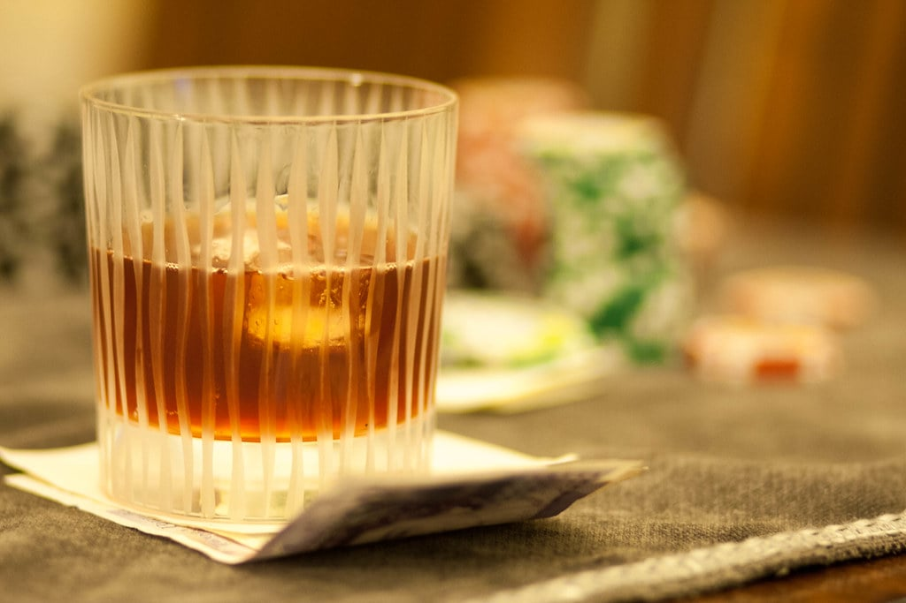

# Vieux Carré

The Vieux Carré is a short drink of [rye whiskey](ref:whisky), [Cognac](ref:brandy), [sweet vermouth](ref:vermouth), Bénédictine and Peychaud's and Angostura bitters. It is usually stirred, strained over ice into a rocks glass and garnished with an orange twist and a cocktail cherry. Rye brings spice, Cognac brings fruit, sweet vermouth brings herbal sweetness, Bénédictine adds honey and spice, and the two bitters give the drink its aromatic top and its long, dry finish. It is one of New Orleans's most complete contributions to cocktail history.

Figure: A Vieux Carré over ice in an Old Fashioned glass; the orange peel and cherry garnish are not visible in this photograph. Image: ChodHound, CC BY-SA 2.0, via [source page](https://www.flickr.com/photo.gne?id=8609713590).

## The French Quarter and the name

Vieux Carré is French for "old square", and it refers to the French Quarter of New Orleans. The neighbourhood was laid out by French colonists in the 18th century, then passed through Spanish rule, American acquisition and several fires and rebuildings, producing the mixed French, Spanish and Caribbean texture of the modern district. Naming a drink after the old square is a way of putting a whole neighbourhood into a glass.

The name is not decorative. The recipe contains French Cognac, French sweet vermouth and a French monastic liqueur, alongside American rye whiskey and New Orleans's own Peychaud's bitters. That combination of French ingredients and American spirit mirrors the city's layered culture. This is not a single-base cocktail; it is a drink that puts materials from several traditions into one glass and lets them explain each other.

The streets and architecture of the French Quarter are often used as a visual reference for the drink, but this page does not turn that into tourist copy. The link between the name and the district is clear. Whether the recipe was deliberately designed to map the city's history is a later interpretation, not an archival fact.

## 1938, Hotel Monteleone and Walter Bergeron

The drink is usually dated to 1938 and credited to Walter Bergeron, a bartender at the Hotel Monteleone in New Orleans. The hotel's own history places 1938, Bergeron and the Vieux Carré alongside the later Carousel Bar; some sources give 1937 instead. The discrepancy does not change the main story: the drink was born in an old French Quarter hotel bar and later became one of the hotel's signature drinks.

The creation is often placed in the hotel's Swan Room, the site associated with the later Carousel Bar. The Carousel Bar began rotating in 1949 and became a New Orleans landmark; the Vieux Carré stayed on the hotel's menu and was repeated in twentieth-century cocktail books. Its history is better documented than many pre-Prohibition legends because it has both hotel records and printed recipes behind it.

Bergeron's name appears often in connection with the drink, but personal information about him is thin. His position and the attribution are recorded; his inspiration, and whether a guest or a recipe book influenced him, are not. Leaving those gaps visible is more honest than inventing an anecdote.

## Two base spirits, two jobs

The common formula is 30 ml rye whiskey, 30 ml Cognac, 30 ml sweet vermouth, 1 bar spoon of Bénédictine (about 5 ml), 2 dashes of Peychaud's bitters and 2 dashes of Angostura bitters. Rye supplies spice, black pepper and a dry grain frame; Cognac supplies grape, flowers and a round middle. The two are equal partners, not substitutes: one gives the skeleton, the other gives the flesh.

The choice of rye changes the drink noticeably. A high-rye whiskey is spicier and drier, holding back the sugar of the vermouth and Bénédictine. A low-rye, high-corn whiskey is sweeter and rounder, pushing the drink toward softness. Cognac matters too: a young Cognac has direct fruit and little tannin, which suits citrus and cherry; an older Cognac brings more oak, vanilla and dried fruit, making the drink heavier and closer to an after-dinner style.

The double-base structure also explains why a single whiskey does not replace the pair. Rye alone is too dry and spicy; Cognac alone is too round and sweet. Half and half, with vermouth and Bénédictine filling the middle, produces the wide but coherent body that defines the drink. Bourbon can simplify the recipe, but it raises the sweetness, and the bitters need to be adjusted in response.

## Sweet vermouth is not a supporting player

At 30 ml, sweet vermouth makes up nearly a third of the drink. It is not a rinse or a seasoning; it is part of the body. Vermouth brings the acidity, herbs and bitterness of wine, as well as sugar and colour. It fills the gap between the rye and the Cognac so that the two spirits do not speak past each other. Without vermouth, the Vieux Carré becomes a spiced spirit drink.

Freshness is the most common variable. Once opened, vermouth oxidises slowly, its aroma moving from fresh herbs toward soy, nuts and vinegar. A Vieux Carré made with oxidised vermouth tastes dull and bitter, with an old-cabinet quality. Keep the bottle refrigerated and use it within a few weeks; if a bar's vermouth has been open for months, no amount of other adjustment will rescue the drink.

When choosing sweet vermouth, look at its bitterness and acidity. A drier, more bitter style holds back the Bénédictine and suits a high-rye version. A sweeter, fruitier style makes the drink rounder and suits a Cognac-heavy or softer interpretation. Do not add syrup on top: the vermouth and Bénédictine already provide enough sugar.

## Bénédictine and its 27 botanicals

Bénédictine is a herbal liqueur from Fécamp in Normandy, bottled at 40% ABV according to the producer, with 27 plants and spices in the recipe. Its aroma includes honey, saffron, citrus peel, cinnamon and vanilla. In the Vieux Carré it is used in a tiny quantity, 1 bar spoon or about 5 ml, but that spoonful changes the aromatic direction of the whole drink. Without it, the finish is drier and more wine- and whiskey-led; with it, a honeyed, spiced middle appears.

Five millilitres is a narrow window. Too little and the Bénédictine leaves only a vague sweetness, with no herbal definition. Too much and the honey and sugar bury the Cognac's floral notes, the finish turns sticky and the bitters are pushed back. Measure it with a bar spoon or a small jigger rather than pouring freehand. This drink has less tolerance than an equal-parts cocktail; once the sweetness is too high, it is hard to pull back.

The sweetness of Bénédictine is not plain sugar. It carries a herbal bitterness and a warm spice note, which connects to the herbs of the vermouth, the anise of Peychaud's and the clove of Angostura. Replacing it with another honey liqueur may match the sugar level, but the herbal and spice layers break. It is not a casual substitution.

## The division of labour between two bitters

Peychaud's and Angostura are not duplicates. Peychaud's originated in 19th-century New Orleans and carries anise, cherry, clove and a light red fruit note; its bitterness is relatively gentle and its aroma is bright. Angostura is more bitter, with gentian, clove, cinnamon and a deep, musky complexity, and it lengthens the finish. Two dashes of each place one aromatic layer in front and another behind, instead of flattening both into a single bitter note.

Peychaud's also has a local meaning. It was promoted by the New Orleans pharmacist Antoine Amédée Peychaud in the 19th century and became a marker of the Sazerac and many New Orleans drinks. Using both Peychaud's and Angostura puts a local bitter next to a Caribbean and Venezuelan one, echoing the city's trade and migration history.

Restraint matters. Two dashes is a common starting point, but bottle mouths flow at different rates, so the actual amount varies. Too much bitters makes the drink bitter and dry, suppressing the Bénédictine. Bitters are there to lift and connect the aromas, not to increase the perception of bitterness for its own sake.

## Stirring, ice and the rocks glass

The drink is [stirred](ref:stirring), not shaken. Combine all ingredients in a mixing glass with ice, stir for 20 to 30 seconds until the glass is thoroughly chilled, and dilute by about 20%. Strain into a rocks glass over ice. Stirring cools evenly and dilutes without aeration; shaking would cloud the drink and loosen the aromas of the vermouth and Cognac.

A [rocks glass](ref:rocks) is the usual vessel. One large, clear cube keeps the drink cold and dilutes it slowly; small cubes melt too fast and leave the second half watery. Chill the glass, fill it about seven-tenths full and leave room to nose the drink. The IBA's written version strains into a chilled cocktail glass for immediate service; the New Orleans convention is rocks glass over ice. Both are valid, but the dilution curves are different.

The garnish is usually an orange twist and a cocktail cherry. Expressed orange peel leaves citrus oil on the surface, so the first sip begins with orange; the cherry adds colour and a little fruit sweetness, but a sugar-heavy cocktail cherry will disturb the body with sweetness and colour. A twist alone is enough if the cherry is not a good one.

## The flavour map and its failure points

The entry is rye spice and Cognac fruit, followed by the herbal sweetness of vermouth and the honey and spice of Bénédictine. The finish brings Peychaud's anise, Angostura's bitterness and oak tannin. It is a sweet, aromatic spirit drink, but not a sweet liqueur: 30 ml of vermouth and 5 ml of Bénédictine supply the sugar, while rye and bitters pull it back toward dryness. The ideal is a drink in which every layer can be identified without any one layer taking over.

The common failures are predictable. Too much Bénédictine turns the drink into spiced syrup. Oxidised vermouth gives a sour, bitter finish. Rye that is too hot buries the Cognac. Cognac that is too old lets oak fight the vermouth. Under-stirring leaves the alcohol sharp and the temperature uneven; over-stirring makes the drink watery and disperses the aroma. When adjusting, check the vermouth first, then the Bénédictine, and only then consider changing the base spirits.

Temperature and ice change the balance. Poured cold, the drink is aromatic and focused; as the ice melts, sweetness and herbs open up and the bitterness softens. It is meant to be sipped, but not left until the ice has completely melted. In a hot room, use a larger cube or chill the glass more thoroughly.

## How it differs from the Sazerac

The Vieux Carré and the [Sazerac](ref:sazerac) are often discussed together because both come from New Orleans and both use rye and Peychaud's. The difference is structural. The Sazerac is built from rye, sugar, Peychaud's and an absinthe rinse, usually served up without ice. The Vieux Carré adds Cognac, sweet vermouth and Bénédictine and is usually served over ice. The Sazerac is drier and more direct; the Vieux Carré is wider, sweeter and more complex.

Calling the Vieux Carré a "stronger Sazerac" is inaccurate. The aromatic centre of the Sazerac is absinthe's anise and Peychaud's cherry; the centre of the Vieux Carré is the double base, the vermouth and the honeyed herbs of Bénédictine. Their sweetness, body and service are different. They are two branches of the same city's drinking culture, not two versions of one drink.

To compare them, order small measures and drink the Sazerac first. Its absinthe and rye open the palate, and the Vieux Carré then tastes wider and sweeter. In the reverse order, the Vieux Carré's sweetness can mask the Sazerac's detail. Pay attention to the ice and dilution in both, or temperature will hide the difference.

## Variations and how to order

Bourbon instead of rye gives a sweeter, rounder version. Armagnac instead of Cognac gives more dried fruit and spice. Dry vermouth instead of sweet vermouth makes the drink drier and more bitter, but it is no longer the classic structure. Some recipes add a drop of absinthe or a little orange liqueur for aroma; such changes should be stated, or comparisons between recipes with the same name lose their meaning.

For Vieux Carré, begin with the base and the ratio, then the dilution and the ice, and finish with the garnish and the glass; that order keeps the account grounded.

It works as an aperitif or an after-dinner drink with gumbo, jambalaya, roast duck, steak, hard cheese and dark chocolate. Rye spice and bitters cut through fat, while Cognac and Bénédictine meet roasted meat and spice. Very spicy dishes are a poor match, because the heat flattens the vermouth and bitters.

## Common misconceptions

First, that the Vieux Carré is a New Orleans Manhattan. A Manhattan is whiskey, sweet vermouth and bitters; the Vieux Carré adds Cognac, Bénédictine and a second bitters, and its structure is wider. Second, that Bénédictine is optional. Five millilitres decide the honeyed, spiced middle. Third, that oxidised vermouth is acceptable. It is the most common source of failure. Fourth, that more bitters means more complexity. Two dashes of each is enough; excess turns the drink bitter. Fifth, that the drink is sweet. Its sugar is held back by rye, bitters and dilution, and it lands at roughly 25% to 27% ABV. Sixth, that the ice does not matter. A large clear cube and crushed ice produce completely different dilution curves.

## See also

- [Whiskey](ref:whisky): the spice and grain frame of rye.
- [Brandy](ref:brandy): the fruit and round middle of Cognac.
- [Vermouth](ref:vermouth): the herbs, acidity and freshness of sweet vermouth.
- [Stirring](ref:stirring): chilling, dilution and aromatic integration.
- [Sazerac](ref:sazerac): the other classic branch from the same city.
