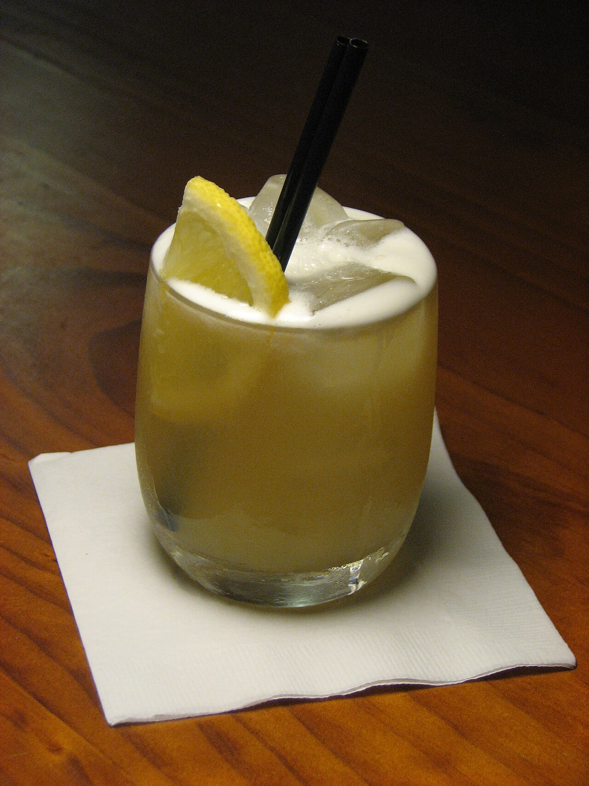

# Whiskey Sour

Whiskey Sour is a classic cocktail of [whiskey](ref:whisky), lemon juice and sugar syrup, shaken and served. Acid and sugar balance the strength of the spirit; egg-white foam is optional, and the usual garnish is a lemon slice or cherry.

Figure: Whiskey Sour. Image: Jgilgamesh, CC BY-SA 3.0, via Wikimedia Commons ([source page](https://commons.wikimedia.org/wiki/File:Whiskey_Sour.jpg)).

## Definition and identity

In cocktail history, a "sour" is a structure: a spirit plus acid (usually citrus juice) and sweet (sugar or syrup), then water or ice dilution. Whiskey Sour belongs to this family but is not the only version; gin, rum and other spirits can form their own sours.

## Recipe (IBA version)

The public IBA recipe uses whiskey, lemon juice and sugar syrup, shaken and strained into a glass, garnished with a lemon slice or cherry; egg white is optional and produces a fine foam. Quantities are a starting point, not a law: more whiskey gives a stronger drink, more lemon a more sour one, more syrup a sweeter one.

Shaking aims to combine the ingredients, chill them and add some dilution, not to turn the drink into foam. If egg white is used, shake first without ice and then with ice to build a stable foam layer.

## Choosing the whiskey

[Whiskey](ref:whisky) is the body of the drink. Bourbon brings corn sweetness, vanilla and caramel, rye is spicier and drier, and Scotch may bring peat or malt. Different whiskeys combined with lemon and sugar produce different balances.

Higher-strength whiskey needs more dilution, lower-strength whiskey less shaking. If the whiskey itself is strongly flavoured, the syrup and lemon proportions should be adjusted too, or the drink will lose balance.

## Acid and sweetness

Lemon juice provides acidity and citrus aroma and is the core of the sour structure. Too little acid makes the drink sweet and flat; too much overpowers the whiskey. Fresh lemon juice differs clearly from bottled, with the former having fuller aroma.

Sugar syrup provides sweetness and roundness, balancing acid and alcohol burn. Too little sugar makes the acid sharp; too much covers the whiskey. Syrup dissolves more easily than granulated sugar and suits shaking; with granulated sugar, dissolve it before mixing.

## Shaking and dilution

A Whiskey Sour is usually shaken rather than stirred: shaking chills faster, mixes better and lets egg white form foam. Too little shaking leaves the drink insufficiently chilled and diluted; too much dilutes it and thins the body.

Ice quality directly affects the result. Large ice melts slowly and keeps dilution controllable; crushed ice chills quickly but can over-dilute. The goal is to chill while retaining enough body. For more on ice types and temperature, see [ice and temperature](ref:ice).

## Glass and garnish

Traditionally served in a sour glass or a rocks glass. A sour glass has a narrow bowl and small volume, concentrating aroma and holding the foam; a rocks glass holds more and suits serving over ice. The glass should be chilled.

A lemon slice or cherry is the usual garnish, providing citrus aroma and visual identity. If egg white is used, let the drink rest briefly after shaking before pouring, and place the garnish on the foam.

## Variations

Using bourbon instead of rye gives a sweeter version; using another citrus juice instead of lemon changes acidity and aroma; adding egg white gives a richer foam; adding a little red wine produces the "New York Sour" variant.

Variations are not wrong versions but branches with a clear substitution logic. When recording a variation, state what was substituted and how the proportions changed. For general cocktail structure, see [cocktail basics](ref:cocktails-guide); compared with the [Manhattan](ref:manhattan), the Whiskey Sour uses lemon and syrup instead of vermouth.

## Common misconceptions

First, assuming a sour must be very sour. Acid and sweetness need balance, and too much acid overpowers the whiskey.

Second, substituting bottled lemon juice without adjusting the amount. Acidity and aroma differ.

Third, ignoring shaking and dilution. Without enough dilution the aroma does not open and the alcohol burn stands out.

Fourth, treating egg white as mandatory. It affects texture and appearance but is not part of the definition.

For Whiskey Sour, a common mistake is treating a variation as the same recipe. After replacing a main ingredient, use the variant name and state the difference.

## Drinking and boundaries

A Whiskey Sour suits slow pre-dinner or after-dinner drinking with nuts, cheese or simple savoury snacks. It is relatively strong, so sip slowly and drink water; do not drink quickly on an empty stomach. Do not drink if driving, taking medication or pregnant.

This page records one sourced version and does not rate specific brands or present one whiskey or ratio as the only correct answer. The final strength depends on the whiskey's [alcohol by volume](ref:abv), the amount of syrup and ice dilution, not on the recipe numbers alone.

**At a glance:** A classic cocktail of whiskey, lemon juice and sugar syrup, shaken and served, optionally with an egg-white foam; commonly garnished with a lemon slice or cherry. 

For Whiskey Sour, begin with the base and the ratio. Then look at the dilution and the ice, and finally ask the garnish and the glass. The answers point to different choices, not to a single score.

The classic ratio is 2 oz whiskey, 0.75 oz lemon and 0.5 oz syrup; an egg white adds foam, and a dry shake before ice improves the texture.

A Boston sour adds egg white, while a New York sour floats red wine on top; the base recipe stays the same.

**Key facts.**

| Item | Detail |
| --- | --- |
| In one line | A classic cocktail of whiskey, lemon juice and sugar syrup, shaken and served, optionally with an egg-white foam; commonly garnished with a lemon slice or cherry. |
| Style | Classic cocktail |
| Origin | United States (late 19th century) |

**Sources and limits.** The key claims about Whiskey Sour are checked against the following sources: International Bartenders Association (Used to check the official recipe, method and garnish; Used to confirm the drink is on the IBA official cocktail list), Oxford University Press (Used to check historical background and basic composition), David Wondrich / Perigee (Used to check background on 19th-century American cocktail development) and 5 sources in total. Prices, batches and status change; the body is project-written and does not reproduce source text.

**Read alongside.** Put Whiskey Sour next to Whisky, Alcohol by volume (ABV), A cocktail is another way in: the first fixes identity and boundary, the others provide a region, process or peer comparison. Read this page first, then return to those entries; the links become coordinates, not decoration.

For Whiskey Sour, this page was last checked in 2026; prices, batches and availability change, so confirm them against the sources below.

## Further reading

- [Whiskey](ref:whisky): the body and style source of the Whiskey Sour.
- [Cocktail basics](ref:cocktails-guide): general principles of structure, dilution and shaking.
- [Ice and temperature](ref:ice): how ice type and chilling affect the drink.
- [Alcohol by volume](ref:abv): understanding final strength and ice dilution.
- [Manhattan](ref:manhattan): another classic that uses vermouth instead of citrus and syrup.
