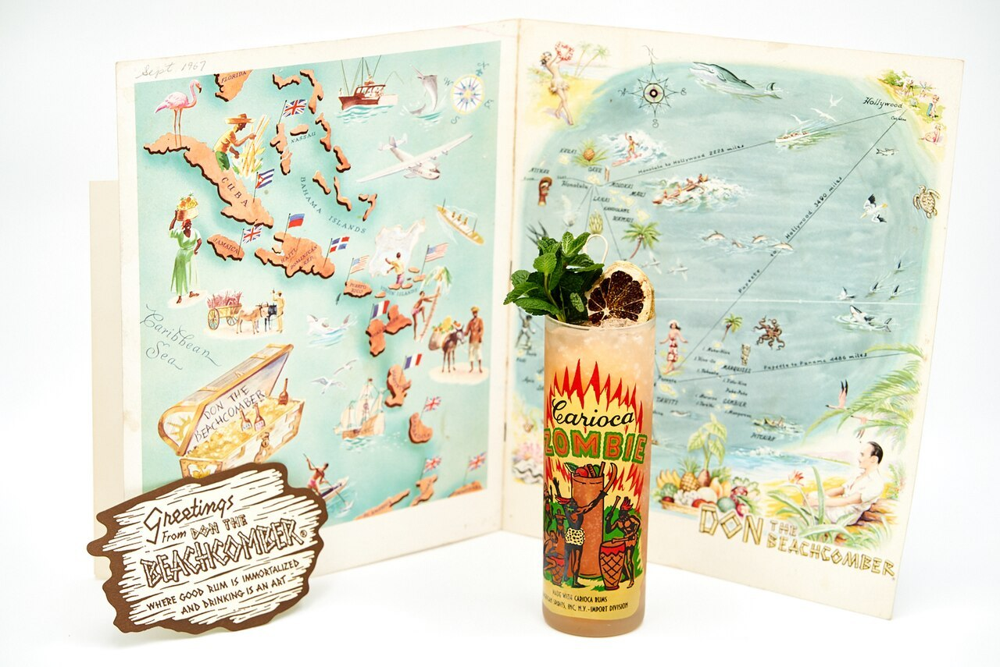

# Zombie

The Zombie is not "a tropical drink with a lot of rum in it." It is the signature cocktail that Don the Beachcomber built in Hollywood in 1934 and deliberately kept out of rivals' reach: the recipe was written in code, and even the bartenders did not know what was in the bottles. What allows us to make it today is the later detective work on an old notebook and a set of syrup code names.

Figure: Zombie. Photograph: Zombie cocktail gianni zottola. Credit: GianniZottola, CC BY-SA 4.0, via Wikimedia Commons ([source](https://commons.wikimedia.org/w/index.php?curid=63768726)).

## A Recipe Kept in Code

Donn Beach treated his recipes as trade secrets. In Beachbum Berry's account, the Don the Beachcomber recipes used numbers that corresponded to unlabelled bottles behind the bar; staff simply took the bottle with the right number and could not read the contents off the label. A rival who poached a bartender still could not reproduce a complete Zombie.

The code also shaped the drink's history. Once the original was lost, imitators improvised their own "rum plus juice" versions, and the Zombie became a long tropical drink that was everything in general and nothing in particular. Any serious discussion has to separate the 1934 structure from what bars did later.

## Donn Beach and the 1934 Hollywood Bar

Donn Beach was born Ernest Raymond Beaumont Gantt and opened Don the Beachcomber in Hollywood in 1934. The bar put South Seas decor, crushed ice, fruit juice and multi-rum blending into one room, and it is now treated as the prototype of the tiki bar.

The Zombie is one of its most famous drinks. The best-known anecdote says a hung-over customer had an important business meeting that evening; Donn poured an ounce each of six different rums, added other ingredients, and the customer said, "It made a Zombie of me." This is a house story recorded in 1948, not an archive document. What can be confirmed is the drink's name, the bar and the 1930s setting.

## The Two-Drink Rule

The Zombie's "two per customer" limit is not an urban legend. Beachbum Berry states plainly that Donn would serve no more than two to any customer. The rule was both a safety measure and a piece of marketing: it turned a very fruity drink into something that had to be taken seriously.

There is a compositional reason for the limit. The three rums total 120 ml, including a 151-proof Demerara; crushed ice and juice cover the alcohol, so it drinks like fruit juice while carrying the alcohol of roughly two to three standard short drinks. Treating it as an ordinary long drink and finishing it quickly is the classic mistake.

## 1939: The Fair and the Imitator

By 1939 the Zombie had grown from a niche bar drink into a national tiki symbol. In the same period, an imitator in New York calling himself "Monty Proser Beachcomber" publicly claimed to have invented the Zombie; Don the Beachcomber's own history treats this as a case of a brand being copied.

The New York World's Fair of that era also brought tropical-themed bars to a much wider audience, and the Zombie spread with the fashion. The year and the setting are documented; exactly who first served the drink at the fair is told differently in different accounts.

## The Structured Recipe

The version below follows Jeff "Beachbum" Berry's reconstruction from the old notebook, cross-checked against the public IBA recipe. The two are very close: the IBA uses 20 ml of lime juice, while Berry writes about 22.5 ml. For the principles of blending and mixing, see [Blending](ref:blending).

| Ingredient | Amount | Role |
| --- | --- | --- |
| Aged Jamaican dark rum | 45 ml | Caramel, ripe fruit and a heavy body |
| Gold Puerto Rican rum | 45 ml | Clean cane sweetness and the mid-palate |
| Demerara rum (often 151 proof) | 30 ml | Smoke, spice and strength |
| Fresh lime juice | 20 ml | IBA amount; Berry uses about 22.5 ml |
| Falernum | 15 ml | Clove, almond, ginger and lime syrup |
| Donn's Mix | 15 ml | 2 parts grapefruit juice to 1 part cinnamon syrup |
| Grenadine | 5 ml (1 tsp) | Colour and a little fruit sweetness |
| Angostura bitters | 1 dash | Ties the aromas together |
| Pernod or absinthe | 6 drops | Anise finish; easy to overdo |

- **Ratio:** 120 ml of rum in total, 20 ml of lime, and about 35 ml of sweet ingredients; by volume it is a heavy-bodied, lightly sweet-sour build.
- **Glass:** a tall tiki mug or highball glass of 400–450 ml.
- **Ice:** 170 g of crushed ice in the blender, then more ice cubes in the glass.
- **Method:** pulse in an electric blender for 3–5 seconds and pour everything in, unstrained; this is a flash blend, not a frozen drink.
- **Garnish:** a large mint sprig pushed into the crushed ice.

## Three Rums, Three Jobs

The three [rums](ref:rum) are not there to make the drink "more complex" in the abstract. Jamaican rum supplies dark fruit and ester notes, gold Puerto Rican rum supplies clean cane sweetness and body, and Demerara rum supplies smoke, caramel and the final strength. Remove the Jamaican and the drink goes flat; remove the Puerto Rican and it turns heavy; remove the 151-proof Demerara and the finish is short.

Substitute by style, not by brand. A high-ester Jamaican rum pushes the drink toward ripe fruit and spice, while the proof of the Demerara changes the finished strength directly. With only two rums, a higher-proof dark rum can replace the Demerara, but the sweetness and smoke will shift.

## Donn's Mix: Grapefruit and Cinnamon

Donn's Mix is the part most often dropped and least safe to drop. Berry's research identified the notebook's "Spices #4" as cinnamon syrup after an older bartender recognised it; Donn's Mix is two parts fresh grapefruit juice to one part cinnamon syrup.

The grapefruit brings bitterness and acidity, the cinnamon brings warmth and sweetness, and together they form the Zombie's mid-palate. Without the cinnamon the drink tastes like an ordinary citrus long drink; without the grapefruit it turns sweet and dull. The syrup can be made ahead and refrigerated, but the grapefruit should be squeezed to order.

## Falernum and Six Drops of Pernod

Falernum is a Caribbean spiced syrup, usually clove, almond, ginger and lime. It is not a high-proof [liqueur](ref:liqueur), but it is not optional sweetness either: it is where the "tiki" impression comes from. Without it, the rums and juice lack a spice layer to connect them.

Pernod or absinthe goes in six drops only, adding a little anise and herb to the finish; a little more and it covers the falernum. Angostura needs just one dash, for aroma rather than bitterness. Both are ingredients you cannot see but can clearly taste.

## Blender, Crushed Ice, Glass

The Zombie uses a blender, but only for a few pulses: enough to mix the crushed ice, syrup and juice while keeping plenty of ice intact. Blend it smooth and you have a slushie with a completely different dilution curve. Pouring the whole blend into the glass and adding ice cubes keeps the drink cold as it is served. For the finished texture, see [Body](ref:body).

The glass needs to be large: below 400 ml there is no room for the ice, liquid and mint. Chill the glass, add the mint just before serving, and in hot weather chill both glass and ice harder, or the second half of the drink will taste thin.

## The Mai Tai Question

Donn Beach and Trader Vic (Victor Bergeron) both claimed to have created the Mai Tai, the most famous authorship dispute in tiki history. The common account dates Trader Vic's version to Oakland in 1944, while Donn's side insists on an earlier date; the available material does not settle the question.

The two drinks are not two versions of one recipe. The Zombie uses three rums, falernum, grapefruit-cinnamon syrup and grenadine: large, fruity and heavily spiced. The [Mai Tai](ref:mai-tai) uses rum, orange liqueur, orgeat and lime: smaller, drier and more citrus-focused. Calling the Zombie "another Mai Tai" misses both structures.

## Where It Goes Wrong

First, blending too long. Past five seconds the ice collapses into water, the body thins and the aroma scatters.

Second, skipping Donn's Mix. Grapefruit and cinnamon are the mid-palate; without them it is just rum and juice.

Third, overdoing the 151-proof rum. It provides strength, not the lead aroma; above 30 ml it overwhelms the falernum.

Fourth, using bottled lime juice or sweetened grapefruit juice. The acidity and bitterness are both wrong, and the drink turns cloying.

Fifth, drinking it like an ordinary long drink. The total alcohol is high and the crushed ice delays the effect; the finished [ABV](ref:abv) cannot be judged from the recipe numbers alone.

## Variations and a Non-Alcoholic Build

- **Smuggler's Cove simplified version:** two rums instead of three, keeping lime, grenadine, falernum and the grapefruit-cinnamon syrup; useful for a home bar.
- **Less 151-proof rum:** replace it with extra dark rum for a softer body, at the cost of smoke and strength.
- **More grapefruit:** raise Donn's Mix to 30 ml for a longer, more bitter drink suited to hot weather.
- **Retro slushie:** use the maximum crushed ice and blend smooth; pleasant, but no longer a flash blend.

A non-alcoholic build can only be an approximation: 60 ml of 0.0% dark "rum", 20 ml fresh lime, 15 ml falernum syrup, 20 ml Donn's Mix, 5 ml grenadine and a drop or two of anise syrup, shaken and poured over crushed ice. The spice and citrus frame survives, but without the weight and ester notes of rum the body is noticeably thinner.
