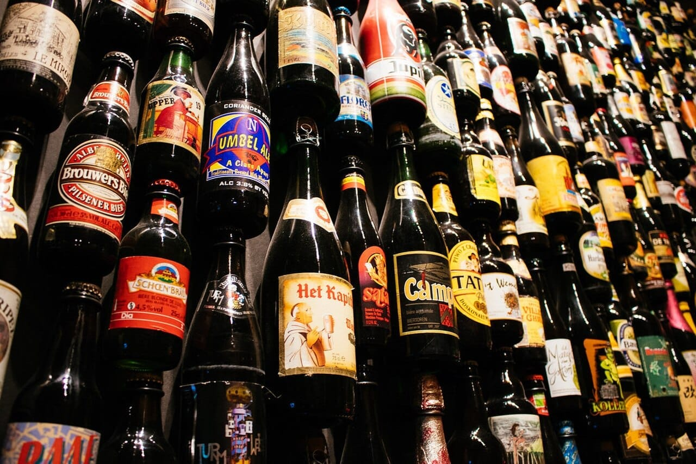

# Abbey beer

Abbey beer is a broad term for beer brewed by a monastery, or brewed commercially under a monastery name and licence. It covers two relationships: brewing inside a monastery, and a name licence between a commercial brewery and a monastery. The distinction readers most need is between Trappist and abbey: the former carries strict requirements on place and supervision, while the latter is closer to a commercial and historical association.

Figure: Abbey beer. Image: BLloydT, CC BY-SA 4.0, via Wikimedia Commons ([source page](https://commons.wikimedia.org/wiki/File:A_wall_of_Belgian_beer_bottles_at_the_Bruges_beer_experience.jpg)).

## Definition and standards

Trappist beer must be brewed inside a Trappist monastery, by the monks themselves or under their supervision, with the proceeds supporting the monastery and its charitable work. Products that qualify may use the Trappist label, which is administered by the International Trappist Association. Which breweries are approved is published by that association in a list that is updated over time, so no fixed number should be quoted; the official site is the reference.

Abbey beer is broader in scope. Commercial breweries may use a monastery name, a historical story or a licence to name a product, and some countries have their own recognised labels and licensing rules, to be checked against local provisions. A licence explains where the name comes from; it does not by itself say anything about quality.

Dubbel, tripel and quadrupel describe strength tiers rather than separate styles. Dubbel commonly has 6–8% alcohol, tripel commonly 7.5–10%, and quadrupel often 10% or more; these are naming conventions with no uniform legal grading. Some breweries use single or enkel for a lighter base beer. Colour and strength are not tied together: tripel is usually pale, while dubbel and quadrupel are usually dark.

## Origin and history

Monastic brewing was routine in the Middle Ages: monks needed beer for their own use, for guests and for alms, and brewing became part of the monastery economy. The Trappist order grew out of the 1664 reform at La Trappe, which stressed a return to the contemplative rule, and monasteries were later founded in France and the Low Countries.

The French Revolution and two world wars caused many monasteries to stop brewing or move, and only in the 20th century did they gradually recover. Meanwhile commercial breweries began borrowing monastery names and imagery to sell beer, and the broad category of abbey beer took shape. [Belgium](ref:belgium) is the most concentrated home, while the Netherlands, Germany, Austria and the United Kingdom also have their own monastery-style products.

Trappist breweries in Belgium, such as Westmalle, Chimay, Orval, Rochefort and Westvleteren, are known for bottle conditioning and high carbonation. The list and identity of abbey beers change over time, so verification should return to the association and the breweries' public information.

## Ingredients and process

[Water](ref:water) and [barley](ref:barley) malt form the base, and some recipes add wheat or oats to adjust body and foam. Dark versions use dark or caramel malt for dried fruit, caramel and cocoa. Dubbel and tripel often add candi sugar, an invert syrup made from beet or cane sugar, to raise alcohol without adding much malt flavour; quadrupel is stronger still.

[Fermentation](ref:fermentation) is top-fermenting, usually at 18–22°C. Yeast is an important variable in the style: the level of esters and the dryness of the finish depend on the strain and on attenuation. Adding sugar and yeast at bottling for a second fermentation is how many abbey beers produce their fine bubbles. Monastery breweries usually draw on their own water source, work at modest scale and allow batch-to-batch variation.

Strong versions continue to change in bottle, so [original gravity](ref:original-gravity) and alcohol content are practical indicators of cellaring potential. Low-alcohol single or pale versions are best drunk fresh.

## Flavour profile

Dubbel is deep brown to reddish brown, with raisin, fig, caramel, cocoa and spice on the nose, a medium body and a fairly dry finish. Tripel is usually pale gold to gold, with pepper, clove, citrus and light banana; it is strong but should not taste sweet and heavy. Quadrupel is darker and richer, with sweetness, alcohol warmth and bitterness together.

The common thread is prominent yeast expression, ample carbonation and a clean finish. Abbey beer is not synonymous with “sweet beer”; a heavy sweetness caused by incomplete fermentation usually indicates a recipe or fermentation problem. Quality rests on balance, completion of fermentation and aromatic complexity, not on alcohol content alone.

## Tasting and serving

Best served at around 8–14°C, and too cold suppresses the esters. A tulip or a wide goblet helps gather aroma. Bottle-conditioned products often carry sediment, and whether to mix it in is a matter of personal preference.

With food, dubbel suits stews, game and hard cheese; tripel suits seafood, poultry and spicy dishes; quadrupel suits rich main courses and dark chocolate desserts. Store away from light, in a cool place and upright, avoiding repeated warming. Strong products are for moderate consumption, and when cellaring, check the cork and fill level periodically.

## Common misconceptions

First, treating every abbey beer as Trappist. Only those meeting the location and supervision requirements and carrying the label qualify.
Second, assuming licensed abbey products must be inferior. The licence describes the origin of the name, and quality still has to be judged in the glass.
Third, believing there is a fixed number of Trappist breweries. The list is published by the International Trappist Association and changes, so check its official site.
Fourth, assuming higher alcohol always means better beer. A dubbel can be excellent too.
Fifth, assuming abbey beers are all sweet. Most finish fairly dry.
Sixth, assuming every abbey beer is suitable for long cellaring. Low-alcohol versions do not keep well.

**At a glance:** An umbrella term for beers brewed by monasteries or brewed commercially under a monastery name and licence; Trappist beer must be brewed inside a Trappist monastery under monastic supervision, while abbey beer is mostly a licensed commercial product, and dubbel, tripel and quadrupel denote strength tiers rather than separate styles. 

Start with the production rule. From there, consider the strength, then the usual serving. That is how a practical judgment about Abbey beer is built.

Start with [Beer](ref:beer) for legal definition, then read [Water](ref:water) for materials and process. Seeing both keeps Abbey beer from being confused with a neighbouring idea.

**Key facts.**

| Item | Detail |
| --- | --- |
| In one line | An umbrella term for beers brewed by monasteries or brewed commercially under a monastery name and licence; Trappist beer must be brewed inside a Trappist monastery under monastic supervision, while abbey beer is mostly … |
| Parent style | Beer |
| Aroma family | Malt and yeast |

**Sources and limits.** The key claims about Abbey beer are checked against the following sources: International Trappist Association, Beer Judge Certification Program (strength, bitterness and flavour boundaries for dubbel, tripel and quadrupel; no original text is reproduced), Brewers Association (public craft-industry statements on monastery styles and Belgian ale; no original wording is reproduced) and 4 sources in total. Prices, batches and status change; the body is project-written and does not reproduce source text.

## Further reading

- [Beer](ref:beer): where abbey beer sits in the beer style system.
- [Belgium](ref:belgium): the most concentrated home of Trappist and abbey beer.
- [Water](ref:water): how monastery water sources shape the style.
- [Barley](ref:barley): malt and the source of dark flavour.
- [Fermentation](ref:fermentation): top fermentation and bottle conditioning.
- [Original gravity](ref:original-gravity): a measure of strength and cellaring potential.
- [Craft beer](ref:craft-beer): the market background for modern monastery-style products.
