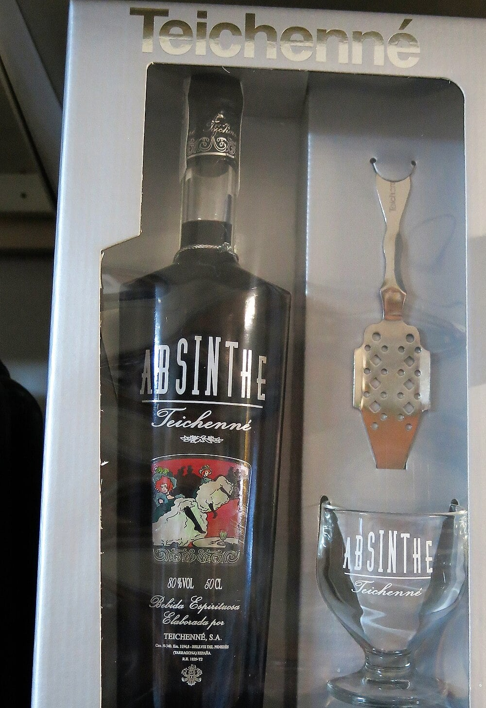

# Absinthe

Absinthe is a spirit defined by wormwood, fennel and anise. It is normally macerated and distilled, very high in alcohol, and turns milky when water is added. It became central to café culture in France and Switzerland at the end of the 19th century, was banned by several countries in the early 20th century, and only returned to the market from the 1990s. It is not [vermouth](ref:aperitif), not a [liqueur](ref:liqueur), but a spirit category built on a botanical recipe and high strength.

Figure: An absinthe gift set: a black Teichenné bottle, a slotted metal sugar spoon and a glass lettered ABSINTHE. Image: Tangopaso, Public domain, via [source page](https://commons.wikimedia.org/wiki/File:Absinthe_bottle_with_glass_and_spoon.jpg).

## The boundary: what counts as absinthe

The core plant is wormwood (Artemisia absinthium), usually used with green anise and fennel to create an “anise, bitterness and herb” skeleton. It must be macerated and distilled rather than simply steeped in alcohol, and it usually runs from 45% to 74% alcohol, far above most aperitifs.

What does not count: pastis, ouzo and sambuca, which are anise-led and usually contain no wormwood or differ in strength and recipe; aromatised wine; and blended products using anise flavouring without a botanical maceration. They may also cloud when diluted, but the category and raw materials differ.

## The botanical recipe

Beyond wormwood, traditional recipes often include Roman wormwood (Artemisia pontica), green anise, fennel, hyssop, lemon balm, coriander and star anise. Wormwood supplies bitterness and an herbal base, the anise family supplies sweetness and the ability to louche, and the other plants add flowers, citrus and spice. The proportions are a producer's central secret.

Names such as “the green fairy” describe colour and literary imagination, not a recipe standard. Absinthe can be green, clear, amber or even red; colour comes from a second maceration of chlorophyll or from natural colouring, not from an obligatory artificial dye.

## Distillation and colouring

Producers first macerate the plants in high-strength neutral alcohol, then distil. The distillate is colourless, and two routes follow: dilute and bottle for the blanche (white) style, or carry out a second cold maceration with more plants for the verte (green) style. The second maceration adds colour and extra herbal bitterness.

The still and the cut points decide the body. Pushing strength too high lets alcohol bury the anise and wormwood detail; a very wide cut drags in rough plant notes. Traditional recipes often bottled at 68% to 72%, while modern products cover a wider range.

## Louche: why water turns it white

The milky cloud that appears on dilution is called louche. Water lowers the alcohol strength, so hydrophobic compounds such as anethole from anise become less soluble, form suspended particles and scatter light. Temperature, pouring speed and strength all affect how thick the cloud becomes.

This is physics, not spoilage and not evidence that absinthe is poisonous. It is equally inaccurate to treat louche as a quality mark: products with different recipes and strengths have different cloud points and intensities.

## Regulation and thujone

EU spirit-drink law does not create a dedicated absinthe category comparable to gin; the drink is usually handled as an aniseed-flavoured spirit or under the general spirit rules. What applies directly is flavouring law: EU 1334/2008 sets limits for thujone in alcoholic beverages at 35 mg/kg above 25% alcohol and 10 mg/kg at or below 25%.

Thujone is a terpenoid found in wormwood and is neuroactive at high doses, but regulated products contain far less than the doses behind the historical panic. In the United States, TTB administers absinthe-type products through ingredient and labelling rules, and individual states may add their own sales restrictions.

## History and prohibition

Absinthe appeared on the Swiss-French border in the 1790s and spread through Paris café culture in the 19th century. It became a symbol of bohemian life and was attacked for its strength and associated social problems. The Lanfray case in Switzerland in 1905 became the trigger for prohibition; Switzerland formally banned absinthe in 1910, France followed in 1915, and the United States had already banned sales in 1912.

Prohibition turned thujone into the supposed cause of hallucination, but later research concluded that thujone at regulated doses cannot explain the legendary effects. Switzerland lifted its ban in 2005 and France in 2011, and the European market gradually reopened. The US position loosened around 2007 as the standards were adjusted.

## A stylistic map

French verte is usually green, strongly herbal and high in alcohol; Swiss blanche is clear, softer and more anise-forward; Spanish and Czech products may be sweeter or lean on star anise. Czech products sold as “absinth” sometimes contain no wormwood, a different commercial tradition that should not be confused with the French recipe.

By strength, absinthe ranges from a softer 45% to 55%, through a standard 60% or so, to the traditional 68% to 74%. High strength is not a quality mark; it is one part of the recipe and the serving method.

## The serving ritual

The traditional serve drips iced water slowly into the glass through a sugar cube resting on a slotted spoon. Water and sugar reduce the alcohol sting, release the anise aroma and trigger louche. The glass is often marked so the drinker can control the amount of water; the slots in the spoon hold the sugar.

Setting the sugar alight before dropping it into the glass is a theatrical gesture, not a required tradition, and it carries a fire risk. Neat absinthe is uncommon because the strength is too high; dilution or a small measure in a cocktail is more usual.

## Use in cocktails

In classic cocktails absinthe usually appears as a rinse or a small addition. The [Sazerac](ref:sazerac) rinses the glass with it, the [Corpse Reviver #2](ref:corpse-reviver) uses it for anise and herbal depth, and Death in the Afternoon pairs it with Champagne. Its strength and powerful aroma mean the dose must stay small.

Compared with [gin](ref:gin), both gain aroma from distilled botanicals, but gin is built on juniper and absinthe on wormwood and anise; they cannot replace each other. At the end of the 19th century it was often an [aperitif](ref:aperitif); today it belongs more to mixing and collecting.

## Common misconceptions and disputes

First, that absinthe causes hallucinations. Second, that all absinthe is green. Third, that absinthe is vermouth. Fourth, that higher strength is better. Fifth, that burning sugar is the traditional ritual. Sixth, that prohibition proves it is more dangerous than other spirits.

Disputes centre on the long-term health effects of thujone, differences in residual national bans, and whether the name “absinthe” is being misused. What is certain: it is a high-strength spirit and should be consumed in moderation; pregnant people, people taking medication and anyone driving should not drink.

**In brief:** A high-strength spirit built on wormwood, fennel and anise and made by maceration and distillation; EU flavouring law sets 35 mg/kg and 10 mg/kg thujone ceilings, and the clouding on dilution is physics, not proof of hallucination.
