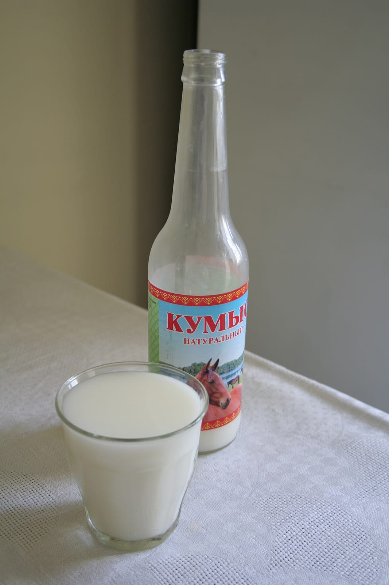
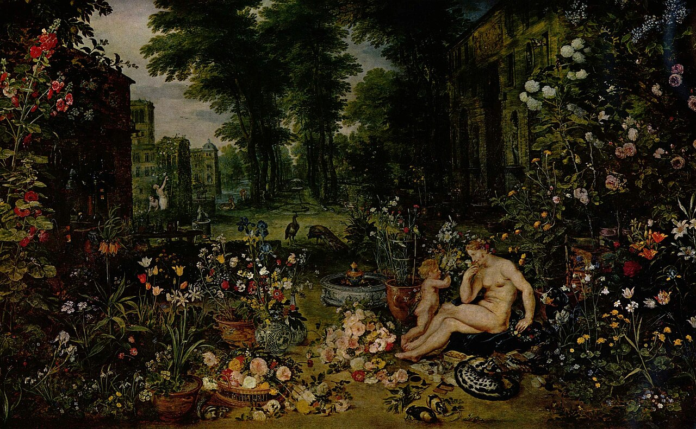

# Airag / Kumis

A low-alcohol drink of Mongolia and Central Asia made by naturally fermenting mare's milk, tart and milky with light bubbles; usually 1–3% alcohol, part of nomadic food and festivals.

In the "Hejiu" taxonomy, airag belongs with fermented milk drinks, not wine, beer or distilled spirits. To judge whether a drink is typical, check four things: the raw material is mare's milk, fermentation is driven by lactic acid bacteria and yeast, alcohol stays around 1–3%, and the result has gentle bubbles and acidity. There is no vintage, oak-ageing or distillation-cut framework here; flavour depends much more on the milk, season, container, fermentation temperature and freshness.

Figure: Airag / Kumis: Kumys-bottle (Wikimedia Commons). Image: A.Savin, CC BY-SA 3.0, via Wikimedia Commons ([source page](https://commons.wikimedia.org/wiki/File:Kumys-bottle.jpg)).

## Definition and boundaries

Airag (Mongolian) or kumis/kumyss (Turkic and Russian) is made from mare's milk through natural fermentation with lactic acid bacteria and yeast. Mongolia, Kazakhstan, Kyrgyzstan, southern Russia and the pastoral areas of Inner Mongolia and Xinjiang in China all have traditions. Methods are similar, but milk source, fermentation time, whether a starter is kept, and drinking habits differ.

It is not a geographically protected "wine style"; it is a family of fermented milk drinks within nomadic food culture. Airag and kumis overlap in most usage, but the words do not cover exactly the same range in every language. Both normally mean a low-alcohol fermented mare's-milk drink, not a distillate.

Read the label for ingredients first: whether it is only mare's milk, or milk plus a small amount of starter; whether live cultures are declared; alcohol content and shelf life. Bottled "kumis" made from cow's milk also exists, and a change of raw material changes flavour, legal status and lactose content.

## History and naming

The history of airag is tied to nomadic movement, seasonal milk and herd management. The traditional milking season runs from mid-June to early October, with a mare yielding roughly 3–6 litres a day. Fresh milk is cooled, poured into a khokhuur (a cowhide vessel), and churned repeatedly with a buluur (paddle) while the starter (khovoo) left in the vessel keeps the fermentation going.

In the nineteenth century, Russian "kumis therapy" brought the steppe drink into sanatoria; the Soviet period added larger-scale production. In Mongolia, Naadam, summer pastures and family celebrations still keep herd-level production alive. In 2019, UNESCO inscribed the traditional technique of making airag in a khokhuur, and its associated customs, on the Representative List of the Intangible Cultural Heritage of Humanity.

Origin stories often credit an ancestor or an accidental fermentation. The more reliable explanation is the container, air temperature, milking frequency and migration route: these shape the microbial community, acidity and carbonation, and explain why the drink is hard to commercialise over long distances.

## Materials and process

The raw material is fresh mare's milk. Its casein and fat structure differ from cow's milk, and its higher lactose makes acidity rise quickly while the body stays light. Traditional production relies on lactic acid bacteria, lactic streptococci and yeasts from the environment and the container, with repeated churning. UNESCO's account stresses more than 500 churning movements and the careful keeping and handing on of the starter.

The key parameters are milk temperature, container, churning frequency and time. Cool conditions slow fermentation and keep acidity soft; warm conditions push lactic acid up quickly and risk over-souring. Fermentation usually takes hours to two days, reaching roughly 1–3% alcohol with a little carbon dioxide. Modern producers inoculate cultures, control temperature and cold-fill; pasteurisation weakens the natural flora and the bubbles, which is the main difference from an industrial dairy drink.

## Style and palate

The flavour is yoghurt-like and creamy, with light alcohol and bubbles, clear acidity and a short finish, often with a yeast or green-grass note. This is not a drink that improves with age: freshness, cold chain and microbial activity matter more than any vintage.

Temperature changes it markedly. Chilling to 4–8°C makes it fresher and fizzier; room temperature amplifies creamy aroma and acidity; heating to the point where protein separates ruins it. Nor should it be "opened up" like wine.

Judge it on four axes: sweet–acid balance, cleanliness of the milky aroma, carbonation, and alcoholic prickle. Over-souring, a stale or rancid note, obvious yeast bitterness or separation usually point to a fermentation or storage problem.

## Regions and ways of drinking

Core areas include Mongolia, Kazakhstan, Kyrgyzstan, southern Russia, and the pastoral areas of Inner Mongolia and Xinjiang. Production is mostly household, herd-based and festive; there are few national brands, and differences between herders in one region are often larger than differences between "brands".

Traditionally it is drunk from a wooden bowl or a skin vessel, alongside boiled mutton, dried curd, roasted millet and festival meals. Naadam, weddings and summer pasture are the main settings. It is a poor cocktail base: acidity and milky aroma clash with most fruit juices and syrups.

Serve at about 4–8°C. People with lactose intolerance should start with a small amount. Once opened, drink it soon; do not keep it for long.

## Buying, storage and misreadings

Common misreadings: treating acidity as spoilage; treating bubbles as added carbonation; mistaking a cow's-milk imitation for airag; treating "traditional" or "handmade" as a guarantee of quality.

For bottled products, read ingredients, cultures, alcohol, heat treatment and shelf life. For loose or home-made airag, check the cold chain and hygiene. Cross-border sales are limited by dairy quarantine and refrigeration, so most bottled airag is made and consumed locally.

A higher price does not make a drink more traditional. Small-scale handmade and industrial products carry different risks; raw material, fermentation parameters and freshness remain the real criteria.

## Further reading and see also

Airag shares a lactic-fermentation logic with yoghurt, kefir and cheese, not the "style–region–vintage" framework of wine. Compare by raw material, culture, acidity and alcohol.

To learn this family, build a "fresh–slightly sour–over-sour" sequence: taste a batch fermented the same day, then a chilled one-day product, then an over-fermented sample. After three steps the changes in acidity and carbonation become clear.

- Related: [other](ref:other), [fermentation](ref:fermentation), [aroma](ref:aroma), [body](ref:body), [terroir](ref:terroir).
- This style offers no brand ranking, prices or shopping channels; airag is a category of fermented milk drinks, not a quality grade.

**Short definition:** A low-alcohol drink of Mongolia and Central Asia made by naturally fermenting mare’s milk, tart and milky with light bubbles; usually 1–3% alcohol, part of nomadic food and festivals.

Airag / Kumis is best read by starting with the production rule, moving to the strength, and ending with the usual serving.

[Other Drinks (Category Note)](ref:other)'s legal definition and [Aroma](ref:aroma)'s materials and process form a useful pair: the contrast shows where one ends and the other begins.

## Related images

Image: Aroma. Credit: Jan Brueghel the Elder / Peter Paul Rubens, Public domain, via Wikimedia Commons ([source page](https://commons.wikimedia.org/wiki/File:Jan_Brueghel_d._O._-_Allegorie_van_de_geur.jpg)). Related image for Airag / Kumis.
