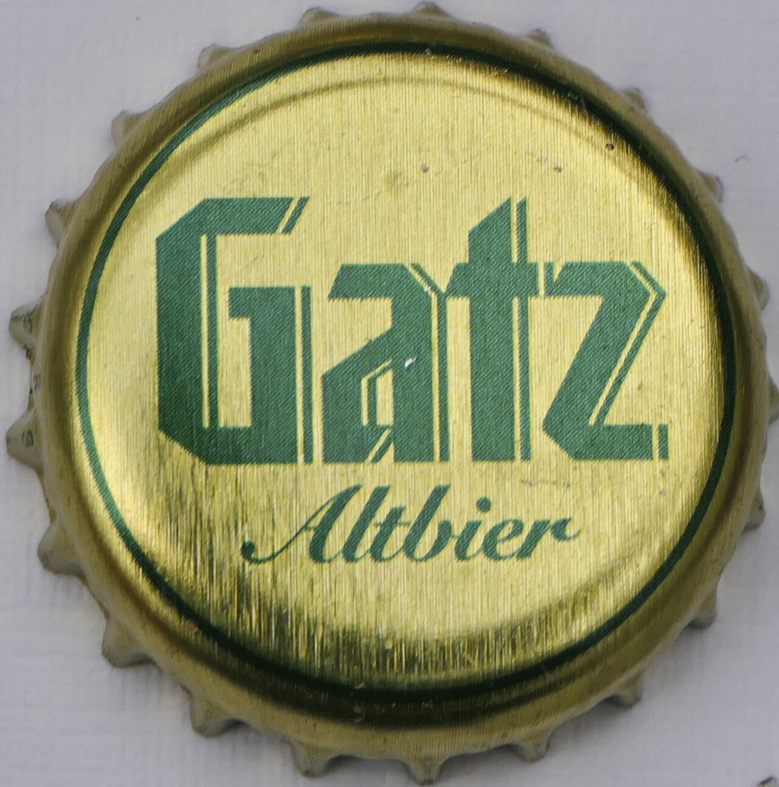

# Altbier

Altbier is a traditional top-fermented beer from Düsseldorf and the Rhineland in Germany, conditioned cold like a lager after fermentation. Copper-brown, clean-malted and medium-hopped, it sits between ale and lager; the name Alt means "old", referring to the upper-fermentation method that predated lager brewing.

Figure: Altbier: Gatz - Altbier, 2019 (Wikimedia Commons). Image: unknown, scanned by 5snake5, CC0, via Wikimedia Commons ([source page](https://commons.wikimedia.org/wiki/File:Gatz_-_Altbier,_2019.jpg)).

## Definition and boundaries

Altbier is a beer (ref:beer) fermented on top with ale yeast, then cold-conditioned the way a lager is stored. It keeps the ale fermentation while borrowing the lager's cold maturation, which places it between the two: its malt skeleton is more defined than a typical lager, while its finish is drier than most British ales. Guidelines separate a broad Altbier category from the stricter Düsseldorf Altbier, whose bitterness, colour and body sit closest to the local Düsseldorf tradition.

The German word Alt means "old", referring to this pre-lager tradition of top fermentation and traditional mashing. Altbier is not a protected legal appellation: breweries outside Germany (ref:germany) make nearby beers with comparable methods, and whether the label states Düsseldorf, the yeast type and the raw materials are the key cues for origin and style. Together with Cologne's Kölsch it is one of Germany's top-fermented traditions, but the two differ in colour, malt and hop balance.

## History and naming

The modern Altbier took shape in late-19th-century Düsseldorf. As bottom-fermented lager spread, local breweries kept the top-fermentation method and called the beer Altbier to contrast it with lager. Mathias Schumacher opened his Düsseldorf brewery in 1838 and was among the early producers using the Altbier name; his son Ferdinand built a new brewery at Oststraße 123 in 1871.

Earlier regional brewing roots reach the Middle Ages: documented brewing in the Düsseldorf area appears in 873 (the Gerresheim monastery with Archbishop Willibert), and in 974 Otto II granted the monastery grut brewing rights. The 14th-century keutebier was an early regional malt drink; guidelines note that older German styles brewed in the area have no linkage to modern Altbier. Near Korschenbroich, the Bolten brewery holds brewing rights dating to 1266 and is called the world's oldest Altbier brewery. Note that medieval malt drinks differ from today's Altbier in malting, hop varieties and conditioning; this history is regional background, not a replica of the current recipe.

## Materials and process

The base uses German malts, mainly Pils malt with some Munich malt; small amounts of crystal, chocolate or black malt add colour and roast, and wheat appears occasionally. Barley (ref:barley) malt supplies a clean bread-and-biscuit skeleton, while the dark malts give copper-brown colour and a light toast rather than the heavy roast of a stout.

Hops (ref:hop) traditionally are Spalt and other Czech- or German-style noble hops, with other Saazer-type varieties allowed, contributing earth, herbal and floral notes and a medium-high but not harsh bitterness. The yeast is a clean, highly attenuative ale strain; mashing uses a step mash or decoction mash. Fermentation (ref:fermentation) runs first at a cool ale temperature, roughly 15.5–20°C, followed by cold conditioning around 10°C to leave the beer clean and smooth. Fruit, spice or oak additions are not part of the finished product.

## Style and palate

A typical Altbier ranges copper-brown to reddish brown, with bread, biscuit, light caramel and malt sweetness on the nose, and noble hops adding earth, herbal and a light floral note. The palate is clean malt, mid-palate hop bitterness and spice, and a dry finish where bitterness lingers without pulling sweetness back. Body is medium-light, carbonation moderate, mouthfeel crisp rather than the cloying roundness of a sweet brown ale.

On statistics, the broad Altbier sits at 4.3–5.5% ABV, IBU 25–50, SRM 9–17; the Düsseldorf Altbier runs 4.5–5.2% ABV, IBU 35–50, SRM 11–17. The difference between the two tiers is mainly bitterness and colour depth, not the raw-material system. The stronger Sticke Alt — the dialect word means "secret" — has a higher ABV and is released on set days by certain Düsseldorf pubs; the doppelsticke pushes strength one tier further as a variation within the style.

## Representative regions and brands

The four traditional brewpubs in Düsseldorf's Altstadt old town are the local reference points: Zum Uerige, Im Füchschen, Schumacher and Zum Schlüssel, mostly serving fresh draught from their own or connected breweries. Other familiar regional producers include Diebels Alt, Schlösser Alt, Frankenheim Alt and Bolten Alt, offering pub cask, bottled and nationally distributed versions.

These brand names are market and tasting references, not an official classification. A brewery's regular Altbier and its Sticke differ in strength and are not interchangeable. Outside Germany, imitation products often adjust malt ratio and bitterness, so read the label for origin, ABV and whether top fermentation is stated. Bottled and draught versions also differ in freshness and carbonation; the traditional serve is draught at the local pub.

## How to drink and pair

Altbier is traditionally served in a small straight glass (Altbierglas / Stange) at near-cellar temperature, roughly 10–12°C; it should not be ice-cold, which would mask malt and hop aroma. Draught fresh beer is best drunk at the pub, and young bottled versions are finished as opened, with no decanting or airing.

Pairing circles around Rhineland pub food: roast pork, sausages, ham and open rye sandwiches such as the Halve Hahn with hard cheese carry the bread-malt note, while the dry hop bitterness cuts through fat; hard cheese and pretzel are common matches. Heavier smoked meats and stews suit the regular strength, while a strong Sticke pairs with richer meats and blue cheese. Sweet desserts and sweet-and-sour fruit dishes do not match well, where the dry bitterness clashes with sweetness.

## Buying, storage and misreadings

On the label, first confirm origin and process: a Düsseldorf or German beer marked top-fermented and cold-conditioned sits closer to the traditional Altbier; a bottle labelled only "dark ale" without origin or yeast type offers less to compare. Then read ABV and bitterness, keeping regular and Sticke strengths separate.

Altbier is a fresh beer, not one for long ageing: store bottled versions away from light and heat, buy the newest stock and finish an opened bottle promptly. Three common misreadings: treating cold conditioning as lager-yeast fermentation, when it is still an ale yeast; mistaking the copper-brown colour for stout or porter roast, since the dark colour comes from small amounts of roast malt and the body stays light and crisp; and reading it as a sweet brown ale, since the traditional finish is dry with low residual sugar. The distinction from Kölsch is often blurred too: Altbier is copper-brown with heavier malt and bitterness, while Kölsch is pale gold and slender in body.

## Further reading and see also

To approach Altbier, start with a regular-strength Düsseldorf-style example to learn the malt-and-bitterness skeleton, then compare a bottled version from another region, and finish with a strong Sticke. Across those three tiers, the differences from fermentation, conditioning and strength become clear.

- Related: [beer](ref:beer), [barley](ref:barley), [hop](ref:hop), [fermentation](ref:fermentation), [germany](ref:germany).
