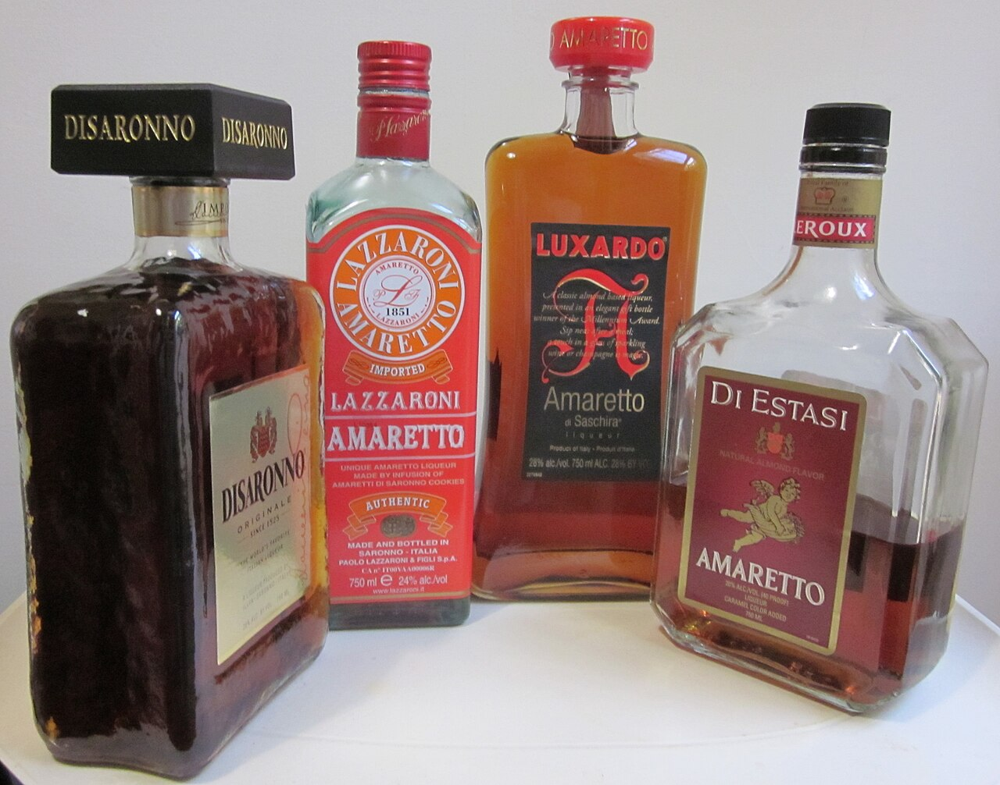

# Amaretto

Amaretto is an Italian almond-flavoured sweet liqueur whose name comes from amaro, the Italian word for bitter, referring to the slightly bitter finish that kernel ingredients leave behind. It is usually infused with apricot kernels, bitter almonds or peach stones, with almond, vanilla, caramel and floral notes; alcohol is commonly 21–28%, and it can be drunk neat, on ice, or mixed into coffee and cocktails.

Figure: Amaretto: Amaretto Bottles 4 (Wikimedia Commons). Image: Infrogmation of New Orleans, CC BY-SA 3.0, via Wikimedia Commons ([source page](https://commons.wikimedia.org/wiki/File:Amaretto_Bottles_4.JPG)).

## Definition and boundaries

Under EU spirits law, amaretto is not a standalone spirit category; products are sold under the generic sales denomination "liqueur". By the regulation, a liqueur is a spirit drink based on ethyl alcohol of agricultural origin, an agricultural distillate or one or more spirit drinks, sweetened and flavoured with spices, agricultural products or foodstuffs. Its minimum alcohol strength is 15% ABV, and apart from special cherry-derived cases it carries at least 100 grams per litre of sweetening expressed as invert sugar. The almond character is a choice of flavour source, not a protected legal name.

Whether a drink belongs to amaretto is decided by its flavour source and ingredient list, not by its amber colour or bottle shape. It is not the same as an amaro: an amaro is a herbal bitter aperitif or digestif that is usually dry, while amaretto is a sweet kernel-flavoured liqueur whose bitterness only balances the sweetness. Brand recipes are proprietary and can differ widely.

## History and naming

The best-known origin legend is tied to Saronno, in Lombardy. In 1525, Bernardino Luini, a pupil of Leonardo da Vinci, was commissioned to paint the Madonna of the Miracles there; he used a young widowed innkeeper as his model, and in gratitude she steeped apricot kernels in brandy to make the first legendary amaretto. This is brand narrative rather than verifiable history, but it reflects the traditional understanding that the almond note comes from kernels.

On the brand lineage, Disaronno's company material traces the Reina family, who brewed their own digestif liqueurs around the seventeenth century; Giovanni Reina rediscovered the old recipe. In the early twentieth century, Domenico Reina opened a Saronno shop and workshop, and ILLVA Saronno was founded in 1947 to carry the brand forward. The product was originally called Amaretto di Saronno and was renamed Disaronno Originale in 2001. Lazzaroni has produced amaretto in Saronno since 1851, using an infusion of Amaretti di Saronno biscuits in alcohol.

## Materials and process

Flavour ingredients usually include apricot kernels, bitter almonds and peach stones; some brands also use sweet almonds or almond extract. The almond-like aroma comes from benzaldehyde-type compounds in the kernels. Bitter almonds and apricot kernels contain cyanogenic glycosides, and industrial production removes the prussic acid so the finished spirit carries no toxic residue. Recipes are each brand's commercial secret: some macerate whole kernels, others use kernel oil or natural extracts, and some add vanilla, caramel, dried fruit and floral spices.

The common method is to macerate kernels or nuts in neutral spirit for days or weeks to draw out the aroma, separate the residue, then sweeten, colour and reduce to bottling strength; some premium products distil or blend after maceration. The base may be agricultural ethyl alcohol, a distillate or a spirit drink itself, following the general rules for [liqueur](ref:liqueur). The finished colour runs from pale amber to deep brown, the body syrupy, with almond and caramel in the front aroma and a bitter-almond, cherry-pit finish.

## Style and palate

A typical amaretto leads with sweet almond and caramel, supported by vanilla, cherry and floral notes; the alcohol is wrapped by sugar, so the entry is smooth. A good version is sweet but not cloying, with a clear bitter base rather than a plain syrup taste. Brand differences concentrate on the ingredient route: apricot-kernel-oil versions are lighter and clearer in nut character, bitter-almond versions are richer and closer to marzipan or almond candy, and sweetness and strength vary as well.

Temperature changes the impression: chilling or adding ice lowers sweetness and alcohol bite and narrows the aroma; neat serving at room temperature opens up caramel, almond and warm spice. It is not a dry digestif and should not be judged by the lean standard used for brandy or whisky. Balance depends on whether sweet, bitter, alcohol and aroma support one another, not on any single intensity.

## Representative regions and brands

Disaronno Originale is the best-known amaretto worldwide, produced in Saronno, Lombardy by ILLVA Saronno at 28% ABV. According to the brand, it blends apricot kernel oil, absolute alcohol, burnt sugar and the essence of seventeen selected herbs and fruits; the finished product contains no almonds, and it comes in a Murano-style rectangular glass bottle. Lazzaroni Amaretto has been bottled in Saronno since 1851 and follows a biscuit-infusion route. Luxardo Amaretto di Saschira comes from Veneto at 24% ABV, its almond note drawn from essential oils in cherry, peach and apricot pits. Gozio Amaretto is made in Gussago, near Brescia, by Distillerie Franciacorta; its recipe dates to 1901, uses bitter almonds and a small list of secret ingredients, and is bottled at 24% ABV.

These brands follow different routes: some emphasise brand history and global distribution, others a small-town traditional maceration method. Under one name, origin, ingredients and sweetness vary widely, so the back label matters more than a vague idea of a typical amaretto.

## How to drink and pair

Neat after dinner is the traditional serve, in a small liqueur glass at room temperature or slightly cool. On ice softens the sweetness and alcohol bite, suiting summer drinking or anyone who dislikes sweet drinks. Amaretto is also added to coffee, hot chocolate or milk as a sweet after-dinner drink. Classic cocktails include the Godfather (whisky and amaretto), which is rich and rounded, and the Amaretto Sour (lemon juice, optional egg white), which is bright and acidic.

With food, it suits almond biscuits, tiramisu, crème caramel, nut tarts and dried-fruit desserts, and a small amount goes into pastry making. Next to blue cheese or salty nuts, sweetness and savouriness set each other off. Heavy red meats and fried dishes do not pair with a sweet liqueur; they make the sweetness feel cloying.

## Buying, storage and misreadings

Common misreadings: assuming amaretto always contains almonds — several products such as Disaronno use apricot kernel oil and contain no nuts; confusing it with an amaro bitter; treating colour depth as age; and taking higher sweetness for higher quality. In fact colour comes from kernels, caramel and colouring, sweetness is a recipe choice, and neither is a quality grade.

When buying, read the back label first: whether the flavour source is almond, apricot kernel or peach stone, whether alcohol and sugar are stated clearly, and where it was produced. Large front-lettering is usually brand marketing. For storage, an unopened bottle keeps away from light and heat, standing upright; its high sugar content makes it relatively stable. Once opened, finish it within a few months; it does not improve with long ageing like a straight spirit. A high price usually reflects brand premium rather than a more typical style.

## Further reading and see also

Drinks close to amaretto share kernel maceration and sweet-liqueur craft: [liqueur](ref:liqueur) is the broad family it belongs to, [italy](ref:italy) is the background of Saronno, Veneto and Brescia production, [maceration](ref:maceration) draws kernel aroma into the liquid, [distillation](ref:distillation) prepares the base spirit, and [proof-and-abv](ref:proof) is the easiest parameter to compare on the label. To learn a liqueur style, start with the standard benchmark, then a variant that changes an ingredient or sweetness, then an extreme example; the boundary becomes clearer than from definitions alone.

- Related: [liqueur](ref:liqueur), [italy](ref:italy), [maceration](ref:maceration), [distillation](ref:distillation), [proof-and-abv](ref:proof).
